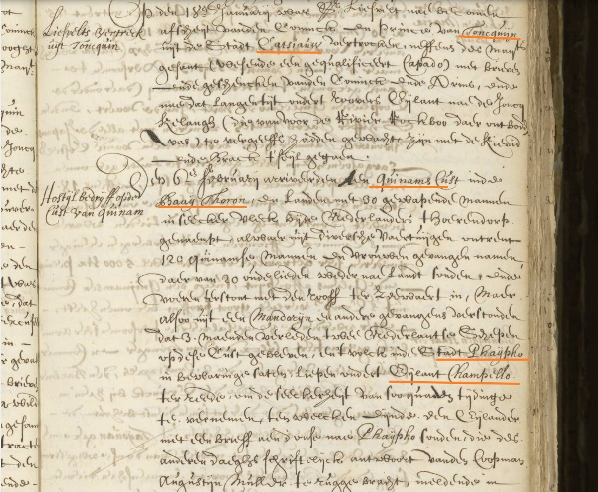
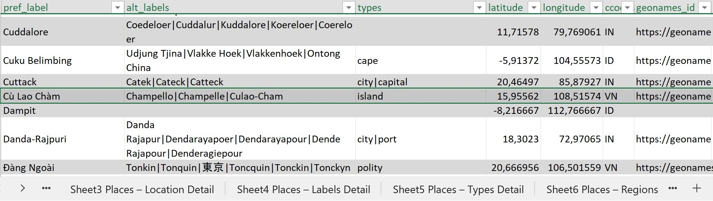
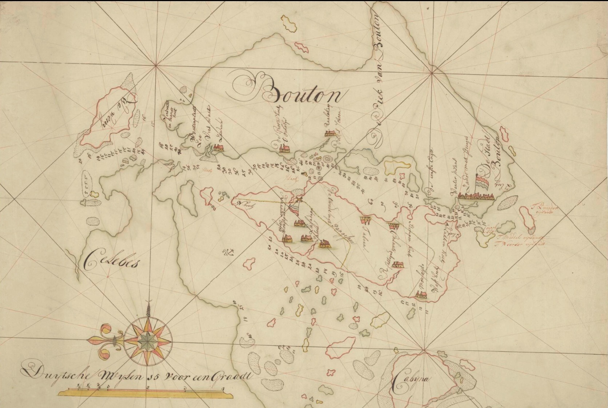

# A Gazetteer for the Dutch East India Company Archives: The GLOBALISE Places Dataset

> **Archived blog post.** This post was originally published on the Globalise project website on 1 August 2025 ([original URL](https://globalise.huygens.knaw.nl/a-gazetteer-for-the-dutch-east-india-company-archives-the-globalise-places-dataset/)). The text is reproduced without changes; links to other blog posts now point to their archived copies, and other links may no longer work.

**About the author:** Dung Pham is a junior researcher in the historical contextualisation team of the Globalise project at the Huygens Institute.

<!-- Bio source: Team page, https://globalise.huygens.knaw.nl/team/ (consulted 2026-10-01) -->

---

On 6 February 1642, the ships of Jacob Liesvelt, merchant of the Dutch East India Company (VOC), arrived at the Thoron bay on the coast of Quinam. Here, he sent thirty armed men ashore to capture over a hundred Quinamese people. This likely had to do with Liesvelt’s earlier audience with the king of Toncquin – whom he had met in January in the city of Catsiauw, and who had asked for the VOC’s assistance in the war against Quinam. Liesvelt, only after sailing away with the Quinamese hostages, learned that some Dutch people were being held captive at a nearby city, Phaijpho. It turned out that a few months earlier, on 26 November 1641, two Dutch ships were caught in a heavy storm on the Quinam coast and stranded near the island of Champello. Eighty-two survivors, alongside many salvaged goods, had been apprehended by the Quinamese ruler.[^1]

These events were recounted in the VOC’s 1641-1642 records kept at Castle Batavia. The following pages of the record detailed how the exchange of hostages went on between Jacob Liesvelt and the king of Quinam (for your information: it did *not* go well). To a scholar interested in, say, the VOC’s involvement in local conflicts in Asia, this record might serve as an interesting source. However, to proceed with the research, wouldn’t it be good to know where these events had taken place? Which kingdoms were ‘Quinam’ and ‘Toncquin’ exactly, which cities were ‘Catsiauw’ and ‘Phaijpho’, and where were the ‘Thoron’ bay and the ‘Champello’ island located?

This is where the [‘**GLOBALISE – Places in the Dutch East India Company Archives (1602-1799)**’ dataset](https://hdl.handle.net/10622/WYVERW) comes into use. This dataset is part of the [GLOBALISE project](https://globalise.huygens.knaw.nl/), whose aim is to make the VOC archives more accessible. As a step towards this goal, the researchers of the project have been creating several datasets that provide structured information on named entities in the archives, such as commodities, weights and measures, polities, and persons. Now, one can also search for place names using the Places dataset. The [first version](https://hdl.handle.net/10622/WYVERW) of the dataset has been published, featuring over 900 places mentioned in the VOC archives.

Various place names mentioned in a VOC archival document. [Nationaal Archief](https://www.nationaalarchief.nl/onderzoeken/archief/1.04.02/invnr/1925/file/NL-HaNA_1.04.02_1925_0305), CC0

### **Bringing together information on places in the VOC archives**

Using the dataset, you can quickly look up unfamiliar place names in the VOC archives that might otherwise cause a headache to identify. Let’s use the aforementioned places in Liesvelt’s journey as examples. With the GLOBALISE Places dataset, you will find out that ‘Toncquin’, or ‘Tonkin’, refers to the early modern Vietnamese realm of Đàng Ngoài, while ‘Quinam’, also known as ‘Cochinchina’, refers to the realm of Đàng Trong. Similarly, you will discover that ‘Champello’ is another name for Cù Lao Chàm, that ‘Catsiauw’ – the Dutch spelling for ‘Kẻ Chợ’ – is an old name of Hanoi, that ‘Thoron’ (Tourane) refers to Đà Nẵng, and ‘Phaijpho’ (Faifo) to Hội An. The dataset, in other words, informs users of the different *labels* – that is, different names or spellings which a place was known by. It links historical names and spelling variations in the archives to geographic names more familiarly used today, and provides each place entry with a ‘preferred label’.

You will also know, for instance, that Cù Lao Chàm is located in modern-day Quảng Nam Province, at latitude 15.95562 and longitude 108.51574, and that it was an island in Vietnam. This is to say that, aside from labels, the dataset also provides information on each place’s *location* (its geographical coordinates, plus the present-day country and region it belongs to) and each place’s *type* (whether it was a river, an island, or a city, a kingdom, a fort,…). To help users navigate all of this information more easily, the dataset has been structured into different sheets. These are, in order:

- Overview
- Location Detail
- Labels Detail
- Types Detail
- Regions Detail

The principal source on which the dataset was based on is the *Generale Missiven der V.O.C.* (1960-2017)[^2], a published selection of the letters written by Dutch Governor Generals in Asia to the Heren XVII – the VOC’s directors based in the Dutch Republic. This series comprises fourteen volumes, covering the period between 1610 and 1767. It is from the geographical indices of these volumes that we extracted the entries for our dataset. We then linked these entries to those found in several external databases, such as the [Exploring Slave Trade in Asia places dataset](https://hdl.handle.net/10622/IWJMHH), the [Atlas of Mutual Heritage](https://whgazetteer.org/datasets/819/places), [GeoNames](https://www.geonames.org/), the [World Historical Gazetteer](https://whgazetteer.org/), and the [Getty Thesaurus of Geographic Names](https://www.getty.edu/research/tools/vocabularies/tgn/?find=&place=&nation=&english=Y). Some of these databases do relate to the historical period in which the VOC was active, while others focus more on present-day places.

In creating our dataset, we have relied on these sources greatly, incorporating their data regarding coordinates, place labels and place types, among others. We have also added information from numerous secondary works related to the VOC and the early modern history of Asia and Africa. By assembling these different pieces of information in one place, the dataset can help to save much time and effort in identifying geographic names in the VOC archives. Users can simultaneously be directed to the various sources referenced in the dataset, which may further support their research.

Snippet of the [GLOBALISE Places dataset](https://hdl.handle.net/10622/WYVERW)

### **Facilitating exploration of the VOC archives**

In addition, in light of the recently launched [GLOBALISE Transcription Viewer](https://transcriptions.globalise.huygens.knaw.nl/), it is now possible to search through a large text corpus of the archives using keyword queries. Suppose you were a researcher interested in the VOC’s activities on the Muna Island in Indonesia, and you wanted to look for archival texts where the Company mentioned this island. When you enter ‘[muna](https://transcriptions.globalise.huygens.knaw.nl/?indexName=docs-2024-03-18&fragmentSize=100&from=0&size=10&sortBy=_score&sortOrder=desc&query=eyJkYXRlRnJvbSI6IjE1MDAtMDEtMDEiLCJkYXRlVG8iOiIxODAwLTAxLTAxIiwicmFuZ2VGcm9tIjoiMCIsInJhbmdlVG8iOiIzMDAwMCIsImZ1bGxUZXh0IjoibXVuYSIsInRlcm1zIjp7fX0%3D)’ as the keyword for your search, the Transcription Viewer yields only 16 results. Out of these, only [one text](https://transcriptions.globalise.huygens.knaw.nl/detail/urn:globalise:NL-HaNA_1.04.02_1346_0638) explicitly refers to ‘muna’ as an island (“‘t eijlant muna”). Was this place really so scarcely visited by the VOC?

This is where the different labels provided by the GLOBALISE Places dataset come in. A search for ‘[Pangasane](https://transcriptions.globalise.huygens.knaw.nl/?indexName=docs-2024-03-18&fragmentSize=100&from=0&size=10&sortBy=_score&sortOrder=desc&query=eyJkYXRlRnJvbSI6IjE1MDAtMDEtMDEiLCJkYXRlVG8iOiIxODAwLTAxLTAxIiwicmFuZ2VGcm9tIjoiMCIsInJhbmdlVG8iOiIzMDAwMCIsImZ1bGxUZXh0IjoiUGFuZ2FzYW5lIiwidGVybXMiOnt9fQ%3D%3D)’ – which, according to the dataset, is an alternative name for the island Muna – returns 44 results. This number surges to 276 if you allow for two spelling variations to the name (‘[Pangasane~2](https://transcriptions.globalise.huygens.knaw.nl/?indexName=docs-2024-03-18&fragmentSize=100&from=0&size=10&sortBy=_score&sortOrder=desc&query=eyJkYXRlRnJvbSI6IjE1MDAtMDEtMDEiLCJkYXRlVG8iOiIxODAwLTAxLTAxIiwicmFuZ2VGcm9tIjoiMCIsInJhbmdlVG8iOiIzMDAwMCIsImZ1bGxUZXh0IjoiUGFuZ2FzYW5lfjEiLCJ0ZXJtcyI6e319)’)[^3]; and a quick look through these results show that quite many of them are indeed references to the island. Other alternative labels listed in the dataset for Muna, such as ‘[Panchiano](https://transcriptions.globalise.huygens.knaw.nl/?indexName=docs-2024-03-18&fragmentSize=100&from=0&size=10&sortBy=_score&sortOrder=desc&query=eyJkYXRlRnJvbSI6IjE1MDAtMDEtMDEiLCJkYXRlVG8iOiIxODAwLTAxLTAxIiwicmFuZ2VGcm9tIjoiMCIsInJhbmdlVG8iOiIzMDAwMCIsImZ1bGxUZXh0IjoicGFuY2hpYW5vIiwidGVybXMiOnt9fQ%3D%3D)’ and ‘[Pantsjano](https://transcriptions.globalise.huygens.knaw.nl/?indexName=docs-2024-03-18&fragmentSize=100&from=0&size=10&sortBy=_score&sortOrder=desc&query=eyJkYXRlRnJvbSI6IjE1MDAtMDEtMDEiLCJkYXRlVG8iOiIxODAwLTAxLTAxIiwicmFuZ2VGcm9tIjoiMCIsInJhbmdlVG8iOiIzMDAwMCIsImZ1bGxUZXh0IjoicGFudHNqYW5vIiwidGVybXMiOnt9fQ%3D%3D)’, can similarly be used to expand your search.

In this way, the dataset can help direct users to a larger number of relevant source materials and increase the chance of finding the information one needs from the VOC archives. While users currently have to search for variants manually, the GLOBALISE research portal that is due to go live by the end of 2026 will automate this functionality. Hopefully, the dataset can also spark new interest in using the archives to research more local histories. By facilitating the search process, we hope that the places dataset makes the myriad of local places in Asia and Africa – and the people and events associated with them – more visible in the archives, as well as in the region’s early modern history.

*Kaart van Straat Bouton, van het Zuyder Eyland tot het eyland Wawony*. [Nationaal Archief](https://www.nationaalarchief.nl/onderzoeken/archief/4.VEL/invnr/468/file/NL-HaNA_4.VEL_468), CC0. The Muna Island (in the centre, outlined in red) is labelled on this map as ‘Pangasane’.

### **Challenges and moving forward**

This dataset is not without limitations. For one, it is *not* an exhaustive list of every place mentioned in the VOC archives, nor of every geographical entry in the indices of the *Generale Missiven*. The places included in this first version of the dataset are primarily those for which the *Generale Missiven* indices indicate at least an alternative label beside a standardised label. At the moment of writing, we are working on a second version of the dataset where more entries from these indices will be added.

Perhaps unsurprisingly, considering how much time has passed since the era of the VOC, it is extremely difficult to locate many of the places mentioned in the Company’s archives. Some places might have been destroyed; others might have grown, disintegrated, or become absorbed into modern places without retaining the names they bore in the seventeenth and eighteenth centuries. Usually for such cases, we could not pinpoint the location of the place itself, and thus have decided to give it the coordinates of a proxy location. For example, according to a text from the *Generale Missiven* and several early modern Dutch maps, there was a place named ‘Kahawatte’ near the southern coast of Sri Lanka.[^4] We could not yet find the precise coordinates for this place, but based on some other sources, we knew that Kahawatte was located close to the mountain of Mulgirigala (also known as Adamsberg).[^5] The coordinates of Mulgirigala have therefore been assigned to Kahawatte in our dataset.

There are, however, still a number of places which we have not been able to identify any locational information for. Some places also do not yet have a place type, either due to time constraints or a lack of information about the place. Looking forward, in addition to the *Generale Missiven* indices, we are also using seventeenth- and eighteenth-century maps as another set of sources to extract place names. This approach allows us to acquire locational and place type information more easily, and also to include more local places that might have been left out of the Company’s textual records. Our current work with maps involves external scholars from different regions in Asia, and will be published as part of the second version when ready.

[^1]: “Verbael uijt d’advijsen van verscheijde quartieren gehouden bij den E. Justus Schouten van 16 November a°: 1641 tot 16 October 1642.,” 1641-1642, 1.04.02. inv. nr. 1138 scan 0417-0706, Nationaal Archief, Den Haag, recto 276, <https://www.nationaalarchief.nl/onderzoeken/archief/1.04.02/invnr/1138/file/NL-HaNA_1.04.02_1138_0587>.
[^2]: Willem Coolhaas et al., eds., *Generale missiven van gouverneurs-generaal en raden aan Heren XVII der Verenigde Oostindische Compagnie*, 14 vols., Grote Serie, 1960-2017, [https://resources.huygens.knaw.nl/vocgeneralemissiven/index_html](https://resources.huygens.knaw.nl/vocgeneralemissiven/index_html_en).
[^3]: A more detailed guide on searching in the Transcription Viewer can be found here: <https://transcriptions.globalise.huygens.knaw.nl/help>.
[^4]: H. K. s’Jacob, ed., *Generale Missiven Deel XIII, 1756-1761. Van gouverneurs-Generaal en Raden aan Heren XVII der Verenigde Oostindische Compagnie*, vol. 13, Rijks geschiedkundige publicatiën Grote serie 258 (Den Haag: Instituut voor Nederlandse Geschiedenis, 2007), <http://resources.huygens.knaw.nl/vocgeneralemissiven>, p. 299; Rob van Diessen and Bert Nelemans, *Grote Atlas van de Verenigde Oost-Indische Compagnie – Volume IV: Ceylon*, vol. 4, 7 vols. (Asia Maior/Atlas Maior, 2008), pp. 168-169.\
[^5]: Simon Casie Chitty, *The Ceylon Gazetteer: Containing an Accurate Account of the Districts, Provinces, Cities, Towns … &c. of the Island of Ceylon* (Sri Lanka: Cotta Church Mission Press, 1834), p. 1; Lodewijk Wagenaar, ed., *Aan de Overkant: Ontmoetingen in Dienst van de VOC En WIC (1600-1800)* (Leiden: Sidestone Press, 2015), p. 128.\
