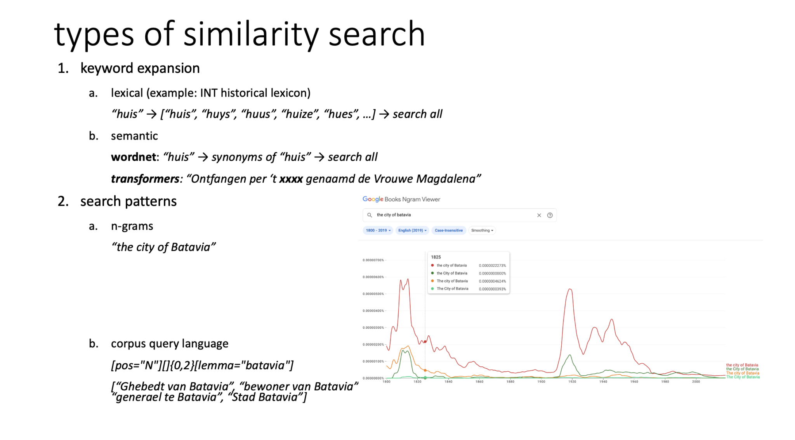

# Aligning GLOBALISE with Researchers’ Needs

> **Archived blog post.** This post was originally published on the Globalise project website on 1 March 2023 ([original URL](https://globalise.huygens.knaw.nl/aligning-globalise-with-researchers-needs/)). The text is reproduced without changes; links to other blog posts now point to their archived copies, and other links may no longer work.

**About the author:** Merve Tosun was coordinator of user interaction and outreach in the Globalise project from January 2022 to January 2024.

<!-- Bio source: Former team members list, https://globalise.huygens.knaw.nl/team/ (consulted 2026-10-01) -->

---

While reading through archival records, you probably often come across names of people or places that you are unfamiliar with. In those moments, nothing is better than having access to resources that have already provided context on those historical persons or places. If your curiosity is tickled enough after such encounters, or secondary resources do not disclose that much information, would it not be great to be able to search through the archives to find other mentions of a specific person, place, or commodity in different contexts?

GLOBALISE is working towards creating a research hub that makes the Dutch East India Company (VOC) archival records more accessible, not only through machine-readable transcriptions of the handwritten texts, but also by contextualising events and entities mentioned in the text and linking to available data and resources – all in one place. In other words, we aim to form a bridge from source material to available contextual information and thus making the archives better “re-searchable”.

## User panel

Of course, there are a multitude of ways to set this up. We believe it is important to define the functionality of the hub in conversation with (future) users, so we organised user panel meetings to discuss different aspects of this endeavour.

Thus, in the latter half of 2022, we met with an international group of twelve scholars, students, researchers, and heritage professionals during two user panels. In these informal, interactive, and above all explorative meetings, we discussed various aspects of our approach and the possibilities they provide for the advancement of their research processes.

These meetings have resulted in valuable insights into research interests, current ways of searching through the archives, and preferences for the presentation of data and results in the future hub. I would like to highlight some of those insights in this blog post to share some of the first findings of this process, as well as underline the value and importance of public engagement with the project.

------------------------------------------------------------------------

*Do you have ideas about features of the future GLOBALISE research hub, or would you like to join one of our panels? Please feel free to [drop us a line](https://globalise.huygens.knaw.nl/contact-us/) (or more)!*

------------------------------------------------------------------------

## **VOC archives & research**

Going into these meetings, we were primarily interested in how the VOC archives are used for research (whether in academic or non-professional settings). What we found during the past panels is that most research with VOC archival records is done in the fields of social and political history, with quantitative approaches being far less common than qualitative analyses.

However, when asked what specific questions panellists would most like to be able to answer, quantitative questions, such as the number of enslaved individuals at a certain location or the amount of (re)negotiated diplomatic contracts, featured much more. This difference might be related to the limitations of currently applied (re)search methods or preconceptions about what kind of questions the research hub might be able to answer – or both.

As the day progressed and the different possibilities for searching in the future hub became clearer, panellists formulated more complex questions, like: “How was the VOC hierarchized in a specific location?” and “What are instances of orientalism in the archival corpus?”.

## **(Re)search methods**

Anyone who has worked with early modern (Dutch) handwritings, specifically with those originating from the VOC archives, knows how difficult it can be to discern characters let alone read and understand (!) whole paragraphs of text in these documents that were never meant to be seen by the public eye. But ploughing through the handwritten material must currently be done, page after page, to find that one document, references to a certain event, or specific lists. This is one of the (major) aspects of the research process that GLOBALISE aims to facilitate.

During the panels, we found that researchers preferred reading through the (scan of the) complete original document instead of relying on automatically generated transcriptions. Search results of online databases were met with the same critical attitude. While we assumed this might be given in by hesitance towards the reliability of query results produced by digital tools, panellists clarified that this is simply part of good research practices. Like any archival document, book, or resource, panellists said, query results should also be approached with critical scrutiny.

This confirms, [once again](/pages/about/archive/blog/looking-back-on-a-successful-kickoff-meeting.md), the importance of introducing both the possibilities and limitations of the research hub, as well as clear guidelines for its responsible use.

## **Future options**

Of course, we also discussed various possible methods for searching through the GLOBALISE corpus with, for example, wildcards, custom thesauri, Boolean operators, keyword expansion, or by way of the entities and events that we identify in the documents. Each method has its unique features, with benefits and limits for different purposes. During the panels, we wanted to explore levels of familiarity with the different methods, and ways in which each method could advance research into the VOC archives.

A slide showing some of the similarity search methods discussed during one of our panel meetings. For more information on the INT lexicon, see [Instituut voor de Nederlandse Taal.](https://taalmaterialen.ivdnt.org/download/tstc-ne-lexicon-nederlands/)

Even though these concepts were approached with enthusiasm, there was still some hesitance regarding the accessibility of the various methods to users with different levels of digital proficiency. We take from this that we should make each search option as intuitive as possible and include guidelines and suggestions for search methods for specific purposes.

While our panellists, and we could say the average historian, generally would not apply all these different methods in their research currently, there was consensus on the tremendous potential that these “new” search methods could provide – both for searching and finding, but also for transforming the character and scope of research questions.

The collective reflections, critical questions, and enthusiasm during the first two user panel meetings have been very inspiring to all four teams of the project. We aim to continue these user panel meetings to discuss features of the hub, and additionally set up smaller, more focused working groups to concentrate on specific topics and challenges.

And of course, you will be able to follow along via our blog updates or our newsletter, if not by joining one of the panels yourself!
