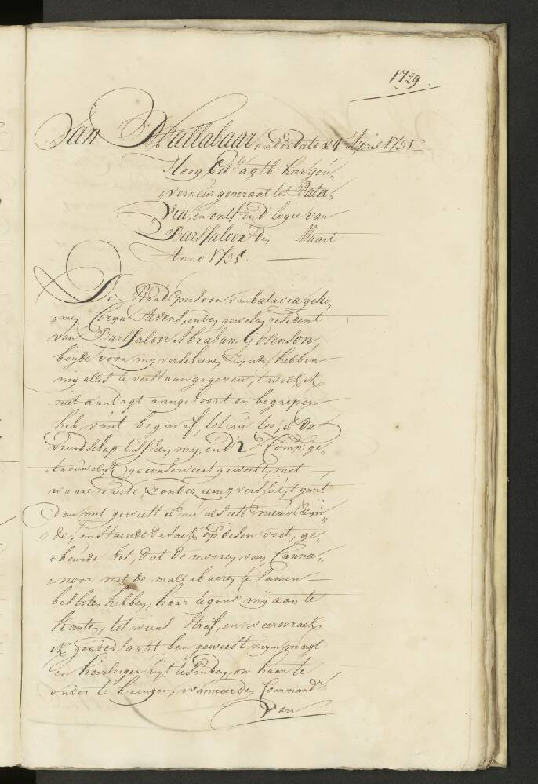
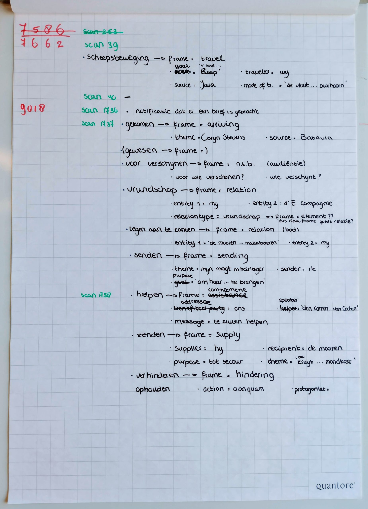

# Automatic Event Detection in Early Modern Dutch (VOC) documents: the Annotation Phase

> **Archived blog post.** This post was originally published on the Globalise project website on 4 October 2022 ([original URL](https://globalise.huygens.knaw.nl/automatic-event-detection-in-early-modern-dutch-voc-documents-the-annotation-phase/)). The text is reproduced without changes; links to other blog posts now point to their archived copies, and other links may no longer work.

**About the author:** Stella Verkijk is a natural language processing developer in the semantic contextualisation team of the Globalise project, based at Vrije Universiteit Amsterdam.

<!-- Bio source: Team page, https://globalise.huygens.knaw.nl/team/ (consulted 2026-10-01) -->

---

In order to unlock as much information as possible from our archives, a big part of the GLOBALISE project is developing software that can automatically detect events in the texts. This would mean, for example, that you could search for and extract data about events like shipwrecks, armed conflicts, or even more fine-grained events like the dismissal of a certain general.

## Event detection and its challenges

This is a complex task because events do not only encompass the verbs, or even nouns or other linguistic elements that describe them, but also the persons that played a role in the event, and the location and time at which an event took place (to name a few, but not all, relevant factors). For example, if you can extract that a ship set out on a journey, it would be interesting to know where it departed from, where they were planning to go and when this happened, otherwise it is not such a valuable piece of information. Language itself is complex, and all the pieces of the puzzle that describe a single event are not described in the same way each time the event in question is mentioned.

In order to train models to recognise and extract this type of information, we need to have training data. These are texts in which human annotators have indicated where the events and all the different pieces of relevant information are located. There are several ways to do this, and at GLOBALISE we are currently in the process of investigating what the most suitable approach would be.

Event annotation and detection in historical texts is something that has been done by many scholars before. To name a few: Sprugnoli and Tonelli[1] annotated travel narratives and news published between the second half of the nineteenth century and the beginning of the twentieth century for event classes; Ide and Woolner[2] annotated a corpus consisting mostly of so-called “memoranda of conversations” (near-transcriptions of meetings between Japanese and US officials) from the time period between 1931 and 1941 with communication events; Cybulska and Vossen[3] extracted events from textual data about the Srebrenica Massacre from July 1995; Fokkens et al.[4] extracted relationships between people and events from data in the Biography Portal of the Netherlands (BPN), which contains biographies from a variety of Dutch biographical dictionaries from the eighteenth century to the present. However, to our knowledge it has never been attempted to annotate and extract events from texts as old as those of the VOC. Working with these types of documents comes with a whole new set of challenges.

Our data consists of Early Modern Dutch texts, which means we have to deal with a different vocabulary, style and grammar than what most existing Natural Language Processing (NLP) tools are trained on. On top of that, our texts have to go through an OCR/HTR (Handwritten Text Recognition) pipeline, presenting its own difficulties: the resulting texts may lack interpunction and characters may have been recognized wrongly by the computer, making the language less consistent than would be expected, and therefore more challenging for machine learning systems to deal with. These are issues that have to be taken into consideration, not only when designing and building our models, but in the first place during the annotation phase, in order to obtain good quality data to train models on. Not many people can read Early Modern texts with (relative) ease, and the experts who can are not trained linguists. This is something that has to be taken into account in the design of the annotation task.

## FrameNet

The largest and most descriptive lexical database available that deals with events and the way they are realised linguistically in natural language is FrameNet[5]. The Berkeley FrameNet project has been an ongoing effort to document the way each (English) word in each of its senses is manifested semantically and syntactically in natural language text. This is useful for various reasons, one of the most obvious being that the same word can sometimes mean different things in different contexts. For example, firing a person is something different than firing a gun. In FrameNet, the frame *Firing* is described as follows:

1\. An **Employer** ends an employment relationship with an **Employee**. There is often a behavior of the **Employee** that motivates the firing (a **Reason**) or some more general **Explanation** given for the action. 

as opposed to the frame *Use_firearm:*

2\. An **Agent** causes a **Firearm** to discharge, usually directing the projectile from the barrel of the **Firearm** (the **Source**), along a **Path**, and to a **Goal**.

As you can see, the descriptions of actions in FrameNet are very detailed. Because FrameNet is such a rich database, and we know of other studies involving historical event detection that have used FrameNet\[4,6\], we decided to experiment with annotating according to this framework.

## A first pilot

We ran a pilot in event annotation following FrameNet in June of this year and came across several issues that are worth discussing. Firstly, we encountered coverage problems in FrameNet. Every language has a vast amount of different words and senses and language is continually changing, which makes it almost impossible to represent everything (as mentioned, FrameNet is an ongoing project). For example, there is a frame for *Damaging* but there is no frame for the action of repairing. Apart from these more elementary actions missing in the database, there are also instances where FrameNet contains frames for very specific situations, but which sometimes fail to represent the same situation from a different standpoint. For example, there is a frame for *Being_born*, but none for the action of giving birth. Also, each frame has different frame elements (the boldfaced items in examples 1 and 2 above): FrameNet works with situation dependent roles. This means that each time an annotator recognises an event in the text, they first have to determine the corresponding frame and then establish which specific frame elements should be annotated (for which they also have to differentiate between so-called core and non-core frame elements). According to the FrameNet theory, core frame elements are those that always occur in the context of the frame and should always be annotated, whereas non-core frame elements are elements that may appear in the context, but not necessarily.

In our event annotation pilot, we annotated 18 scans of reports from the VOC archives for events concerning ship movements and polities (the latter includes actions relating to themes such as diplomatic relations, conflict and employment within the VOC). In these scans we identified 44 instances of relevant frames (or events). During the process, we gathered the unique frames we identified in a preliminary ontology[7]. Each time we identified an event that was not represented in FrameNet in the way we needed it, we created a new frame. It is important to note that we also included frames that were not represented in the scans, but which we deemed to be of importance based on (linguistic) intuition. For example, when we added the frame *Having_a_contract* (because we saw a sentence that should be annotated with this frame) we also added the new frame *Breaking_a_contract* to the ontology. In the end, the ontology contained 9 unique frames for ship movement and 37 unique frames for polities. Of the frames for polities, only 14 were copied as is from FrameNet, meaning we had to create 23 new frames (more than 60% of the total amount of unique frames identified for polities). As for the ship movement frames, we had to create 3 new frames (a third of the total amount of the unique frames identified for ship movement).

*Scan 1737 of inventory number 9018: one of the scans we annotated. Source: [Nationaal Archief](https://www.nationaalarchief.nl/onderzoeken/archief/1.04.02/invnr/9018/file/NL-HaNA_1.04.02_9018_1737), CC0.*

*Notes of frames and frame elements we detected during the pilot in some of the scans, including scan 1737 shown to the left.*

Table 1 shows two frames with their definitions and frame elements (FEs): one that is taken from FrameNet and one that we created ourselves by adapting a frame from the FrameNet database. The FEs all have individual descriptions that were left out here but can be found on the FrameNet website[8]. Table 2 shows examples of how these frames were annotated in the scans. There are a few things that are important to note here. Firstly, it becomes clear that the FEs that FrameNet indicates as core FEs for the frame *Travel* do not all appear in the text we encounter and can thus not be annotated. Secondly, it is important to note that creating a new frame comes with an extra step, namely deciding which FEs should and can be annotated. For each frame element that we create ourselves, we would first have to analyse the way the frame is represented in our text in order to come to a consensus about what FEs should and could be annotated. Lastly, it should be noted that these are two of the more straightforward examples of the annotations made in the pilot.

<table><thead><tr><th>Frame</th><th><strong>Copy from FrameNet?</strong></th><th><strong>Definition</strong></th><th><strong><strong>Core FEs</strong></strong></th><th><strong>Non-core FEs</strong></th></tr></thead><tbody><tr><td> Travel</td><td> Yes</td><td>In this frame a <strong>Traveler</strong> goes on a journey, an activity, generally planned in advance, in which the <strong>Traveler</strong> moves from a <strong>Source</strong> location to a <strong>Goal</strong> along a <strong>Path</strong> or within an <strong>Area</strong>. The journey can be accompanied by <strong>Co-participants</strong> and <strong>Baggage</strong>. The <strong>Duration</strong> or <strong>Distance</strong> of the journey, both generally long, may also be described as the <strong>Mode_of_transportation</strong>. Words in this frame emphasize the whole process of getting from one place to another, rather than profiling merely the beginning or the end of the journey.</td><td>Area, Direction, Goal, Mode_of_transportation, Path, Source, Traveler</td><td>Baggage, Co-participant, Depictive, Descriptor, Distance, Duration, Explanation, Frequency, Iterations, Manner, Means, Period_of_iterations, Place, Purpose, Result, Speed, Time, Travel_means</td></tr><tr><td> Being_sick</td><td> No, adaptation of Condition_symptom_relation</td><td> A <strong>Patient</strong> is in a less than optimal state that can be described by <strong>Symptoms</strong>.</td><td> ?</td><td> ?</td></tr></tbody></table>

*Table 1: snippet of the preliminary GLOBALISE event extraction ontology*

<table><thead><tr><th>Frame</th><th>Annotated text</th><th>Annotated FEs</th></tr></thead><tbody><tr><td><strong>Travel</strong></td><td><strong>den 8„n februarij deses lopende Iaars</strong> <em>[Time]</em> zijn onder de vlagge vanden E. Commandeur forephaes vosch uijt <strong>dese Rhede</strong> <em>[Source] </em><strong>vertrocken</strong>, en<strong> 21.e dagen</strong> <em>[Duration] </em>daer aan in goede gestalte <strong>buijten sundas engte in ruijm zee</strong> <em>[Path] </em>getaekt <strong>deschepen de ridderschap van holland, ’t wapen van alckmaer de vrije zee, de burg van eijden africa, ’t Eijland mouritius en oostenburg</strong> <em>[Traveler]</em> gesamentlijk medegevoert hebbende,<strong> een Cargasoen ten bedrage van ƒ 3270285</strong>: <em>[Cargo]</em></td><td> Time, Source, Duration, Path, Traveler, Cargo.</td></tr><tr><td> <strong>Being_sick</strong></td><td>niet te verbergen dat <strong>sijn tegenwoordige lighaams dispositie</strong> <em>[Patient] </em>door een <strong>sleepende onpasselijkheit</strong> <em>[Symptoms] </em>en <strong>voerscheijde andere qualen</strong> <em>[Symptoms]</em>, vrij veel <strong>verswakt zijnde</strong>,</td><td> Patient, Symptoms.</td></tr></tbody></table>

*Table 2: two example annotations*

## Pilot conclusions

The pilot revealed several issues: we were confronted with FrameNet’s coverage problems (at least for our data), the complexity of the texts we are dealing with, and the complexity of the framework that is FrameNet itself. This framework was made to describe language, while our goal is more practical. Ultimately, we want to create functional software that can extract events that fulfil the (research) needs of the people who will use our research infrastructure – we are not trying to illustrate how events are represented linguistically in Early Modern Dutch. Therefore, we deemed it essential to consider alternative ways of annotating our data.

Another issue that occurs in most event detection efforts, and that was highlighted by what we experienced during the pilot, is that you ideally want to extract a higher level of information where you not only gather information on individual events mentioned in the text, but also on chains of events and the implications that events have (and that are often implicit). For example, it might be mentioned on one page that i) a ship leaves with a certain cargo, and a few pages later it might be mentioned that ii) this ship arrived, but empty. It is fairly simple to extract these facts separately, but a model cannot automatically, without any additional input, draw the conclusion that something happened to the cargo in between, although this would probably be very relevant information that could be drawn from these events.

## What’s next?

The next step for us is thus to figure out how we can come up with a simpler annotation scheme where we do not lose any information that is valuable to us. We know that we need to annotate where events occur in the texts and what elements or people played which role in each event. On top of that, we want to model the implications of these events and investigate how much information we can automatically infer from what is explicitly expressed in the text (possibly without annotating these inferences). For example, if the same ship departed at location *a* at time *t* with cargo *c* and then arrived at location *b* at time *t+x* without cargo *c*, then the model should be able to infer that cargo *c* is now located somewhere between *a* and *b*. We now plan to create an annotation scheme that takes ideas from different frameworks, namely FrameNet, PropBank[9] and the (Circumstantial) Event and Situation Ontology[10]. What the annotation scheme is going to look like exactly will be decided over the coming weeks. We plan to keep readers updated on our progress in future blog posts.

What is extremely important is to first identify which concepts we actually want to extract from this colossal corpus of text, because we cannot extract information about every event. Take the following sentence (3).

3\. After he lifted his pen and signed the contract, the agreement between them was a fact.

Depending on the level of granularity at which we want to extract events, we can pursue anything from extracting the event of two parties *having an agreement* from this sentence to extracting the events *lifting a pen*, *signing a contract*, and *having an agreement*. The more fine-grained we go, the more we will have to annotate, because computational models need a certain amount of examples per event to learn how to extract those events automatically. In other words, a crucial part of the process for creating an annotation scheme that will lead to training data with which we can build a reliable model within a reasonable timeframe is deciding on the relevance or redundancy of information presented in the text. We therefore look forward to collecting feedback from researchers and others interested in using the VOC archives to learn more about their current and future research interests.

------------------------------------------------------------------------

[1] Sprugnoli, R., & Tonelli, S. (2019). Novel event detection and classification for historical texts. *Computational Linguistics*, *45*(2), 229-265.

[2] Ide, N., & Woolner, D. (2007). Historical ontologies. In *Words and intelligence ii* (pp. 137-152). Springer, Dordrecht.

[3] Cybulska, A., & Vossen, P. (2011, June). Historical event extraction from text. In *Proceedings of the 5th ACL-HLT Workshop on Language Technology for Cultural Heritage, Social Sciences, and Humanities* (pp. 39-43).

[4] Fokkens, A., Ter Braake, S., Ockeloen, N., Vossen, P., Legêne, S., Schreiber, G., & de Boer, V. (2018). Biographynet: Extracting relations between people and events. *arXiv preprint arXiv:1801.07073*.

[5] Ruppenhofer, J., Ellsworth, M., Schwarzer-Petruck, M., Johnson, C. R., & Scheffczyk, J.\
(2016). *FrameNet II: Extended theory and practice*. International Computer Science\
Institute. https://framenet.icsi.berkeley.edu/

[6] De Boer, V., Oomen, J., Inel, O., Aroyo, L., Van Staveren, E., Helmich, W., & De Beurs, D. (2015). DIVE into the event-based browsing of linked historical media. *Journal of Web Semantics*, *35*, 152-158.

[7] The preliminary ontology can be found on our GitHub page: [https://github.com/globalise-huygens/nlp-event-detection/tree/main/preliminary_experiments/FrameNet_event_annotation_pilot](https://github.com/globalise-huygens/nlp-event-detection/tree/main/preliminary_experiments/FrameNet_event_annotation_pilot)

[8] [FrameNet Data (berkeley.edu)](https://framenet.icsi.berkeley.edu/frameindex)

[9] Palmer, M., Gildea, D., & Kingsbury, P. (2005). The proposition bank: An annotated corpus of semantic roles. *Computational linguistics*, *31*(1), 71-106.

[10] Segers, R., Caselli, T., & Vossen, P. (2018, May). The circumstantial event ontology (CEO) and ECB+/CEO: An ontology and corpus for implicit causal relations between events. In *Proceedings of the Eleventh International Conference on Language Resources and Evaluation (LREC 2018)*.
