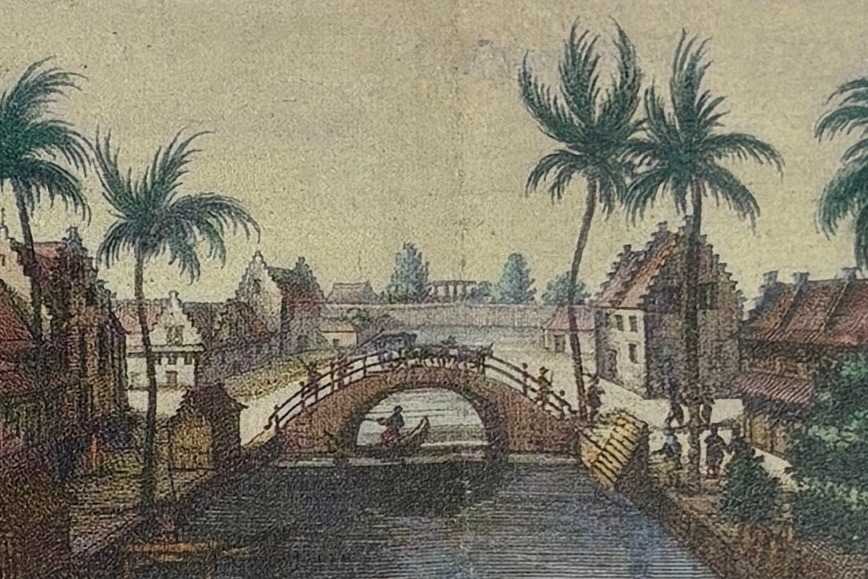
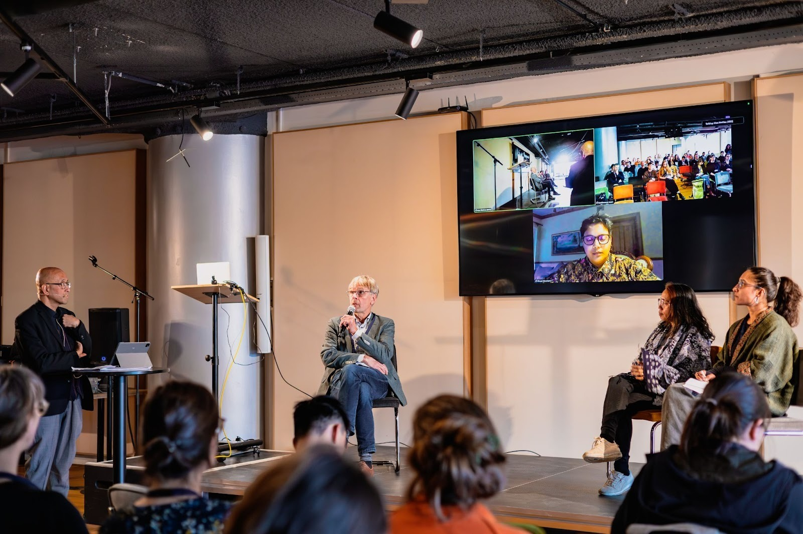
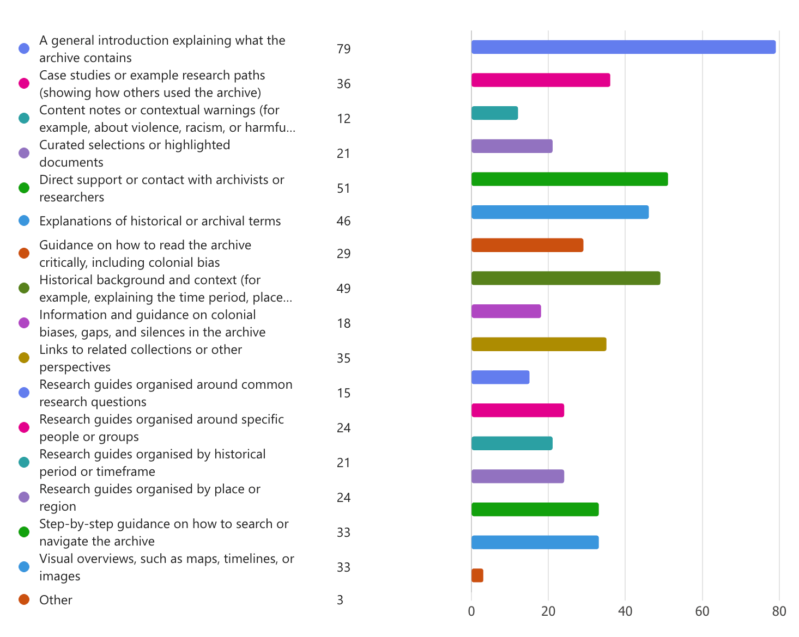
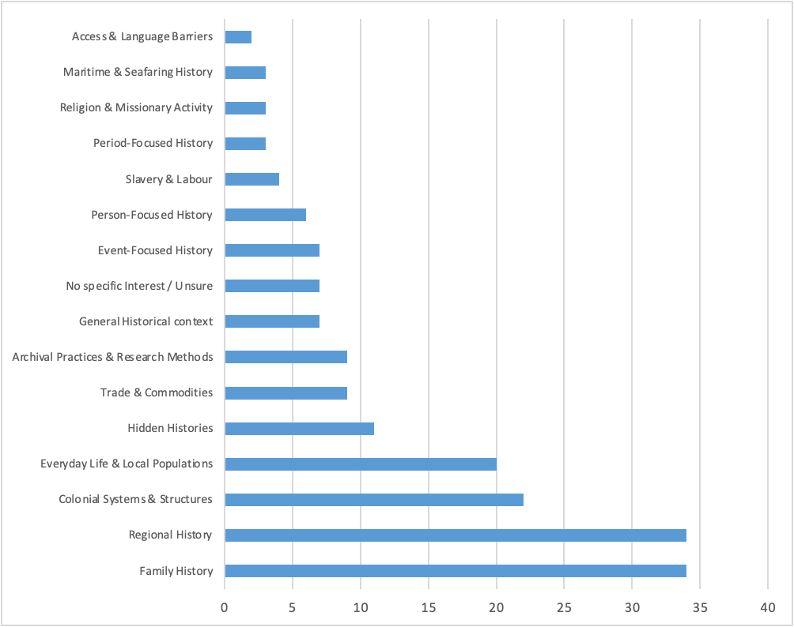

# Building Bridges: Archives as Spaces of Reconnection

> **Archived blog post.** This post was originally published on the Globalise project website on 9 April 2026 ([original URL](https://globalise.huygens.knaw.nl/building-bridges-archives-as-spaces-of-reconnection/)). The text is reproduced without changes; links to other blog posts now point to their archived copies, and other links may no longer work.

**About the author:** Tara Huveneers was an intern with the Globalise project from September 2025 to March 2026, as part of the Master's programme in Archival and Information Studies at the University of Amsterdam.

<!-- Bio source: Introduction to the blog post itself; former team members list, https://globalise.huygens.knaw.nl/team/ -->

---

## ***On Accessibility, Collaboration, and Working with Communities***

> Tara Huveneers completed an internship with the GLOBALISE project as part of the Master’s programme in Archival and Information Studies at the University of Amsterdam, where she explored the accessibility of VOC archives for diverse and community-connected users.

*Detail of View of the Tijgersgracht on Batavia (1682) from the Atlas van der Hagen, volume IV, [Koninklijke Bibliotheek](https://www.kb.nl/ontdekken-bewonderen/topstukken/atlas-van-der-hagen), The Hague. Public domain.*

The final week of my internship at GLOBALISE, as part of the [Master’s programme in Archival and Information Studies at the University of Amsterdam](https://www.uva.nl/shared-content/programmas/en/dual-masters/archival-and-information-studies-heritage-studies/study-programme/study-programme.html), could not have been timed more fittingly. An internship project around the theme of ‘accessibility’ of the VOC archives that began in September 2025 found its culmination in the [GLOBALISE conference](https://globalise.huygens.knaw.nl/globalise-conference-4-6-march-2026-amsterdam/) (3-6 March) in Amsterdam. For a few days, the International Institute of Social History became a gathering space where researchers and heritage practitioners from across the world – many from regions historically connected to the Dutch East India Company – came together to share, listen, and think collectively about how to engage with colonial pasts.

For me, entering this field only recently, this experience felt markedly different from engaging with archives through texts alone. What had previously appeared as distant, often disembodied academic discourse became grounded in people. For a brief moment, this space became an epicentre of early modern Dutch colonial knowledge, but more importantly, a space where tacit knowledge could circulate.

The roundtable *Decolonizing Infrastructure, Engaging Communities* resonated closely with my own internship research. Bringing together participants Asawari Luthra, Yus Broersma, Wisaal Abrahams and Charles Jeurgens, the discussion that was chaired by Wim Manuhutu centred on a deceptively simple question: how can archives become meaningful to people beyond the circle of dedicated researchers and archival professionals?[^1]

In other words – how do we build for people who are not in the room?

Although I only played a small role in helping formulate initial questions, the discussion continued to revolve around four key themes that shaped both the roundtable and my own research: accessibility, responsibility, plurality, and futurity.

What follows is a reflection shaped by that roundtable, by the conference more broadly, and by the observations I gained during both my studies and my internship.

*Impression of roundtable *Decolonizing Infrastructure, Engaging Communities*. From the left: Wim Manuhutu, Charles Jeurgens, Wisaal Abrahams (on screen), Yus Broersma, and Asawari Luthra. Photo: Poorvi Garag, licence CC BY 4.0.*

## **My internship research at GLOBALISE in a nutshell**

My research on accessibility was situated on the user-centred (or perhaps better, human-centred) side of the spectrum. This approach begins by asking who users are, what they are trying to do, what stands in their way, and what forms of support they need – in other words, the expectations and contexts that already exist before entering the digital archive.

The project focused on potential users of the VOC archives, particularly those who feel a personal, communal, or historical connection to them. These are not always academic researchers, but individuals searching for fragments of belonging: traces of people, places, and histories that matter to them and/or their communities.[^2]

To explore this, I interviewed five heritage practitioners connected to regions where the VOC once operated: South Africa, Taiwan, Indonesia, and India. All of them work with colonial archives while engaging broader audiences who are often less familiar with how to access and interpret them, but who nevertheless have strong reasons to seek historical knowledge.

The interviews were followed by a questionnaire, distributed through the interviewees’ networks, which generated 118 responses. This was an attempt to reach a more inexperienced audience, since the interviewees themselves were relatively familiar with archives.

*Survey respondents’ preferred types of guidance or support when accessing the VOC archives*

A recurring point raised in the interviews was that there is often a general awareness that archives related to community histories exist, but not where to find these archives, or how to access them. This was noted by Bony Thomas, who works with intangible heritage communities in Kochi, India[^3], as well as by Bayu Amde Winata, who uses GLOBALISE materials in his research and exhibition work on Riau (Sumatra), Indonesia[^4]. A similar need was expressed by Uma Tavalan (Wan Shu-Chuan), who has worked with Dutch missionary archives for the revitalisation of the Siraya language in Taiwan.[^5] In her case, alongside language barriers, outreach was emphasised as a key next step.

*Survey respondents’ themes of interest*

The questionnaire responses reflect motivations driven by interest in genealogical history, as well as a desire to better understand regions to which respondents are connected, whether locally or through diaspora. Trust in the archive appeared at multiple levels: through reliable indexing and findability, transparency in transcription and translation, and confidence in contextual framing and bias disclosure.[^6]

## **Plurality: archives, families, and difficult relations**

One of the biggest questions I had during my internship was how to work with the plurality of communities connected to the VOC archives. This is an enormous corpus: vast in scale, geographically dispersed in origin, and uneven in the histories it records. When speaking of ‘affected communities’, it is easy to slip into a singular or abstract language that obscures just how internally diverse, historically distant, and differently positioned these communities may be.

It was here that I found the metaphor of family that Wisaal Abrahams drew during the roundtable particularly powerful. She drew on family dynamics to speak about colonial archives, estrangement, and relation. I found that language unexpectedly clarifying. It reveals difference, while also acknowledging connection.

According to Wisaal, the VOC archive, in this framing, becomes a kind of difficult and distant familial figure – specifically a father figure – one that ties people together through histories of violence, displacement, administration, and memory. This suggests that the archive can function not only as a repository, but also as a potential mediator between parties who feel alienated from one another and from the histories that connect them. To reconnect with the archive, then, is not necessarily to celebrate it. It can also mean confronting an inheritance or making sense of a relation.

I found this metaphor especially effective because it allows plurality to remain plurality. Not every family member wants the same thing. Not every community wants the same story told. During the roundtable, Asawari Luthra also pointed out that different communities have different narrative priorities, and that some archival materials or interpretive framings may not align with what a community wants to foreground. This is a reminder that inclusion does not automatically mean consensus. A similar sentiment was expressed by Yus Broersma, who noted that certain indigenous groups in Indonesia might prefer their heritage not to be made publicly accessible.

At the same time, Wisaal’s framing resonates with broader turns in archival scholarship that centre on relationality, ethics of care, and radical empathy.[^7] Here, archivists are not imagined primarily as custodians, but as participants in networks of responsibility that connect records, creators, subjects, users, and communities. In that sense, archiving becomes less about managing records, and more about thinking through these networks of relationships.

## **Responsibility: policy, staying power, and embodied work**

If plurality represents the complexity of the field, then responsibility represents the work required to engage with it. One of the most important points raised during the roundtable was that meaningful community engagement cannot rest on temporary projects alone. Charles Jeurgens observed that as long as major accessibility efforts remain project-based, relationship building with communities remains structurally fragile; he proposed that network building should be understood as part of the outcome – not only the process.

In that sense, the problem is not only methodological, but institutional. If outreach, collaboration, and community interaction are not embedded in policy and staffing structures, they remain optional extras.

Wisaal’s contribution here stayed with me as well. Speaking from her own experience of working with communities, she stressed the importance of what she called ‘staying power’. You will make mistakes. You will disappoint people. You will stumble. But the point is to keep going, to be transparent about your intentions, and to remain accountable. Drawing again on family dynamics, she suggested that this kind of work requires a form of steadiness – not authority, but the willingness to remain present through difficulty.

## **Bridge-builders for the archives**

While the multidisciplinary turn in archiving—through computational methods, data modelling, transcription, and search infrastructures—is crucial, it was suggested during the roundtable that designers may play an important role as bridge-builders in creating a sense of belonging to the archive. Examples of good practice were also drawn from the museum world, highlighting efforts to humanise and pluralise collections, such as [Digital Benin](https://digitalbenin.org/), mentioned by Yus Broersma, and the [Reciprocal Research Network](https://www.rrncommunity.org/), referenced by Charles Jeurgens.

I also found inspiration in the arts and heritage field, particularly the *Diaspora Erfgoed in Beweging* (Diaspora Heritage in Movement) project in the Netherlands, which approaches heritage as something carried, shaped, and activated especially within diaspora communities. Its emphasis on collaboration and an embodied approach resonates closely with the idea of ‘staying power’ discussed in the roundtable.[^8]

## **Towards a renewed language of archival accessibility**

For community-embedded users, these archival records are not just data points. They are traces of lived realities, lineages, losses, and historical worlds that continue to shape identity in the present. This is why I propose that the language of accessibility could benefit from renewal – especially in how it addresses the collaborative work it requires. The dominant vocabulary can still feel too limited to capture the plurality of relationships at play. Terms such as ‘users’ or even ‘access’ tend to flatten these differences rather than making them visible.

The familial language that emerged from the roundtable offers a more directed way of thinking. It reminds us that these archives are entangled in difficult inheritances and asymmetrical relationships. To speak of archives as spaces of reconnection is therefore not to romanticise them. It is to insist that access is also about relation: about how people come to understand their place in history, in relation to one another, and in relation to records that may both estrange and call to them.

This blogpost does not offer a checklist for making archives accessible. What it offers instead is a reframing: a way of thinking about how we speak, write, and formulate policies around accessibility.

And perhaps that is where the bridge lies – not only between user and system, but between people who have long been connected through colonial histories and are still trying to figure out what that connection means.

If archives can help make that work possible – however partial and imperfect that may be – then they may become spaces in which new forms of belonging, dialogue, and reconnection can cautiously begin.

[^1]: Asawari Luthra is an anthropologist and historian. She was a guest researcher at GLOBALISE and currently teaches at the Design Academy in Eindhoven. Yus Broersma is a researcher and community organizer at Radboud University in Nijmegen, where she works on the project Reconcile, which rethinks museum collections in terms of narrative, community engagement, and inclusive learning. Wisaal Abrahams is a visual artist, researcher, and community organizer based in South Africa, and has been a Global Slavery History Fellow at the International Institute of Social History. Charles Jeurgens is Professor of Archival Studies at the University of Amsterdam, and has also been one of my lecturers. Finally, the panel was chaired by Wim Manuhutu, a historian affiliated with the Vrije Universiteit Amsterdam.\
Yoshiharu Okayama, chair of the Dutch Trading Post Heritage Network and director of the Matsura Historical Museum and the Hirado Dutch Trading Post Museum in Hirado, Japan, also contributed to the discussion through a pre-recorded video outlining the network’s work. Due to time difference and geographical distance, he was unable to attend the conference in person.
[^2]: As is often the case, the boundary between ‘inexperienced affected community members’ and ‘academic scholars’ is, in practice, far less distinct than it may appear, with significant overlap between these positions.
[^3]: For more information on Bony’s heritage walks please see: [https://www.instagram.com/walkwithbony/](https://www.instagram.com/walkwithbony/)
[^4]: For more information on one of Bayu’s books please see: [https://arecabooks.com/product/datuklaksemana/](https://arecabooks.com/product/datuklaksemana/)
[^5]: For more information on Uma’s work please see this article: [https://thechinaproject.com/2023/06/05/taiwans-unrecognized-indigenous-tribes-are-reviving-dead-languages-to-achieve-recognition/](https://thechinaproject.com/2023/06/05/taiwans-unrecognized-indigenous-tribes-are-reviving-dead-languages-to-achieve-recognition/)
[^6]: Another part of my internship research included looking into usability research literature, which found that users tend to act before they read. They scan. They look for keywords. They seek cues that tell them whether a page is relevant to what they are trying to do. Only then do they commit to reading more carefully.
[^7]: See for example: Michelle Caswell and Marika Cifor, “From Human Rights to Feminist Ethics: Radical Empathy in the Archives,” Archivaria 81 (2016): 23–43. Marika Cifor and Anne J. Gilliland, “Affect and the Archive, Archives and Their Affects: An Introduction to the Special Issue,” Archival Science 16, no. 1 (2016): 1–6, [https://doi.org/10.1007/s10502-015-9263-3](https://doi.org/10.1007/s10502-015-9263-3). & Jesse Boiteau, “Whose Provenance? Plurality of Provenance and the Redistribution of Archival Authority,” Archival Science 24 (2024): 717–738, [https://doi.org/10.1007/s10502-024-09453-x](https://doi.org/10.1007/s10502-024-09453-x). & J. J. Ghaddar, “Provenance in Place: Crafting the Vienna Convention for Global Decolonization and Archival Repatriation,” in Disputed Archival Heritage, vol. 2, edited by James Lowry (London: Routledge, 2023), [https://www.taylorfrancis.com/books/oa-edit/10.4324/9781003057765/disputed-archival-heritage-jame](https://www.taylorfrancis.com/books/oa-edit/10.4324/9781003057765/disputed-archival-heritage-jame)
[^8]: For more information on *Diaspora Erfgoed in Beweging*, please see: [https://diaspora-erfgoed.sites.uu.nl/](https://diaspora-erfgoed.sites.uu.nl/)
