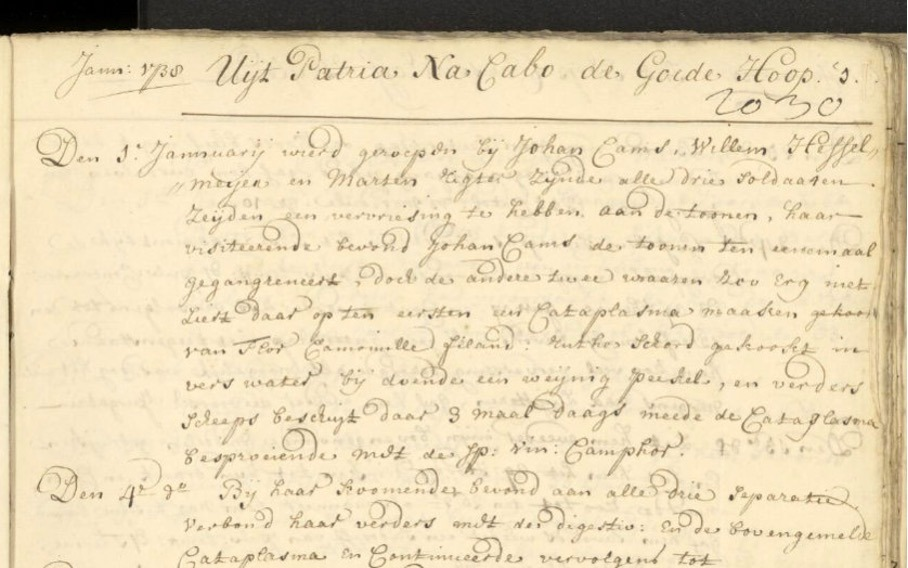
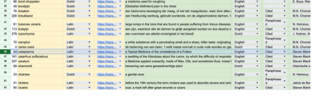
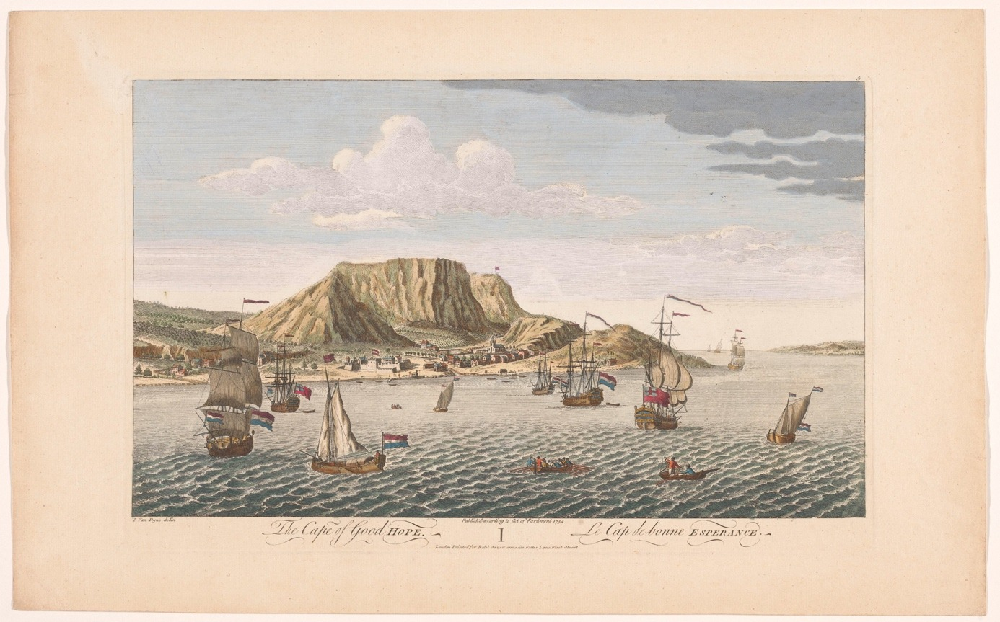
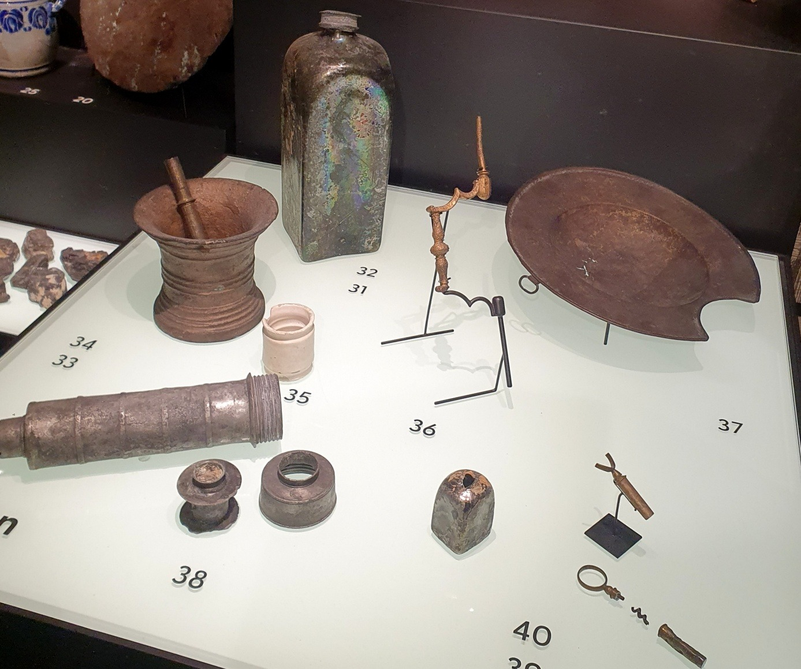

# Cataplasma and Lienteria: Medical Terms in the VOC Archives

> **Archived blog post.** This post was originally published on the Globalise project website on 27 March 2026 ([original URL](https://globalise.huygens.knaw.nl/cataplasma-and-lienteria-medical-terms-in-the-voc-archives/)). The text is reproduced without changes; links to other blog posts now point to their archived copies, and other links may no longer work.

**About the author:** Linda Robertus, a public health physician and Research Master's student in Historical Studies at Radboud University, Nijmegen, interned with the Globalise project from September 2025 to January 2026.

<!-- Bio source: Introduction to the blog post itself (the team page gives September–December 2025 as the period of her internship) -->

---

> Linda Robertus obtained her medical degree in Groningen in 1996. She trained as a public health physician before moving to Australia in 2007. She returned to the Netherlands in 2024 and is currently finishing a Research Master Historical Studies at Radboud University, Nijmegen. She interned with GLOBALISE from September 2025 to January 2026.

On the 1st of January 1738, the VOC ship *Karsenhof* departed from Texel with 289 people on board, bound for Ceylon (Sri Lanka) via the Cape of Good Hope. The *oppermeester* (senior surgeon) on that ship was Hendrick Leuseveld from Zwolle. He had made one previous journey as *oppermeester*, in 1735 on the *Klarabeek* to Batavia, returning in 1737 on the *Voorduin*. On January 1st, 1783, he wrote in his journal that he had been called to see the soldiers Johan Cams, Willem Hesselmeijer and Marten Rigter, who all had frozen toes. Although it was the first day of the voyage, it was probably not the first day on board for the men, because ships that departed in the winter months often had to wait days or even weeks for the right weather conditions, and once on board, the crew was not allowed to leave.

*The first page of the journal written by Hendrick Leuseveld (1738)\
[https://transcriptions.globalise.huygens.knaw.nl/detail/urn:globalise:NL-HaNA_1.04.02_2431_0693](https://transcriptions.globalise.huygens.knaw.nl/detail/urn:globalise:NL-HaNA_1.04.02_2431_0693)*

Leuseveld examined the patients and concluded that the toes of Johan Cams were completely gangrenous (necrotic), but that the toes of the other two soldiers were ‘not so bad’. He ordered a *cataplasma* (poultice) to be made with chamomile cooked in fresh water, a little brine, ships’ biscuit and camphor. The toes of all three patients were treated by having this moist mass applied to them daily. The surgeon declared that on the 4th of March Willem Hesselmeijer and Marten Rigter were ‘completely cured with loss of the first two digits of the toes’ and that on the 20th of March Johan Cams was ‘completely cured with loss of all toes except one and a half toe’. According to the VOC records, all three soldiers were employed for several more years.

## Building the VOC Medical Dataset

I interned with the GLOBALISE project in the autumn of 2025. Leuseveld’s journal is one of fifteen surgeons’ journals and a few other documents that I used to create a dataset of medical terms found in the VOC archives, which will be published later this year. I was drawn toward creating a dataset of medical terms because of my medical background. All the journals that I worked with were kept on the journey from the Netherlands to Ceylon via the Cape of Good Hope, a voyage that if all went well could be done in six months, but often took much longer, sometimes lasting as long as 16 months. The oldest journal dated from 1732, the newest from 1783. The dataset contains 275 concepts related to diseases, treatment, and the human body. For each term, I provide a definition mostly drawn from sources from the 17th to 18th centuries, such as dictionaries and medical works. Where I didn’t find a contemporary definition, I relied on definitions from medical dictionaries from the 19th or early 20th century since many medical terms were still in use in later periods. In a few cases, I’ve used modern-day scholarly work to define the concepts. These sources are mentioned in the dataset as well so users know exactly which sources I have used to procure the definitions. The original concepts are in Dutch and Latin, but for each concept I have added an English translation. This dataset will be especially useful for researchers interested in health and disease in the early modern period, as it will allow them to look up definitions of diseases that they find mentioned in the archive. It also contains alternative labels, which can be spelling variants or different words for the same concept.

*Screenshot of the dataset*

## Life and Disease Aboard the Karsenhof

On the 2nd of January 1738, surgeon Hendrick Leuseveld was consulted by a soldier who complained of continuous diarrhoea: ‘as soon as he ate something, it came out again’. He had had this condition for six months already. We could presume that he postponed seeking help, knowing that once on board, he would not have to pay the doctor. The VOC provided their employees with free medical care for all issues, except those caused by ‘Bacchus and Venus’ (injuries as a result of brawls and venereal diseases).

The surgeon diagnosed this patient with *Lienteria* (a medical term that is no longer used, meaning ‘a form of diarrhoea where food is excreted without being digested’) and treated him with several medicinal substances, including rhubarb and cinnamon. He also prescribed ‘a good diet, with as many refreshments as possible’. Although the standard fare for sailors and soldiers aboard a VOC ship was of poor quality, the surgeon would have been able to provide some extras for his patients. However, in this case nothing worked. Leuseveld tried several more things until the end of April, when he ‘heard testimonies from the people that \[the patient\] secretly ate bacon and drank strong liquor’, and decided to no longer treat this man. When the ship arrived at the Cape on the 29th of May, the patient was taken to the hospital there. Since the Cape was the midway point on most journeys and ships would anchor here for a few weeks, sick people were admitted to the hospital. Some would come back on board for the next part of the journey, but this patient did not return to the *Karsenhof*.

*Robert Sayer (Publisher), *The Cape of Good Hope/Gezicht op Kaap de Goede Hoop te Zuid-*Afrika, 1754\
[Rijksmuseum Amsterdam](https://id.rijksmuseum.nl/200447728), public domain.*

In the meanwhile, Leuseveld had treated several other patients on board. Early in the journey, at the end of January, Leuseveld wrote in his journal that a soldier had been found between decks, hidden among some chests. The man was ‘eaten by vermin’ and died soon after. Leuseveld also described treating several sailors for injuries sustained in accidents on board during rough weather, including one sailor who fell from the foremast. He suffered from a contusion, but recovered in 12 days.

In February, many people on board fell ill with ‘hot fevers’. Initially, the surgeon kept fairly detailed notes of their treatment (bloodletting and various powders and decoctions), but soon he resorted to just writing down the names of the patients, their diagnosis, the date, and whether they recovered or died. On the 18th of that month the surgeon wrote:

In the morning I reported to the Captain that there were 36 sick people. And that because many people fall ill every day we are in dire need of refreshments, for the wellbeing of the Company’s servants. Whereupon the Captain called a meeting of the ship’s council in the afternoon, and it was decided (taking into account the many sick people and the damage to the ship caused by the bad weather) to go to the Island of St. Jago, for refreshments and to repair our ship.

The *Karsenhof* arrived at St. Jago (Santiago in Cape Verde) on the 20th of February and stayed there until the 3rd of March. The ‘hot fevers’, often accompanied by severe headaches and vomiting, continued until early May. The ship reached the Cape on the 29th of May, where 15 sick people were taken to the hospital. In total, 25 people had died during the journey from Texel to the Cape, all except one (the soldier found hidden between decks) from ‘hot fevers’. This means that the mortality rate on this voyage was 8,7%, which is just above the average for the decade 1730-1740.[^1] There were only a few people with scurvy, which is unusual for a ship that left the Netherlands in winter, but this is likely the result of the call at St. Jago, where fresh fruit and vegetables would have been obtained.

*Surgical objects recovered from the wreck of the VOC ship *Rooswijk*\
Maritiem muZEEum Zeeland, photograph by the author.*

The ship stayed at the Cape for one month. During this time, the surgeon caught up with his journalling. He wrote a lengthy statement about the fevers that had plagued the crew and mentioned that he himself and his two junior surgeons had also been sick for three to four weeks in March and April. The cause of these fevers, in his view, was the sudden change in temperature they had experienced. Arriving in a warm climate soon after the cold weather in the first weeks of the voyage meant that ‘the pores were still closed, and could not open fast enough to rid the blood and other fluids of their rough and sharp parts’. This then would cause congestion, heat and inflammation.

He also wrote in detail about the way he had treated this disease, and mentioned that he had had to make some changes in March, when he had used up some of the medicines. He had observed that several patients with ‘hot fevers’ lost their hearing during their sickness (something that was mentioned by surgeons of other ships in their journals as well, and that modern medicine is also aware of[^2]), and theorised that this was caused by the evaporation of ‘nerve fluids’, which caused a congestion of the auditory nerves and made it impossible to conduct the sound to the brain.

He then described several cases, including one of a sailor who during his sickness was found to have severe pressure ulcers on his lower back, with worms crawling in them. Although the surgeons tried their best (Leuseveld mentioned that they had to reapply bandages to the wounds repeatedly because the patient kept tearing them off), the sailor, who must have been in a severely malnourished state before he fell ill, died a few weeks later.

During the last stretch of the voyage, from the Cape to Ceylon, there were a few cases of *anderendaagse koors* (intermittent fever, probably malaria) and several of *continueele coorsen* (continual fever). Two more patients died of fevers. On the 14th of September the ship arrived at Colombo, where two people were taken to hospital. Hendrick Leuseveld signed off on the 18th, declaring that everything he had written was the ‘sincere and pure truth’. According to the VOC records, he stayed in Asia until 1743, when he returned to the Netherlands on the *Schellag*. After that he made two more journeys to Asia, the first in 1744-1747, the second in 1747-1749. He died aboard the *Osdorp* in April 1749, on the return journey from Batavia.

------------------------------------------------------------------------

[^1]: J.R. Bruijn et al., *Dutch-Asiatic Shipping in the 17th and 18th Centuries*, I (Martinus Nijhoff, 1987), 163, <https://resources.huygens.knaw.nl/retroboeken/das/>.
[^2]: Xin Chen et al., ‘Role of Viral Infection in Sudden Hearing Loss’, *The Journal of International Medical Research* 47, no. 7 (2019): 2865–72, <https://doi.org/10.1177/0300060519847860>.
