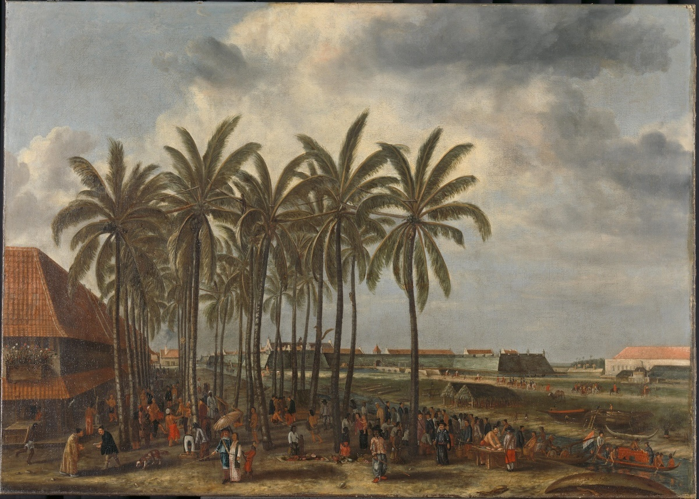
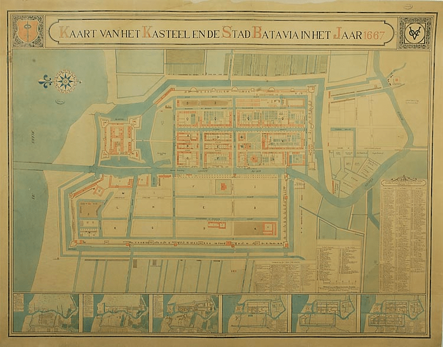
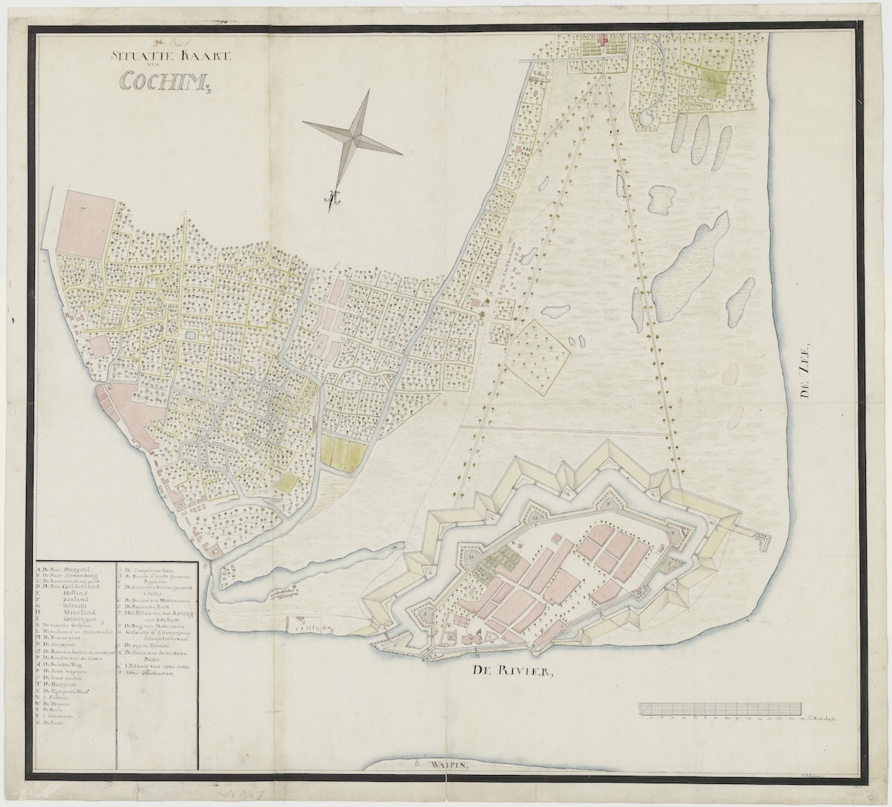
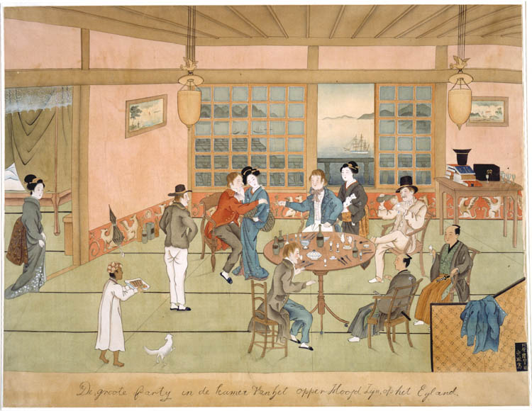

# Closeness at a Distance? The Port Town Paradox

> **Archived blog post.** This post was originally published on the Globalise project website on 25 October 2024 ([original URL](https://globalise.huygens.knaw.nl/closeness-at-a-distance-the-port-town-paradox/)). The text is reproduced without changes; links to other blog posts now point to their archived copies, and other links may no longer work.

**About the author:** Marc Widmer, a graduate in Global History from the Free University of Berlin and the Humboldt University of Berlin, interned with the Globalise project in September 2023 and helped to create the dataset on places.

<!-- Bio source: Introduction to the blog post itself -->

---

> *Marc Widmer has recently graduated from the Free University of Berlin and the Humboldt University of Berlin with a master’s degree in Global History. His studies focus on urban history, early colonialism, and the Indian Ocean and East Asia. He interned with the GLOBALISE project in September 2023 and was involved in the co-creation of the dataset on places.* In this post, Marc shares insights from his thesis and explains how he utilized the GLOBALISE project’s transcription viewer to support his research.

How can social solidarity thrive in highly mobile, culturally diverse, yet ethnically segregated societies? Port cities, shaped by the constant flux of people due to trade and maritime activity, have long grappled with this challenge. Batavia, the Asian headquarters of the *Vereenigde Oostindische Compagnie* (VOC), is a good example of this social tension. Andries Beeckman’s famous painting *The Castle of Batavia* (c. 1662) portrays a vibrant, multicultural port city where Europeans, Chinese, Indians, and Indonesians engage in lively trade and seemingly coexist harmoniously.

*Andries Beeckman, Batavia Castle (c. 1662), [Rijksmuseum Amsterdam](https://id.rijksmuseum.nl/200108197), license CCO.*

However, this façade of peaceful cosmopolitanism starkly contrasted with the deep ethnic divisions and rigid social hierarchies. As J.J. Bollee reveals in his plan of Batavia (1667), the VOC meticulously designed the city from scratch to enforce and maintain ethnic boundaries. Each community was assigned its neighbourhood, strictly separated from others by walls and canals (see the map below). This juxtaposition of cosmopolitanism and segregation was not unique to Batavia but was a defining characteristic of many port cities across early modern Asia.

*Map of the castle and city of Batavia in the year 1667, Wereldmuseum Amsterdam.\
(Image available on [Het Geheugen](https://resolver.kb.nl/resolve?urn=urn:gvn:KIT01:153129).)*

## **Uncovering Cross-Ethnic Relations in Port Cities**

In my master’s thesis for the M.A. Global History programme in Berlin, I explored the paradoxical dynamics of port towns in greater depth.[1] My research was guided by the question of what factors promoted divisions within these societies and, conversely, what fostered solidarity and intimacy between different communities. To explore this, I analysed the interplay between integration and segregation of migrant communities in the port cities of Kochi[2], Melaka[3] and Nagasaki[4]. The three places are comparable not only in terms of their importance in maritime trade and their ethnically diverse, albeit relatively harmonious population but also because they were home to some of Asia’s earliest and longest-standing European communities. Moreover, since all three cities simultaneously underwent changes of rule accompanied by profound social and structural changes, they are particularly well-suited to examining the impact of urban governance on the segregation process. In a similar manner, the Portuguese and Dutch colonial administrations and the Tokugawa shogunate assigned each subject a specific category and associated rights and duties, erected spatial barriers to separate the different communities, and strictly regulated their mutual interactions. For example, colonial and Japanese officials were particularly eager to restrict sexual relations between Christians and non-Christians. A driving force behind such measures was the need of the rather vulnerable authorities to impose a controllable order on the complex social fabric and to foster a loyal population shielded from the harmful influences of the potentially seditious “others.”

*A.A. Buijskes, Map of Cochim (Kochi) (c. 1790), [NL-HaNA, 4.VEL_0907](https://www.nationaalarchief.nl/onderzoeken/archief/4.VEL/invnr/907/file/NL-HaNA_4.VEL_907?eadID=4.VEL&unitID=907&query=), license CC0.*

While the establishment of ethnic divisions and the enforcement of social distance are central themes in the official reports and legal texts of Melaka, Kochi and Nagasaki, instances of intimacy and solidarity between the different communities were often ignored or dismissed as insignificant by the authorities or simply remained beyond the scope of the official record. Nevertheless, a micro-historical study of individual residents can be an excellent method to uncover cross-ethnic relations and cultural hybridisation. An illustrative example is the wife of Abraham Couperus, the last Dutch governor of Melaka. Contemporary visitors and later historians, observing her exotic behaviour, her Malay attire and most likely her Portuguese-Creole mother tongue, described “Madam Couperus” as anything but Dutch; nevertheless, Catharina Johanna, née Koek, was a member of one of the most influential Dutch families in Melaka. Given the scarcity of female migrants and the necessity of intermarriage between foreign men and local women, cultural differences inevitably began to blur in many port cities over time. Furthermore, trial records from the collections of the Dutch judicial councils in Kochi and Melaka and the Japanese Nagasaki magistrates reveal vividly how personal relationships often bridged the social and spatial boundaries in the cities. For example, Sakuemon, a Japanese day labourer working on Dejima, smuggled his “black” friend, presumably a man from Indonesia serving the VOC, into one of Nagasaki’s notorious brothels, strictly forbidden to non-Japanese men. Likewise, Lumut, an enslaved man from Sumatra, regularly sneaked out of his master’s house, either to spend the night out with Chinese friends in the inns of Melaka Town or with his secret lover in the suburb of Tranquera. These and many other examples suggest that faith, origin, social status and gender often played a more decisive role in shaping personal networks than ethnic designations.

*Kawahara Keiga, The party at the home of the Dutch chief on Deshima (c. 1825), National Maritime Museum, Amsterdam.\
(Image available on [Het Geheugen](https://resolver.kb.nl/resolve?urn=urn:gvn:KONB11:A5219-01).)*

## **Doing Research with the GLOBALISE Transcription Viewer**

It is a well-established fact that the Dutch East India Company archives are a rich source for writing detailed, multifaceted, and diverse histories in Asia. Traders, soldiers, officials, and scholars have left behind countless accounts and images of the places where they served on behalf of the Company. Considering the vast number of historical records held in the National Archives in Den Haag, the transcription viewer from the GLOBALISE project was an indispensable tool for my research. Not only did it enable me to find specific documents in the inventory of *Overgekomen brieven en papieren*, such as censuses, registers or the reports of the governors of Melaka and Kochi, but also to conduct an efficient full-text search for individuals in the entire corpus of more than five million pages. In this way, it was possible to conclude, for example, that the administrative terminology was by no means rigid or consistent, as in the case of the merchant Alexio Cardosa, who is sometimes referred to in the documents as “black” or “native” resident of Melaka, sometimes as “*Maardijker*,”[5] but also simply as “burger.”[6]

Although the transcription viewer is undoubtedly an extremely effective research tool, I encountered certain limitations while using the full-text search to trace individuals in the sources. One major challenge is the inconsistent spelling of names and occasional transcription errors—despite the overall excellent performance of the handwriting-text recognition models—which complicate searches significantly. For instance, the merchant Alexio Cardosa appeared in the records under variations such as “Alesio”, “Cardoso”, or even the misspelling “Alepio.”[7] Additionally, it is not uncommon for individuals to be referenced under multiple names, such as the Sino-Malay merchants Tan Somko and Tjieuw An from Melaka, also known by the aliases Baba Som and Baba Mabok.[8] Another issue arises because identical names can naturally refer to different people, making it difficult to distinguish between individuals. This problem was particularly pronounced in the previous version of the viewer, as it was not possible to narrow the full-text search by temporal or geographical parameters. With the updated version of June 2024, a filter function by inventory number was introduced, which offers some improvement. The entity annotation planned for the final version of the GLOBALISE infrastructure may also resolve some of these issues.

A general limitation of my research lies in the current distribution of VOC archives across multiple locations. While many copies of official documents are preserved in the National Archives in Den Haag, a significant portion of local administrative records fell into British hands following the takeover of Melaka and Kochi around 1795. Crucial registers, such as the records of judicial and ecclesiastical councils—which offer invaluable insights into the daily lives and social relations of the inhabitants—are now scattered across London, Malaysia, and India.[9] Although it is beyond the scope of any single project to include all this archival material, similar future projects could explore the possibility of incorporating these dispersed archives editions to allow historians to research across these. Nonetheless, I am grateful for the hard work that the GLOBALISE team has already done to facilitate access to the valuable and fascinating source material of the *Overgekomen brieven en papieren*, and I look forward to the launch of the GLOBALISE research portal in mid-2026.

------------------------------------------------------------------------

[1] I would like to thank Manjusha Kuruppath and Matthias van Rossum for their support in the planning and realising of my research project.

[2] The port city of Kochi (or Cochin), in the Indian state of Kerala, was an important spice market owing to its strategic location on the pepper-growing Malabar Coast. Around 1500, the Raja of Kochi allowed the Portuguese to build their first fort in Asia just outside the town, which later fell to the VOC in 1662. While Kochi is celebrated as a model of religious tolerance, with Christians, Muslims, Hindus, and Jews coexisting peacefully for centuries, the city was also marked by clear social and spatial divisions between the European fort and the Indian town.

[3] Located on the narrow strait between Malaysia and Sumatra, Melaka (or Malacca) emerged in the 15th century as a key gateway connecting the Indian Ocean, the Indonesian archipelago, and China. Its strategic position attracted successive colonial powers, with the Portuguese seizing control in 1511, followed by the Dutch in 1641. Throughout its history, Melaka has been home to diverse communities from India, China, the Archipelago, and Europe, who traditionally settled in distinct ethnic neighbourhoods from the city’s inception.

[4] Nagasaki, in the far southwest of Japan, rose to prominence following the founding of a colony of Portuguese Jesuits in 1571. Initially a refuge for persecuted Japanese Christians, the settlement developed into a flourishing port city within a few decades. After the suppression of Christianity and the imposition of the Tokugawa shogunate’s policy of “national seclusion” in the early 17th century, Nagasaki remained one of Japan’s few open “windows” to the outside world. Most foreigners were expelled, while the remaining Dutch and Chinese traders were confined to segregated quarters under strict surveillance, isolated from the local population.

[5] The term *Mardijker* refers to a heterogeneous group of liberated and predominantly Christian slaves and their descendants in the Dutch East Indies. Originating primarily from former Portuguese territories, they usually spoke a Portuguese-influenced Creole.

[6] See e.g. NL-HaNA, VOC, 8594, 305; 8595, 608; 8596, 275; 8597, 402, transcription GLOBALISE project (https://globalise.huygens.knaw.nl/), March 2024.

[7] See e.g. NL-HaNA, VOC, 1760, 112; 8597, 402; 8595, 630, transcription GLOBALISE project (https://globalise.huygens.knaw.nl/), March 2024.

[8] See e.g. NL-HaNA, VOC, 3599, 964; 3812, 511; 8660, 61, and 3702, 314; 3734, 250, transcription GLOBALISE project (https://globalise.huygens.knaw.nl/), March 2024.

[9] Parts of the Kochi collection in the Tamil Nadu State Archives, Chennai, India, have recently been scanned and are now accessible at the National Archives in Den Haag.
