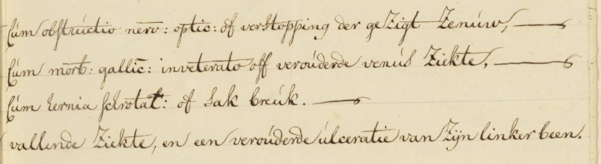
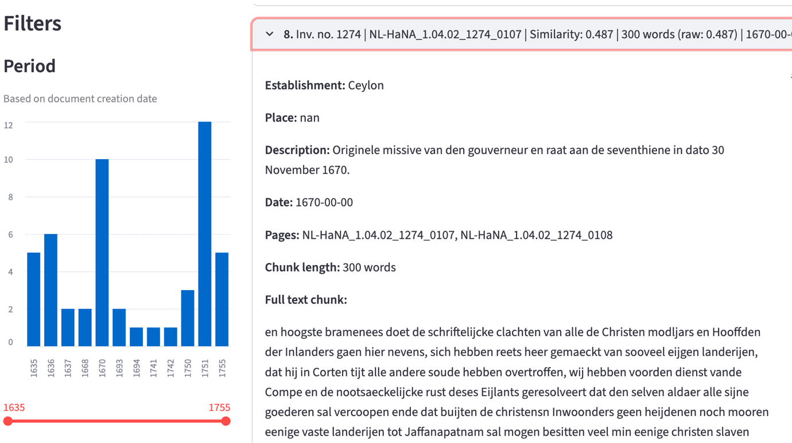
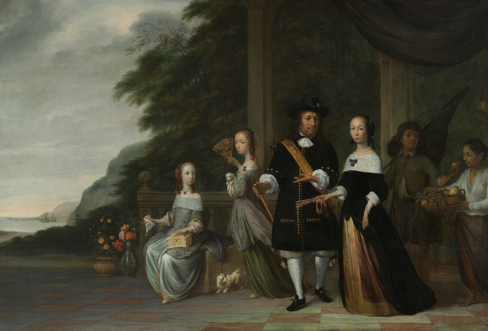

# Digging deeper in the VOC archives, without the right keywords

> **Archived blog post.** This post was originally published on the Globalise project website on 4 February 2026 ([original URL](https://globalise.huygens.knaw.nl/digging-deeper-in-the-voc-archives-without-the-right-keywords/)). The text is reproduced without changes; links to other blog posts now point to their archived copies, and other links may no longer work.

**About the author:** Arlette Verdonk was an intern in the project management and user interaction team of the Globalise project from September 2025 to January 2026.

<!-- Bio source: Former team members list, https://globalise.huygens.knaw.nl/team/ (consulted 2026-10-01) -->

---

Digging out a river along India’s Coromandel Coast in 1719 appears from the archives to have been a poorly thought-out plan: ‘*dog die is van selvs weder opgedroogt, wijlse geen af, of doortogt van boven konde crijgen, om dat ’t Lant aende zeekant hooger is, dan agter*’ (in English: ‘however, it dried up again, as no descent or passage could be obtained from above, because the land at the seaward end is higher than behind it’).[^1] Anyone looking for changes in rivers and harbors influenced by VOC activities will not easily find this passage, simply because the word ‘*rivier*’ (‘river’) appears in 67,355 pages in the GLOBALISE corpus.[^2]

Searching digital archives is usually a matter of coming up with the right keywords and entering them in the correct combination into the search function. The results obtained are the documents in which the keywords appear, with or without the correct context. For example, as described in various [previous blog posts](https://globalise.huygens.knaw.nl/globalise-blog/), you can use the [GLOBALISE Transcription Viewer](https://transcriptions.globalise.huygens.knaw.nl/) to search for people, places, or goods, such as ‘Neeltje Koek’, ‘Chinkiangh’, or ‘silver’. But what if you don’t know the right keywords, yet still have a question you’d like to pose to the archive? For my internship at GLOBALISE, I explored ways to ask these questions using natural language, resulting in an evaluation set that can be used to assess the quality of a future implementation of search functionality that uses AI to find relevant documents.

## Experimenting with natural language search

An accessible way to experiment with a chat function is *ChatGPT.* This tool can read a limited amount of text, so I selected texts that I knew would reveal the desired information. For example, during my search for the presence of women in the archive, I came across the interesting case of sisters-in-law Neeltje Koek and Helena Kackelaar, both widows. I found them in [inventory number 9221 of the VOC archive](https://nationaalarchief.nl/onderzoeken/archief/1.04.02/invnr/9221), containing incoming documents from the Batavia Council of Justice from 1719 to 1726. After compiling the relevant pages, I could use the tool to search through them. The question ‘What can you find about Neeltje Koek and Helena Kackelaar?’ yielded interesting answers, for example that Helena is mentioned as the widow of merchant Jacob de Ladder, that large quantities of *amphioen* (opium) were found in her garden and house, hidden in a cellar under the floor, in dozens of crates (over 40), bearing English marks. Neeltje was found to be an accomplice in subverting the VOC monopoly on the opium trade; she and Helena were exempted from banishment but sentenced to a fine of 8,000 *rijksdaalders*.

Searching with these kinds of chat tools produces lively stories, but not exactly the functionality that GLOBALISE would like to integrate in its search portal. The aim is not to provide descriptive answers, but search results in the form of a list of documents relevant to the question. Using two test versions of an experimental interface, first in the form of a notebook, then as a Streamlit app, I was able to ask a sample of 20 inventory numbers from the VOC archive questions about various topics in modern, natural language. This yielded varying results, from just a few to as many as fifteen relevant documents. For example, the question ‘which diseases are mentioned?’ yielded relevant references to scans, containing mentions of illnesses such as ‘*poraal vallende ziekte*’ (poral episodic disease) and ‘*cum obstructio nerv: optic*’.[^3]

*Page from *missive* from Ceylon, 27 November 1751. [Nationaal Archief](https://www.nationaalarchief.nl/onderzoeken/archief/1.04.02/invnr/2775/file/NL-HaNA_1.04.02_2775_0536?eadID=1.04.02&unitID=2775&query=) CC0.*

This topic unfortunately did not yield much, while questions about religion did. The question ‘what were the consequences of Dutch religion on the native population?’ yielded a larger number of relevant documents, with some confronting descriptions, such as: ‘*wij hebben voor den dienst vande Compe en de nootsaeckelijcke rust deses Eijlants geresolveert dat den selven aldaer alle sijne goederen sal vercoopen ende dat buijten de christensn Inwoonders geen heijdenen noch mooren eenige vaste landerijen tot Jaffanapatnam sal mogen besitten*’ (‘We have resolved, for the benefit of the Comp and the necessary peace of this Island, that he will sell all his goods there and that, besides the Christian inhabitants, no pagans or Moors will be allowed to possess any lands in Jaffanapatnam’).[^4] The results so far were positive, but a parallel keyword search in the same 20 inventory numbers revealed that the tool failed to find several relevant documents. One result for the question ‘What was the influence of rain on the pepper trade?’ is ‘*en door de Continueerende regen vrees ik een slegt gewas van dien Corl, want ken onmogelijk droog werden, en sal aan de ranken moeten rotten, wanneer het drooge weir niet spoedig een begin neemt*’ (‘and due to the continuing rain, I fear a poor crop for that Corn, because it cannot possibly become dry, and will rot on the vines if the dry weather doesn’t begin soon’).[^5] Missing from the results, however, is a page containing the line ‘*staende de peper thuijn die door droogte, en te weijnig water op de bank voor de revier int laden der peper, werd tegen gehouden*’ (‘standing pepper garden which was prevented from loading the pepper by drought and too little water on the bank in front of the river’).[^6] It is clear that the embeddings model behind the experimental app, [OpenAI’s ‘text-embedding-3-large’](https://platform.openai.com/docs/models/text-embedding-3-large), was unable to capture all the meaning of the VOC documents. A future implementation will hopefully perform better.

*Screenshot from the experimental *VOC Natural Language Search Explorer**

Further study is also needed on the presence of women in different contexts. During my querying experiments, I was interested in finding women whose professions were listed. A modest list emerged, with professions including ‘*vroedvrouw*’ (‘midwife’), ‘*binnenmoeder weeshuis*’ (‘orphanage housekeeper’), ‘*bakster*’ (‘baker’), ‘*Chinese koopvrouw*’ (‘female Chinese merchant’), ‘*dienaressen van het huis*’ (‘housemaids’), ‘*gezaghebster/regente/moeder van het Vrouwentuchthuis*’ (‘authority/regent/mother of the Women’s Correctional Center’), and ‘*dansmeid*’ (‘dancing girl’). Women primarily appear in terms such as, unsurprisingly, ‘*vrouw*’ (woman’), but also ‘weduwe’ (widow’), ‘*moeder*’ (mother’), ‘slavin’ (female slave**’**) or ‘inlandse’ (‘native woman’). They appear on lists of people or are mentioned as ‘*vrouw van*’ (‘wife of’), ‘*weduwe van*’ (‘*widow of*’) or ‘*slavin van*’ (‘female slave of’). Topics like these require looking beyond the most common terms, which in turn yields new clues. For example, ‘*huijsvrouw*’ (‘housewife’), ‘*vrouwpersonen*’ (‘female persons’), ‘*vrijvrouw*’ (‘freewoman’), ‘*wees/schoon/stief/grootmoeder*’, (‘orphan/in-law/stepmother/grandmother’), ‘*juffrouw*’ (‘miss’),‘*meijsjes*’ (‘maidens’), ‘*suster*’ (‘sister’), ‘*dogter*’ (‘daughter’), ‘*koningin*’ (‘queen’), and ‘*princes*’ (‘princess’) are terms found in all sorts of spelling variations.

Targeted searches like these – where natural language search can help to find the right keywords – reveal that women do appear in the archives and that they played a significant role in the early colonial society. Especially because official texts from the VOC archives primarily report on men, it is important to dig deeper to uncover women’s stories that have long stayed buried within the archives.

*Jacob Coeman, *Pieter Cnoll, Cornelia van Nijenrode, hun dochters en twee tot slaaf gemaakte bedienden*, 1665. [Rijksmuseum Amsterdam](https://id.rijksmuseum.nl/200109190), CC0.*

[^1]: [https://transcriptions.globalise.huygens.knaw.nl/detail/urn:globalise:NL-HaNA_1.04.02_8834_0451](https://transcriptions.globalise.huygens.knaw.nl/detail/urn:globalise:NL-HaNA_1.04.02_8834_0451)
[^2]: [https://transcriptions.globalise.huygens.knaw.nl/?query\[fullText\]=rivier](https://transcriptions.globalise.huygens.knaw.nl/?query%5BfullText%5D=rivier)
[^3]: [https://transcriptions.globalise.huygens.knaw.nl/detail/urn:globalise:NL-HaNA_1.04.02_2775_0537](https://transcriptions.globalise.huygens.knaw.nl/detail/urn:globalise:NL-HaNA_1.04.02_2775_0537)
[^4]: [https://transcriptions.globalise.huygens.knaw.nl/detail/urn:globalise:NL-HaNA_1.04.02_1274_0107](https://transcriptions.globalise.huygens.knaw.nl/detail/urn:globalise:NL-HaNA_1.04.02_1274_0107)
[^5]: [https://transcriptions.globalise.huygens.knaw.nl/detail/urn:globalise:NL-HaNA_1.04.02_8276_0109](https://transcriptions.globalise.huygens.knaw.nl/detail/urn:globalise:NL-HaNA_1.04.02_8276_0109)
[^6]: [https://transcriptions.globalise.huygens.knaw.nl/detail/urn:globalise:NL-HaNA_1.04.02_1539_0604](https://transcriptions.globalise.huygens.knaw.nl/detail/urn:globalise:NL-HaNA_1.04.02_1539_0604)
