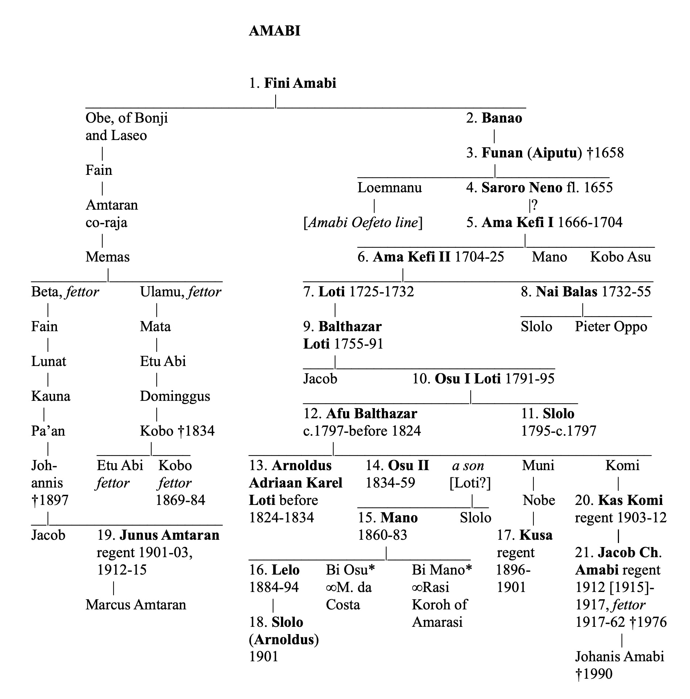

# Documenting the Indonesian princely states

> **Archived blog post.** This post was originally published on the Globalise project website on 21 April 2026 ([original URL](https://globalise.huygens.knaw.nl/documenting-the-indonesian-princely-states/)). The text is reproduced without changes; links to other blog posts now point to their archived copies, and other links may no longer work.

**About the author:** Hans Hägerdal, a member of the Globalise advisory board, is Professor in History at Linnaeus University, Sweden, and has published widely on colonial encounters in Southeast Asia, the history of slavery and early European–Asian diplomacy.

<!-- Bio source: Introduction to the blog post itself; advisory board list on https://globalise.huygens.knaw.nl/governance/ -->

---

> Hans Hägerdal is a Professor in History at Linnaeus University, Sweden. He has published extensively about Orientalism, colonial encounters in Southeast Asia, the history of slavery, and early European-Asian diplomacy. In this blog post, he introduces the Kerajaan2 Indonesia dataset, which is published and can be accessed through the [Globalise dataverse](https://doi.org/10.34894/CBO80N). An earlier version of the Kerajaan2 Indonesia dataset was the principal source for the [GLOBALISE polities dataset](https://doi.org/10.34894/SIAUPO).

While modern Southeast Asian states such as Thailand, Burma (Myanmar) and Vietnam are keen to claim a historical continuity with premodern kingdoms, this is problematic in the case of Indonesia. The sprawling nation of 17,000 islands is basically a successor of the Dutch Colonial State that was forged through warfare and intimidation in the 19th and early 20th centuries. While the Majapahit Kingdom (1293-c. 1520) may have enjoyed a brief hegemony over various parts of the archipelago, the history of Indonesia – a term itself coined in the mid-19th century – is rather characterized by political dispersion. Many hundreds of larger and smaller kingdoms dotted the islands up to relatively modern times, while large areas were basically stateless until the encroachment of Dutch colonialism.

While the Dutch authorities abolished some kingdoms deemed to impede colonial governance, such as Aceh, Palembang and Banjarmasin, the bulk of them continued to exist as *zelfbesturende landschappen* (self-ruling territories) under colonial supervision. Especially, the Central Javanese kingdoms Yogyakarta and Surakarta enjoyed a role as cultural nexuses and specimens of refined court culture. Other *landschappen* were very small, perhaps consisting of a settlement with hinterland, but still recognized by the Dutch colonial apparatus via formalized contracts and declarations. Examples of these were the small Batak states in North Sumatra and the domains of the Solor and Alor Islands. Tiny as they may have seemed, they often had a history that encompassed many centuries.

*The Indonesian rulers were sometimes surrounded by expensive pomp and circumstances but could also have a more frugal appearance. This photo shows the Raja of Timu on Savu Island, Ama Piga Jara (1869-1910) and his family.  \
Unknown author, De Radja van Timoe Ama Piga Djara met zijn gezin, Sawoe (TMnr 10006076). Collectie Wereldmuseum, *[Wikimedia Commons](https://commons.wikimedia.org/wiki/File:COLLECTIE_TROPENMUSEUM_De_Radja_van_Timoe_Ama_Piga_Djara_met_zijn_gezin_Sawoe_TMnr_10006076.jpg).* License: CC-BY-SA 3.0.*

The Dutch Colonial State frequently intervened by supposedly rationalizing the political landscape. Smaller polities were often merged to make for larger units, even if this meant disregarding cultural or religious affiliations. Thus, the nineteen domains of Rote Island were merged into one in the early 20th century, while the Catholic Raja of Larantuka on Flores suddenly found himself the headman of traditionally hostile Muslim territories. With all these reshufflings, there were still hundreds of *zelfbesturende landschappen* when Indonesia gained independence in 1949. The traditional elites, often cooperative with the Dutch, were not popular with the Indonesian Republicans, and dynastic rule was phased out in the years up to 1962. Only Yogyakarta, whose sultan had sided with the Republicans during the Indonesian Revolution, retained a special status that has persisted until today.

The dataset *Kerajaan2 Indonesia* gathers the available data about the Indonesian princely states in the form of genealogies and order of succession. The Malay and Indonesian term *kerajaan* means kingdom, or more exactly ‘the state of having a king’, while plural forms of substantives are indicated in the Indonesian language by doubling them (written out as -2). The dataset covers kingdoms from earliest times, such as Sriwijaya, Pasai and Majapahit as far as they are known; however, the bulk of the kingdoms for which we have information flourished in the last four-five centuries. Materials for the compilation were found in archival sources available at, among other places, the [Dutch National Archives](https://nationaalarchief.nl/) in the Hague, and the [KITLV](https://www.kitlv.nl/) in Leiden. Dutch colonial officials needed information about the elites they tried to control, and we therefore find much information about names and successions, both in the VOC records available via GLOBALISE and later reports and memorandums. The years since the fall of Soeharto in 1998 have also seen an increasing interest for local history, leading to an upsurge of studies based on locally obtained information. This material, critically scrutinized, has been used for the dataset.

*Page from a genealogy available in the VOC archives of Cheribon in the document titled “Memorie left behind by the Senior Merchant and Former Sahbander of Batavia, Robert Hendrik Armenault, outgoing Resident of this Comptoir, left behind for his successor the merchant titular Evert Jan van Nieuwkerken named Nijvenheim”, dated 31st August 1771.\
[NL-HaNA, VOC, 3309, 0733](https://transcriptions.globalise.huygens.knaw.nl/detail/urn:globalise:NL-HaNA_1.04.02_3309_0733), transcription [GLOBALISE project](https://globalise.huygens.knaw.nl/), March 2024. License: CC0.*

Documentation of all these states varies enormously. While the Sultans of Ternate in the Moluccas can be followed in great detail since 1500 via European and indigenous sources, many kingdoms can only be traced from local pedigrees up to the late 19th century. Many rulers cannot be exactly dated since the preservation of exact dates was simply not practiced by the chroniclers, whose concern was rather the genealogical continuity. Often, one must strike a delicate balance between indigenous and Dutch sources when tracing the kingdoms, noting the differences as well as similarities. For example, royal pedigrees preserved on Timor are often widely different from information found in Dutch reports, and the indigenous dates of the Aceh sultans are sometimes at variance with European and epigraphic dates. While there will always remain debatable points, it is hoped that the present dataset can serve as a useful tool for those working in the field of Indonesian political and diplomatic history.

*Genealogical Table of the polity Amabi (Timor) from the Kerajaan2 Indonesia Dataset.\
Hans Hägerdal, 2026, “Kerajaan2 Indonesia”, <https://doi.org/10.34894/CBO80N>, DataverseNL, V3, p. 17.*
