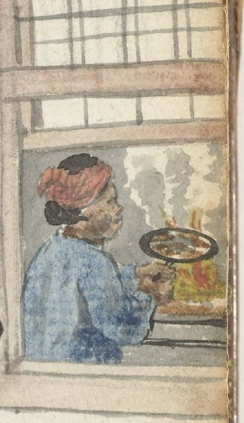
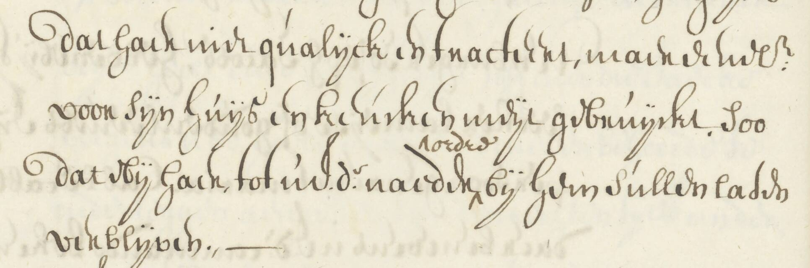
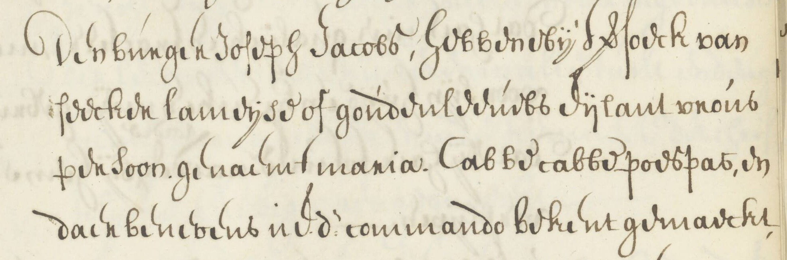
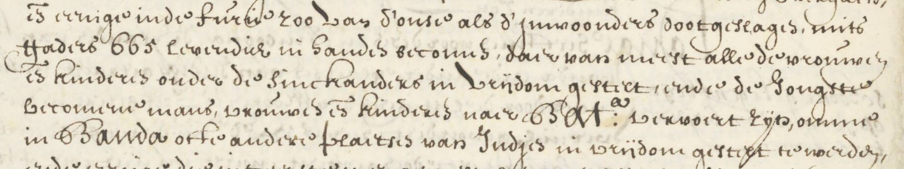
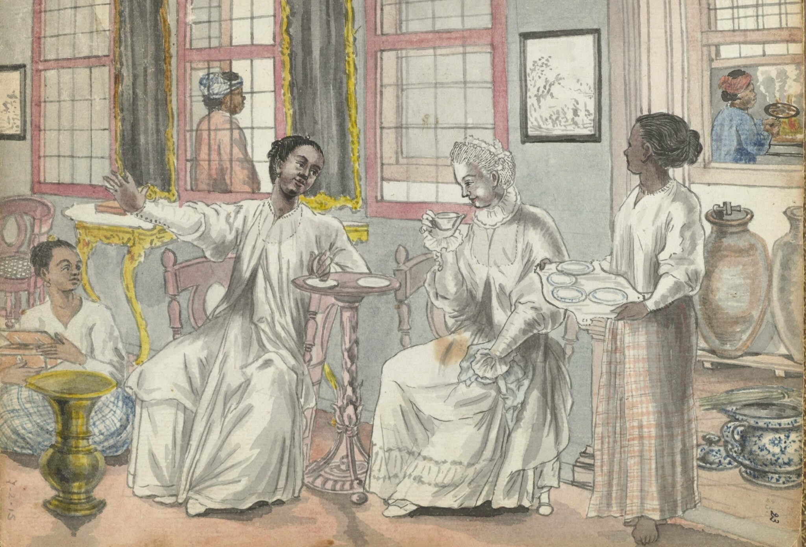

# Echoes of genocidal erasure: a reflection on historical ‘voices’ and digital infrastructure for colonial archives

> **Archived blog post.** This post was originally published on the Globalise project website on 19 December 2025 ([original URL](https://globalise.huygens.knaw.nl/echoes-of-genocidal-erasure-a-reflection-on-historical-voices-and-digital-infrastructure-for-colonial-archives/)). The text is reproduced without changes; links to other blog posts now point to their archived copies, and other links may no longer work.

**About the author:** Matthias van Rossum, project leader of Globalise, is Senior Researcher at the International Institute of Social History in Amsterdam and Professor of Global Histories of Labour and Colonialism at Radboud University, Nijmegen.

<!-- Bio source: Introduction to the blog post itself; team page -->

---

> [Matthias van Rossum](https://iisg.amsterdam/en/about/staff/matthias-van-rossum) is Senior Researcher at the International Institute of Social History, Amsterdam and Professor of *Global Histories of Labour and Colonialism* at Radboud University, Nijmegen. Project leader (PI) of [GLOBALISE](https://globalise.huygens.knaw.nl/), [Voices of Resistance](https://voices.iisg.nl/projects/voices-of-resistance/) and [Resisting Enslavement](https://voices.iisg.nl/projects/about-the-project/).[^1]

## **The voice of Maria?**

The fog of colonial history has obscured many marginalized voices that deserve to be heard. Yet sometimes, if we read carefully, such voices scream to us from the pages of the colonial archive. Although exact words may have been lost, the motions of the archive can still reflect the bravery and the voices of people whose actions would otherwise have gone unnoticed.

The actions of one woman present such a case of archival traces that reveal her strive for freedom. In the archive she appears derogatorily named as ‘Maria Cabbecabbe Poespas’. For lack of any archival references to her original name(s), we will call her here by this given name, Maria.

*A woman cooking in a European house in Batavia, likely an enslaved person.* *Detail from the sketchbook of Jan Brandes, dl. 2 (1808), p. 23.* Collection of Rijksmuseum, [NG-1985-7-2-15](https://id.rijksmuseum.nl/200242630). Public domain.

A hasty reader could easily have glossed over her silenced voice and the horrifying history behind it. We encounter Maria only in a copy letter book of the Dutch East India Company (VOC) colony of the Banda Islands. In a specific report (*missive*) from Banda to Batavia in 1654, the Banda governor Abraham Weijns mentions Maria in a summary to his superiors of what he communicated to her ‘owner’.

We can find this slave master, Joseph Jacobs, frequently in the archive. He recurs, for example, in [household registers](https://transcriptions.globalise.huygens.knaw.nl/detail/urn:globalise:NL-HaNA_1.04.02_1205_0940) of 1654, which list all heads of households and the persons belonging to this household in order to describe ‘the souls living in entire of Banda’. He was categorized as an ‘inland’ (non-European) burgher, and mentioned as living in Selamon (Pulau Banda Besar) while [owning 38 enslaved persons](https://transcriptions.globalise.huygens.knaw.nl/detail/urn:globalise:NL-HaNA_1.04.02_1205_0941). Given the high number of enslaved it is likely he was a planter. He was also [active in local trade](https://transcriptions.globalise.huygens.knaw.nl/detail/urn:globalise:NL-HaNA_1.04.02_1199_1039) and was not hesitant to use such voyages to transport the captured runaway slaves of other burghers back to Banda for their punishment by the Court of Justice of the VOC.

It is the voice of this slave owning-planter and burgher that we see reflected in these sources. The governor explains in the summary that he ruled that Maria should not be granted her freedom. He explicitly follows, and almost seems to cite, [the reasoning of Joseph Jacobs](https://transcriptions.globalise.huygens.knaw.nl/detail/urn:globalise:NL-HaNA_1.04.02_1205_0750) that ‘he had not treated her badly, but only used her for \[services in\] his house and as a kitchen maid’ (see the above image). And even more so that ‘he had bought her, and that as such \[he\] would not like to place the mentioned woman in freedom’.

But even though the records echo the perspectives of a governor and planter, it is crucial to note that these procedures and their archival traces had been set in motion solely because of the *actions* of Maria herself. It was she who had first asked for her freedom.

The missive seems to suggest that Maria had done so not via her owner, but by directly approaching the governor or his clerks. The summary of the governor thus [notes](https://transcriptions.globalise.huygens.knaw.nl/detail/urn:globalise:NL-HaNA_1.04.02_1205_0749) that ‘we have made known \[to the burgher Joseph Jacobs\] *the request of a certain Lamey or Golden Lion Island woman*, called Maria Cabbecabbe Poespas, and also have made known Your Honourable directions.’ It is unclear whether she had written a request or visited a servant of the governor in person. But it is clear that this request of Maria – unfortunately lost in the fog of colonial history – stood at the beginning of the investigation, the reporting and the ruling of the governor through which we learn parts of her life story today.

## **Afterlives of a genocide**

So, what can we learn about Maria? Who was she, and what was the context of her formal request for her freedom?

Although her voice and actions remain implicit in the copy letter book of the Banda governor, the colonial archive does provide a wealth of information that can be pieced together, especially by combining the new search possibilities enabled by large-scale (automated) transcriptions with a critical reading of the sources.

We learn from the copy letter book that Maria was born on the island of Lamey or Liuqiu, a small island off the coast of Taiwan. We also learn that, according to Jacobs and the Banda authorities, she was now considered to be enslaved (‘als lijfeijgen woonachtig is’) and living in the household of this Banda burgher. According to her owner, she served as a kitchen maid in his household. In fact, the name she was called, ‘Maria Cabbecabbe Poespas’,  seems to refer to her status as cook. Cabbecabbe could refer to ‘[gaba-gaba](https://www.cortsfoundation.org/pdf/COENV7.pdf)’, derivatives of sago palm leaves. [Sago starch](https://expatliving.sg/sago-cooking-with-asian-ingredients-at-home/) is still commonly used as a thickening substance in cooking. The word Poespas refers to a mishmash or hotchpotch dish, but is also used to indicate that the content of that dish could be uncertain. Maria’s added names would in that case be [derogatory](file:///C:/Users/MatthiasR/AppData/Local/Microsoft/Windows/INetCache/Content.Outlook/WSOBL2OK/(https:/gtb.ivdnt.org/iWDB/search%3factie=article&wdb=WNT&id=M054981&lemma=poespas&domein=0&conc=true).

What more can we learn from the colonial archives? The document in which Maria is introduced already testified how she had been sold three times. The information on these transactions is included in the missive, because it supported the ownership claim of Joseph Jacobs over Maria. And because it provided support to his argument that freeing her would infringe on his property rights. The prices that were paid for Maria figure prominently in the missive. We learn from this account of serial transactions that she had been sold by public auction in 1641 after the death of the burgher Daniel Kaijl. Earlier, in the year 1636, she had been brought from Batavia to Banda by Jan Sijmonsz, who would later become the governor of Banda. This Jan Sijmonsz, it was mentioned, had bought Maria and her brother in the same year from the Dutch East India Company (VOC).

This specific year, 1636, was not a coincidence. And neither was the reference to her region of origin – the island of Liuqiu, near Taiwan, which was by the VOC referred to as Lamey or Golden Lion Island. None of this was coincidence, as it was exactly the people on this island who were subjected to violent conquest, genocide and deportation by the VOC in 1636.

## **Foundations of historiography and gamechangers to research practice**

What we know about this genocidal conquest is to a large extent influenced by the structure of the archive, as well as by efforts of earlier generations of academics to organize access to it. Most of our knowledge thus comes from the very brief but telling references in the published source series that has long dominated traditional historiography, the [*Dagregisters van Zeelandia*](https://resources.huygens.knaw.nl/retroboeken/taiwan/), the [*Generale Missiven*](https://resources.huygens.knaw.nl/retroboeken/generalemissiven/), and the [*Dagregisters van Batavia*](https://sejarah-nusantara.anri.go.id/daily_journals_volumes/). These more formal, top-down source series tell us that of the approximately 1.200 people on the island, more than 400 were killed ‘in the fury and by weapons \[or\] killed themselves out of desperateness’. Of the survivors, some were sent as slaves to Batavia; others were enslaved and given to inhabitants of Sinkan on Taiwan; 24 were ‘given to households \[on Taiwan\] to be raised in a Dutch manner’. 

We also know about this history from more recent historiography. The events have been reconstructed especially in the work of Leonard Blussé and others, such as [*The Formosan Encounter*](https://books.google.nl/books/about/The_Formosan_Encounter.html?id=2DVWAAAAYAAJ). These studies have based themselves mostly on two specific inventory numbers (inv.nr. 1170, folio 624, and inv.nr. 1134, folio 175-176). And that makes sense, because it was for these inventory numbers that the well-known [TANAP-index](https://docs.globalise.huygens.knaw.nl/tanap/) for the series Copied Letters from Asia (Overgekomen Brieven en Papieren) provided explicit entries that indicated the presence of information on the genocide – the ‘extract from the resolution books concerning the island Lamey or the Lamey Nation’ and ‘several instructions on the island of Lameij’ in 1636.[^2]

The ongoing efforts to create large-scale automated transcriptions of colonial archives produced in projects like [GLOBALISE](https://transcriptions.globalise.huygens.knaw.nl/) and the [ERC project *Voices of Resistance*](https://voices.iisg.nl/) provide a very practical but fundamental gamechanger. Earlier historical research was dependent on two potential methods for finding information. Using research aids, like the TANAP-index for the Copied Letters series, or manually inspecting entire sections of the archive in a systematic way. In the first case, the level of detail and the purpose of the index both facilitated and limited what could be found. The TANAP-index was created based on contemporary tables of content that were included in most of bundles of the Copied Letters series. The tables, and thus the index, only provided limited descriptions of short titles, sometimes author, dates and place. The descriptions can be as undefined as ‘a number of letters of Malay merchants’ or ‘missive’ of a local governor, and tend to be catered to the (material) interests of the Company and its ruling elite.

One can imagine that most historians employed methods that flipped this way of working around completely: researchers mostly opted for systematized page-by-page reading of regional or thematic archival series in order to analyze and contextualize the interesting cases and information that surfaced from this process. These labor-intensive methods produced amazing and rich work, both in colonial history as well as in area studies. But these methods lent themselves better to rich descriptions of specific processes of the VOC (shipping, trade, labour recruitment) or regional dynamics (local societies, economic development, specific events), and less for systematic approaches to subaltern and marginal topics.

References to structural colonial violence, marginalized historical individuals, or other themes of interest to present-day historians or communities of origin, are often hidden away or scattered in the archive in ways that are not easily covered by the archival structure or its conventional indexes. The same holds true for transnational networks, everyday processes, cultural frameworks, and more. This is where text recognition comes in. It allows us to find fragments and observations that were sometimes almost impossible to find before.

This in itself is a crucial innovation, and deserves our attention, practically and methodologically. Now, the academic discipline still seems to be too awestruck by the promises of more advanced Digital Humanities methods (network analysis, word embeddings) to analyze and reflect on the silent revolution that underlies it – the fact that it is no longer collections of published source material (mostly newspapers, diplomatic letters, more official document types) that are digitized and text-recognized, but rather [complete archives](https://voices.iisg.nl/sourceslab/), including more everyday level sources and colonial administrations, with high varieties of different and more complex document types as can be found in the early modern colonial archives.

## **‘Placed in freedom’? How the VOC put a humane façade on colonial genocide**

We can now, for example, try to see what uncharted archival finds will surface if we search in text-recognized colonial materials for what happened on Lamey, and even for the marginalized story of Maria. It is because of this text recognition that we can explore fragments in the archive that report on the genocidal depopulation itself, but that are not in specific series covering the administrative region or are preserved under a title that indicate relevant aspects of its content. These are actually the fragments of the reporting that were underlying the accounts of the *Dagregisters* and the *Generale Missiven*. And as such these were often more detailed.

An interesting example are the documents in inventory number 1120. It is one of the hits in a search that combines references to the Liuqiu island (*goude\* AND leeu\**) with references to inhabitants (*inwoon\**) and their eradicaton (*ontbloot\**). In the TANAP-index, one would find only a document referred to as ‘[a missive from Putmans to Antonio van Diemen’](https://transcriptions.globalise.huygens.knaw.nl/detail/urn:globalise:NL-HaNA_1.04.02_1120_0295), a letter from the governor on Formosa to his superior in Batavia. Upon inspection, however, this contains a report on the cruel extermination of the Lamey people.

This report was not produced after the attack on the island, but while it unfolded. It recounts how the conquest was still in progress and that the soldiers were trying to reach the inhabitants of the island who fled into caves and holes. As their commander wrote, the soldiers tried to kill the hiding inhabitants by ‘[starvation, fire, fear or the throwing of grenades until this work was completed by the grace of God](https://transcriptions.globalise.huygens.knaw.nl/detail/urn:globalise:NL-HaNA_1.04.02_1120_0295)’.

In similar fashion, we can find in this bundle information on the Lamey massacre hidden in the [*memorie* (advice) of governor Putmans to his successor](https://transcriptions.globalise.huygens.knaw.nl/detail/urn:globalise:NL-HaNA_1.04.02_1120_0021). Again, the title would not provide any clue, but a lexical search on *ontbloot\** (eradicated) and *lamei\** (Liuqiu island) is sufficient to uncover information on the genocidal atrocities. In his letter, the governor reported that a large share of the inhabitants who survived during the first attacks died out of the harshness, hunger and thirst that was inflicted upon them by the VOC soldiers.

This document, as was not uncommon in the colonial self-fashioning of the Company ruling elite, even (absurdly) portrayed the aftermath of the genocide and deportation as a humane intervention. Putmans reported that the survivors were spread over Taiwan and Batavia, and that in doing so – and I quote his words – ‘placed in freedom’ with the Sinkan people, on Banda and elsewhere.

Later references brought forward even more grotesque claims. The Council of the Indies would not much later decide that the deported Lamey islanders in Batavia would be ‘[given out to well-mannered citizens, on the condition that in addition to cost and clothing they would receive education in the foundations of the Christian religion, that they would be baptized, that each to their own would learn a trade, and that each one of them would be bound to their master for the period of six subsequent years, after which they would be returned to the Company and be placed in freedom.](https://transcriptions.globalise.huygens.knaw.nl/detail/urn:globalise:NL-HaNA_1.04.02_1122_0450)’

## **In search of Maria**

This was not the case, as we learn from the story of Maria, as well as other references in the colonial archive. Putmans mentioned in his missive that of the first groups of deported islanders ‘[the women and children were placed in freedom under the Sincanders](https://transcriptions.globalise.huygens.knaw.nl/detail/urn:globalise:NL-HaNA_1.04.02_1120_0021)’, a community on Taiwan that was allied to the Company. But it seems more likely that the Lamey people were the price of war, given away as captives as a reward for the Sincander military support. Elsewhere in the Company records, it is therefore mentioned that these first waves of deported Lamey people were ‘[distributed in Sincan under the inhabitants](https://transcriptions.globalise.huygens.knaw.nl/detail/urn:globalise:NL-HaNA_1.04.02_1120_0357)’.

It is likely that Maria was not amongst these first groups, but part of the second wave of deported Lamey people, because these were the groups that were transported to Batavia after they ‘[had been captured by violence](https://transcriptions.globalise.huygens.knaw.nl/detail/urn:globalise:NL-HaNA_1.04.02_1120_0021)’. This would mean that Maria experienced herself the most extreme genocidal atrocities inflicted upon the remaining population, as referred to in the report that reached Putmans during the attacks. Their suffering did not end in Batavia. It was reported by the ‘[overseers of the slaves \[in Batavia\] that of the Lamey people who were recently sent from Formosa many are dying](https://transcriptions.globalise.huygens.knaw.nl/detail/urn:globalise:NL-HaNA_1.04.02_1122_0450)’. It was in this context, that Maria was taken to Banda by Sijmonsz, as one of the surviving enslaved captives from Lamey that were distributed in Batavia to burghers and Company employees. Once in Banda, she was sold, and sold, and sold again.

Was this the context to which she herself referred, eighteen years later, when she requested her freedom? Was she aware that the ‘humane façade’ that the Company erected after the genocide and deportation of the Lamey people could in fact provide a formal ground to fight her enslavement?

After all, the six years of service had long passed. So even according to the Company’s own rulings, Maria should have been free for twelve years. That this had not happened is actually not that strange for two reasons. Firstly, the ‘humane façade’ dressed up by the Council of the Indies after its genocide, namely the policy of ‘civilizing’ and in time ‘freeing’ the conquered Lamey, was likely never intended to be enforced as a practice. Secondly, in the context of commodified (or ‘colonial’) slavery – in which enslaved individuals like Maria could be sold and resold – the background and conditions of enslavement of individuals, including the possibilities to be freed, were easily erased. The case of Maria actually demonstrates [how different regimes of enslavement fed into each other](https://doi.org/10.1017/S0010417521000153). It was Maria herself who, with her request for freedom, challenged a *status quo* that would have otherwise perpetuated her enslavement.

*From the sketchbook of Jan Brandes, dl. 2 (1808), p. 23.* Collection of Rijksmuseum, [NG-1985-7-2-15](https://id.rijksmuseum.nl/200242630). Public domain.

## **Afterthoughts – new worlds of research**

The documents in the VOC archive thus provide a lens not only on the colonial expansion of the Dutch East India Company, but on world history, on the impact of the VOC on local societies, the interaction between the local and the global. Especially the administration of the VOC in Asia, as survived in the ‘copied letters’ series made available by [GLOBALISE](https://transcriptions.globalise.huygens.knaw.nl/) and the local archives from India, Sri Lanka, and elsewhere made available by the IISH-project [*Voices of Resistance*](https://voices.iisg.nl/), provide access to a myriad of documents that plunge the reader into a multiplicity of moments and contexts. These archives confront the reader with colonial administrative abstractions, as well as everyday situations, that might at times be difficult to grasp, and need deep contextualization, but together make up a contentious treasure trove for the writing of colonial, global *and* local histories that is as rich as it is blood-soaked.

The story of the brave ‘Maria Cabbecabbe Poespas’ – whose real name we unfortunately do not know – can teach us several things.

The value of large-scale automated transcriptions (handwritten text recognition) is not just about finding new, previously unknown historic events, big or small, as if nothing has been done before. Existing historic knowledge, in source publications and historiography has excavated a vast  terrain. But it often had to do so by finding documents in places where one might expect information on events or developments given their place and time, and likely locations in the archive.

Of course, the increased text recognition of colonial archives will lead to new finds, while conventional research is certainly made easier, faster and more effective in many ways. But it is crucial to stress that the value of text recognition lies just as much in an increased ability to trace the unexpected. Tracing the *afterlives* of events such as that of the Lamey genocide, for example. And tracing survivors such as the enslaved woman from Lamey *beyond* what the inventory or earlier research indexes would have allowed us to do. That is what holds the true potential value of text recognition. This comes in play not only for research on histories of slavery, migration or colonial violence, but also on other terrains, such as that of histories of environment, religion, disease, and more.

It fits with other lessons that the [GLOBALISE](https://transcriptions.globalise.huygens.knaw.nl/) and [*Voices of Resistance*](https://voices.iisg.nl/) projects take to heart. One is that text recognition is crucial not only for finding things unknown (new events or unexplored afterlives), but also because it can and should facilitate *re-interpretation*. The lesson that the story of Maria tells us is that going back to the sources, making them available in better and new ways, is especially relevant as it makes us look and understand anew the genocidal episodes of Dutch history that have for too long remained unexplored.

And such ongoing reinterpretation is necessary because of the long-lasting disregard of the colonial, expansionist and inherent violent character of the Dutch East India Company. This has led not only to a skewed and still persisting image of Dutch colonialism, but has also limited the understanding of its deep and long-term impact on societies across the globe. Traditional historiography has echoed perspectives on the VOC as a ‘merchant’, instead of the war machine and exploitative colonial power that it was. Making these sources available in new and better ways can thus facilitate further research and especially re-interpretation – not only of specific source material, but also of existing bodies of knowledge, lingering assumptions and their historic and even societal implications. 

And Maria? She seems to have continued her fight for freedom. Initially denied her request to be freed, a document in 1658 refers to [the ‘order’ to free ‘Maria Kabbekabbes Daughter’](https://transcriptions.globalise.huygens.knaw.nl/detail/urn:globalise:NL-HaNA_1.04.02_1221_0628) . It seems likely that this was the exact same woman who was earlier referred to as ‘Maria Cabbecabbe Poespas’, because it was accompanied with a reference to the confirmation that Joseph Jacobs was willing to accept the ruling to set her free. It was mentioned that he would seek his ‘guarantuee’ (or: financial compensation) with the heirs of the diseased previous owner Daniel Keijl. It is difficult to call this justice after a long history of genocide, displacement and enslavement, but it was certainly a victory for Maria.

------------------------------------------------------------------------

*This blog appears simultaneously on the website [voices.iisg.nl](https://voices.iisg.nl/blog-echoes-of-genocidal-erasure)*

[^1]: *Thanks to Pascal Konings and students at the Radboud University Nijmegen for commenting on this text.*
[^2]: Extract uijt de resolutieboucken des Casteels Zeelandia rakende ’t eijlant Lameij ofte de Lameijsche natie, waerinne aengewesen wert, ’t gene sedert den 2 Junij 1636 ten tijde van den heer gouverneur Putmans tot 27 Februarij 1645 in rade van Formosa daerover besloten is. Inv.nr. 1170, 581. Copie verscheijde instructien raeckende het eijlant Lameij sedert 19 April 1636 tot 15 Maij 1639. Inv.nr. 1170, 628.
