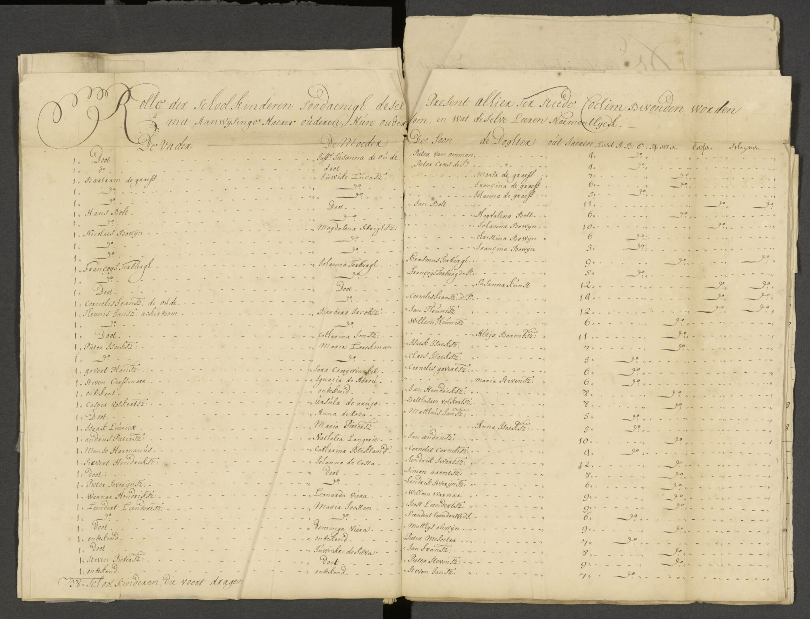
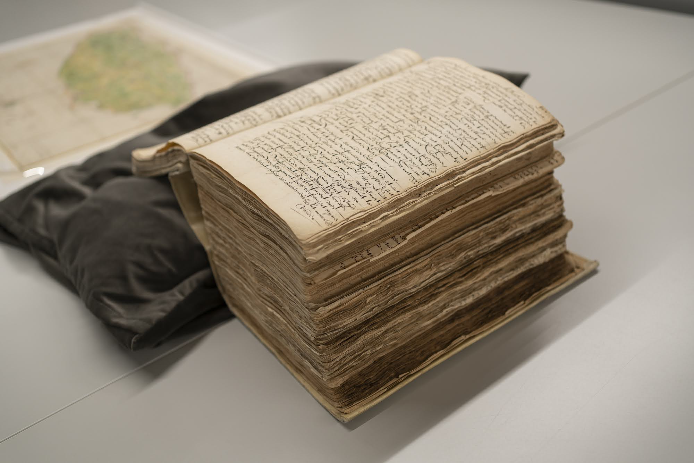
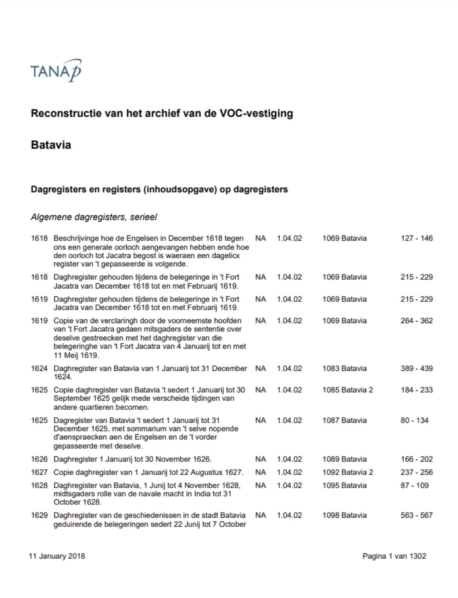
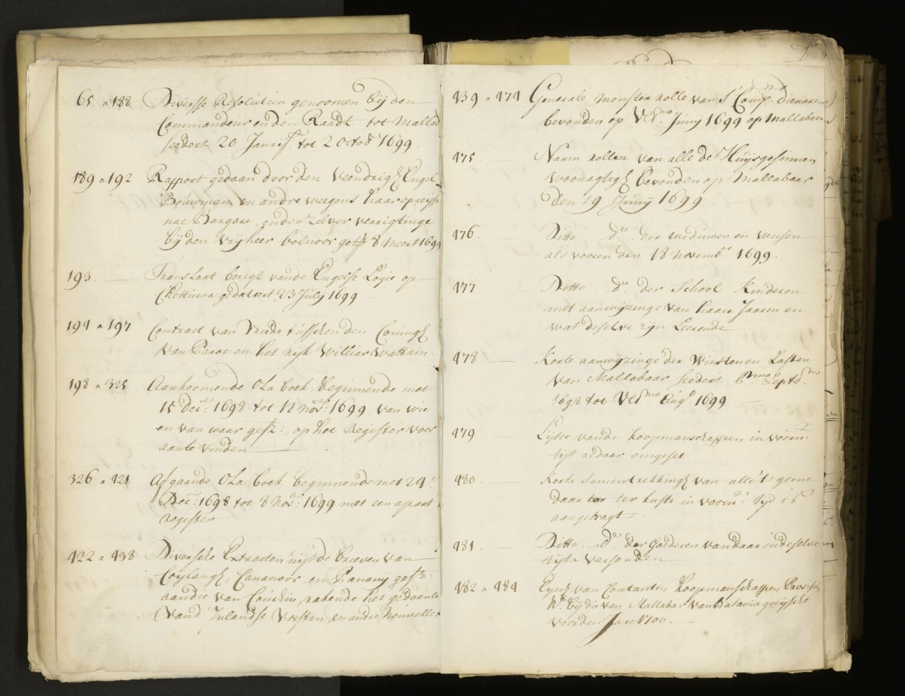

# From ABC to VOC Volume: Utilizing Traditional Finding Aids for the GLOBALISE Infrastructure

> **Archived blog post.** This post was originally published on the Globalise project website on 20 June 2024 ([original URL](https://globalise.huygens.knaw.nl/from-abc-to-voc-volume-utilizing-traditional-finding-aids-for-the-globalise-infrastructure/)). The text is reproduced without changes; links to other blog posts now point to their archived copies, and other links may no longer work.

**About the author:** Renate Smit was an intern and student assistant in the historical contextualisation team of the Globalise project from September 2023 to August 2025.

<!-- Bio source: Former team members list, https://globalise.huygens.knaw.nl/team/ (consulted 2026-10-01) -->

---

In June of 1699, seven-year-old Maria de Graeff attended school in the town of Cochin (present-day Kochi) on the southwest coast of India, together with her two sisters Francina and Johanna. Just like her peers, she was learning how to spell after learning her ABCs. Her father, Bartram de Graeff, was most likely employed by the Dutch East India Company (VOC), as were the parents of the other 54 children who attended the same school. All this information can be found in a document titled *[Rolle der schoolkinderen soodaenigh deses present alhier ter steede Cochim bevonden met aanwijsinge haerer ouderen, hun ouderdom, en wat deselve leeren](https://www.nationaalarchief.nl/onderzoeken/archief/1.04.02/invnr/1619/file/NL-HaNA_1.04.02_1619_0528)* in the VOC archives. It was sent from the VOC establishment that Cochin was a part of, Malabar, to Batavia. There, it was copied and bundled together with other documents they received from the same location and sent to the company’s Amsterdam chamber.

**Rolle der schoolkinderen soodaenigh deses present alhier ter steede Cochim bevonden met aanwijsinge haerer ouderen, hun ouderdom, en wat deselve leeren*. [Nationaal Archief](https://www.nationaalarchief.nl/onderzoeken/archief/1.04.02/invnr/1619/file/NL-HaNA_1.04.02_1619_0528), CC0.*

This practice resulted in the creation of thousands of thick volumes which we now know as the [*Overgekomen brieven en papieren* (Received Letters and Papers, OBP)](https://globalise.huygens.knaw.nl/source-corpus/): the series that GLOBALISE aims to make more accessible. It comprises many documents whose contents vary greatly. There are, for example, the General Missives: summary reports the central administration in Batavia sent to the board of the VOC (The Gentlemen Seventeen). Other documents include daily journals that describe on a day-to-day basis all important events regarding a specific establishment, or resolutions taken by local councils. You will also find a wide array of letters that were, for example, sent between the establishments and between establishments and local rulers. Many documents also show other sides to the VOC beyond that of trade and correspondence, like the list of schoolchildren mentioned above, and that you may not expect to find in the company’s archive. All of these documents together offer a rich source of information for researching the early modern world.

**A volume from the Overgekomen Brieven en Papieren series in the VOC archives*. Photo Dave Straatmeyer.*

As a part of making the OBP series more accessible, the GLOBALISE project aims to allow users to find individual documents more easily. One way of doing this is to enhance the page scans of the OBP series with additional information, which will enable users to search for documents based on this metadata and understand their original context. In the case of the list of schoolchildren, for example, this could be the year (1699) and the location where it was created (Cochin). To find this information manually for every document is not feasible. Therefore, GLOBALISE is looking into how document boundaries and classification can be established in computer-readable form for the entire corpus. The reusing of traditional finding aids plays an instrumental role in this. The most important are the indices to the OBP created by the TANAP (Towards a New Age of Partnership) project: a collaboration between different archival institutions, including the Dutch National Archives, and universities between 2000 and 2007.

## The Role of the TANAP Project in Archival Accessibility

The TANAP project aimed (amongst other things) at increasing the accessibility of the VOC archives.[^1] As a part of this, the individual documents that can be found in the thousands of OBP volumes were described and ordered in indices based on the VOC office that created them (Fig. 4). Subsequently, they were assigned document categories, for example, ‘General daily journals, serial’, which were created in the context of the TANAP project. The TANAP project thereby greatly increased the accessibility of the OBP series by making it possible for users to find individual documents in the OBP volumes. Since their publication, they have become the essential index to the VOC archives for most historians. The TANAP website has been offline for some time, but the indexes can still be accessed through the [Wayback Machine](https://web.archive.org/web/20180623020037/http://databases.tanap.net/vocrecords/). Additionally, the Dutch National Archives have partially digitised their contents and made them available through the [*VOC: overgekomen brieven en papieren, 1609-1795* index](https://www.nationaalarchief.nl/onderzoeken/zoekhulpen/voc-overgekomen-brieven-en-papieren-1609-1795) on their website.

**TANAP index of the VOC establishment Batavia, featuring the document category* Dagregisters en registers (inhoudsopgave) op dagregisters *and its subcategory* Algemene dagregisters, serieel*.**

During my internship for the Master’s programme Archival and Information Studies at the University of Amsterdam, I was tasked to learn more about the creation of the TANAP indices to consider how GLOBALISE can use them for its infrastructure. What I discovered is that the descriptions of the documents are either based on the tables of contents that can be found in the OBP volumes, or are modelled after them (in case volumes do not contain a table of contents). The VOC chambers that received the OBP created the tables of contents to make it easier to find individual documents in the often huge OBP volumes. They have therefore been created from the perspective of the VOC chambers and include information about the individual documents they thought was useful. Often, they contain (a few of) the following components: document type, sender(s), recipient(s), topic(s), date(s), location(s), and appendix/appendices. 

**The table of contents to the volume featuring the Rolle der schoolkinderen, which is mentioned on the right page, after 477.* [Nationaal Archief](https://www.nationaalarchief.nl/onderzoeken/archief/1.04.02/invnr/1619/file/NL-HaNA_1.04.02_1619_0006), CC0.*

During the TANAP project, these descriptions were digitised and sometimes enriched with information from the documents. In all of the cases I came across, this concerned one or more of the abovementioned components. Based on these digitised descriptions, document categories were assigned. The TANAP project created these categories by taking the content of the archive in terms of document types and the function of documents from the perspective of the VOC as the main point of reference; examples include daily journals, resolutions and lists. What can be concluded from this, is that the TANAP indices follow the VOC’s perspective.

This is important to be aware of since reusing information from these indices in an unreflected manner risks adopting the same view. In creating finding aids such as indices, choices have to be made on what to include and how to describe it, thereby prioritising certain perspectives over others. However, colonial archives are not neutral to begin with. They ‘mirror the seventeenth and eighteenth-century hierarchies in terms of religion, race, gender, and class and echo the voices and views of the creators of the records, the colonial administrators, the traders, and slave owners.’[^2] They were the people who made observations and who decided what information was worthwhile to record. Consequently, documents were inevitably created from their (European) perspective and with their interests in mind. Colonial archives are therefore not representative of what happened in colonised areas but rather offer a selective and coloured view of it.[^3] 

In making these collections accessible, it is possible to adopt the same perspective as the organisation that created it (which was customary for a long time) or try to facilitate the inclusion of other perspectives as well. During the TANAP project, it was decided to do the former. GLOBALISE, on the other hand, aims to allow users to browse and research the VOC archive from the different perspectives it offers, and not only from the one it was created from. It is therefore important for GLOBALISE to reuse the information from the TANAP indices in a way that contributes towards this aim. 

An example of what might happen if the information from the TANAP indices is reused without critical reflection is that marginalised perspectives remain hidden. If an OBP volume contains a series of letters from non-European actors, for example, they are often described in the table of contents as one document, which was taken over by TANAP. *[Diverse copien van den Quinamschen coninck aen den gouverneur generaal ende den gouverneur Putmans getranslateert \[in dato primo Maijus anno 1636\]](https://www.nationaalarchief.nl/onderzoeken/archief/1.04.02/invnr/1120/file/NL-HaNA_1.04.02_1120_0567)*, for instance, consists of ten individual letters. In contrast, letters from VOC employees are often described individually. If GLOBALISE takes over this classification, it will be more difficult for users to find letters from locals than VOC employees. This will only perpetuate the power imbalances that are already present in the archive.[^4]

## Challenges and Future Directions for GLOBALISE

What this consideration has shown is that it is important to be critical in reusing information from the TANAP indexes for the GLOBALISE infrastructure because it influences how users can work with the OBP series.

In doing so, a balance has to be found between providing information about the colonial context wherein the OBP series was created, as well as facilitating new ways of engaging with the material beyond the VOC’s perspective. This will not only help users place the documents in their original context but will also open up new possibilities for exploring the rich details of the OBP volumes.

## Notes

[^1]: I want to thank dr. Lennart Bes for providing me with immensely useful information about the TANAP project, without which my research into the TANAP indexes would have been far less detailed.
[^2]: M. Luthra, K. Todorov, C. Jeurgens and G. Colavizza, ‘Unsilencing Colonial Archives via Automated Entity Recognition’, *Journal of Documentation* (2023) 1-24, there 1. [https://doi.org/10.48550/arXiv.2210.02194](https://doi.org/10.48550/arXiv.2210.02194).
[^3]: Id., 1-4.
[^4]: For more information about colonial bias in the VOC archive, see: M. Luthra, M. van Rossum and M. Kuruppath, ‘Revisiting Indian Ocean History in the Face of the Digital Turn’, forthcoming 2024.
