# Guide to finding places in the GLOBALISE corpus of VOC documents

> **Archived blog post.** This post was originally published on the Globalise project website on 5 November 2025 ([original URL](https://globalise.huygens.knaw.nl/guide-to-finding-places-in-the-globalise-corpus-of-voc-documents/)). The text is reproduced without changes; links to other blog posts now point to their archived copies, and other links may no longer work.

**About the author:** Nikhil Bellarykar is an external contributor to the Globalise project who helps to create the places dataset; no further biographical information was given on the former project website.

<!-- Bio source: Opening paragraph of the blog post itself; listed as 'external collaborator' on https://globalise.huygens.knaw.nl/output/ -->

---

## Introduction

I work as an external contributor to the GLOBALISE project, where I help co-create the [places dataset](/pages/about/archive/blog/a-gazetteer-for-the-dutch-east-india-company-archives-the-globalise-places-dataset.md). In my role as dataset creator, I have used the [GLOBALISE transcriptions viewer](https://transcriptions.globalise.huygens.knaw.nl/) extensively. My learning curve in figuring out how to use the viewer was rather smooth and swift – and the rewards were substantial, too. I could discover many place names, from small settlements and villages, to big cities, forts, mountain ranges, rivers, temple names and the like. Most of these places were discovered by accident – no different from shooting in the dark and hoping for success. But gradually, there emerged a method in the madness. I hope that sharing my search experiences will be beneficial for others seeking to exploit the capabilities of this amazing tool.

It is possible to “automate” the search for place names and what follows are a set of observations that I stumbled upon in the course of my explorations. These are not definite rules but rather strategies that I have deployed quite successfully. In what follows, I will try to justify my insights with a few examples, all from the geographical context of India, as I focussed on extracting place information from India when creating the places dataset. But it will be evident on further reflection to the reader that these search rules will apply to other locations with some minor modifications.

## Finding VOC places in India

I have used the following strategies when searching the transcriptions viewer:

1.  Dutch versions of certain famous places to begin with
2.  Certain suffixes that places in India typically tend to have
3.  Places near some famous places with their location types
4.  Location types only
5.  Finding *missives* and sifting through them

Let us now delve in detail for each of the points mentioned above.

### Initiate your search with Dutch renderings of famous places

This is the baseline. After all, one delves into the unknown via the known. For example, consider the port of Surat, situated on the west coast of India, currently a major city in the Indian state of Gujarat. It was a very important port in the 17th and 18th centuries and as a result features ubiquitously in European correspondence pertaining to India in the said period. In the VOC records, Surat is mentioned variously as *Souratta*, *Suratte*, etc. Some other Dutch sources, such as travelogues and newspapers from the 17th and 18th centuries, mention the port city using similar spellings. Other famous places during this period, such as Bombay, Kabul, Delhi, Machilipatnam, Pulicat, etc. also feature regularly in the VOC archives. What I would therefore recommend is to consult published sources such as the *Batavia Dagh Registers*, *Generale Missiven*, etc. to identify which spellings are used, and consequently use the same spelling possibilities in your search in the Globalise transcriptions viewer.

For example, consider the search term *souratta*: more than 100 thousand results appear, as shown in the screenshot below.

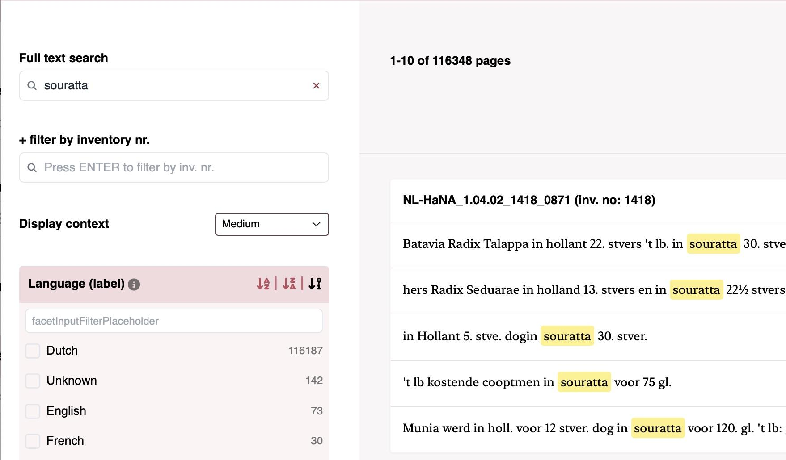

Given my own background in Maratha history, I tried to see if famous places related to this history were mentioned in Dutch records.[1] And sure enough, they were: consider, for example, the mountain fort Raigad, the seat of Shivaji’s coronation, which is frequently mentioned as Rairy.[2] The likely Dutch variant of the same would be *rairij* – which indeed appears in Dutch records too, mentioned both as a mountain and a fortress, as can be seen below.

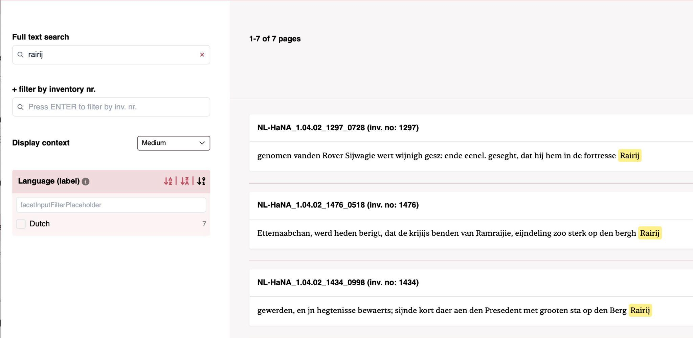

## Certain prefixes/suffixes that many places in India typically tend to have

Many places in India tend to have common suffixes and prefixes. Here are the VOC renderings of some of the suffixes and prefixes of Indian place names.

|  |  |
|----|----|
| **Suffix/Prefix** | **Renderings in VOC documents** |
| -nagar (suffix) | -neger, -negger, -nager |
| -pur (or -puram) (suffix) | -pur, -pour, -poer, (or -puram, -pouram, -poeram) |
| -ur (suffix) | -our, -oer |
| -bad (suffix) | -baad, -bath. |
| Thiru-(prefix) | Tiru-, tiroe-. |

Please note that this is by no means an exhaustive list. Other variations can and do occur, partly due to the HTR errors and partly due to the variety in spellings themselves.

For an idea on how spellings differ in VOC documents, it would be instructive to take a look at the page 6 of the [VOC Glossarium](https://resources.huygens.knaw.nl/pdf/vocglossarium/VOCGlossarium.pdf).[3] A few examples from the same are as follows:

- a – ae – aa – i – o
- c – k – s
- ch – g – k – ts – tsj
- dj – g – j – s
- oe – o – ou – u

Each row shows various ways of spelling the same syllable.

Armed with this knowledge, and the capabilities of the GLOBALISE transcriptions viewer, where one can use wildcards to search all examples of a certain type, I was able to extract many place names with this approach. It must of course be noted that this alone is by no means sufficient and every placename thus found needs to be manually verified.

A screenshot for the search term *\*poer* as specified above is as follows. We have more than thirteen thousand results. The screenshot shows at least three different locations in the first three entries alone. Going through them one by one, the actual locations become evident.

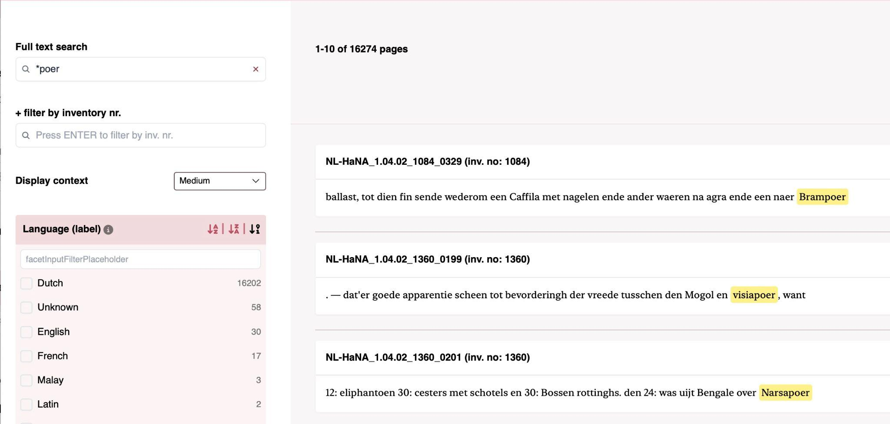

In South India, many places have the suffix -puram. Considering the Dutch spelling of the same, if we give the search term *\*poeram*, the result is as follows. We get more than thirteen thousand results, and the first four entries show at least two different places.

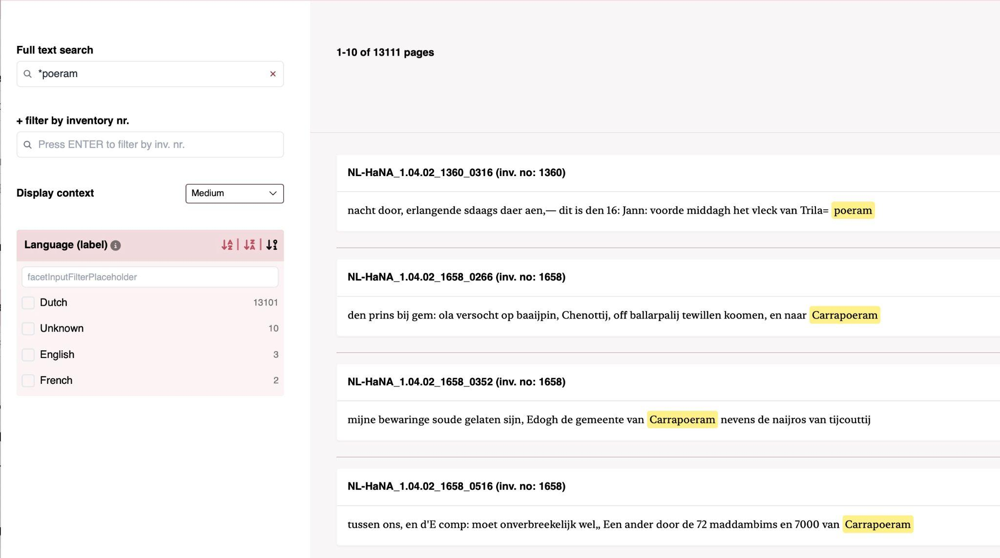

Considering the prefix tiru- in many south Indian location names, if we use the search term tiroe\* then more than two thousand results appear and the first three entries show three different locations.

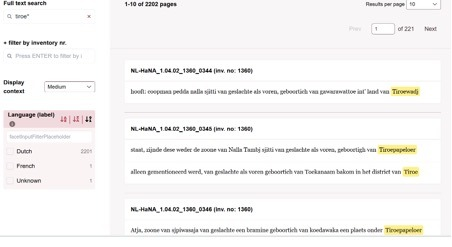

For places with -nagar in their names, the results are as follows. The search term to be used is \*negger. Numerous results appear and the first three entries show at least two identifiable locations.

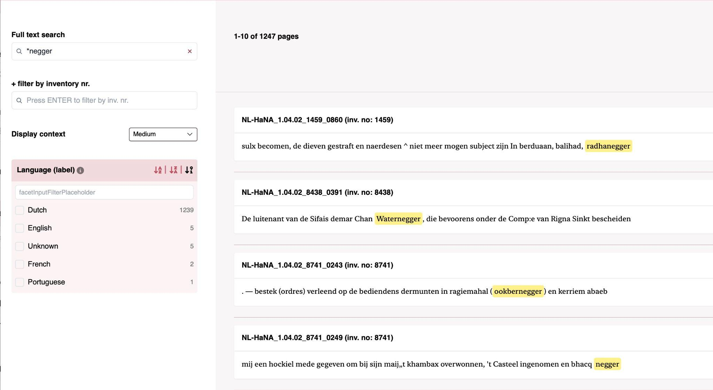

For the suffix -bad, the Dutch variant often seen is -bath. The search for \*bath yields more than nine thousand results, and the first three results show at least two identifiable locations.

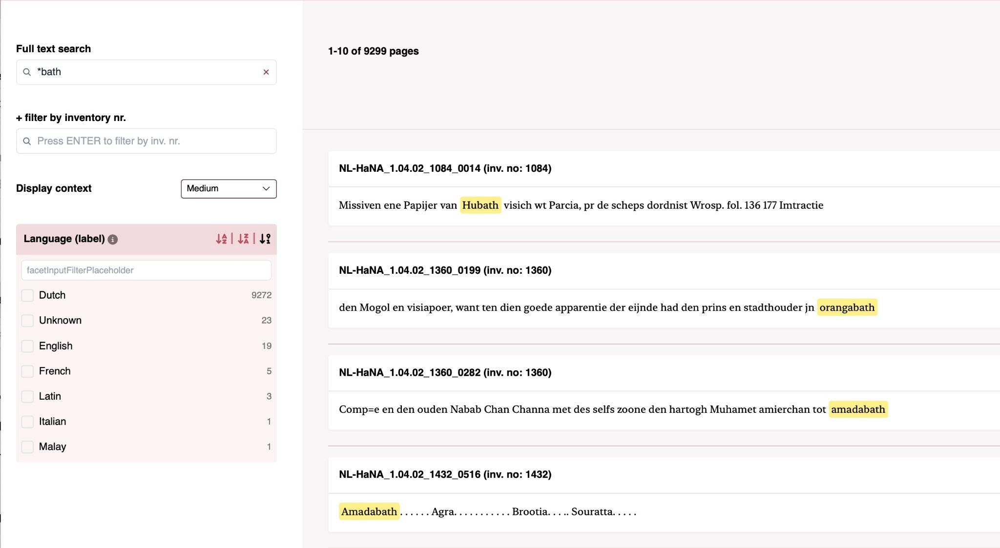

It is important to note that suffixes such as -pur or -nagar can also be used to find places in South East Asia such as Tanjongpura, Indrapura, etc.

### Places near some famous places with their location types

This approach relies on the fact that in many cases, the location types are explicitly mentioned in the VOC records. Words such as *dorp (village)*, *revier (river)*, *stad (city)*, etc. feature abundantly. If one uses queries that search for all instances where a given place name and a given location type occur on the same page, then many such examples can be found.

Consider, for example, this query: *Souratta* AND *dorp*.

This will search for all instances where the words *souratta* and *dorp* will occur. Generally, it is advisable to use *dorp* (village) because that is likely to fetch a higher number of generally unknown or not readily identifiable places. One can of course use *stad* (city) or any variants thereof as well.

The result is as follows. With the search term above, we get more than a thousand results. The very first two entries contain at least 2 village names.

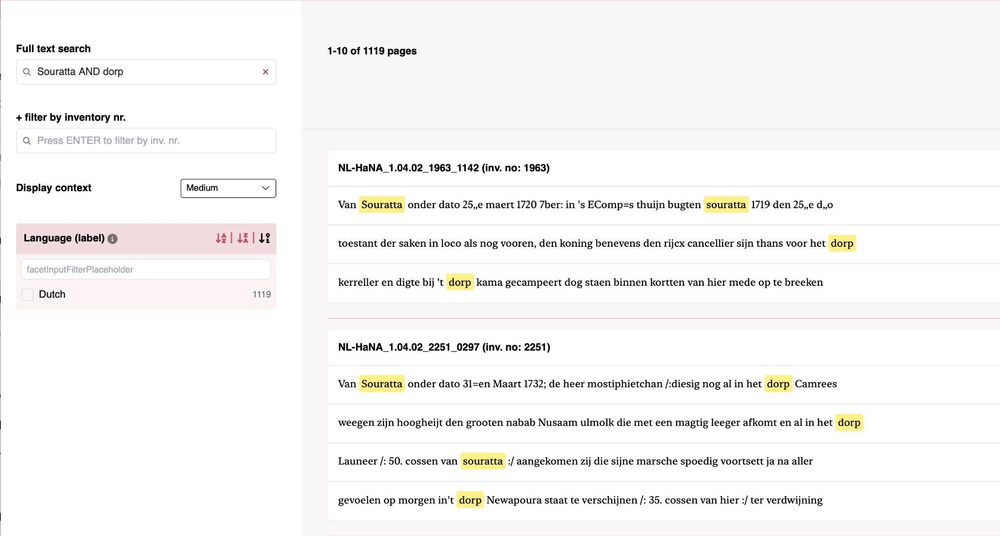

Many other combinations can be used as well – apart from dorp, one can try stad, revier, etc. The name of the famous location can be changed as well.

### Location types only

Here, we use the search term as follows.

location type AND gena\* \[gena is used to identified references to the term ‘genaamd’ (meaning named); the first part of the term ‘genaamd’ is used together with the wildcard \* to capture all spelling variations for the term genaamd\]

e.g. (dorp AND gena\*) or (stad AND gena\*) etc.

The result for the search term (dorp AND gena\*) is as follows. More than five thousand entries exist and the very first entry shows a number of villages. One such result found with this query can be seen below. The page mentions a *dorp genamt omback* i.e. a village named omback.

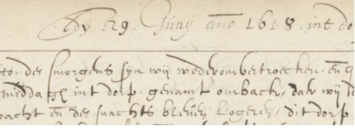

*Page from Cornelis van Maseijck’s journal from Japara and his voyage to Mataram, June-July 1618. [Nationaal Archief](https://www.nationaalarchief.nl/onderzoeken/archief/1.04.02/invnr/1068/file/NL-HaNA_1.04.02_1068_0305), CC0.*

But this is a more time-consuming approach than the earlier one, where one ‘anchors’ the search to a famously known place and thus has an idea of the approximate location for the lesser-known place.

### Finding *missives* and sifting through them

This approach yields the most number of examples with relatively less effort. In VOC records, one keeps coming across *missives*, a type of travel diary or report. The structure of these diaries is such that the beginning, end and every step of the journey are very well documented. Consider, for example, a *missive* of the travels of an VOC official from Agra to Surat of which a copy is signed and dispatched to the Company superiors in Batavia on the conclusion of the journey.

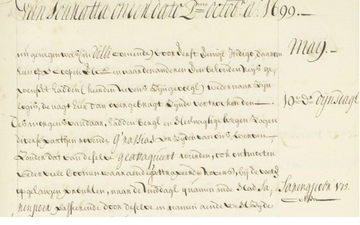

*Page from *missive* from Surat, 1 October 1699. [Nationaal Archief](https://www.nationaalarchief.nl/onderzoeken/archief/1.04.02/invnr/1625/file/NL-HaNA_1.04.02_1625_0523), CC0.*

Here is a screenshot of a part of the missive. It records events and travels undertaken every single day, listing the approximate distance from either the most recent place visited or the place from which the journey commenced. One can clearly see the date on the page above: Tuesday, 19 May, 1699. The name of the city *Sarengpoer* is clearly mentioned as is its distance from Agra, i.e. 175 “cossen” (a unit of distance, sometimes equal to a Dutch mile). .Plenty of other information is also mentioned, eg. that the VOC officials rested in a *Saray* or resthouse there and that a group of people named *Girasias* attacked them before reaching the city. In the course of a *missive*, information on many such places feature.

Another well known example of a *missive* is that of Johan van Twist, who travelled from the west coast of India to Bijapur to meet the Adil Shahi Sultan in 1637 CE and obtain from him the royal approval to open a Dutch trading lodge at Vengurla. A sample page from this *missive* can be seen below. In only two paragraphs, numerous places in the Konkan region (west coast of India, between Mumbai and Goa) as well as the region east of the western ghats are mentioned, eg. *Chipelone* (Chiplun)*Helewaecko* (Helwak), *Dabul* (Dabhol), *gattamatte* (Ghatmatha), *Balagatte* (Balaghat), and *Cambari* (Kumbharli).

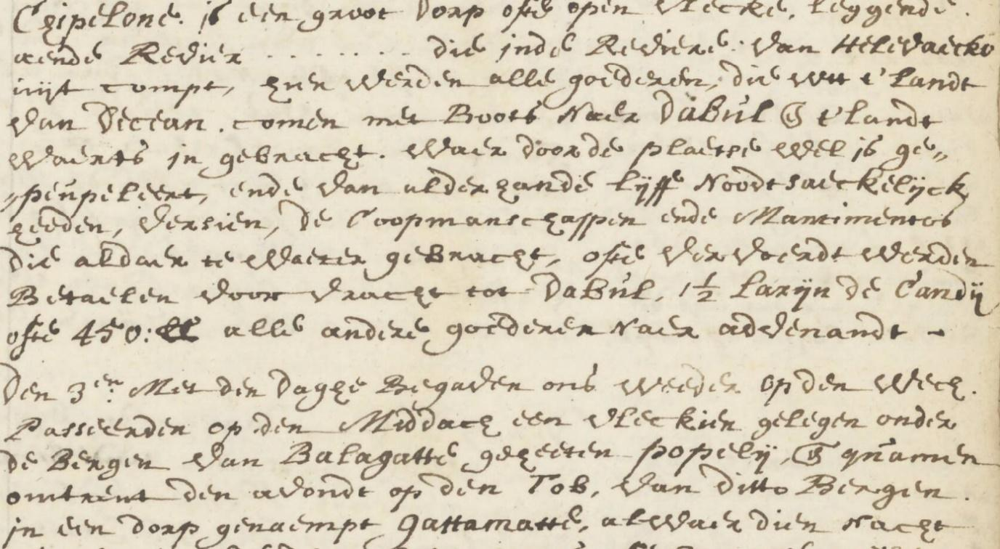

*Page from Johan van Twist’s *missive*. [Nationaal Archief](https://www.nationaalarchief.nl/onderzoeken/archief/1.04.02/invnr/1122/file/NL-HaNA_1.04.02_1122_0701), CC0.*

## Putting it all together: strategies and cautions

To summarize, one can find many places in the Indian subcontinent in VOC records, using the strategies outlined above. These strategies are by no means exhaustive, even for Indian locations. One can devise one’s own custom strategies for non-Indian place extraction by going through the above. The knowledge of VOC and local history is also crucial for speedier identification of the manifold places.

One final precaution would be to manually check the spelling in the handwritten records even after finding it in the transcriptions. Given that the HTR is not 100% accurate, the spellings are in some cases wrongly transcribed. For example, the name *siuasi* (Shivaji, the founder of Maratha polity) in the handwritten records is often transcribed as *sinasi*, and the frequent consultation of GLOBALISE database may sometimes obscure the fact that the handwritten version should be the standard one and not the HTR version. Even if one might use the HTR version for searching, the final result to be written down should always follow the version in handwritten records.

All in all, it is a very rewarding exercise. Despite historical vicissitudes, I found that many times the VOC descriptions and current geography match rather closely, which says a lot about how meticulous and precise the Dutch records were; despite the usual disclaimers about their veracity, which have more to do with their socio-political point of view rather than factual description of the landscape.

------------------------------------------------------------------------

[1] Marathas are an ethnic group originating western Deccan, who first consolidated into a polity in the 17th century CE and later expanded into a pan-Indian power in 18th century CE.

[2] Shivaji was the founder of Maratha polity in 17th century

[3] An online glossary of the terms used in VOC records. Marc Kooijmans and Judith Schooneveld-Oosterling, *VOC-Glossarium: Verklaringen van termen, verzameld uit de rijks geschiedkundige publicatiën die betrekking hebben op de Verenigde Oost-indische Compagnie* (Instituut voor Nederlandse Geschiedenis: Den Haag, 2000). [https://resources.huygens.knaw.nl/vocglossarium](https://resources.huygens.knaw.nl/vocglossarium)
