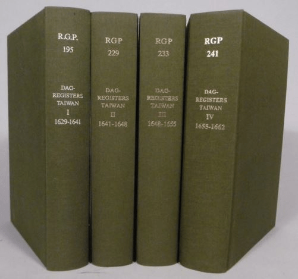
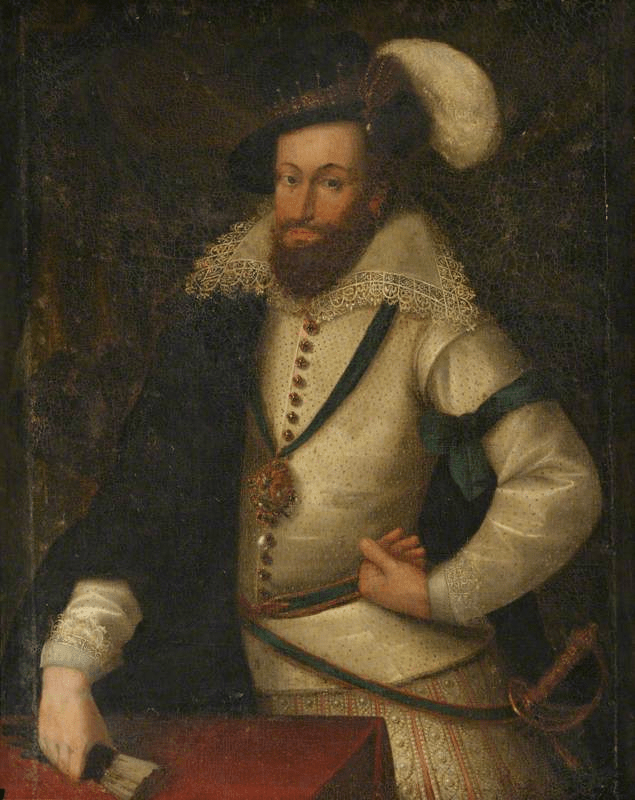

# Incognito Royalty on the Princes Roijael

> **Archived blog post.** This post was originally published on the Globalise project website on 29 May 2025 ([original URL](https://globalise.huygens.knaw.nl/incognito-royalty-on-the-princes-roijael/)). The text is reproduced without changes; links to other blog posts now point to their archived copies, and other links may no longer work.

**About the author:** Ann Heylen, a guest researcher with the Globalise project, is a professor at National Taiwan Normal University (NTNU) in Taipei, where she directs the International Taiwan Studies Center.

<!-- Bio source: Author note at the end of the blog post itself; guest researcher list on https://globalise.huygens.knaw.nl/team/ -->

---

*This blogpost contains references to methods of punishment that users might find disturbing.*

The Dutch East India Company (VOC) established and controlled numerous trading posts (factories) across maritime Asia, one of which was the Tayouan Factory from which the Company controlled the entire island of Taiwan or Formosa. Although VOC rule over the island only lasted forty odd years (1624-1662, 1664-1668), it holds a significant position in the globality of the Dutch colonial presence in Asia, and for the history of Taiwan in particular. Even today, the seventeenth century VOC presence features prominently in Taiwanese memory, and occupies a steadfast position in the historiography of the island and its education. This is mainly political and has to do with the identity quest central to Taiwanese nation building. What fuels this continued memory is partially thanks to the dedicated efforts of Dutch and Taiwanese academics in making the VOC archival sources public. Since the 1980s, extracts from the [*Dagregisters van het Kasteel Zeelandia*](https://resources.huygens.knaw.nl/retroboeken/taiwan/#page=0&accessor=toc&view=homePane) and *De Missieven van de gouverneurs* have been transcribed, published and are currently also available (ongoing) in Mandarin and/or English translation such as the *Formosan Encounter*.[^1] These materials are but a small part of the archival data available on Taiwan that have been transcribed and made available online. Hence, the [GLOBALISE transcriptions viewer](https://transcriptions.globalise.huygens.knaw.nl/?indexName=docs-2024-03-18&fragmentSize=100&from=0&size=10&sortBy=_score&sortOrder=desc&query=eyJkYXRlRnJvbSI6IjE1MDAtMDEtMDEiLCJkYXRlVG8iOiIxODAwLTAxLTAxIiwicmFuZ2VGcm9tIjoiMCIsInJhbmdlVG8iOiIzMDAwMCIsInRlcm1zIjp7fX0%3D) offers a vast array of research opportunities to dig deeper and develop a more lucid portrait of ‘Dutch Formosa’ in the VOC globality of colonial history. 

*The four book volumes of [*Dagregisters van het Kasteel Zeelandia*](https://resources.huygens.knaw.nl/retroboeken/taiwan/#page=0&accessor=toc&view=homePane)*

## Exploring gender in archival documents from Dutch Formosa

Since January 2025, I am a guest researcher at Globalise. I was previously aware of the project, and had occasionally used the transcriptions viewer when browsing the TANAP resources and was in need of additional information, or when searching for specific passages in the online *Dagregisters* when the printed copy was not at hand. When I started working as a guest researcher, I became aware that GLOBALISE has more to offer than only providing the full text transcriptions of handwritten manuscripts, and my *in situ* acquaintance with the GLOBALISE transcriptions viewer has led to some interesting discoveries.

Usually, keyword research can be rather straightforward when looking for places, personal names, or commodities in the archives. It becomes more complex when one is interested in concepts that involve belief systems, local knowledge, or other non-physical or immaterial aspects of cultural expression. Gender history – the central theme of my new research project – has numerous examples of such concepts. How then can we research gender in the VOC archives? Research has it that not so much has been documented on the female voice; which is not surprising knowing that recording the wheeling-and-dealing, decision-making diplomatic correspondence of the Company was primarily conducted as a manly business. The male gaze also defined the frame by which the female gender came into the spotlight and was recorded. In the quest for gender-related information in the archives, two challenges revealed themselves: first, a search for female-gendered vocabulary and second, its contexualization in the Taiwanese local context in the 1600s.

I initially started out to search the index of the printed *Dagregisters van het Kasteel Zeelandia* for gender-oriented vocabulary denoting womanhood. For instance, in one of the entries, I came across the term ‘vroetmoeder’ (midwife), and noticed that this occupation was not indexed in the *Dagregisters* although the work itself came with an exhaustive index.[^2] This led me to move away from source publications and encouraged me to search the selection from the VOC archives which has been made available on the GLOBALISE transcriptions viewer. At the same time, it proved a useful digital exercise in familiarizing myself with the [Word2vec tool](https://lab.globalise.huygens.knaw.nl/experiments/GLOBALISE_Word2Vec_Lab/) and how it could help me explore the archives.[^3] One of the capabilities of this tool is that it is able to identify the most semantically similar words (to the one searched for) that appear in collocation. Two terms that I sought to search for in the Taiwanese context were ‘swangere’ (pregnant) and ‘geboorte’ (birth). I then searched each of these terms in combination with the place name Taijouan in a follow up full-text search, and some interesting facts emerged.

## Tracing an incognito Prince

One of the results that came up in the search for ‘geboorte’ and ‘Taijouan’ featured in the letter dated 16th January, 1658 from the High Government in Batavia to Directors of the Company of the Chamber of Amsterdam.[^4] This document revealed the curious fact that one of the ‘passengers’ on the Princes Roijael was a certain ‘Fredrick woldenaer van Hoogewalt’. He deserved a mention because he claimed to be a biological son of King Christian the Fourth of Denmark, but also made it understood that he had served a few years incognito in Taijouan. Now in Batavia, he made his original identity known, and according to the ones who knew him in Denmark, he expressed the desire to go to Spain. In order to show him some respect – now that it was known that he was of noble birth – he was allowed to sleep in the cabin and eat on the deckhouse during the voyage. My search for more about this nobleman in the archives took me in a few directions. First, searching for Fredrick Woldenaer van Hoogewalt in a variety of spellings – because spellings in the VOC archives are not standardized – using the Word2vec led me to another entry made a couple of years earlier (1651-2).[^5] The Fredrick Hoogewolt in this document (here spelled as Fredrick Hoochwolt) was from Hamburg, who together with another soldier Hans Steffelaer from Neurenburch (Nuerenburg), found themselves in a situation where they prayed for forgiveness from the Council of India as they were accused (contra), and were inevitably punished for misconduct on the job – for having fallen asleep while holding guard. Fredrick Hoogewolt was sentenced to half a day on the ‘wooden horse’ (or Spanish donkey).[^6]

*Christian IV (1577–1648), King of Denmark, [National Trust Images](https://artuk.org/discover/artworks/christian-iv-15771648-king-of-denmark-kg-219070).*

## **Archival detours before returning to gendered histories**

These two instances cited here merely illustrate the possibilities that this semantic module offers, and its ability to take us in directions than originally intended. Although I had set out to study gender in the archives, I chanced on unrelated yet fascinating findings when using the Word2vec tool. There are undoubtedly questions that still remain unanswered. Do both documents discuss the same individual, even if their places of origin differ starkly? Could it be possible that he travelled first from Denmark to Hamburg and boarded a VOC ship later? If the two documents do indeed reference the same Frederick, might we be one step closer to contextualizing his ‘incognito service in Taijouan’? How much more information can be sourced about Frederick in the archives, and in what capacity did he serve the Company in Formosa? Would it be possible to find Frederick’s letters of attestation in the archives? As letters which served as proof of proper moral conduct that all VOC recruits were expected to carry, could Frederick’s letter, if found, tell us more about his past?[^7] While these questions shed light on what information we are missing, they also indicate the possibilities that the archives behold.

Where do I stand with regard to my original intention of studying gender in the archives? Currently, I remain focused on documenting the legal status and occupational history of women as recorded in the archives pertaining to 17th century Taiwan. This includes comparative results from the ‘Minute Book of the Teyoan Consistory’ (*Kercke-boek*), which I hope to present in a future blogpost.

*Ann Heylen, a professor at National Taiwan Normal University (NTNU), Taipei, specializes in Taiwan studies. She directs NTNU’s International Taiwan Studies Center and holds a Ph.D. from KU Leuven (Sinology).*

------------------------------------------------------------------------

[^1]: L. Blussé, et al., De Dagregisters van het kasteel Zeelandia, Taiwan 1629-1662. Deel I 1629-1640; Deel II 1641-1648; Deel III 1649-1654; Deel IV 1655-1662 (The Hague: Martinus Nijhoff, 1986-2001) <https://resources.huygens.knaw.nl/voctaiwan>; For transcriptions and translations, see Chiang, Shu-sheng  江樹生主編/註 (2010)，《荷蘭聯合東印度公司臺灣長官致巴達維亞總督書信集 II 1627-1629》 De missiven van de VOC-gouverneur in Taiwan aan de Gouverneur-generaal te Batavia II, (1627-1629) ，Nantou: Academia Historica  南投市 : 國史館臺灣文獻館 ;  Chiang, Shu-sheng江樹生主編 (2010)，《荷蘭聯合東印度公司臺灣長官致巴達維亞總督書信集 原文篇 第一冊 1622-1628》 De missiven van de VOC-gouverneur in Taiwan aan de Gouverneur-generaal te Batavia I, 1622-1628, Tainan: National Museum of Taiwan History 臺南 : 國立台灣歷史博物館; Chiang, Shu-sheng江樹生主編(2015)，《荷蘭聯合東印度公司臺灣長官致巴達維亞總督書信集 III 1629-1636》 De missiven van de VOC-gouverneur in Taiwan aan de Gouverneur-generaal te Batavia III, (1629-1636), Nantou: Academia Historica 南投市 : 國史館臺灣文獻館. Also see, L. Blussé, N. Everts and E. Frech, The Formosan Encounter: Notes on Formosa’s Aboriginal Society: A Selection of Documents from Dutch Archival Sources: Volume I: 1623-1635; Volume II: 1636-1645 (Taipei Shung Ye Museum of Formosan Aborigines, 1999-2000), L. Blussé, N. Everts, The Formosan Encounter: Notes on Formosa’s Aboriginal Society: A Selection of Documents from Dutch Archival Sources: Volume III, 1646-1654; Volume IV: 1655-1668 (Taipei Shung Ye Museum of Formosan Aborigines, 2000, 2010).
[^2]: J.L. Blussé et al (eds), *De dagregisters van het Kasteel Zeelandia, Taiwan 1629-1662, vol. 1: 1648-1655* (The Hague: Martinus Nijhoff, 1986), p. 274. [https://resources.huygens.knaw.nl/retroboeken/taiwan/#page=295&accessor=toc&source=3](https://resources.huygens.knaw.nl/retroboeken/taiwan/#page=295&accessor=toc&source=3)
[^3]: van Wissen, Leon, and GLOBALISE. “GLOBALISE Word2vec Experiment”. Zenodo, March 17, 2025. [https://doi.org/10.5281/zenodo.15038313](https://doi.org/10.5281/zenodo.15038313).
[^4]: See NL-HaNA, VOC, 1221, 0183, transcription GLOBALISE project (https://globalise.huygens.knaw.nl/), January 2025. [Globalise Transcriptions Viewer](https://transcriptions.globalise.huygens.knaw.nl/detail/urn:globalise:NL-HaNA_1.04.02_1221_0183).
[^5]: See NL-HaNA, VOC, 9286, 0167, transcription GLOBALISE project (https://globalise.huygens.knaw.nl/), January 2025. [Globalise Transcriptions Viewer](https://transcriptions.globalise.huygens.knaw.nl/detail/urn:globalise:NL-HaNA_1.04.02_9286_0167).
[^6]: The ‘wooden horse’ (houten paert), a.k.a. Spanish donkey was a corporal punishment tool, or torturing device used since the medieval ages. It was a triangular wooden box with a very sharp top end (i.e., where the horse’s spine would be) which the culprit was straddled on. Sometimes weights were added on to prevent the person from falling, but in reality, this only increased the torture. This device caused pain in the crotch and made the culprit unfit for walking.
[^7]: Company personnel were required to show one or two letters of attestation upon embarkation in Taijouan. These letters showed proof of proper moral conduct, and were issued by a church authority, either from their homestead or at the port of departure, together with a letter from the captain testifying to behavior onboard. Letters of attestation represented the regional control that the Calvinist church was able to implement. In the Dutch Republic, believers who moved from one location to another also had to present these letters, which noted whether they had been sanctioned by church discipline in their previous habitats and how well versed they were in church doctrines. See H. Roodenburg, *Onder censuur: De kerkelijke tucht in de gereformeerde gemeente van Amsterdam, 1578-1700* (Hilversum: Verloren, 1990). Philip Gorski translates the letters as “certificates-of-good-conduct, certifying that they were confessing members of the reformed Church and were not currently under censure,” see P. S. Gorski, *The Disciplinary Revolution: Calvinism and the Rise of the State in Early Modern Europe*, (Chicago: University of Chicago Press, 2003), p. 63.
