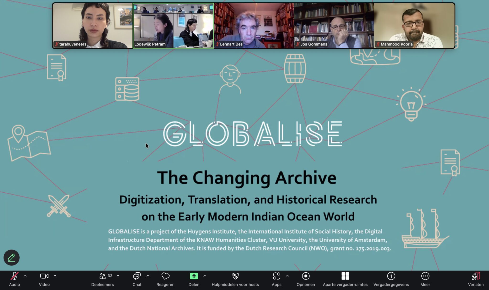
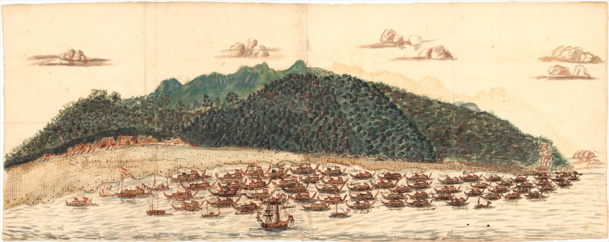

# Looking Back and Ahead: Access and Research in a Changing Archive

> **Archived blog post.** This post was originally published on the Globalise project website on 30 December 2025 ([original URL](https://globalise.huygens.knaw.nl/looking-back-and-ahead-access-and-research-in-a-changing-archive/)). The text is reproduced without changes; links to other blog posts now point to their archived copies, and other links may no longer work.

**About the author:** Tara Huveneers was an intern with the Globalise project from September 2025 to March 2026, as part of the Master's programme in Archival and Information Studies at the University of Amsterdam.

<!-- Bio source: Former team members list, https://globalise.huygens.knaw.nl/team/; introduction to her blog post of 9 April 2026 -->

---

On 2 December 2025, GLOBALISE hosted the online roundtable **“The Changing Archive: Digitization, Translation, and Historical Research on the Early Modern Indian Ocean World.”** As the project enters its final year, the webinar offered a moment to reflect on a field in transition: from hand-edited printed volumes to AI-assisted transcription pipelines, and from a small group of specialists working in Dutch archives to a much wider international community being able to engage with digitised colonial records. These developments create new opportunities for research, while also raising important technical, social, and methodological challenges, as well as questions about the future use of these archival materials as they take on new digital forms and become available at a much larger scale.

To explore these issues, GLOBALISE invited **Asawari Luthra**, **Jos Gommans**, **Lennart Bes**, **Mahmood Kooria**, **Norifumi Daito**, and **Tristan Mostert**. The session was chaired by **Manjusha Kuruppath**, with an introduction by GLOBALISE project leader **Matthias van Rossum**. The speakers reflected on their experiences with source publications – such as the RGP series, on which GLOBALISE builds – and their searchable digital successors, and considered how new digital tools and infrastructures are reshaping this longstanding research practice.

This blogpost highlights the main themes that emerged from the roundtable.

## **Transcription, Translation, and the Value of the Original Text**

A recurring theme was the layered nature of original text, transcription and translation. Working with colonial archives means navigating multiple languages, temporalities, and geographical perspectives. Traditional source publications were crafted with careful intention: historians deliberately chose how to transcribe, translate, and annotate texts, and their decisions, including when *not* to translate certain terms, were often deliberate and meaningful.

Digital tools change that landscape. HTR speeds up transcription significantly, and machine translation can render Dutch texts into English or other languages in seconds. While these tools widen access, they also introduce new risks.

**Lennart Bes**, Assistant Professor at Leiden University who has worked with early modern sources for over two decades, noted that automated transcriptions can misread local words, something he observed with Indian names and terminology in the current beta version of the GLOBALISE Transcriptions Viewer. When users then feed these flawed transcriptions into machine-translation tools, the errors are not corrected but amplified. Non-expert users, or students without training in early modern Dutch, especially those outside the Netherlands, may not notice these distortions.

**Jos Gommans**, Professor of Colonial and Global History at Leiden University with over 25 years of experience translating Dutch archival texts, warned that the increasing distance between users and the original document makes the original even more important, not less. Even if many users cannot read old Dutch, the biased and historically situated character of the original is crucial for understanding how to “read along and against the grain.”

**Norifumi Daito**, assistant professor at the Historiographical Institute of the University of Tokyo, illustrated this point through his work on translating diaries written by Dutch officials in early modern Japan. Some Japanese terms appear in Dutch as phonetic approximations, small but significant traces of cross-cultural interaction. Translating these terms “correctly” would erase instances of misunderstanding and encounter. Translation is then not only linguistic conversion but an interpretive act.

## **Context Matters – Historically, Archivally, Emotionally**

Another core thread of the discussion was context: How do we guide users, researchers, descendants, and the wider public, through colonial materials that can be emotionally difficult, historically dense, and structurally complex?

**Asawari Luthra,** a historian and anthropologist who spent a year as a guest researcher at GLOBALISE, noted that digital access does little to lessen the emotional weight of colonial records. Encounters with violence, enslavement, and dehumanising descriptions can be overwhelming. She cited two cases, one researcher and one student, who experienced breakdowns upon encountering such materials.

**Tristan Mostert**, drawing on his work as one of the coordinators of the Atlas of Mutual Heritage, a growing image database related to images of places where the VOC and WIC operated, described similar experiences when digitising and publishing colonial imagery. Four years ago, a series of drawings depicting a violent siege in western Seram from the perspective of a colonial official triggered intense discussion and emotion in Maluku. Conversely, a recently digitised image of an Indigenous fleet near Sawai (north Seram) sparked enthusiasm and strong interest among local communities. These reactions, he noted, underscore both the potential and the sensitivity involved in making colonial materials publicly accessible online.

Johannes Hogeboom, “Hongi near the village of Sawai, northern Ceram.” Appendix to a letter by Nicolaas Witsen, c. 1700. Amsterdam, Allard Pierson Collection UvA. Hs. Bf. 76 C (3). Digitally accessible via the [Atlas of Mutual Heritage](https://www.atlasofmutualheritage.nl/page/11181/hongi-near-the-village-of-sawai-north-seram#description-11181).

**Luthra** noted that in institutional spaces, such as physical reading rooms or classrooms, archivists, teachers, and peers can offer support when users encounter distressing material. Online, however, that support structure disappears. Users may confront descriptions of enslavement or derogatory language entirely on their own in front of a computer screen. She therefore emphasised the need for upfront transparency about bias, clear acknowledgment of archival silences, and the creation of digital spaces where users can share experiences, annotate materials, or access support resources. For many communities, the reinterpretation or reframing of colonial materials can play a role in healing, but this is only possible when frameworks exist to guide and sustain such engagement.

## **Historical and Archival Context**

**Gommans** argued that in an era of large-scale accessibility, embedding the text in historical and regional contexts is more essential than ever. Without contextual framing, a lot of users may encounter VOC documents without understanding their function, genre, conventions, or biases.

**Bes** expanded this argument: archival literacy is more crucial than ever. In the pre-digital era, navigating archives forced researchers to learn how collections were structured; keyword search now risks bypassing this tacit learning. Archival guides, explanations of structure, and contextual introductions therefore become indispensable, tools that not only help users orient themselves, but also teach them how to read the documents critically. At the same time, Bes noted that the growing demand for contextualisation can place additional pressure on editors and researchers, sometimes limiting how much material they can publish.

Responding to these needs, GLOBALISE is developing contextual layers that enrich the corpus through historical reference data, semantic contextualisation, and entity linking, helping users understand what they are reading and search the material more effectively.[^1]

**Mahmood Kooria**, Lecturer in the History of the Indian Ocean World at University of Edinburgh, drawing on his research experience, added that working with colonial material carries significant moral and ethical responsibilities, especially when making such material widely accessible online.

## **Highlights and Selectiveness: From Source Publications to Digital Infrastructures**

The panel also examined the role of highlights, curated selections that help users or researchers orient themselves. The *Generale Missiven* in the RGP once served as a first entry point for generations of historians, studying early modern Indian Ocean history. While selective, they offered a sense of what themes and questions might be found in the archives.

Digital infrastructures face a similar dilemma. Highlights can be helpful but are inevitably selective. Kooria noted that users without language skills may become overly dependent on these curated pathways. Simultaneously, Mostert noted that with AI amplifying the visibility of what is already online, materials absent from the digital sphere, including many local archives, risk becoming even less visible.

​​Yet providing no orientation at all leaves users adrift in an ocean of data. In such cases, transparency about selection criteria and their limitations is essential for guiding users responsibly.

## **Multilingual Texts, Local Sources, and Counter-Narratives**

A number of speakers emphasised that GLOBALISE should not simply funnel users toward VOC records, but also help them discover counter-narratives and sources beyond Dutch archives from the same period. Kooria highlighted materials from the Malabar region that offer perspectives missing in VOC documents. One example is the *1691 golden-coil treaty* between the Dutch East India Company and the Zamorin. Another is the Paṭappāṭṭu, a Malayalam war song describing a battle involving the Dutch, Portuguese, and local rulers such as the Raja of Cochin and the Zamorin of Calicut.

*Treaty between Calicut and the Dutch, India*, 1691, 45 x 2030mm. From the British Library Collection: MS Malayalam 12.  

These sources provide rich, locally grounded accounts of the early modern Indian Ocean world. Directing users toward them, rather than recentering Dutch material, helps foster a more balanced and multi-perspectival understanding of this history.

## **The Historian’s Evolving Role**

A central discussion concerned the future role of the historian. Matthias van Rossum opened up the discussion further by asking whether recent technical advances and AI might lessen the need for certain forms of historical expertise. The panel strongly disagreed. For Gommans, historians become more essential, not less: not primarily as translators, but as contextualizers, critics, and guides. Similarly, Bes argued that archival literacy must increase precisely because digital abundance obscures archival structure. And Luthra stressed that users from formerly colonised societies need support and interpretive tools at every stage of navigating the archive. In all cases, historical expertise is valuable. The panel also noted that these developments have implications for academic training: history students must be able to get the opportunity to learn to work with new digital tools and methods.

## **Conclusion**

The increasing availability of colonial primary sources in digital form does not diminish the need for historical expertise, it amplifies it. Users around the world may now approach VOC records with 21st-century eyes, but interpreting these 17th- and 18th-century documents still requires guidance and contextual understanding.

Entering the colonial archive means confronting structures of power, violence and engaging with perspectives shaped by those who produced the records. In this environment, interpretative frameworks and pedagogical support are essential. As the roundtable underscored, an archive reshaped by digitisation and machine learning requires deeper care and renewed responsibility.

GLOBALISE’s task is therefore not only to open the archive, but to shape the conditions under which it can be read, questioned, and reinterpreted. Contextualisation, archival literacy, and critical reflection remain central to responsible engagement with digital colonial archives. As Luthra concluded, the aim should be to guide users safely and critically through the archive.

## **List of resources**

Luthra, Asawari. *Recommendations for Decolonising Access to Heritage Infrastructures in the Netherlands: An Ethnographic Approach.* [(2025). https://doi.org/10.5281/zenodo.17244957](https://doi.org/10.5281/zenodo.17244957)

Gommans, Jos, Lennart Bes and Gijs Kruijtzer (eds.) *Dutch Sources on South Asia c. 1600-1825*, volumes 1-3. Available on [Nationaal Archief, Den Haag (section 8ED).](https://www.nationaalarchief.nl/onderzoeken/archief/2.14.97/invnr/%40B.~8ED)

Kooria, Mahmood. “Arabic-Malayalam texts at the British Library: Themes, Genres and Production.” *International Journal of Islam in Asia*. 3 (2022), 89-127. [10.1163/25899996-20230014](https://doi.org/10.1163/25899996-20230014)

[Historiographical Institute, University of Tokyo](https://www.hi.u-tokyo.ac.jp/en)

[Atlas of Mutual Heritage](https://www.atlasofmutualheritage.nl)

[Linschoten Vereeniging](https://www.linschoten-vereeniging.nl/english)

**Disclaimer: **This post includes links to external resources for reference and further reading. We endeavour to keep these links up-to-date, but we do not take responsibility for the content and security of external websites, kindly make use of these links at your own discretion.

[^1]: See the preliminary building blocks of the future digital infrastructure on GLOBALISE’s website, [Lab](https://lab.globalise.huygens.knaw.nl/), and [Dataverse](https://datasets.iisg.amsterdam/dataverse/globalise?q=&types=dataverses%3Adatasets&sort=dateSort&order=desc&page=3).
