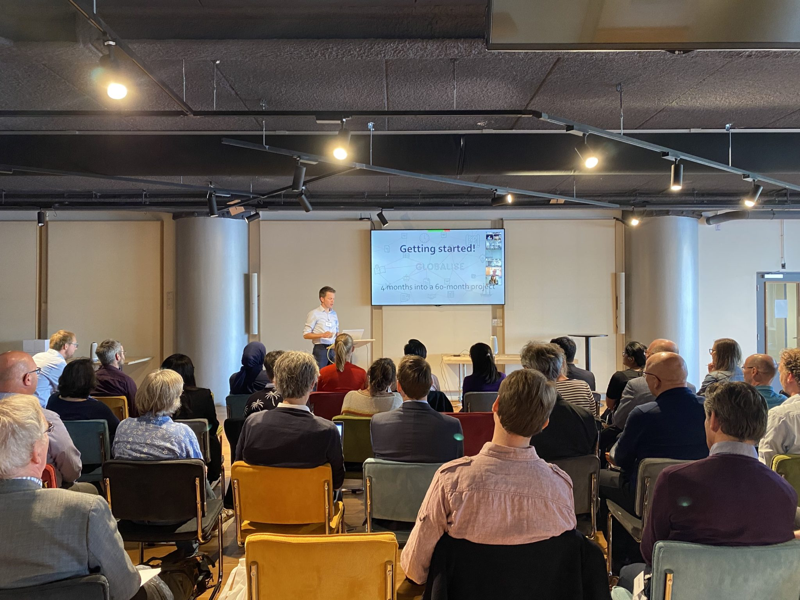
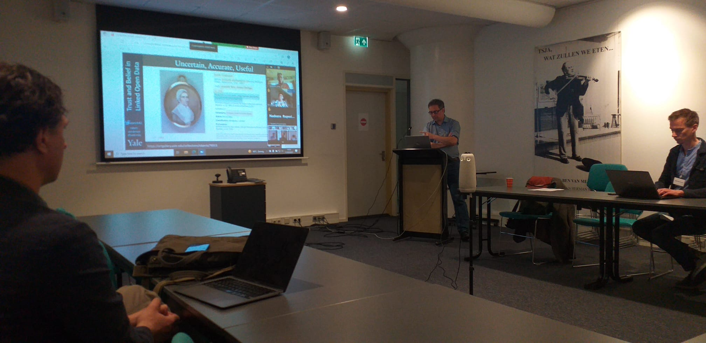
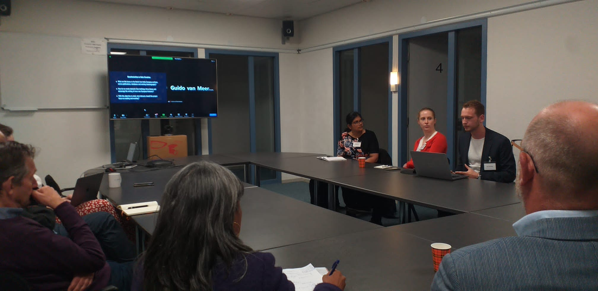
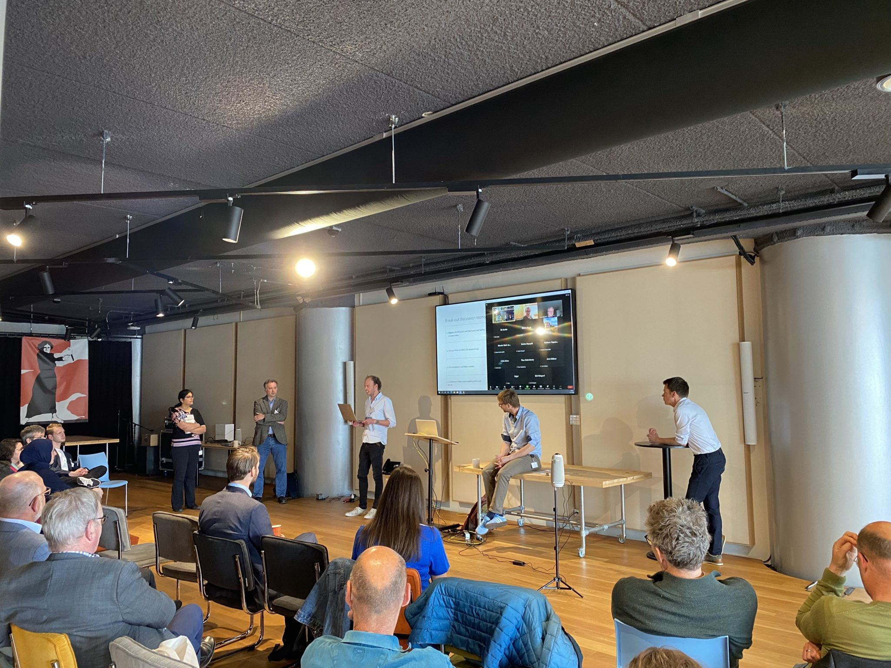

# Looking back on a successful kickoff meeting

> **Archived blog post.** This post was originally published on the Globalise project website on 23 May 2022 ([original URL](https://globalise.huygens.knaw.nl/looking-back-on-a-successful-kickoff-meeting/)). The text is reproduced without changes; links to other blog posts now point to their archived copies, and other links may no longer work.

**About the author:** Merve Tosun was coordinator of user interaction and outreach in the Globalise project from January 2022 to January 2024.

<!-- Bio source: Former team members list, https://globalise.huygens.knaw.nl/team/ (consulted 2026-10-01) -->

---

On 11 May 2022, the International Institute of Social History hosted the GLOBALISE kickoff for those associated with the project as board and steering committee members and interested researchers and developers working on similar topics. An international group of more than sixty scholars, developers and heritage specialists attended, both on location and online.

*Getting started!*

The kickoff was a moment to introduce the project aims and approach, and to offer a peek into the first results of the Handwritten Text Recognition (HTR), Historical Contextualisation, and Semantic Contextualisation work packages. Only four months into the project, we have been able to improve the HTR on VOC archives, lay the first stones in a working Natural Language Processing system, and curate several datasets for the historical contextualisation of entities.

After the introduction, we asked participants to join one of four thematic tables during two rounds of discussion sessions to exchange expertise on questions that are central to the project. The discussion groups were centered around 1) aligning GLOBALISE with researchers’ needs, 2) the design of the research hub, 3) decolonisation and data creation, and 4) data enrichment and modelling. The sessions resulted in very valuable insights, which we would like to highlight and respond to here.

## Transparency

A recurring point that was raised across the four panels was that of transparency. Whether it is in the creation of reference datasets (conceptualisations, definitions, and methodology), entity modelling, the process behind querying results, and the possibilities and limitations of the hub – transparency and documentation were the key words.

As a large infrastructure project with many moving parts and a diverse team, we recognise the importance of accessible documentation. At this stage, we try to realise this by using a git-repository where we keep track of source codes and scripts, HTR ground truth, reference datasets, and team meetings. Our aim is to provide clear documentation of the process towards the realisation of the GLOBALISE research hub while working in line with [FAIR principles](https://www.go-fair.org/fair-principles/).

The call for transparency also included the design of the research hub. Participants stressed the importance of a visible genealogy of both the archives and query results, statements of (un)certainty in those results, and accountability over data curation and annotations. These questions have occupied us as well and it has been very helpful to collect feedback and practical tips for tackling these issues, which we will keep in mind once we start developing the frontend of the research hub.

## Accessibility

The topic of transparency was in some ways also connected to questions of accessibility. Participants pointed out that users should be able to understand what exactly the research hub can and cannot do. Practically, this could be translated into a user guide and/or introductory workshops on both the source corpus and the research hub. Participants also wanted the hub to be accessible to non-Dutch-speaking researchers to allow for broader and more diverse perspectives on VOC and Asian histories. This is exactly why there will be an English translation available for every resource in the research hub. Even though the source material will remain Dutch, non-Dutch-speaking researchers will be able to search through and locate relevant documents in the archive.

Finally, we were also reminded of the importance of sustainable access, especially in light of projects and tools with similar aims slowly disappearing from the web.

*An impression of two of four simultaneous breakout discussion sessions*

## Research

It was especially motivating to hear of all the various themes and questions that researchers would want to dive into using our hub. The fact that our hub could accelerate the hermeneutic process was much appreciated, but researchers found it difficult to foresee how exactly the hub would transform their research practice. Given the current absence of a space to try out the system, this is an understandable, but still very important observation. Relating this to questions of accessibility and user requirements as well, we would like to organise panels to discuss and demonstrate this further in the near future.

## (Open) Data

There was consensus among participants that the colonial character of the Dutch East India Company was ingrained in the very nature of the archive: it was created to legitimize and rationalize the trading and colonial endeavors of the VOC, which meant that characterizations and categorizations of activities, events and people were recorded in accordance with colonial interests.

To circumvent perpetuating biases originating from the source material, participants suggested using local terminology, creating glossaries of non-European terms that feature in the archive, and indicating the genealogy of documents. To account for possible biases in the curation of data, participants also called for accessible documentation of revisions and authorship. Finally, there was a clear call to shift the traditional focus from trade to datasets more inclusive of non-European agents, categories, and terminology.

We acknowledge the importance of recognising and challenging existing biases and are committed to reporting our methodology in data curation with transparency. Currently, we are curating datasets on ships, places and polities, because this data was most easily available to develop our pilot with. We will share these datasets as open access files as soon as the project pilot is finalised, which is soon!

*Session chairs presenting the main takeaways from their thematic tables*

All in all, it has been very helpful to collectively reflect upon so many relevant questions with such a diverse group of experts. The participants’ enthusiasm and constructive feedback for the project definitely did not go unnoticed. We would like to thank everyone again for their time, energy and kind words during the project kickoff!

With this, we would also like to announce that we will share more in-depth analyses of the panels, as well as posts on various themes relating to the project on our [GLOBALISE blog](https://globalise.huygens.knaw.nl/index.php/globalise-blog/).

Stay tuned!
