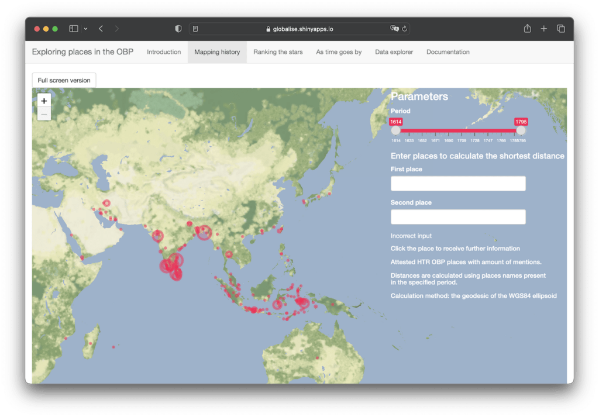
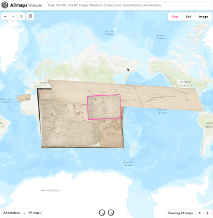
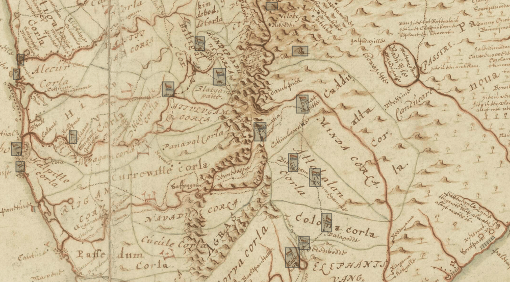
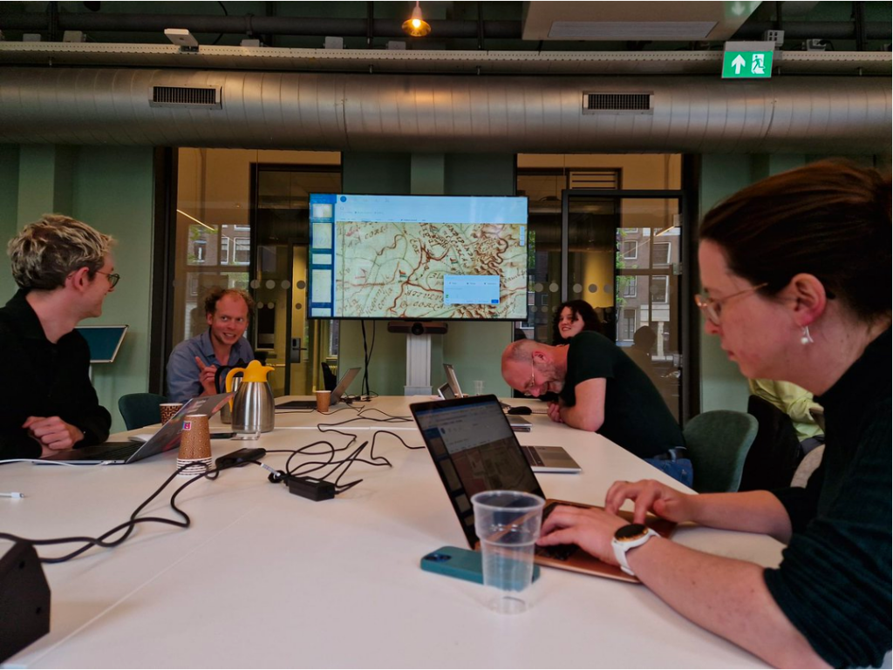

# Old Maps, New Discoveries: A Datasprint’s Digital Exploration

> **Archived blog post.** This post was originally published on the Globalise project website on 6 November 2023 ([original URL](https://globalise.huygens.knaw.nl/old-maps-new-discoveries-a-datasprints-digital-exploration/)). The text is reproduced without changes; links to other blog posts now point to their archived copies, and other links may no longer work.

**About the author:** Leon van Wissen leads the semantic contextualisation team of the Globalise project and is based at the University of Amsterdam.

<!-- Bio source: Team page, https://globalise.huygens.knaw.nl/team/ (consulted 2026-10-01) -->

---

Earlier this year, GLOBALISE together with the University of Amsterdam’s [CREATE Lab](https://www.create.humanities.uva.nl/) organised a collaborative datasprint on historical places in the area around the Indian Ocean and Indonesian archipelago. This resulted in 48 georeferenced historical maps from the collection of the Dutch National Archives, almost 500 annotations of visual map features, and above all lots of learning.

Historical places present GLOBALISE with many challenges. They are often referred to with different name variants (colonial and indigenous) and spellings in the documents of the VOC. Their names sometimes change over time. Little is known of some of the smaller places.

Several online resources, such as the [Atlas of Mutual Heritage](https://www.atlasofmutualheritage.nl/), which brings together digital historical maps of the area where the VOC was active, and the [World Historical Gazetteer](https://whgazetteer.org/), a database of historical variants of place names, make it possible to address these challenges. But how can we make best use of them? To answer that question, we brought together historians, data scientists and heritage experts to try out innovative digital techniques, think about their usability for GLOBALISE, and meanwhile generate useful data about historical places.

## **Sessions**

After an introductory presentation in which our intern Ruben Land talked about his work on the places mentioned in the [book series with transcriptions of selected General Missives](https://resources.huygens.knaw.nl/vocgeneralemissiven) and presented his (very nice!) [interactive data visualisation](https://globalise.shinyapps.io/mapping_places/), the datasprint participants joined one of three simultaneous sessions on georeferencing of historical maps, data extraction from maps, and data linking respectively.

*Screenshot of Ruben Land’s interactive data visualisation of places mentioned in the printed volumes of the VOC General Missives: [https://globalise.shinyapps.io/mapping_places/](https://globalise.shinyapps.io/mapping_places/)*

### **Preparation of data**

Two of these sessions required access to digitally available map data. We chose the National Archives’ [4.VEL collection](https://www.nationaalarchief.nl/onderzoeken/archief/4.VEL) for this purpose. Images of maps from this collection are presented in a standardised way according to the IIIF Image API specification. Moreover, the Atlas of Mutual Heritage provides extensive descriptions of this material. We included that metadata in the IIIF Collections and Manifests that we generated to make these maps accessible via session annotation tools. Additionally, we made a link between the images itself, the IIIF Manifests, and the (structured) metadata of the Atlas of Mutual Heritage by modelling its data in the Europeana Data Model (RDF).[^1]

In short, we combined the rich descriptions of the Atlas with the high resolution images of the National Archives. All the data, scripts, and documentation of the preparatory work can be found in our [GitHub repository](https://github.com/globalise-huygens/datasprint-amh/).

### **Session 1: Georeferencing early modern maps**

Digitised historical maps can be challenging to read and compare to their modern equivalents, given their varied styles, orientations, map projections and more. Georeferencing, which anchors specific points to precise geospatial coordinates, proves invaluable here. This technique allows historical maps to be used as an overlay in interactive web maps or GIS-applications, allowing for direct comparison between then and now. Other use cases include showing geospatial data on the historical map or, conversely, converting old map features into vector data. Traditionally, such processes necessitated generating derivatives, replicating servers, and relying on proprietary software, which often led to closed and non-shareable data.

This session, chaired by [Jules Schoonman](https://www.tudelft.nl/staff/j.a.schoonman/) (TU Delft) introduced [Allmaps](https://allmaps.org/), a new set of open-source tools to georeference, view and explore digitised maps from institutions supporting the [International Image Interoperability Framework](https://iiif.io/) (IIIF). Using the sub-collection of maps from the National Archives, the aim was to (1) learn about IIIIF and how to find the right endpoints, (2) georeference maps in the [Allmaps Editor](https://editor.allmaps.org/), (3) learn about the format of a [Georeference Annotation](https://iiif.io/api/extension/georef/), (4) view the map in the [Allmaps Viewer](https://viewer.allmaps.org/), and (5) explore other uses for georeferenced maps.

#### *Outcomes*

By the end of the session this group had georeferenced 48 maps using the Allmaps tool. This was done by adding at least three annotations on top of each map, indicating where a particular pixel coordinate (on the image) is located on the world map (using the WGS84 coordinate system).

Following the exercise, the group had a critical discussion on the usability of information on georeferenced maps and the georeferencing process itself. They acknowledged that historical maps were obviously drawn for specific purposes and that for example maps of coastlines are often very sketchy, making them difficult to georeference. This underscores the necessity to consider the original intent of the map when determining the reliability of extractable information (see the next session’s report). Additionally, it was observed that some maps appeared to have not been georeferenced correctly, typically due to their projections, which can be adjusted by adding more control points.

The georeference annotations are saved in the Allmaps platform. We plan to moreover embed them in the GLOBALISE infrastructure as annotations in the IIIF Manifests that we made for this map collection. For now, the results of this exercise can be inspected in an [online notebook](https://observablehq.com/@allmaps/globalise-datasprint#cell-515).

*The Allmaps viewer, showing all our georeferenced maps on top of each other. The tool allows to inspect each map individually.*

### **Session 2: Data extraction from early modern maps**

In this session, chaired by [Melvin Wevers](https://www.uva.nl/en/profile/w/e/m.j.h.f.wevers/m.j.h.f.wevers.html) (University of Amsterdam), we tried to identify the kinds of information that can be extracted from old maps (e.g. inhabited places, but also, for example, plantations, mills, and harbours) to come up with an initial annotation framework. We then used this framework to annotate a number of maps ourselves.

#### *Outcomes*

We started this session by annotating any visual element we found relevant on two Asian map collections from the National Archives in the [Recogito tool](https://recogito.pelagios.org/):

- B.3 <https://recogito.pelagios.org/document/nhqbo0pnsyndkf> (Sea maps Asia)
- C.2 <https://recogito.pelagios.org/document/nrxcaswptaoatn> (Land maps Asia)

This bottom-up approach resulted in almost 500 annotations of features that we tagged as trees, flags, villages, houses, churches, bridges, fields, compass roses, pagodas, fortresses, ships, canons, leopards, elephants, and much more.

The next step entails interpreting these visuals, organising and standardising their tags, and assigning them specific definitions. For instance, the tag ‘flag’ might indicate a VOC outpost (see image below). This approach aims to condense our tagset, which should, in turn, enhance the consistency of these annotations. By integrating visual details from more early modern maps into this refined dataset, we aim to compile enough verified data to either train or refine a computer vision model that can consistently identify these features across the entire map corpus.

*Example annotations in Recogito on land map ‘Kaart van het Eiland Ceylon, een klein gedeelte van de Kust van Malabar, Madure en Cormandel’ (4.VEL, 924)*

### **Session 3: Curating and linking new places data(sets)**

With this datasprint, we also wanted to give researchers the opportunity to make the data collected within their own research more accessible and reusable. Because all too often, research data disappears in dissertations or become inaccessible. In this session, chaired by [Rombert Stapel](https://iisg.amsterdam/nl/about/staff/rombert-stapel) (International Institute of Social History), we worked together to curate locations datasets to eventually upload them to the [World Historical Gazetteer](https://whgazetteer.org/) (WHG) database and link them to other places within the WHG index – generating new, accessible, and reusable data on historical places.

#### *Outcomes*

We used this session to exchange ideas and to collect relevant pointers to useful datasets. The participants contributed places data, including the English East India Company’s shipping routes, ports of call, and the birthplaces of its staff, alongside place-based information from the [REPUBLIC project](https://republic.huygens.knaw.nl/)’s resolutions, and ship voyage data from the [ESTA project](https://iisg.amsterdam/nl/research/projects/slave-trade-asia). These data was then compared to the place data that Ruben Land extracted from the printed volumes of VOC General Missives.

### **Next steps**

Historical maps are a rich source of information that we can use to supplement our evolving dataset of places in the Indian Ocean region. Their allure and intrigue, however, merit more than just a supplemental role. We are currently initiating plans to extend focus of the GLOBALISE research infrastructure to encompass historical maps, extending beyond the written records of the VOC. Achieving this integration exceeds the scope of our current project, prompting us to seek further funding. Our goal is to access and utilise the rich data from historical colonial maps housed in the National Archives, the Allard Pierson Museum / University Library of the University of Amsterdam and from the Royal Netherlands Institute of Southeast Asian and Caribbean Studies / Leiden University Library.

The next GLOBALISE data sprint will be held on 4 December 2023 (see the [Events page](https://globalise.huygens.knaw.nl/events/)). This time we will work on our commodities thesaurus, in which we seek to define as many commodities mentioned in VOC documents as possible and organise them in a logical structure. Again, we will try to make it an afternoon where all participants contribute knowledge or expertise and everyone gets something in return.

*Participants of the GLOBALISE datasprint on historical maps and places exploring the Recogito tool.*

[^1]: The problem with IIIF Collections and Manifests is that any additional metadata is included as (textual) labels, thereby losing the extra semantics that RDF-properties provide. To solve this, we linked from the Manifests to the structured RDF data using the `rdfs:seeAlso` property, and from the map to the Manifest using the `dcterms:isReferencedBy` property. This makes all of the data easily queryable (e.g. via SPARQL or a web application via JSON-LD). We thank the RCE and the National Archives for providing us with a data dump of the Atlas!
