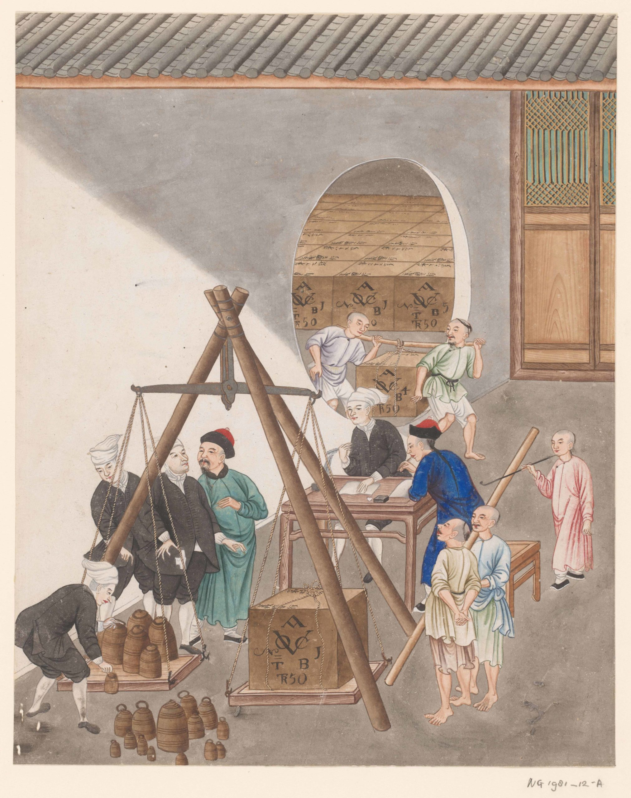
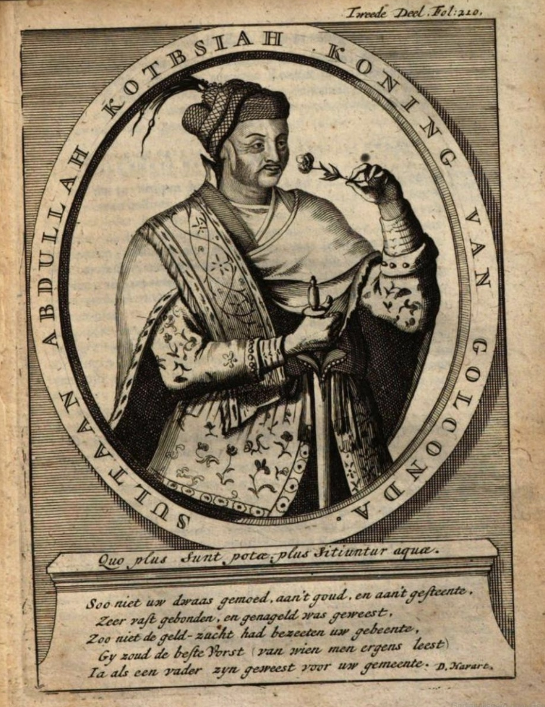

# Rediscovering Early Modern Polities: First Thoughts on Dataset Creation

> **Archived blog post.** This post was originally published on the Globalise project website on 30 June 2022 ([original URL](https://globalise.huygens.knaw.nl/rediscovering-early-modern-polities-first-thoughts-on-dataset-creation/)). The text is reproduced without changes; links to other blog posts now point to their archived copies, and other links may no longer work.

**About the author:** Manjusha Kuruppath leads the historical contextualisation team of the Globalise project at the Huygens Institute.

<!-- Bio source: Team page, https://globalise.huygens.knaw.nl/team/ (consulted 2026-10-01) -->

---

*Update: we published a first version of the Polities dataset in July 2024.*\
*[https://hdl.handle.net/10622/SOS0KC](https://hdl.handle.net/10622/SOS0KC)*

You have been pouring over the archives for weeks together in search of precious information on your research subject. Just when you thought you had laid your hands on the document that would answer your research question (forgive the slight exaggeration here), you hit upon the name of a place or person that you know nothing of and this causes momentary bewilderment. As historians, we know this feeling of puzzlement all too well. This is why the [GLOBALISE project](https://globalise.huygens.knaw.nl/#the-project) is working to contextualise entities like the names of the places, ships and polities in the VOC archives. The first step to making this information available to you as a user is to create datasets which contain ordered information that is relevant to the VOC archives. These datasets will then be incorporated into the user interface that is developed as part of the project. 

## Re-using existing VOC datasets

At the very outset, the project aims to collate existing databases that draw on information from the Dutch East India Company archives which are scattered across the web and thereby simplify the quest for such data.  A good example of this exercise in curating datasets is the one on shipping that the project has created as part of its pilot. The shipping dataset brings together information on VOC ships which feature in three separate datasets, [Dutch Asiatic Shipping](http://resources.huygens.knaw.nl/das), [Bookkeeper-General Batavia](https://bgb.huygens.knaw.nl/) and the [General Sea Muster Rolls](https://pure.knaw.nl/portal/en/publications/generale-zeemonsterrollen-verenigde-oost-indische-compagnie-1691-). The project will also create [other datasets](https://globalise.huygens.knaw.nl/share-your-data/) such as a dataset on weights, measures and commodities that will allow researchers to explore the trading pursuits of the VOC and trade in the region in general in greater detail. Any researcher will tell you that understanding the various regimes of weights and measures that were in use across the Indian Ocean in the period is woefully challenging. Yet, such data is crucial to comprehending patterns of trade, production, industry and consumption in the period and can stimulate comparative histories about standards of living in different places across the Indian Ocean world. 

*Determining the weight of tea chests for the VOC in Canton (now Guangzhou), China around 1770. *[Rijksmuseum Amsterdam, license CC0.](http://hdl.handle.net/10934/RM0001.COLLECT.338231)**

## New datasets: new perspectives, new research possibilities

We would also be doing gross injustice to the archives of the VOC if we did not acknowledge the potential and indispensability of this corpus in writing histories on myriad non-economic subjects such as conflict, religion, disease, natural disasters and climate in the Indian Ocean world. Thematically therefore, the GLOBALISE project aims to decolonise research practice. It aspires to create datasets that draw attention away from the VOC as the sole research subject yet focus on the richness of its archive in unearthing histories of the Indian Ocean world. As many scholars have argued, we acknowledge the fact that decolonisation as an object is next to unachievable. We however desire to offset the biases of the Dutch East India Company archive and existing historiography in the best way we can. As a result, we want to curate and create datasets that satisfy four conditions: i) concern themes that shed light on non-European subjects, ii) that are viable, iii) respond to existing research questions iv) have the potential to generate new questions.

What do our datasets look like? Let’s use the example of our dataset on polities to reflect on this. This dataset, currently under construction, will bring together information about all polities that existed in the 1600-1800 period that find mention in the VOC archives. This dataset borrows Craig Calhoun’s *Dictionary of the Social Sciences’* [definition](https://www.oxfordreference.com/view/10.1093/acref/9780195123715.001.0001/acref-9780195123715-e-1288) of an early modern polity as a ‘politically-organised society’. It aims to feature information on all polities that existed in the 1600 to 1800 period that find reference in the VOC archives. Some of the categories contained in this dataset includes

- Life-Span of the Polity
- Name of ruling dynasty
- List of Power-Holders and Regnal Years
- Nature of Polity
- Nature of Relationship between Polities

## Reconceptualising the Indian Ocean world

We concede that some early modern polities are so well known that collating information about these entities might seem obsolete. But this precisely is the problem with our understanding of the early modern Indian Ocean world. Conventional attempts to grapple with the political landscape of the Indian Ocean world has meant engaging with the bigger, better known and longer enduring polities like the Mughal, Mataram or the Qing. But what of the rest of the political landscape of the Indian Ocean world that was dotted with states of all shapes and sizes? Writing about the early modern kingdom of Mrauk-U, Sanjay Subrahmanyam notes that the study of the Arakan in South-East Asia, where the kingdom was located, ‘probably posed the greatest problems to the historian of the early modern period on account of its obscurity’. This remark captures the quandary of all historians hoping to piece together the pasts of numerous lesser-known polities in the period. Details of these states are so difficult to reconstruct that even secondary histories on polities shy away from either providing us with lists of its rulers or deliberating on their geographical extent. Our dataset therefore will provide greater context to what would otherwise only be unknown entities whose names aimlessly flit across the archives. By laying this groundwork, it intends to reconceptualise the Indian Ocean world as a dynamic political space populated by a mind-boggling number of polities interacting with one another in complex ways. 

*Image of Abdullah Qutb Shah of the Qutb Shahi Dynasty who ruled the kingdom of Golconda from 1626 to 1672. Source:  Daniel Havart’s *Op- en ondergang van Coromandel *(published in the Dutch Republic in 1693). Printed Dutch works from the early modern period like Havart’s account carried genealogies of ruling dynasties in Asia.*

If by creating our dataset we promise to throw light on themes that are otherwise forbidding to piece together, our ambitions come with an array of challenges. The first and the most challenging is to reconstruct information about these polities from existing encyclopaedias, the Dutch East India Company archives and related source publications, other contemporary sources, and published histories from the seventeenth century to the present day. Classifying polities on the basis of typology is also problematic. Working with labels is nothing short of stirring the hornet’s nest. There lies the obvious danger of using categories that are anachronistic or inherently European in provenance.2 Moreover, a kingdom is never always a kingdom. As a result, assigning labels like empire or kingdom to polities which are essentially organic, ever-changing beings involves the danger of imposing an unnatural fixity on these entities. A polity can also invoke multiple labels in a given period of time. For instance, a polity in self-observation might regard itself as an empire but other contemporaries may have other opinions. The notion of clearly bounded states in this period can similarly be an aberration and another contentious issue is chronology. There are as many chronological lists of dynasties and rulers as there are histories. Khoo Kay Kim’s ‘The Perak Sultanate: Ancient and Modern’ is a striking instance of just how stark the problem can be. Kim indicates that there are at least three indigenous sources chronicling the origins of the Perak Sultanate all of which bear contradictory information.3 

Here are our initial thoughts on how our datasets will navigate these problems. Firstly, with regard to typology, instead of creating a restrictive list of polity types ourselves, we will use labels that our sources employ. Researchers will therefore be free to make their own evaluations of what type a particular polity is from the data we collate. Secondly, and also as part of decolonising the knowledge we produce, these datasets will not solely rely on information and terminology used in the Dutch East India Company archives. Wherever possible, we will populate our datasets with information and perspectives from other sources over a period of time thereby exposing users to a variety of stand-points of a particular polity and also allowing them to plot the temporal transformation of the polity. Where we have to choose one chronological list over another, we will ensure that we provide relevant references to the alternative, contesting chronologies that have not merited a place in our schema. While we hope to address the aforementioned issues with the solutions we have devised, it is only natural that we’ll have to confront other and perhaps bigger problems in the course of our work in the next months.

## Forgotten entities

What are the kinds of research that our dataset on polities can inform? The evident contribution of the dataset to the writing of political histories and histories of identity, conflict and diplomacy. It will also help create the backdrop that is vital for the writing of economic, cultural and social histories of the period. The greatest impact that we foresee, would be in the manner in which the dataset can encourage people to re-envision and re-evaluate the early modern world. By bringing polities that have been unceremoniously left out of nineteenth and twentieth century histories, post-colonial history curriculums and consequently the consciousness of communities and societies back into the spotlight, we hope to spark interest into the histories of these forgotten entities.4 

------------------------------------------------------------------------

1 Sanjay Subrahmanyam, ‘Slaves and Tyrants: Dutch Tribulations in Seventeenth-Century Mrauk-U’, *Journal of Early Modern History* 1, no. 3 (1997): 201–53, [https://doi.org/10.1163/157006597X00028](https://doi.org/10.1163/157006597X00028).

2 Guido van Meersbergen also pointed this out in our breakout session titled ‘Decolonisation and data creation’ at the kick-off to the GLOBALISE project on 11 May, 2022.

3 Khoo Kay Kim, ‘The Perak Sultanate: Ancient and Modern’, *Journal of the Malaysian Branch of the Royal Asiatic Society* 59, no. 1 (250) (1986): 1–26.

4 In our breakout session on ‘Decolonisation and data creation,’ Professor Hans Hägerdal spoke of how communities are eager to rediscover their political pasts.
