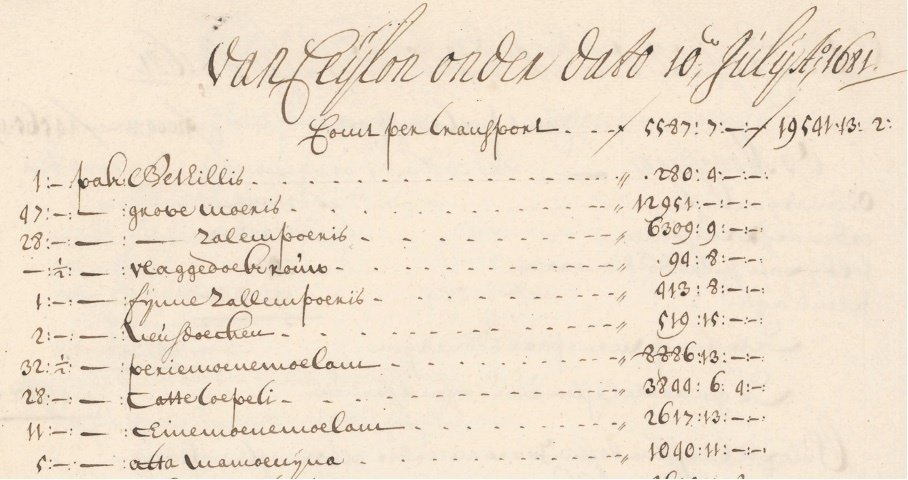
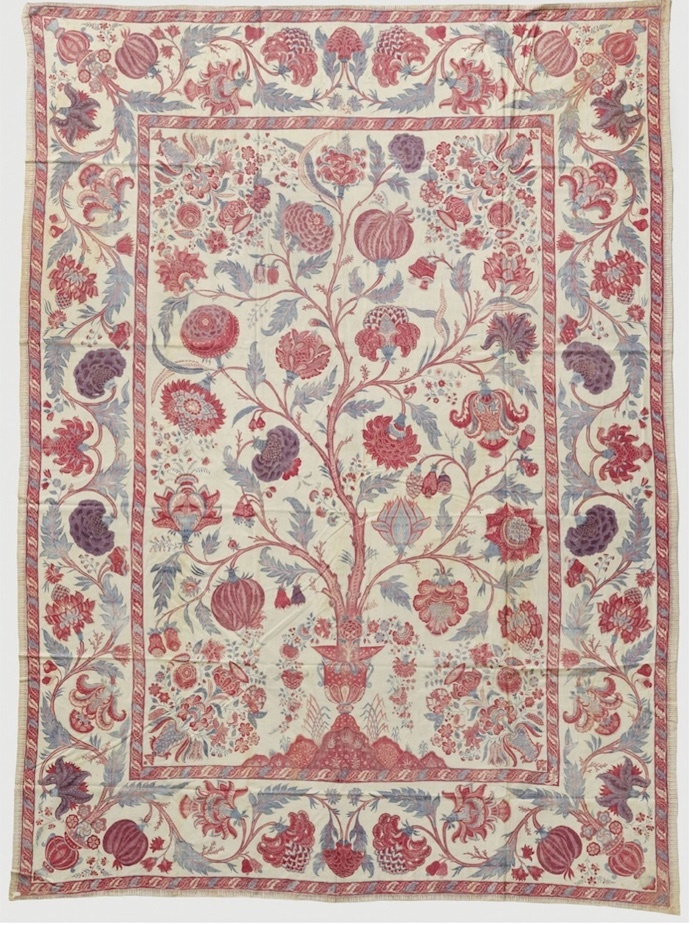
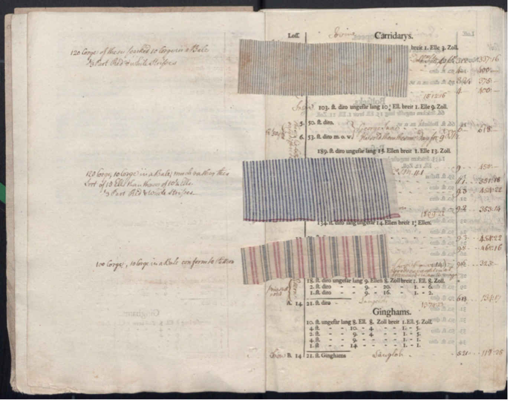

# Textile Taxonomies – GLOBALISE’s efforts in defining traded textiles in the Indian Ocean Region

> **Archived blog post.** This post was originally published on the Globalise project website on 5 April 2023 ([original URL](https://globalise.huygens.knaw.nl/textile-taxonomies-globalises-efforts-in-defining-traded-textiles-in-the-indian-ocean-region/)). The text is reproduced without changes; links to other blog posts now point to their archived copies, and other links may no longer work.

**About the author:** Henrike Vellinga was a student assistant and junior researcher in the historical contextualisation team of the Globalise project from June 2022 to August 2024.

<!-- Bio source: Former team members list, https://globalise.huygens.knaw.nl/team/ (consulted 2026-10-01) -->

---

*GLOBALISE’s textile taxonomy is part of the project’s larger commodity thesaurus. The first version of the thesaurus was published in November 2023 and can be accessed [here](https://hdl.handle.net/10622/YAWDOV). The author thanks dr. Carrie Anderson and dr. Marsely Kehoe from the [Dutch Textile Trade Project](https://dutchtextiletrade.org), as well as dr. Chris Nierstrasz for kindly sharing their expertise on VOC textile trade during the research phase of taxonomy.*

Do you know what a roll of ‘periemoenemolam’ is? Or what ‘gorgorongs’ are for that matter? Chance is, that you will at some point encounter cryptic terms like these as types of traded goods in the archives of the Dutch East India Company (VOC). VOC ships carried a wide range of commodities in their holds. Users of the archive may find information about these commodities reflected in shipping or auction lists, and in more general reports about VOC trade. Many of the terms for these commodities, however, can seem completely foreign to contemporary readers, and their definitions cannot be easily found by a quick Google search.

This is where the work we do at GLOBALISE comes in. Contextualising the VOC archive for the wider public is one of the aims of the GLOBALISE project. One of the main subjects we focus on are commodities. We create datasets of the Company’s most traded commodities, that we then define and categorise. Perhaps surprisingly, our first dataset of five hundred goods that were among the most traded in the eighteenth century, turned out to contain over two hundred kinds of textiles. This led us to give ample attention to textiles traded by the VOC in our classification efforts, which proved to be a challenging and exciting exercise. In this blogpost, I want to elaborate on these challenges posed by trying to define and categorise the various textiles featured in the VOC archives. Our aim is that by overcoming these challenges, we will eventually make it easier for our users to identify *periemoenemolam* as a kind of cotton textile, and *gorgorongs* as kind of silk textile.

**An example of a cargo list with textiles from Ceylon in the VOC archive, with several packs of* bethilles, moeris, vlaggedoek, salempoeris, neusdoeken *and* periemoenemolam. [Nationaal Archief](https://www.nationaalarchief.nl/onderzoeken/archief/1.04.02/invnr/8902/file/NL-HaNA_1.04.02_8902_0001), CC0.*

## The Importance of Textiles to VOC Trade

To the general public, the VOC is best known for its trade in spices. However, an important part of the company’s exports consisted of Indian textiles.1 The VOC had inserted itself into the existing intra-Asian textile trade early in the 17th Century.2 These textiles came mostly from the Indian subcontinent, which was a major producer and exporter of textiles in the 17th century, in the form of piece goods.3 Indian regions like Coromandel, Bengal, Gujurat and Surat were famous for their production of textiles, especially cotton cloths in all manner of bright colours, but also luxurious silks. While the Company gained revenue from the straightforward sales of piece goods in Asia and Europe, the relevance of the textile trade also lay in the use of textiles as barter goods for spices in Asia.4 Additionally Indian textiles served as a major commodity to trade for enslaved people, gold and ivory in West-Africa.5

Users of the VOC archives will find that the VOC traded in a wide array of textiles and raw materials to produce textiles. One can find mentions of Persian, Bengal and Chinese raw silk; cotton piece goods (*katoene lijwaten*); silk piece goods (*zijde stoffen)*; silk and cotton yarns; wool and linen.6 The textiles in our dataset are mostly from the Boekhouder Generaal Batavia, which kept records on commodities for more than 50 years in the 18th century.7

**An eighteenth century palampore originating from the Coromandel Coast.* [Rijksmuseum](http://hdl.handle.net/10934/RM0001.COLLECT.353959), CC0.*

The history of the textile trade can shed a light on a broad range of topics. Knowledge of textiles can contribute to writing histories of fashion, consumption and trade in Europe, Asia and Africa.8 Our dataset is also relevant to historians interested in the technology involved in the manufacture, dyeing and printing of textiles.

## What’s in a name? Defining textiles from the archive

Defining early modern textiles from the Indian Ocean world traded by European trading companies is notoriously tricky. The major issue being that there are not many surviving pieces of the textiles, which makes it hard to connect the names we find in the archive with what they actually were. Textile historians usually define textiles by referring to glossaries, which provide the name of a textile with its various alternative spellings, and its definition, lifted from written primary sources. What we at GLOBALISE would preferably like to know when a type of textile is mentioned, is the material it was made of, whether it was a fine or a coarse cloth, the colours it came in and if it was a cheap or an expensive cloth; periodisation; and the region of origin and trade. This information could help to contextualise the demand for textiles in certain areas and enlighten us about the pattern of consumption and trade. While in the past few decades, scholars have made headway in determining many of the textiles traded by European East India Companies, there still remain a few challenges.

**An example of textile samples in the archive of the Danish East India Company*. [Danish National Archives](https://www.sa.dk/ao-soegesider/da/billedviser?epid=20202401#293002,59148111). *This source has been kindly brought to my attention by dr. Marsely Kehoe and dr. Carrie Anderson of the* [Dutch Textile Trade Project](https://dutchtextiletrade.org) *and was shared with them by dr. Vibe Maria Martens of the Danish National Archives.**

There are two main issues. Firstly, the vast varieties in spelling of textile types in European sources make it difficult to determine their original equivalent as well as equivalents traded by other East India Companies. Already in the late 1970s, Indian historian K.N. Chaudhuri pointed out that the corrupted spellings of textile types which feature in the records of European East India Companies complicate the search for the exact Indian term and meaning of textiles.9 Europeans would write down the Indian language names of textiles phonetically leading to corruptions. For example, the textile called ‘sarat-khani’ in Bengali became ‘seerhaudconnae’ in the records of the East India Company.10

The other issue is that most of the glossaries are based on the archives of the East India Company and thus feature English spellings of textiles. While many of the names of textiles traded by the EIC are similar to those traded by the VOC, one has to critically regard this and not assume that these were identical, without confirmation from a trusted source. So, while the English *seerhaudconnae* is intuitively very similar to the Dutch *seerhandconaas* you cannot conclude that these are the same kind of cloth. Making such assumptions based on the similarity of terms is problematic even when just comparing Dutch terms. For example, it would seem obvious to assume that *kannekijns* and *kannekije* are one and the same kind of textile, but *kannekijns* are fine, white cloths and are completely different from *kannekije* which is a low-grade quality of Persian silk.11

This issue leads us to the question: How can we be certain that the names of textiles even possessed a fixed meaning, especially when we mostly rely on textual sources? Textile historians have pointed out variations in the meaning of textile terms. Over time, textile types with a certain name changed in the material they were made of, but these changes are not well documented. For example, cheaper imitations of certain luxury cloth were traded under the same name, which means that a bale of *patolu* found in an auction list could be either a cheap cotton or an expensive silk.12

## Moving forward

So how have we attempted to deal with these issues and questions in our database? While we aim to give users as much context as possible, it is not in our scope to do extensive research ourselves which tackles these major questions.

In recent years, various projects have already taken on these questions and have added to our knowledge about textiles traded by the VOC. For example, the ‘Trading Eurasia 1600-1830’ project at Warwick University created a textile database, which links textiles from the archives of several European East India Companies to surviving samples in museums and archives.13 More recently, the Dutch Textile Project has launched their visual textile glossary, in which textile terms are defined and further contextualised.14

As for GLOBALISE, there are a few practical measures which we have adopted. Firstly, our secondary sources are all based on research into the VOC textile trade specifically, and explicitly mention the spelling which we find in the archive. Furthermore, we give users up to three separate definitions. Crucially, we inform users of the issues one encounters in textile research and lead them to the historiography on the subject. Our work is thus a starting point for further research.

The parts of the VOC archives which will be made accessible through the GLOBALISE project will no doubt lead users to encounter many kinds of textiles traded by the VOC. Our textile database shall contextualise a part of these based on existing research. It will also lead us to more unknown and undefined textiles, while at the same time open up ways to define these ‘new’ fabrics. There is much more to uncover.

*A first version of this blog was posted on 5 April 2023 and it was updated on 19 December 2023.*

------------------------------------------------------------------------

1 O. Prakash, ‘The Dutch and the English East India Companies’ Trade in Indian Textile in the Seventeenth and the Eighteenth Century: A Comparative View’ in M. Berg, F. Gottmann, H. Hodacs and C. Nierstrasz (eds.), *Goods from the East, 1600-1800: trading Eurasia* (Hampshire, 2015), pp. 183–94, p. 183.

2 E.M. Jacobs, *Merchant in Asia: The Trade of the Dutch East India Company during the Eighteenth Century* (Leiden, 2006), p. 91.

3 P. Parthasarathi, ‘Cotton Textiles in the Indian Subcontinent 1200-1800’ in G. Riello and P. Parthasarathi (eds.), *The Spinning World: a Global History of Cotton Textiles, 1200-1850* .(Oxford, 2009), pp. 17-42, p. 18.

4 Jacobs, *Merchant in Asia*, p. 91.

5 R.J. Barendse, *Arabian Seas, 1700-1763. Volume I: The Western Indian Ocean in the Eighteenth Century* (Leiden, 2009), p. 1043; C.E. Kriger, ‘Guinea Cloth, Production and Consumption of Textiles in West Africa before and during the Atlantic Slave Trade’ in G. Riello and P. Parthasarathi (eds.), *The Spinning World: a Global History of Cotton Textiles, 1200-1850* .(Oxford, 2009), pp. 105-126, p. 105.

6 F.S. Gaastra, ‘The Textile Trade of the VOC, The Dutch Response to the English Challenge’, *South Asia* 19 (1996), pp. 85–95.

7 The Boekhouder Generaal Batatvia database can be accessed on: [https://bgb.huygens.knaw.nl](https://bgb.huygens.knaw.nl/).

8 For example: B. Lemire & G. Riello, ‘East and West, Textiles and Fashion in Early Modern Europe’, Journal of Social History (2008), pp. 887-916; C. Nierstrasz, *Rivalry for Trade in Tea and Textiles: the English and Dutch East India Companies (1700-1800)* (New York, 2015).

9 K. N Chaudhuri, *The trading world of Asia and the English East India Company, 1660-1760* (Cambridge, England; New York: Cambridge University Press, 2006), p. 500.

10 Chaudhuri, *The Trading World*, p. 500. 

11 R. Laarhoven, ‘The Power of Cloth: The Texile Trade of the Dutch East India Company (VOC) 1600-1780’ (Australian National University, 1994), p. 59; M. Kooijmans & J. Schooneveld-Oosterling. *VOC-glossarium, Verklaring van Termen, Verzameld uit de Rijks Geschiedkundige Publicatien die Betrekking hebben op de Verenigde Oost Indische Compagnie* (The Hague: Instituut voor Nederlandse Geschiedenis, 2000), p. 59.

12 Laarhoven, ‘The Power of Cloth’, p. 304.

13 <https://warwick.ac.uk/fac/arts/history/ghcc/eac/databases/textiles/>, accessed 12/18/2023.

14 C. Anderson and M. Kehoe, The Dutch Textile Trade Project, [https://dutchtextiletrade.org/](https://dutchtextiletrade.org/), accessed 12/18/2023. See also the special issue of the Journal of Historians of Netherlandish Art which introduced the Dutch Textile Trade Project: <https://jhna.org/issues/vol-15-1-2023/>.
