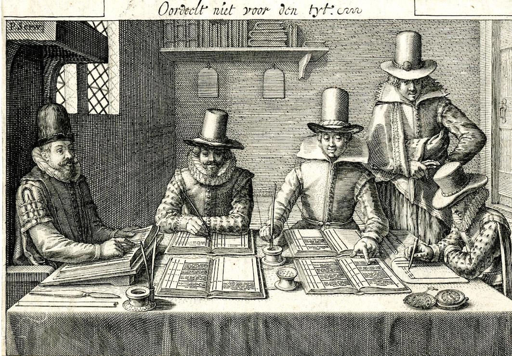
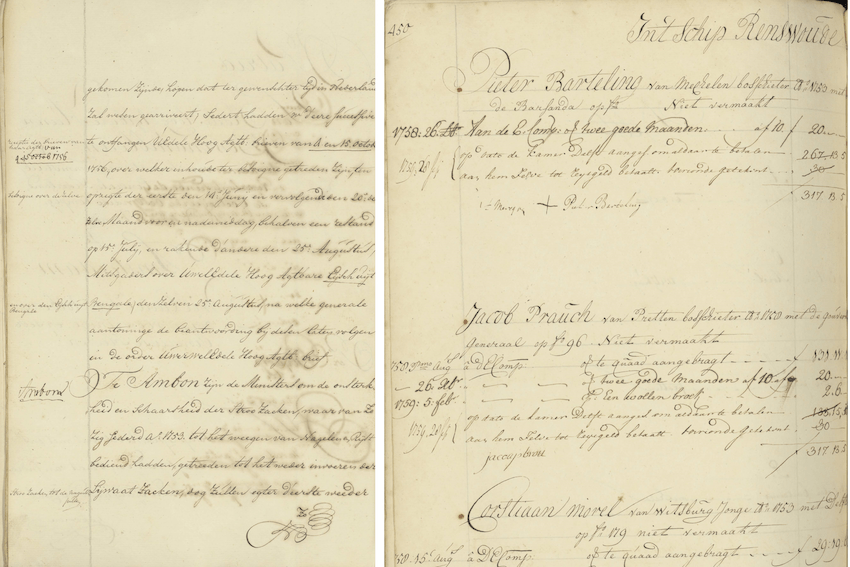

# The (Ground) Truth is out there: an introduction to GLOBALISE’s use of Handwritten Text Recognition

> **Archived blog post.** This post was originally published on the Globalise project website on 13 December 2022 ([original URL](https://globalise.huygens.knaw.nl/the-ground-truth-is-out-there-an-introduction-to-globalises-use-of-handwritten-text-recognition/)). The text is reproduced without changes; links to other blog posts now point to their archived copies, and other links may no longer work.

**About the authors:** Maartje Hids was a research assistant in the historical contextualisation team of the Globalise project from February 2022 to January 2023; Kay Pepping is a junior researcher in the same team at the Huygens Institute.

<!-- Bio source: Team page and former team members list, https://globalise.huygens.knaw.nl/team/ (consulted 2026-10-01) -->

---

Anyone who has ever worked with the archives of the Dutch East India Company is bound to be impressed with its sheer scope. Even when limiting its ambitions to the letters, reports and other documents sent over from Asia to the Dutch Republic, GLOBALISE is faced with thousands of inventory numbers. Each of those numbers represents a hefty tome at the National Archives big enough to give students who don’t lift from the knees future back problems.

Despite the efforts of countless historians who have created source publications of parts of the archive, most of this material is still only accessible as it was when it was created: page upon page of scribbles from scribes. GLOBALISE is working to convert these pages into the sort of text you and I are familiar with on our computers, so researchers can start exploring them through new methods.

*A room with four men seated around a table, one of them teaching from behind a pulpit (left), the three others copying text from books lying in front of them, another standing beyond (right), 1610-1657. Source: [The Trustees of the British Museum](https://www.britishmuseum.org/collection/object/P_1928-0313-153), CC BY-NC-SA 4.0.*

The National Archives has been carefully scanning the material to make it available online. Using *Handwritten Text Recognition (HTR)* we can automatically transcribe these pages. In order for the computer to make a good transcription, or for it to even understand what ‘good’ means, the HTR-inference process needs a model of the handwritten text. That model, in turn, is trained on ‘Ground Truth’, examples created by historians of ‘perfect pages’ (or as perfect as humans can make it).

## Challenges

Luckily, the GLOBALISE-project can stand on the shoulders of giants. Thanks to earlier initiatives such as the [IJsberg-project](https://www.nationaalarchief.nl/handschriftherkenning/projectplan-de-ijsberg-zichtbaar-maken), there are already robust models based on [large amounts of Ground Truth](https://zenodo.org/record/6414086) out there. The challenge for GLOBALISE is to create new Ground Truth to adapt these models to the peculiarities of the VOC-material. These documents span two centuries with as many differences as similarities between them.

Those differences and similarities could be described as both vertical (through time) and horizontal (between different types of documents in the VOC-archive). When looking at the General Missives, perhaps one of the best-known types of documents within the archive, this becomes clear. The General Missives are reports about the different VOC-settlements in Asia, sent over from Batavia to the Gentlemen XVII in the Dutch Republic to keep them up to date on the most important events. The differences between General Missives can be stark; the handwriting and language in a General Missive from 1622 is very different from one that was written in 1758. However, with regard to layout and content a missive from 1758 is much closer to a missive from 1622 than it is to a *monsterrol* (crewlist) from 1758. GLOBALISE is currently considering whether an all-encompassing VOC-model would provide better results than specific models trained on subsets of material, for example the General Missives. The ultimate goal is to train the model(s) to deal with these quirks of the VOC-archives as a whole.

*Left: A page from a missive dated 1758. Source: [National Archives](https://www.nationaalarchief.nl/onderzoeken/archief/1.04.02/invnr/2888/file/NL-HaNA_1.04.02_2888_0017), CC0.\
Right: A page from a *monsterrol* dated 1758. Source: [National Archives](https://www.nationaalarchief.nl/onderzoeken/archief/1.04.02/invnr/6363/file/NL-HaNA_1.04.02_6363_0686), CC0.*

During this process, we have learned a few valuable lessons that might be of use to others looking to create Ground Truth. Whether you are hoping to tackle a gigantic corpus like ours, or are working on a much smaller set (perhaps even just the handwriting of one particular person), these are the things we’ve found essential during our work:

## 1. **Guidelines**

Consistency is key when creating Ground Truth and the key to consistency are guidelines. You have to make countless small decisions when creating Ground Truth. Do you capitalise this letter? Do you write out this abbreviation? For experienced transcribers, it is tempting to make this decision on a case-by-case basis, leading to potentially inconsistent Ground Truth. Formulating guidelines forces you to consider your choices and write them down so you can refer back to them.

## 2. Review, review, review

When more than one person is creating Ground Truth, make sure you have regular and recurring moments of evaluation. We’ve found that there are things that people do differently without even thinking about them. Make sure to look at each other’s work or, as we’ve found preferable, work on pages together and discuss the differences. This will result in the most consistent Ground Truth.

## 3. Time management

Don’t underestimate how taxing it is to create good Ground Truth. You can’t create perfect material in one go. Careful review is needed to catch small mistakes and inconsistencies. We have found that working in short sessions generally resulted in better material than material made in one marathon-session. Don’t strain your eyes and attention-span beyond their limits: your material will suffer from it. A great excuse to take a break!

## 4. Model training

Creating Ground Truth isn’t just about creating the best transcriptions. It is about creating the best transcriptions for the HTR-model. Keep that goal in mind! Your software or model might have some requirements that feel slightly counter-intuitive, but will produce better results. Consult with the team that is creating and running the model or check the resources provided by the tool of your choice.

## 5. Use the resources at your disposal

Don’t create Ground Truth in a vacuum. Use the resources you would normally use to do academic research on your topic. Seemingly nonsensical words might have meanings you didn’t know about, but that occur in literature, primary source publications or dictionaries such as the [WNT](https://ivdnt.org/woordenboeken/woordenboek-der-nederlandsche-taal/). Did you know that *Abrekocken* are a type of apricot?

It is clear that creating Ground Truth is a challenge. It combines all the difficult parts of creating really good transcriptions with the hassles of slightly unfamiliar technology. There is good news too: you’ll only need 30-40 pages to train a model of your own for a specific handwriting. With good planning and a little preparation using our tips, that should be achievable for most. Our GT, HTR-output and final models will also be published at some point in the future. Until then, get experimenting! Unlocking your corpus for digital analysis is only a couple dozen pages of Ground Truth away…
