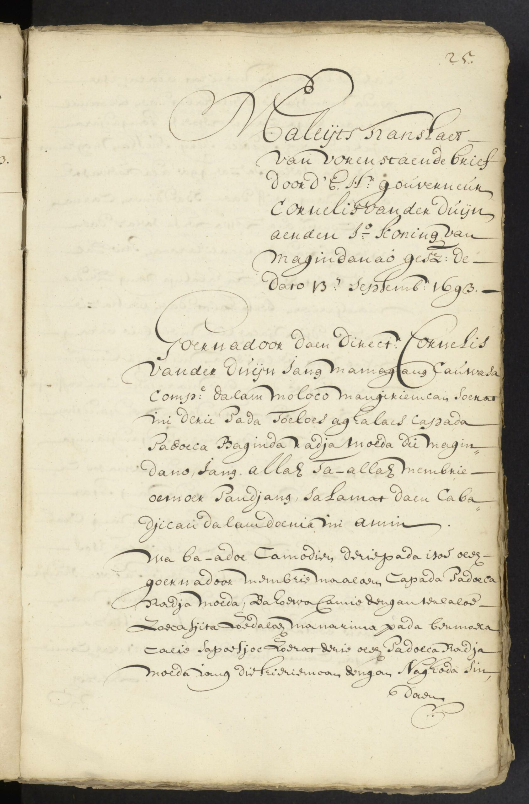
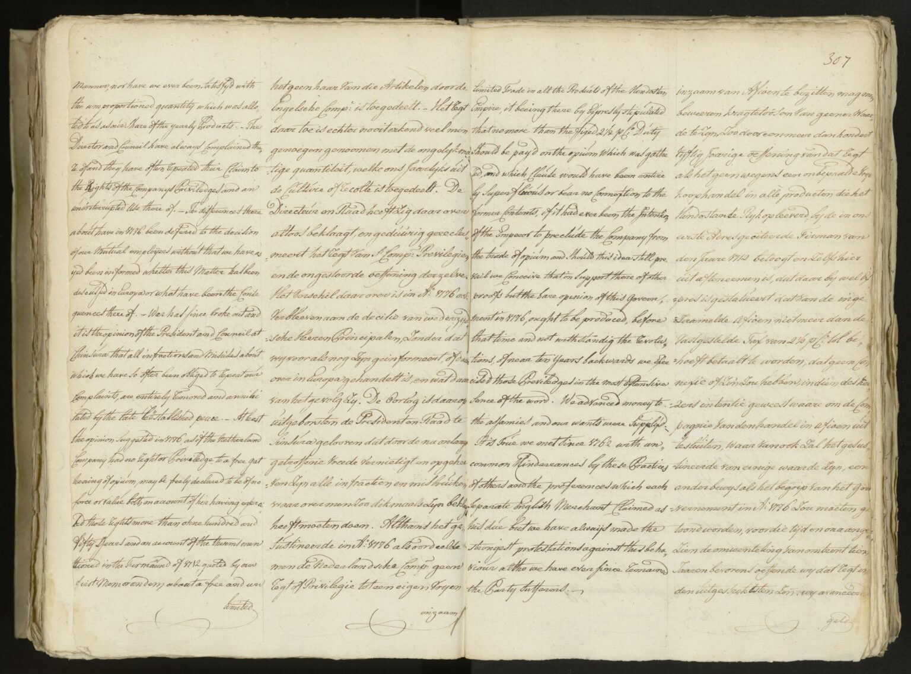
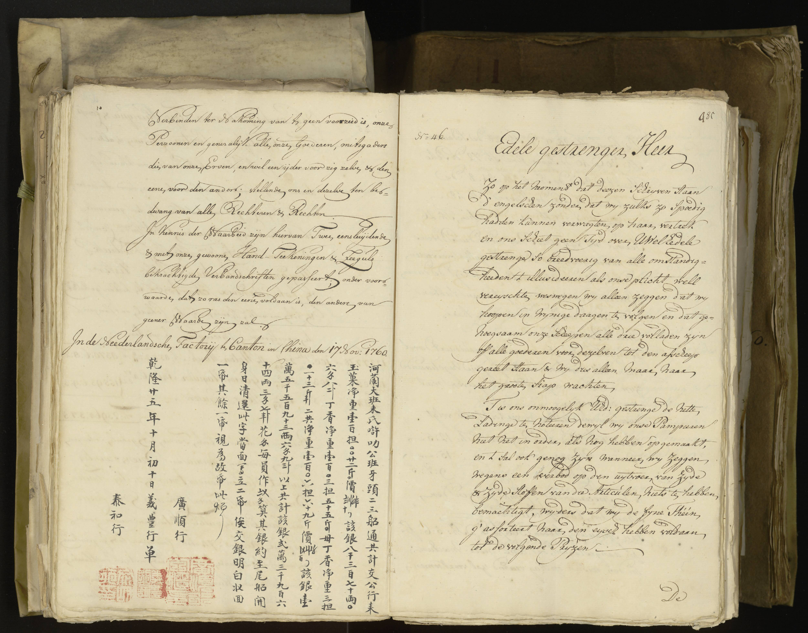

# The Languages of GLOBALISE

> **Archived blog post.** This post was originally published on the Globalise project website on 11 December 2024 ([original URL](https://globalise.huygens.knaw.nl/the-languages-of-globalise/)). The text is reproduced without changes; links to other blog posts now point to their archived copies, and other links may no longer work.

**About the author:** Arno Bosse was team lead for digital infrastructure in the Globalise project from January 2022 to September 2025.

<!-- Bio source: Former team members list, https://globalise.huygens.knaw.nl/team/ (consulted 2026-10-01) -->

---

**Update: 25 July, 2025** We recently found examples of texts written in several new languages: [Buginese](https://transcriptions.globalise.huygens.knaw.nl/detail/urn:globalise:NL-HaNA_1.04.02_2828_0089), [Gujarati](https://transcriptions.globalise.huygens.knaw.nl/detail/urn:globalise:NL-HaNA_1.04.02_1143_0113), and [Japanese](https://transcriptions.globalise.huygens.knaw.nl/detail/urn:globalise:NL-HaNA_1.04.02_1116_0658).

The vast majority of documents in the GLOBALISE VOC corpus were written in Dutch. But what of the letters, petitions, treaties, and diplomatic notes in this collection which were exchanged in other regional and European languages with local rulers, trading companies or VOC employees? We already know that a significant but still unknown quantity of these documents exist because of references to them in the VOC inventories, previous scholarship by researchers and because we’ve occasionally even run across them ourselves during the course of our work. In fact, being able to filter search results by language was one of the most requested features during the [user panels](/pages/about/archive/blog/aligning-globalise-with-researchers-needs.md) we organised at the beginning of the GLOBALISE project. And so earlier this year we set out with the ambitious goal of identifying all of the language(s) in our corpus, sharing this metadata, and making it available as a filter option in our prototype transcriptions viewer.

*Dutch-Malay ([link](https://transcriptions.globalise.huygens.knaw.nl/detail/urn:globalise:NL-HaNA_1.04.02_1554_0601))*

## **Challenges in Detecting Languages in Early Modern Texts**

With all of these texts already [machine-transcribed and searchable](https://transcriptions.globalise.huygens.knaw.nl/), shouldn’t it be a simple matter to apply a language detection algorithm to the whole corpus and record the results? Well, yes.. but in practice it wasn’t that straightforward. As a start, language detection tools such as [lingua-rs](https://github.com/pemistahl/lingua-rs) are primarily trained to detect modern languages in contemporary texts, not on the still often faulty machine-transcribed early modern texts in our collection. Then there is the basic question of when a text should be identified as being in one language or another (or both). For example, if a Dutch text also includes ten or twelve words in English, do we still record this as a Dutch text or a mixed Dutch-English text? And what about Malay words for commodities that are freely used in Dutch texts – do we count these as Malay or as Malay loan-words like *bamboe* that have now become Dutch as well? And what are we going to do about documents written in scripts which [Loghi](https://github.com/knaw-huc/loghi), our transcription software, was not able to process at all? For example, text passages or entire documents written in Chinese or Japanese?

Following a series of trial and error tests this summer, we arrived at a method that allowed us to automatically identify Latin-script languages in the GLOBALISE VOC corpus, leaving aside those (mostly tabular, but for example also blank) pages which contained too little continuous text for the algorithm. You can [read more about our methodology](https://github.com/globalise-huygens/language-identification-data/blob/main/README.md) but in essence, we decided that to be recorded as present, a non-Dutch language needed to be identified on at least three consecutive lines on a page or else in at least 25% of the total lines of text in the main body (i.e. layout) region. This rule was applied to filter out, on the one hand, very short, non-Dutch phrases (for example, names), but on the other hand also be able to accommodate pages that were evenly split between Dutch and non-Dutch in parallel columns. Each line of text is first examined using a character-based language recognition model for the presence of one or more instances of a pre-selected group of languages known to be present in the corpus (Dutch, French, Latin, English, Portuguese, Spanish, German, Italian, transliterated Malay, and Danish). These predictions were then compared on the word level with language-specific lexical models before the final language assignment was made.

*English-Dutch ([link](https://transcriptions.globalise.huygens.knaw.nl/detail/urn:globalise:NL-HaNA_1.04.02_3714_0343))*

In one sense, what we found was exactly what we had expected. The vast majority of the texts in the corpus are indeed written in Dutch (almost 97% or c. 4.3 million pages). This is followed by 3% ‘unknown’ pages where we were unable to automatically identify a language(s), and then a long list of very small percentages (all under 0.1%) consisting of single or multiple languages in combination. Of these, the top five, in order of frequency were: French and Dutch (0.07%, 3070 pages), French (0.06%, 2477 pages), English and Dutch (0.05%, 2430 pages), Latin and Dutch (0.04%, 1635 pages), and English (0.02%, 1119 pages).

Documents written in South and East Asian languages such as Chinese, Persian, or Sinhala presented different challenges. As we noted earlier, Loghi is unable to recognise non-Latin scripts and turns these into a series of seemingly random characters like this: 45 12 7.p 1 x 1 ƒ ƒ \#f. But the characters, or rather the *types* of characters Loghi produced are not entirely random. Confronted by, for example, a series of Arabic characters, it tries first to ‘make it fit’ to a Latin character that looks most like it (e.g. a number) and if it really can’t manage, it falls back on increasingly rarely used letters, punctuation and symbols such as ꝝ, ȼ or ꝕ. Could we take advantage of this and search the corpus for similar, ‘random’ combinations of obscure characters as a stand-in for the underlying non-Latin script languages? We could! After undertaking a series of explorations on this basis (plus a good deal of manual page flipping guided by the entries in the VOC inventories), we were able to identify a small number of additional pages written (wholly or partially) in [Malay](https://transcriptions.globalise.huygens.knaw.nl/detail/urn:globalise:NL-HaNA_1.04.02_1074_0461) (Arabic script), [Sinhala](https://transcriptions.globalise.huygens.knaw.nl/detail/urn:globalise:NL-HaNA_1.04.02_1616_0387), [Tamil](https://transcriptions.globalise.huygens.knaw.nl/detail/urn:globalise:NL-HaNA_1.04.02_1864_0957), [Bengali](https://transcriptions.globalise.huygens.knaw.nl/detail/urn:globalise:NL-HaNA_1.04.02_3687_0539), [Chinese](https://transcriptions.globalise.huygens.knaw.nl/detail/urn:globalise:NL-HaNA_1.04.02_4384_0500), [Persian](https://transcriptions.globalise.huygens.knaw.nl/detail/urn:globalise:NL-HaNA_1.04.02_3715_0160), [Old Church Slavonic](https://transcriptions.globalise.huygens.knaw.nl/detail/urn:globalise:NL-HaNA_1.04.02_3658_1061), and even coded in [cipher](https://transcriptions.globalise.huygens.knaw.nl/detail/urn:globalise:NL-HaNA_1.04.02_1292_1221).

*Dutch-Chinese ([link](https://transcriptions.globalise.huygens.knaw.nl/detail/urn:globalise:NL-HaNA_1.04.02_4384_0199))*

## Results and Open Access to Datasets

The table below provides an overview. You can download a tab-delimited file ([pages.lang.tsv](https://github.com/globalise-huygens/language-identification-data/blob/main/latin-script-pages/pages.lang.tsv)) with a list of the automatically and manually identified language(s) for every page and inventory in the GLOBALISE VOC corpus.

| Language(s)                  | Page Count | Percentage |
|------------------------------|------------|------------|
| Dutch                        | 4337493    | 96.67%     |
| Unknown                      | 136163     | 3.03%      |
| French, Dutch                | 3070       | 0.07%      |
| French                       | 2477       | 0.06%      |
| English, Dutch               | 2430       | 0.05%      |
| Latin, Dutch                 | 1635       | 0.04%      |
| English                      | 1119       | 0.02%      |
| Latin                        | 559        | 0.01%      |
| Portuguese                   | 362        | 0.01%      |
| Malay, Dutch                 | 268        | 0.01%      |
| Malay                        | 232        | 0.01%      |
| Dutch, Portuguese            | 215        | \<0.01%    |
| Spanish                      | 214        | \<0.01%    |
| Sinhala, Dutch               | 107        | \<0.01%    |
| German, Dutch                | 80         | \<0.01%    |
| German                       | 57         | \<0.01%    |
| Dutch, Spanish               | 54         | \<0.01%    |
| Danish, Dutch                | 24         | \<0.01%    |
| English, French              | 23         | \<0.01%    |
| English, French, Dutch       | 21         | \<0.01%    |
| Italian, Dutch               | 14         | \<0.01%    |
| Chinese, Dutch               | 11         | \<0.01%    |
| Tamil, Dutch                 | 8          | \<0.01%    |
| Cipher                       | 7          | \<0.01%    |
| Chinese                      | 7          | \<0.01%    |
| Portuguese, Spanish          | 5          | \<0.01%    |
| Persian                      | 5          | \<0.01%    |
| Japanese                     | 5          | \<0.01%    |
| Italian                      | 4          | \<0.01%    |
| Danish                       | 4          | \<0.01%    |
| French, Latin, Dutch         | 3          | \<0.01%    |
| English, Bengali, Persian    | 3          | \<0.01%    |
| Church Slavonic              | 2          | \<0.01%    |
| German, English, Dutch       | 2          | \<0.01%    |
| Gujarati                     | 2          | \<0.01%    |
| Buginese                     | 2          | \<0.01%    |
| English, Latin, Dutch        | 1          | \<0.01%    |
| Dutch, Cipher                | 1          | \<0.01%    |
| French, Latin                | 1          | \<0.01%    |
| Danish, French, Dutch        | 1          | \<0.01%    |
| English, Dutch, Portuguese   | 1          | \<0.01%    |
| Hebrew, Ancient Greek, Dutch | 1          | \<0.01%    |

However, we felt that this was not enough. Since the choices we made to determine, for example, whether there was ‘enough’ non-Dutch text on a page to be worth recording were in a sense arbitrary we wanted to provide you with several more ways to easily access and review the relevant (in particular, non-Dutch and unknown) texts yourselves:

- [nondutch-pages.lang.tsv](https://github.com/globalise-huygens/language-identification-data/blob/main/latin-script-pages/nondutch-pages.lang.tsv) – all automatically identified pages with at least one non-Dutch language; also includes their relevant paragraph region texts and page URLs.
- [unknown-pages.lang.tsv](https://github.com/globalise-huygens/language-identification-data/blob/main/latin-script-pages/unknown-pages.lang.tsv) – all pages whose language(s) could not be automatically identified (e.g. blank pages, pages consisting primarily of tables, upside-down pages etc.); also includes their relevant paragraph region texts and page URLs.
- [non-latin.scripts.tsv](https://github.com/globalise-huygens/language-identification-data/blob/main/non-latin-script-pages/non-latin.scripts.tsv) – a manually curated list of pages with text in one or more languages written in non-Latin scripts, as well as pages written in cipher; includes the page URLs but not the paragraph region texts.
- [corrections.lang.tsv](https://github.com/globalise-huygens/language-identification-data/blob/main/corrections/corrections.lang.tsv) – a manually curated list of additions and corrections to pages with automatically identified languages.

All of these metadata, a more detailed description of our methodology, and links to the software, lexica, and language models used to create these lists can be found on the GLOBALISE [language-identification-data](https://github.com/globalise-huygens/language-identification-data) repository on GitHub. All of the files on the repository are freely available for (re)use under open-access and open-source licenses.

At present, it’s not yet possible to filter on one or more language(s) in the [GLOBALISE Transcriptions Viewer](https://transcriptions.globalise.huygens.knaw.nl). But we plan to add this functionality in early 2025. Until then, we hope that these lists of identified languages stimulate many new discoveries and research questions. No doubt there will also be some mistakes in our lists (and new language identifications still to be made) in particular amongst the large set of ‘unknown’ pages. Please let us know if you have corrections or additions for us or if these metadata led you to interesting new findings – [we’d love to hear from you](https://globalise.huygens.knaw.nl/contact-us/).
