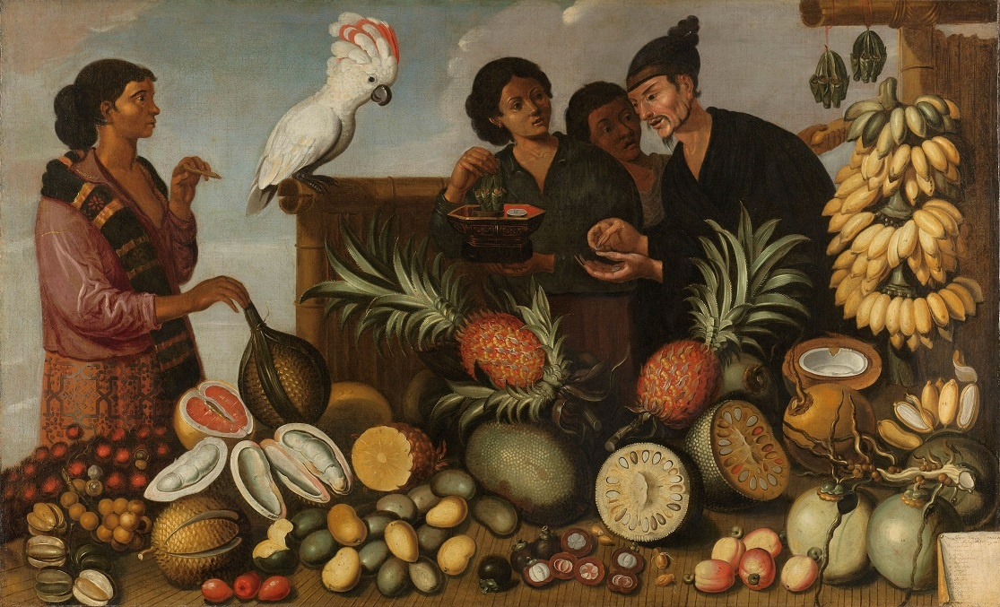
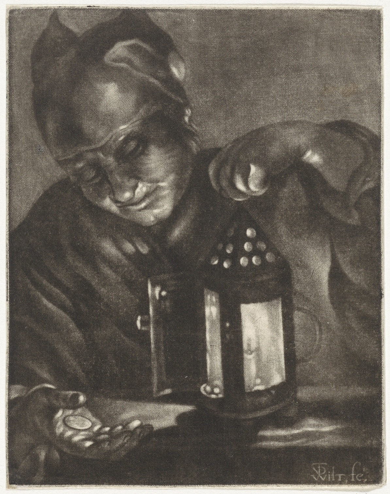
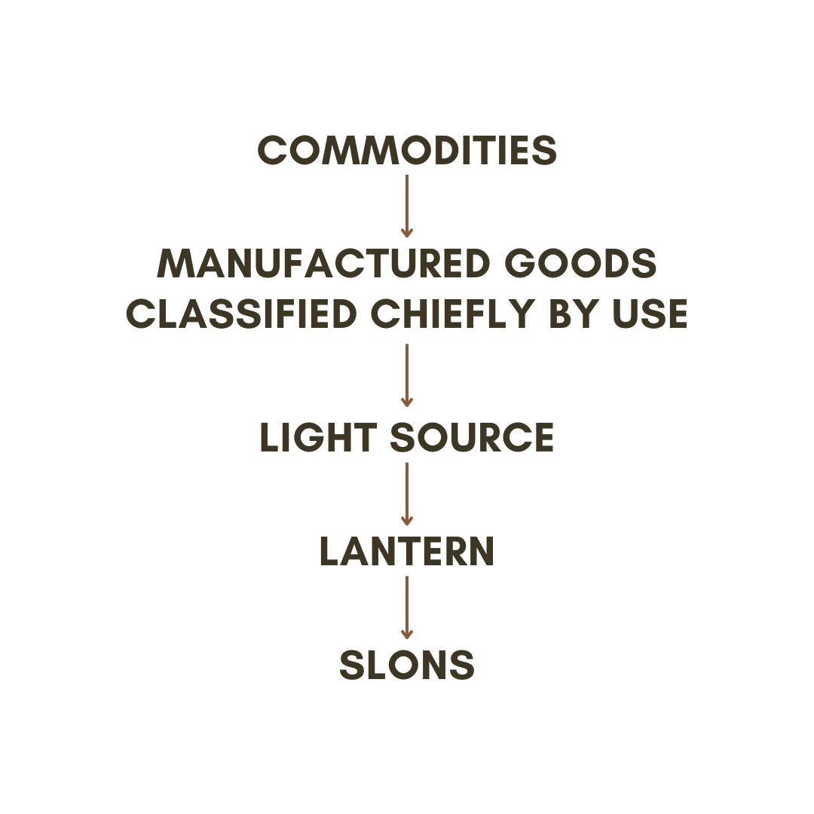

# Thesaurus Treasures: Why We’re Creating a Hierarchical Lexicon of Commodities

> **Archived blog post.** This post was originally published on the Globalise project website on 15 February 2024 ([original URL](https://globalise.huygens.knaw.nl/thesaurus-treasures-why-were-creating-a-hierarchical-lexicon-of-commodities/)). The text is reproduced without changes; links to other blog posts now point to their archived copies, and other links may no longer work.

**About the author:** Kay Pepping is a junior researcher in the historical contextualisation team of the Globalise project at the Huygens Institute.

<!-- Bio source: Team page, https://globalise.huygens.knaw.nl/team/ (consulted 2026-10-01) -->

---

Working with the GLOBALISE transcriptions of the VOC archives that are publicly available both as a [download](https://hdl.handle.net/10622/LVXSBW) and through a temporary [transcription viewer](https://transcriptions.globalise.huygens.knaw.nl/) can be challenging. As the archival material spans two centuries, multiple continents and millions of pages, it is sometimes difficult to find what you’re looking for. The archive is full of terms and expressions that are not familiar to a modern audience, but that are essential to both finding relevant material and understanding what you’ve found.

One does not need to look for long to find an example of this challenge. Most people with a passing familiarity with the VOC associate it with spices. One of the company’s most infamous acts is the brutal monopolizing of the worldwide trade in cloves (*kruidnagelen* in Dutch). Yet, somehow searching through the transcriptions with the query “[*kruidnagel*](https://transcriptions.globalise.huygens.knaw.nl/?indexName=docs-2024-03-18&fragmentSize=100&from=0&size=10&sortBy=_score&sortOrder=desc&query=eyJkYXRlRnJvbSI6IjE1MDAtMDEtMDEiLCJkYXRlVG8iOiIxODAwLTAxLTAxIiwiZnVsbFRleHQiOiJrcnVpZG5hZ2VsIiwidGVybXMiOnt9fQ%3D%3D)” results in… zero hits. “[*kruidnagelen*](https://transcriptions.globalise.huygens.knaw.nl/?indexName=docs-2024-03-18&fragmentSize=100&from=0&size=10&sortBy=_score&sortOrder=desc&query=eyJkYXRlRnJvbSI6IjE1MDAtMDEtMDEiLCJkYXRlVG8iOiIxODAwLTAxLTAxIiwiZnVsbFRleHQiOiJrcnVpZG5hZ2VsZW4iLCJ0ZXJtcyI6e319)” works better, but only returns 37 results. Using [Levenshtein distance of 3](https://transcriptions.globalise.huygens.knaw.nl/?indexName=docs-2024-03-18&fragmentSize=100&from=0&size=10&sortBy=_score&sortOrder=desc&query=eyJkYXRlRnJvbSI6IjE1MDAtMDEtMDEiLCJkYXRlVG8iOiIxODAwLTAxLTAxIiwiZnVsbFRleHQiOiJrcnVpZG5hZ2VsZW5%2BMyIsInRlcm1zIjp7fX0%3D)[^1], which can be used to account for deviations in spelling and errors in transcription, expands the results to 123 hits. How is it possible that one of the most important trade goods is mentioned only about a hundred times across a 200 year period?

The answer is deceptively simple: the VOC generally did not talk about cloves. Instead, they spoke about various subdivisions such as *garioffel* (prime quality cloves) or *moernagel* (the mature ovary of a clove). Once you learn this, the clove becomes visible in the archive. “[*garioffel*](https://transcriptions.globalise.huygens.knaw.nl/?indexName=docs-2024-03-18&fragmentSize=100&from=0&size=10&sortBy=_score&sortOrder=desc&query=eyJkYXRlRnJvbSI6IjE1MDAtMDEtMDEiLCJkYXRlVG8iOiIxODAwLTAxLTAxIiwiZnVsbFRleHQiOiJHYXJpb2ZmZWwiLCJ0ZXJtcyI6e319)”, without allowing for any spelling variation, already returns a staggering 21,416 results.

To help people with finding what they’re looking for in the archives, GLOBALISE aims to provide several reference datasets. The first of these, [a dataset on the commodities of the early modern Indian Ocean World sourced from existing datasets based on the VOC archives](https://hdl.handle.net/10622/YAWDOV) has now been published.

**A Market Stall in Batavia*, attributed to Albert Eckhout,  c. 1640 – c. 1666. [Rijksmuseum](http://hdl.handle.net/10934/RM0001.COLLECT.10087), CC0.*

## **Structure and contents of the dataset**

The dataset has the form of a thesaurus: commodity entries feature a definition and a list of synonyms. We used a data model called [SKOS](https://www.w3.org/2004/02/skos/) (Simple Knowledge Organization System) to do so. Each different commodity was turned into a skos:Concept and given a special code (URI). We then gave each item a name, or label, based its mention in either the VOC archive or the literature. The most commonly used name became the main label (skos:prefLabel), while other names for the same item were considered as ‘alternate labels’ (skos:altLabel). Then, they are grouped together in a tree-like structure according to their definition.

Content-wise, the thesaurus consists of commodities that appear in the shipping ledgers of the [*Boekhouder-Generaal Batavia* dataset](https://bgb.huygens.knaw.nl/), an important source of information for the Company’s trade in the eighteenth century. We provide an initial definition and classification for 1,400 of the most frequently occurring commodities from this dataset. As we have worked on commodities with the most mentions in this dataset, we presume that these 1400 concepts cover a large share of the commodity occurrences in the *[Overgekomen Brieven en Papieren](https://globalise.huygens.knaw.nl/source-corpus/)*, the corpus in the VOC archives that the Globalise Project is digitizing.

It is important to note that some disparities exist between what the VOC considered ‘goods’ suitable for shipping lists and what modern historians define as commodities. One striking example is the inclusion of enslaved persons within the category ‘people treated as commodities’. While this may be unsettling, it is a deliberate choice. These entries serve as a stark reminder of the historical violence associated with the commodification of enslaved individuals. By retaining these mentions, the dataset aims to acknowledge these historical atrocities and ensure they are not forgotten.

Furthermore, in a similar vein, it is essential to acknowledge that the current iteration of the dataset still harbors some regrettable phrasing within certain definitions. Some of the material we have used to provide definitions uses outdated or colonial language. We have worked hard on formulating how we want to paraphrase these definitions and are committed to make sure that future versions of the dataset are free from offensive and antiquated terminology while also maintaining transparency regarding the historical context of each definition.

Within the first version of the dataset, 2,294 concepts have not been defined and classified as yet. These were the least frequently occurring concepts in the *Boekhouder-Generaal Batavia* (occurring less than 8 times each). As such, they are in the dataset under the category NOT YET CLASSIFIED, so that they can be put in the right spot in the future.

## **Explaining the structure of the dataset**

To illustrate the aforementioned tree-like structure, let’s take a closer look at the concept of *slons* in our dataset*.* Although Dutch readers might associate this term with untidiness, in this context a *slons* is a small lantern that oftentimes only emits light at the front. The slons is also known as a *dievenlantaarn,* a thief’s lantern. A lantern, in turn, has quite an elaborate definition:

“A device for enclosing and protecting a light source, usually consisting of walls of a translucent material, usually glass, formerly also often horn, set between some uprights and covered with a hood.”

**Oude vrouw bekijkt munte*n, Thomas van der Wilt*.* [Rijksmuseum](http://hdl.handle.net/10934/RM0001.COLLECT.47177), CC0.*

The utilitarian definition of a ‘lantern’ leads this concept to be classified within the taxonomy primarily based on its function as a ‘light source’. As such, it is a type of light source, which in turn is categorized under the parent category of ‘manufactured goods classified chiefly by use’. Supplementary to this category, our hierarchy also includes ‘manufactured goods classified chiefly by material’, which includes concepts such as ‘copper wire’.

This results in the following place for the concept of *slons* within our hierarchy*.*

1.  **Commodities:** as the highest level of this dataset, every concept in the dataset is in some form a commodity.
2.  **Manufactured goods classified chiefly by use:** A commodity used as a light source is defined not as made from a specific material, but by its use in illumination.
3.  **Light source:** although technically not a light source in itself, the purpose of a lantern is to house a source of light. From the perspective of its meaning, ‘light source’ is a more relevant categorization than the alternative of ‘container’.
4.  **Lantern:** the slons is a type of lantern, with added specifications such as being small and often emitting light at the front.
5.  **Slons:** At the tail end of the hierarchy, the *slons* inherits all the above information: it is a lantern, a light source, a manufactured good classified chiefly by use and a commodity. Because the *slons* is also known as a *slonslantaarn* and in plural form, *slonsjes,* these two words are added as alternative labels.

For now, this is where our hierarchy ends. However, our group of NOT YET CLASSIFIED concepts include a sub-category of *dievenslons.* From context and a definition from a secondary source, we can infer that this concept might be a slons that **always** only emits light at the front. In the future, it could therefore be added as:

6\.   **Dievenslons:** a slons which only emits light at the front.

![ierkante handlantaarn op ijzeren voetstuk met ingezwenkte naden en bolvormige pootjes. Opstaande rand met rond gaatje. Voor- en zijkant van glas. Het glas in de zijkanten is geslepen. Centraal in voorkant VOC-embleem en in de vier hoeken geschulpt bloemmotief. Hierboven een opstaande rand met ...-motief die overgaat in bovenkant met ingezwenkte randen waarop een bronzen knop (...vorm) is bevestigd. Hieroverheen is het handvat genageld. Achterzijde: ijzeren deurtje met bronzen plaat aan binnenzijde. Hierin een holle ronde vorm geperst. Sluiting in vorm van grendel met balustervormige sluiting. Scharnierend handvat aan buitenzijde van deur.](/assets/images/about/archive/blog/thesaurus-treasures-why-were-creating-a-hierarchical-lexicon-of-commodities/2.jpg)

*VOC lantaarn, [Rijksmuseum](http://hdl.handle.net/10934/RM0001.COLLECT.363266), CC0.*

## **An example of using the dataset: query expansion**

All of the commodities in the dataset are within a hierarchy like the one for *slons.* As such, the dataset does not just provide you a definition for concepts you might never have heard of before: it can also help you find what you’re looking for within the archive. In the earlier example of cloves, you could use thesauri-based query expansion to include all alternative names for cloves, and all of its subtypes like *garioffel* and *moernagel* with their respective names, in one query. This would expand the number of results from virtually none to tens of thousands.

For now, that seems like more than is feasible to research. However, as more ways to facet and filter the transcriptions become available, the value of getting as many relevant results as possible increases. When searching, for example, for appearances of *kruidnagel* in documents coming from Siam between 1640 and 1645, the expanded query will presumably result in a much smaller amount of results, where every found instance is welcome.

The value of thesaurus-based query expansion increases when looking at categories a little higher up in the taxonomy. It would be feasible to manually search for *kruidnagel, garioffel, moernagel* and its various variations. For someone who is interested in all spices, it would be much more laborious. The dataset enables researchers to get a large set of relevant search terms in one go. As the dataset grows, this efficiency will grow with it.

For now, researchers will have to write their own scripted solution to expand their queries (or enter the search terms manually). In the future, we hope to offer a (re)search interface that allows automated query expansion.

## **The road to GLOBALISE Commodities Thesaurus 2.0**

As the earlier remark about NOT YET CLASSIFIED has shown, there is as much work to be done as has been accomplished so far. At GLOBALISE, we have several aims for the second version:

1.  To classify and organize the commodities listed as NOT YET CLASSIFIED
2.  To improve upon existing definitions in the dataset based on community feedback
3.  To increase the number of alternative labels in the dataset
4.  Identify the languages of the commodity labels
5.  To remove problematic language from definitions

At the moment of writing, there are still over three years left for the project. By releasing this first version of the dataset ‘relatively’ early, we are hoping to collect and accommodate community feedback, suggestions and content. Although these are welcome in any form, there are a few ways which will be particularly helpful to us:

1.  Suggestions on new or better definitions, labels and categorizations when you encounter concepts that either are NOT YET CLASSIFIED or that are defined and classified in a way you think is insufficient. The easiest way to do this is by going to our [contact form](https://globalise.huygens.knaw.nl/contact-us/). Any comments, improvements or remarks are welcome, no matter how big or small.
2.  Datasets, glossaries and other information that you have the rights to that could improve the dataset. So far, we’ve been grateful to have received, among others, lists of animals shipped by the VOC as gifts, taxonomies, and small glossaries published with articles. The easiest way to send these to us is, again, through our [contact form](https://globalise.huygens.knaw.nl/contact-us/).

[^1]: The ‘~’ parameter allows to take Levenshtein-distance into account when using the Transcriptions viewer. An overview of usable search parameters can be found here: [https://transcriptions.globalise.huygens.knaw.nl/help](https://transcriptions.globalise.huygens.knaw.nl/help).
