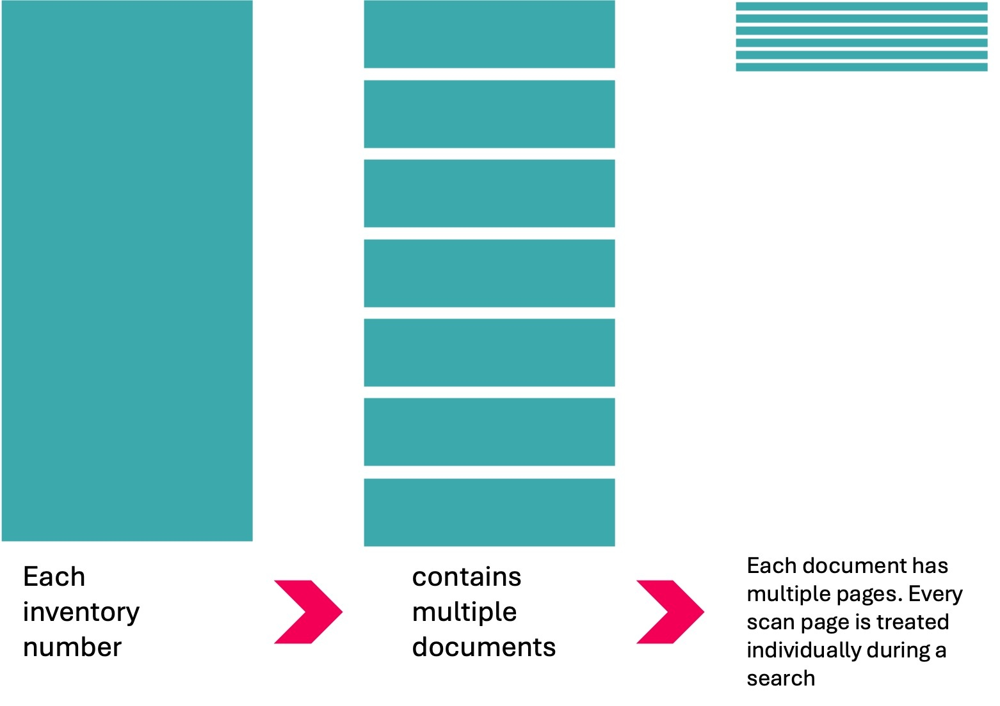
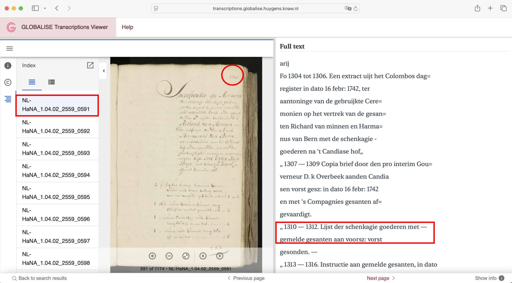
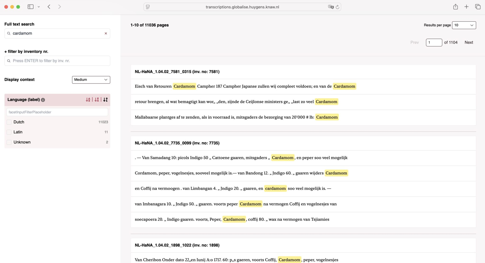
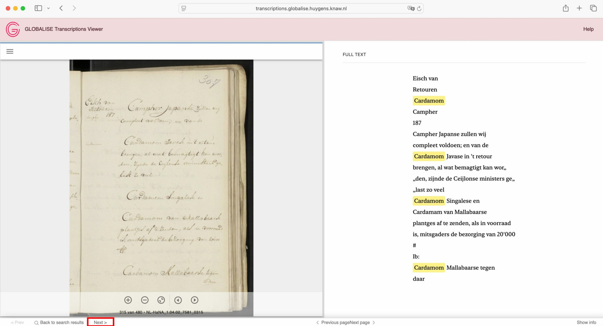
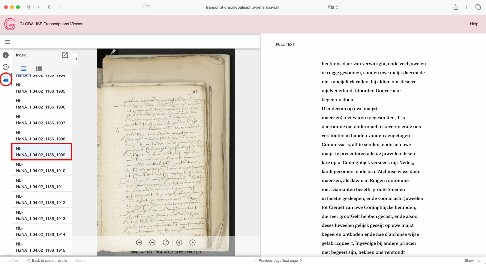
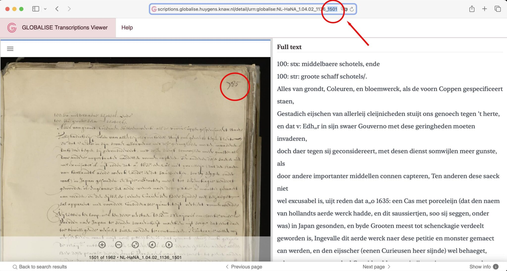
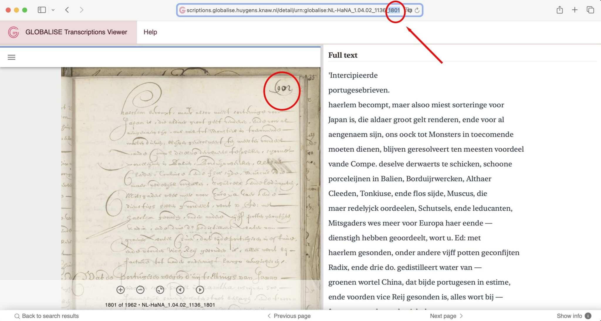
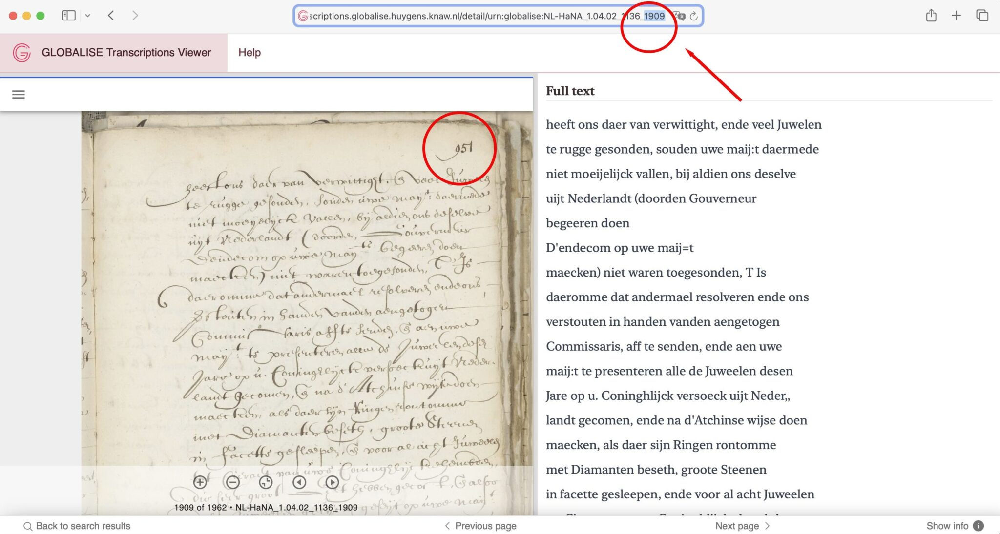
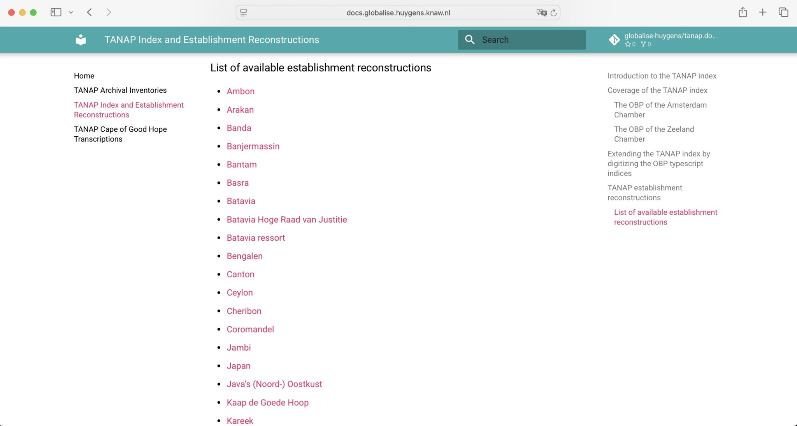
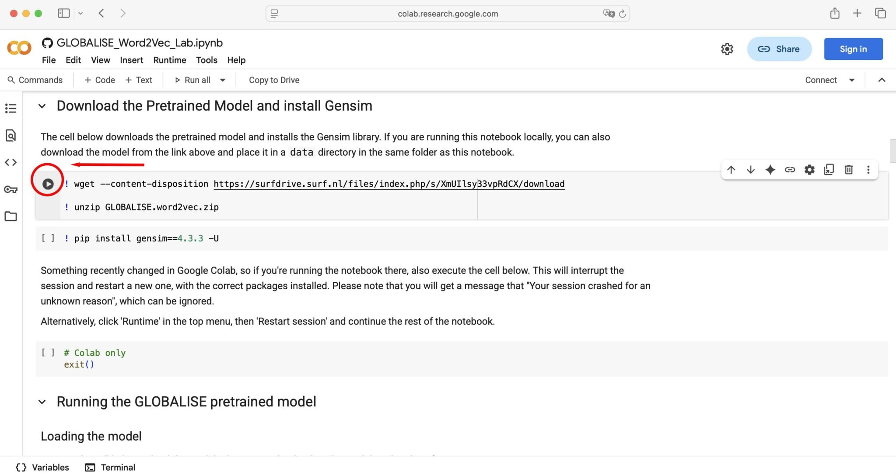

# Transcriptions Viewer How-to Guide

> **Archived blog post.** This post was originally published on the Globalise project website on 3 July 2025 ([original URL](https://globalise.huygens.knaw.nl/transcriptions-viewer-how-to-guide/)). The text is reproduced without changes; links to other blog posts now point to their archived copies, and other links may no longer work.

**About the author:** Melinda Susanto is community and outreach manager of the Globalise project at the Huygens Institute.

<!-- Bio source: Team page, https://globalise.huygens.knaw.nl/team/ (consulted 2026-10-01) -->

---

## Introduction

The Dutch East India Company (VOC) records are in the Nationaal Archief Den Haag, under the number [1.04.02](https://www.nationaalarchief.nl/onderzoeken/archief/1.04.02). These trading company records span two centuries and cover a wide range of maritime Asia as well as the Cape of Good Hope. In addition to information pertaining to commercial activities of the company, this rich resource also provides glimpses into interactions between the VOC, political powers and communities across these regions. An [introduction in English by F. S. Gaastra](https://www.nationaalarchief.nl/sites/default/files/afbeeldingen/toegangen/NL-HaNA_1.04.02_introduction-VOC.pdf) provides more detailed guidance on these archives.

The GLOBALISE corpus comprises of *Overgekomen Brieven en Papieren* (Received Letters and Papers) inventory numbers **1053-4454** and **7527-11024**. GLOBALISE’s [Transcriptions Viewer](https://transcriptions.globalise.huygens.knaw.nl/) enables searching through the HTR results of approximately 5 million scans of these records. The infrastructure aims to facilitate research around [key themes](https://docs.globalise.huygens.knaw.nl/mission/mission_researchthemes/). Possibilities includes tracing the movements of individuals, objects, and ideas across regions, as well as explorations into new themes that were previously not as easily searchable through analogue means. This guide provides examples of typical search queries. If you have a new question, feel free to reach out to us!

## Before you begin

Read our [help page](https://transcriptions.globalise.huygens.knaw.nl/help) for practical tips on how to search the corpus using keywords and wildcards. Do keep the following points in mind.

### **Transcription errors**

These transcriptions have not been individually and manually verified. A search may return unexpected results, or expected results may not appear. If secondary literature confirms that the record exists within the GLOBALISE corpus, but the record cannot be found using a simple keyword search, try out combinations of keywords related to your topic.

### **Historical and variant spellings**

Use historical terms and be aware of variant spellings. For example, searching for ‘nootmuskaat’ will not return a single search result, because ‘nootmuskaat’ is a modern Dutch word. Instead, use historical terms such as ‘noten’, ‘muskaat’, or ‘folie’.

Helpful references to have on hand include the [historical dictionary of old Dutch](https://gtb.ivdnt.org/search/) and the [VOC glossarium](https://resources.huygens.knaw.nl/vocglossarium/inleiding). Relevant historical terms may also be found in our [datasets](https://dataverse.nl/dataverse/globalise) and [thesaurus of commodities](https://thesaurus.globalise.huygens.knaw.nl/commodities/en/).

### **Interpreting search results**

The Transcriptions Viewer currently has limited functionality to order or filter the search result. The ranking of search results is determined by a combination of the number of matching hits relative to the length (ie. number of words) of the scan page and relative density of the text.

Relative density means how often a keyword appears within a cluster of words. A scan page with **8 hits** where keywords appear close to one another will be ranked higher than a scan page with **10 hits** where keywords are sparsely distributed across the scan page. Rare keywords or exact matches will also rank higher in the search results.

Currently, every scan page is searched individually, as the results are not yet stacked per inventory number. You may come across a different scan page from the same document, or from the same inventory number, much later in the list of search results.

Because of this, it is not enough to view only the first few pages of search results, as relevant information may be found much further down the list. These search results are **out of context**. Interpreting search results requires further contextualisation using other historical sources. When a search query yields a very large number of results, try to develop a general ‘sense’ of inventory numbers which seem to be recurring, also note the **geography** or the **time period** that may appear relevant. Then try out keywords using ‘**AND’** combined with geography or time markers, to further direct your search queries.

### **Information about each scan page**

On any page, click on the three lines on the sidebar to the left to display metadata for each scan. This shows the year and location from where the document was sent. In the example below, the inventory number **[1616](https://transcriptions.globalise.huygens.knaw.nl/detail/urn:globalise:NL-HaNA_1.04.02_1616_0387)** is dated 1700 and comes from Ceylon (present-day Sri Lanka). The permalink leads back to the Nationaal Archief website, where the high-resolution image is available for download.

Click on the third icon to browse through all scans in the same inventory number in order.

### Using the image viewer

Clicking back and forth on the arrows in the image viewer (1) does not automatically load corresponding transcriptions on the right.

Instead, click on **\< previous page** or **next page \>** (2) on the navigation bar at the bottom to turn *both* the transcription page and the image.

In fact, this disconnect can be useful to browse and locate specific pages in the same volume. First, load the contents page of an inventory number, in this case [**2559**](https://transcriptions.globalise.huygens.knaw.nl/detail/urn:globalise:NL-HaNA_1.04.02_2559_0009). Make sure the corresponding transcription is displayed on the right. Next, click the sidebar (3) to display the list of scans in the same inventory number.

In this example, we are looking for a list of gifts on folio **1310**. We can click down the list of scans to find the required page. This action does not automatically load corresponding transcriptions on the right. This is a fast way to navigate the volume, while still having the contents page open on the right. In this case, folio **1310** turns out to be scan number **[591](https://transcriptions.globalise.huygens.knaw.nl/detail/urn:globalise:NL-HaNA_1.04.02_2559_0591)**.

### **Moving between inventory numbers in search results**

A recent update for the Transcriptions Viewer introduces a new function: two arrows in the lower left corner to move between search results. Take for example, a search query for ‘[**cardamom**](https://transcriptions.globalise.huygens.knaw.nl/?indexName=globalise-2024.03.18-test&fragmentSize=100&from=0&size=10&sortBy=_score&sortOrder=desc&query=eyJkYXRlRnJvbSI6IjE1MDAtMDEtMDEiLCJkYXRlVG8iOiIxODAwLTAxLTAxIiwicmFuZ2VGcm9tIjoiMCIsInJhbmdlVG8iOiIzMDAwMCIsImZ1bGxUZXh0IjoiY2FyZGFtb20iLCJ0ZXJtcyI6e319)‘.

The first three results are from inventory numbers 7581, 7735 and 1898. Clicking on the first link in this list of results brings us to the inventory number **[7581](https://transcriptions.globalise.huygens.knaw.nl/detail/urn:globalise:NL-HaNA_1.04.02_7581_0315)**.

If you click on ‘**Next \>**’ in the lower left corner, this will bring us to the next inventory number, 7735. 

Either load the sidebar on the left (1), or use **\< Previous page** and **Next page \>** (2) arrows to browse through this inventory number (7735). While browsing this volume, clicking on **\<Prev or Next\>** (3) in the lower left corner will navigate **between** the different inventory numbers from the list of search results, **not** the current volume that is displayed.  

With the recent updates, there is also a small technical bug where the **\< Previous page** and **Next page \>** arrows may be dormant and do not turn the pages. To resolve this, ensure that there is a query in the URL in the browser. If you have started your search using the Transcriptions Viewer, this query should appear automatically. If you have accessed the page from a previously saved link, you may add this manually the last part to the URL:

**?query\[fullText\]=lijst**

You may also replace the term ‘lijst’ with any other keyword, this term will be highlighted if found on the scan page. Note that you cannot leave this empty, at the moment, the **\< Previous page** and **Next page \>** arrows will not work properly without a functional query.

## Navigate through this guide: What are you searching for? Cited record \| Document type \| Event \| Location \| Person \| Object \| Keywords \| Tips on searching \| Further reading

## 1. Locating an original record cited in secondary literature

If you find references to a VOC record in secondary literature, you may wish to look up its original. The first thing to check is the **format** of the inventory number. In case the record in referenced using the now-obsolete **ARA (Algemene Rijks Archief)** inventory number, use the [convertor tool](https://testa.exploringslavetradeinasia.com/convertor/) to find the corresponding **NA** **1.04.02** inventory number. This tool provides a concordance between historic ARA numbers and current 1.04.02 numbers.

Next, check whether the record is found within the GLOBALISE corpus. The GLOBALISE corpus only includes **NA 1.04.02** inventory numbers **1053-4454** and **7527-11024**. In case the inventory number is not within our corpus, scans may be digitally available on Nationaal Archief [1.04.02](https://www.nationaalarchief.nl/onderzoeken/archief/1.04.02), search for it using the ‘**zoek naar inventarisnummer**’ function.

### **Finding the correct inventory number**

As an example, we aim to find a record cited in secondary literature as such: **VOC 1136, f. 951v**.1 This number (**951v**) refers to the handwritten number on the original VOC record. A folio or page number is usually ***not*** the same as the scan number. By page, we usually mean the physical page of the record. Folio numbers generally mean records are numbered consecutively every two pages. The reverse page is usually unnumbered, and in this example, the folio will be **951** and its reverse **951v**. The next physical page with a number will be folio **952**. However, VOC records may feature either page numbers or folio numbers, or even a mix of both! The best option is check several pages of each inventory number to determine its pagination.

There are two options to find a specific inventory number. The **first option** is to use **filter by inventory nr.** on the Transcriptions Viewer. To browse through the whole volume of an inventory number in order, leave the **full text search** field empty. The scans will be listed in ascending order for the inventory number, starting from scan page 0001.

*Screenshot*

[*Search for inv. nmr. 1136*](https://transcriptions.globalise.huygens.knaw.nl/?indexName=globalise-2024.03.18-test&fragmentSize=100&from=0&size=10&sortBy=_score&sortOrder=desc&query=eyJkYXRlRnJvbSI6IjE1MDAtMDEtMDEiLCJkYXRlVG8iOiIxODAwLTAxLTAxIiwicmFuZ2VGcm9tIjoiMCIsInJhbmdlVG8iOiIzMDAwMCIsImZ1bGxUZXh0IjoiKiIsInRlcm1zIjp7Imludk5yIjpbIjExMzYiXX19)

The **second option** is to download the full-text of inventory number 1136, available from the [VOC transcriptions dataset](https://doi.org/10.34894/K7IVEW). Enter 1136 into **search this dataset**. After downloading the full-text document, it is possible to use **CTRL** or **Command + F** to search with keywords. These two options are functionally the same. The only difference is that the Transcriptions Viewer searches it online, or while downloading the full-text enables you to search the text locally on your own computer.

### Finding the correct scan page

There are two options to find the correct scan page.

**1. Browsing the full list of scans in one inventory number.**

Open the first page in the inventory number [**1136**](https://transcriptions.globalise.huygens.knaw.nl/detail/urn:globalise:NL-HaNA_1.04.02_1136_0001), and click on the sidebar on the left to browse the list of scans in this volume. 

Click on any scan image on the left and check the corresponding folio number that is handwritten on the paper, usually visible in the top left corner. Scroll down the list of scan images until you find the folio number 951. This is scan number [**1909**](https://transcriptions.globalise.huygens.knaw.nl/detail/urn:globalise:NL-HaNA_1.04.02_1136_1909). The citation **VOC 1136, f. 951v** refers to scan number **[1910](https://transcriptions.globalise.huygens.knaw.nl/detail/urn:globalise:NL-HaNA_1.04.02_1136_1910)**.

**2. Changing the scan number in the URL bar**

Open any page in the inventory number 1136, then manually change the scan number in the URL bar. Make sure it is 4 digits. For small numbers, insert additional zeros (eg. **0045**). Scan numbers are often double the numeric value of the folio number. Since folio **951** is far into the volume, we can attempt scan number further along, for example **[1501](https://transcriptions.globalise.huygens.knaw.nl/detail/urn:globalise:NL-HaNA_1.04.02_1136_1501)**. This yields a page with the folio number **785**, which is not close enough for our purposes.

For a second attempt, we can try scan number **[1801](https://transcriptions.globalise.huygens.knaw.nl/detail/urn:globalise:NL-HaNA_1.04.02_1136_1801)**. This brings us to folio number **902**, which is very close to the folio we are looking for.

Through this manual trial and error method, we can reach folio **951**, corresponding to scan number **[1909](https://transcriptions.globalise.huygens.knaw.nl/detail/urn:globalise:NL-HaNA_1.04.02_1136_1909)**:

There is no scan page numbered **915v,** but this refers to the reverse page after **915**. So the citation **VOC 1136, f. 951v** refers to scan number **[1910](https://transcriptions.globalise.huygens.knaw.nl/detail/urn:globalise:NL-HaNA_1.04.02_1136_1910)**.

## **2. Finding a specific type of document**

The VOC administrative infrastructure is built around specific types of documents. Each inventory number represents a volume compiled of multiple documents. The former TANAP website had been a conventional entrypoint to the VOC archives for many scholars. **Renate Smit** writes about TANAP indexes in [From ABC to VOC Volume: Utilizing Traditional Finding Aids for the GLOBALISE Infrastructure](/pages/about/archive/blog/from-abc-to-voc-volume-utilizing-traditional-finding-aids-for-the-globalise-infrastructure.md).

GLOBALISE Docs preserves some of these [TANAP resources](https://docs.globalise.huygens.knaw.nl/tanap/) including PDF lists of available [establishment reconstructions](https://docs.globalise.huygens.knaw.nl/tanap/tanap-index-establishment-reconstructions/#list-of-available-establishment-reconstructions).

Nationaal Archief Den Haag has made available the [VOC: overgekomen brieven en papieren, 1609-1795 index](https://www.nationaalarchief.nl/onderzoeken/zoekhulpen/voc-overgekomen-brieven-en-papieren-1609-1795), which works in a similar way to the search function on the former TANAP website. This search looks through **titles** of VOC records described in the indexes. For example, if you search for ‘**coffij**’ (coffee), the search yields **85 results**. This may seem like a strangely low number. Surely, coffee has been mentioned many more times than this within the VOC records? This just means that **coffij** appears in titles of 85 VOC records described in these indexes. This does not ascertain how many and which letters may discuss coffee in its **contents**. With the GLOBALISE Transcriptions Viewer, it is now also possible to search the full-text of VOC records within the GLOBALISE corpus for ‘**coffij**’ in the **contents** ([query here](https://transcriptions.globalise.huygens.knaw.nl/?indexName=globalise-2024.03.18-test&fragmentSize=100&from=0&size=10&sortBy=_score&sortOrder=desc&query=eyJkYXRlRnJvbSI6IjE1MDAtMDEtMDEiLCJkYXRlVG8iOiIxODAwLTAxLTAxIiwicmFuZ2VGcm9tIjoiMCIsInJhbmdlVG8iOiIzMDAwMCIsImZ1bGxUZXh0IjoiY29mZmlqfiIsInRlcm1zIjp7fX0%3D)).

The former TANAP indexes do not fully cover the complete range of the Overgekomen Brieven en Papieren (OBP). GLOBALISE offers an enriched dataset: [Digitized Indexes of the Dutch East India Company OBP (1602-1799).](https://hdl.handle.net/10622/LVOQTG) This dataset complements the TANAP indexes with new information on inventory numbers **1669-2325; 4374-4447**.

Below is an example of a search for a *daghregister*, or the daily journal. It is possible to use a combination of keywords and geographical location, or keyword and date.

daghregister **AND** Zeelandia

daghregister **AND** 1630

A specific date is useful to narrow down the search if you already know from secondary literature that there exists a daily journal on this specific date. Broadening the search date is possible using wildcards.

If you know the decade,

daghregister **AND** 163\* 

daghregister **AND** 164\*

If you want to browse either the 17th or 18th century:

daghregister **AND** 16\*\*

daghregister **AND** 17\*\*

It is also possible to combine both date and region, for example:

daghregister **AND** 17\*\* **AND** colombo

daghregister **AND** colombo **AND** 17\*\*

Functionally, the two searches above (whether **geography** or **time** is entered first) yield the same number of results. Do note, however, these queries search the text on the scan page. The dates on the scan page may not necessarily be the date of the document. To check the date of the document, load the sidebar as shown in the Information about scan page section.

## **3. Looking up a historical event**

Any historical event is made of up a series of interconnected actions and processes. It is important to first gather contextual information from secondary literature before conducting search queries. Say for example, we are interested in struggles for power between the Dutch and Spanish empires in and around the Philippines. These played out over a series of naval battles over the first half of the 17th century. Key moments included the Battles of Playa Honda (1610, 1617, 1624) and La Naval de Manila (1646), all of which could be understood within the longer duration of the Eighty Years’ War between Spain and Dutch provinces (1566/8-1648). To begin looking for records connected to **La Naval de Manila**, we could start with searching by location and date of event, in this case using the keywords **Manilha AND 1646**.

The Transcriptions Viewer only yields 37 pages of search results, but these are very promising results. In the first search result, inventory number **1160**, the table of contents already includes reports related to naval battles in and around Manila, dated between March and August 1646. Based on contextual knowledge from secondary literature, this is the correct timeframe for these naval battles.

[Contents page of 1.04.02 inv. nr. 1160](https://transcriptions.globalise.huygens.knaw.nl/detail/urn:globalise:NL-HaNA_1.04.02_1160_0009)

When reviewing search results, take note in which VOC establishment were the events reported. In this case, many reports about events in and around Manila were reported from Batavia. We may surmise that the Batavia section of the OBP would be of most relevance to us. The [TANAP lists](https://docs.globalise.huygens.knaw.nl/tanap/tanap-index-establishment-reconstructions/#list-of-available-establishment-reconstructions) allows us to search for records which describe Manila in their titles. Make sure to also try out different historical spellings (**Manila, Manilha, Manilla**). Manila recurs quite often in the category ‘**correspondentie met andere Europeanen**’. We can choose specific inventory numbers from this list to search through the Transcriptions Viewer. This is only necessary at this point because the Transcriptions Viewer does not yet have more advanced filtering options.

For other types of recurring events, for example **embassies to courts**, try combinations of ‘**gezant**’ (the term for ambassador), the geographic location, or the date of the embassy if known. Depending on the region, ‘**reis**’ or ‘**hofreis**’ may also yield relevant results.

Finally, aside from searching for historical events according to time, place or key actors involved, the Transcriptions Viewer now also enables searching through **event types**. **Stella Verkijk** writes about this approach: [‘Yes okay – but what were they doing? How a lexical approach to event extraction can provide some first answers’](/pages/about/archive/blog/yes-okay-but-what-were-they-doing.md). There is a table of event queries at the end of Stella’s post, try it out yourself!

## **4. Finding a location or polity**

When looking for a location or polity, search using known historical spelling(s). For example, a search using the term ‘Manila’ yields **438** pages. Even with a wildcard, ‘**Manila~**’ only yields **1281** pages. This does not appear correct, given that historically there were substantial trade and shipping connections between Batavia (now Jakarta, Indonesia) and Manila in the Philippines during the VOC period.

After exploring the first few pages of the search results, there is an instance of ‘**Manilha**’. This turns out to be the more frequent historical spelling used in VOC records. A search query of ‘[**Manilha**](https://transcriptions.globalise.huygens.knaw.nl/?indexName=globalise-2024.03.18-test&fragmentSize=100&from=0&size=10&sortBy=_score&sortOrder=desc&query=eyJkYXRlRnJvbSI6IjE1MDAtMDEtMDEiLCJkYXRlVG8iOiIxODAwLTAxLTAxIiwicmFuZ2VGcm9tIjoiMCIsInJhbmdlVG8iOiIzMDAwMCIsImZ1bGxUZXh0IjoiTWFuaWxoYSIsInRlcm1zIjp7fX0%3D)‘ yields 4652 pages, while ‘[**Manilha~**](https://transcriptions.globalise.huygens.knaw.nl/?indexName=globalise-2024.03.18-test&fragmentSize=100&from=0&size=10&sortBy=_score&sortOrder=desc&query=eyJkYXRlRnJvbSI6IjE1MDAtMDEtMDEiLCJkYXRlVG8iOiIxODAwLTAxLTAxIiwicmFuZ2VGcm9tIjoiMCIsInJhbmdlVG8iOiIzMDAwMCIsImZ1bGxUZXh0IjoiTWFuaWxoYX4iLCJ0ZXJtcyI6e319)‘ yields 5280 pages. Spellings were not yet standardised in this period. Manila in the archives can be written as ‘**Manilha’**, ‘**Manelhia’** or even ‘**Manilla’**. The more variations you are aware of and try out, the more expansive your search results will be.

You may find more historical terms in the [Early Modern Polities](https://hdl.handle.net/10622/SOS0KC) dataset, the [Places](https://hdl.handle.net/10622/WYVERW) dataset, or the [GLOBALISE geographical indices](https://hdl.handle.net/10622/75DURG) dataset.

## 5. Finding a person

*Who is who?* When searching for a person’s name, note the two possibilities:

1\) Variant spellings of names may appear, but they could be referring to the same person.

2\) The exact same spelling of a name may refer to two different persons.

One way to verify this is to check the birth and date of the person(s), and the location(s) of their employment or travel route. This background research is very necessary to verify multiple instances of names with the same spelling.

For a more robust search using the Transcriptions Viewer, use a combination of keywords. This could be a combination of **profession and date**, or **profession and geographic location**.

It is also important to know historical names of persons as they might have been known at the time.

The Ming loyalist who fought against the VOC in Taiwan with the name **Zheng Chenggong** (1624-1662) is known more often as **Koxinga**. In VOC records, his name is often spelled as either **Koxinga** or **[Coxinga](https://transcriptions.globalise.huygens.knaw.nl/?indexName=globalise-2024.03.18-test&fragmentSize=100&from=0&size=10&sortBy=_score&sortOrder=desc&query=eyJkYXRlRnJvbSI6IjE1MDAtMDEtMDEiLCJkYXRlVG8iOiIxODAwLTAxLTAxIiwicmFuZ2VGcm9tIjoiMCIsInJhbmdlVG8iOiIzMDAwMCIsImZ1bGxUZXh0IjoiY294aW5nYX4iLCJ0ZXJtcyI6e319)**.

Names of people in the Indonesian archipelago sometimes use the old spelling where the vowel sound ‘u’ is written as ‘oe’. Mentions of **Sultan Hasanuddin** (1631-1670) of the Sultanate of Gowa can be found using the old spelling ‘Hasanoeddin’. A search for ‘**[hasanudin~’](https://transcriptions.globalise.huygens.knaw.nl/?indexName=globalise-2024.03.18-test&fragmentSize=100&from=0&size=10&sortBy=_score&sortOrder=desc&query=eyJkYXRlRnJvbSI6IjE1MDAtMDEtMDEiLCJkYXRlVG8iOiIxODAwLTAxLTAxIiwicmFuZ2VGcm9tIjoiMCIsInJhbmdlVG8iOiIzMDAwMCIsImZ1bGxUZXh0IjoiaGFzYW51ZGlufiIsInRlcm1zIjp7fX0%3D)** yields **31 pages**, while **‘[hasanoedin~](https://transcriptions.globalise.huygens.knaw.nl/?indexName=globalise-2024.03.18-test&fragmentSize=100&from=0&size=10&sortBy=_score&sortOrder=desc&query=eyJkYXRlRnJvbSI6IjE1MDAtMDEtMDEiLCJkYXRlVG8iOiIxODAwLTAxLTAxIiwicmFuZ2VGcm9tIjoiMCIsInJhbmdlVG8iOiIzMDAwMCIsImZ1bGxUZXh0IjoiaGFzYW5vZWRpbn4iLCJ0ZXJtcyI6e319)**‘ yields **156 results**.

For Europeans in the early modern period, their names may also appear differently depending on their educational and social background. For example, the VOC physician and botanist **Paul Hermann** (1646-1695) can be found using the Latin spelling of his name **Paulus Hermanus**.

Several indexes and datasets provide useful starting points and references when searching for a historical person:

The [Namebooks of the Dutch East India Company (1730-1794)](https://hdl.handle.net/10622/DITM0Z)is derived from18th century booklets of VOC personnel employment data.

The [Overview of People in the TEPC Inventories (1673-1844)](https://hdl.handle.net/10622/XDI7DD) dataset provides names in the inventories of deceased people created by the Orphan Chamber of the Cape of Good Hope from 1673-1844.

The 14 volumes of the [Generale Missiven](https://resources.huygens.knaw.nl/retroboeken/generalemissiven/#page=0&accessor=toc&view=homePane) series, covering the years 1610-1767, feature an index of persons’ names at the end of every volume.

The Nationaal Archief Den Haag also provides indexes for [VOC Opvarenden](https://www.nationaalarchief.nl/onderzoeken/index/nt00444?activeTab=nt) and [Oost-Indische Testamenten](https://www.nationaalarchief.nl/onderzoeken/index/nt00214?activeTab=nt&sortering=prs_achternaam&volgorde=asc).

In case you do not yet have a person’s name to look for, but simply want to start your search by knowing which communities are mentioned in the archives, you can use our [Ethnicities, Religious Groups and Castes in the Archives of the Dutch East India Company](https://hdl.handle.net/10622/5LRS03) dataset to find terms that were used to reference some of the communities mentioned in the archives. The dataset mentions which languages the terms are associated with, which may help you to filter your search. The accompanying data documentation includes an introduction to social categories within the context of historical research pertaining to the Dutch East India Company. Kindly read the dataset documentation before you proceed further.

## **6. Searching for an object**

The VOC archives are rich with information about objects, whether as commodities, gifts, personal items, or provisions. When searching for a particular object or material in the Transcriptions Viewer, use wildcards and always think of corresponding or related terms.

For example, a search for ‘**parelmoer**‘ (mother of pearl) initially only returns **3 pages** of results, but a search using ‘**[parelmoer~](https://transcriptions.globalise.huygens.knaw.nl/?indexName=globalise-2024.03.18-test&fragmentSize=100&from=0&size=10&sortBy=_score&sortOrder=desc&query=eyJkYXRlRnJvbSI6IjE1MDAtMDEtMDEiLCJkYXRlVG8iOiIxODAwLTAxLTAxIiwicmFuZ2VGcm9tIjoiMCIsInJhbmdlVG8iOiIzMDAwMCIsImZ1bGxUZXh0IjoicGFyZWxtb2VyfiIsInRlcm1zIjp7fX0%3D)**‘ returns **1259 pages**. Reading up on contemporaneous texts from the early modern period may also shed light on other relevant terms. In the context of shells, Georg Eberhard Rumphius’ [D’Amboinsche Rariteitenkamer](https://books.google.nl/books?id=Ui1MAAAAcAAJ) (1705) provides more names and keywords to search for, even names in local languages. By compiling a search of relevant keywords, such as **[schelpen~](https://transcriptions.globalise.huygens.knaw.nl/?indexName=globalise-2024.03.18-test&fragmentSize=100&from=0&size=10&sortBy=_score&sortOrder=desc&query=eyJkYXRlRnJvbSI6IjE1MDAtMDEtMDEiLCJkYXRlVG8iOiIxODAwLTAxLTAxIiwicmFuZ2VGcm9tIjoiMCIsInJhbmdlVG8iOiIzMDAwMCIsImZ1bGxUZXh0Ijoic2NoZWxwZW5%2BIiwidGVybXMiOnt9fQ%3D%3D)**, **[schulpen~](https://transcriptions.globalise.huygens.knaw.nl/?indexName=globalise-2024.03.18-test&fragmentSize=100&from=0&size=10&sortBy=_score&sortOrder=desc&query=eyJkYXRlRnJvbSI6IjE1MDAtMDEtMDEiLCJkYXRlVG8iOiIxODAwLTAxLTAxIiwicmFuZ2VGcm9tIjoiMCIsInJhbmdlVG8iOiIzMDAwMCIsImZ1bGxUZXh0Ijoic2NodWxwZW5%2BIiwidGVybXMiOnt9fQ%3D%3D)**, **[schaalvis~](https://transcriptions.globalise.huygens.knaw.nl/?indexName=globalise-2024.03.18-test&fragmentSize=100&from=0&size=10&sortBy=_score&sortOrder=desc&query=eyJkYXRlRnJvbSI6IjE1MDAtMDEtMDEiLCJkYXRlVG8iOiIxODAwLTAxLTAxIiwicmFuZ2VGcm9tIjoiMCIsInJhbmdlVG8iOiIzMDAwMCIsImZ1bGxUZXh0Ijoic2NoYWFsdmlzfiIsInRlcm1zIjp7fX0%3D)**, **[hoorntjes~](https://transcriptions.globalise.huygens.knaw.nl/?indexName=globalise-2024.03.18-test&fragmentSize=100&from=0&size=10&sortBy=_score&sortOrder=desc&query=eyJkYXRlRnJvbSI6IjE1MDAtMDEtMDEiLCJkYXRlVG8iOiIxODAwLTAxLTAxIiwicmFuZ2VGcm9tIjoiMCIsInJhbmdlVG8iOiIzMDAwMCIsImZ1bGxUZXh0IjoiaG9vcm50amVzfiIsInRlcm1zIjp7fX0%3D)**, it is possible to find more results. Of course, more research needs to be done to understand how terms relate to each other, to distinguish between different species of molluscs, or the relationship between materiality of such objects and the living species which they were derived from.

Another useful tool for keyword exploration is the [Word2Vec tool](https://lab.globalise.huygens.knaw.nl/experiments/GLOBALISE_Word2Vec_Lab/). This tool can assist to find keywords that occur in similar contexts within the GLOBALISE corpus. To run this tool online, click on Option One: **Open this notebook in Google Colab**.

To start, click the **play icon**, one at a time, from the top of the page. Each cell will display a **check mark** once it is successfully run. Then continue down the page, clicking the play icon on the next cell below. Once everything is ready, you can insert your own keywords to replace the given examples. Note that it is only possible to search for **one** word, not **multiple** words, and it must all be in **lowercase**. If the tool returns an error when searching a particular keyword, this means that the term does not exist within the GLOBALISE corpus.

[Running the Word2Vec model in Google CoLab](https://colab.research.google.com/github/globalise-huygens/lab.globalise.huygens.knaw.nl/blob/main/docs/experiments/GLOBALISE_Word2Vec_Lab.ipynb)

GLOBALISE guest researcher **Ann Heylen** writes about exploratory searches using the Word2Vec tool, and how this led her down the trail of an unexpected story: [Incognito Royalty on the Princes Roijael](/pages/about/archive/blog/incognito-royalty-on-the-princes-roijael.md).

For more inspiration, browse our [thesaurus of commodities](https://thesaurus.globalise.huygens.knaw.nl/en/) to explore various objects found in the VOC archives. For textiles, the [Dutch Textile Trade Project](https://dutchtextiletrade.org/textiles/) as well as the [Textile Databases](https://warwick.ac.uk/fac/arts/history/ghcc/eac/databases/textiles/) provide useful terminology for search queries in the Transcriptions Viewer.

The [Book-Keeper General of Batavia database](https://resources.huygens.knaw.nl/boekhoudergeneraalbatavia/index_html_en) covers 18th-century movement of VOC ships and their cargoes, which can be used to trace the volume of goods and materials transported across different routes.

## 7. Exploring with contextual keywords

The searchable corpus of GLOBALISE enables us to search phrases and interesting connections to and from the Dutch East India Company. Starting with just one term, it is possible to first contextualise that term, then look up corresponding terms, which leads to new search possibilities. An exploratory example is to search for connections between Batavia and Manila. Using wildcards with **Batavia~** and **Manilha~**, we come across records describing different types of interactions.

For example, a group of people described as ‘**[Manilase Spaenjaerden’](https://transcriptions.globalise.huygens.knaw.nl/?indexName=globalise-2024.03.18-test&fragmentSize=100&from=0&size=10&sortBy=_score&sortOrder=desc&query=eyJkYXRlRnJvbSI6IjE1MDAtMDEtMDEiLCJkYXRlVG8iOiIxODAwLTAxLTAxIiwicmFuZ2VGcm9tIjoiMCIsInJhbmdlVG8iOiIzMDAwMCIsImZ1bGxUZXh0IjoiTWFuaWxhc2UgQU5EIFNwYWVuamFlcmRlbiIsInRlcm1zIjp7fX0%3D)**. Who were these people? Using this phrase as a new search query leads to a different archival snippet, which mentions letters to Manila-based Spanish being intercepted by VOC agents. This subsequent phrase,**‘[geintercipieerde brieven](https://transcriptions.globalise.huygens.knaw.nl/?indexName=globalise-2024.03.18-test&fragmentSize=100&from=0&size=10&sortBy=_score&sortOrder=desc&query=eyJkYXRlRnJvbSI6IjE1MDAtMDEtMDEiLCJkYXRlVG8iOiIxODAwLTAxLTAxIiwicmFuZ2VGcm9tIjoiMCIsInJhbmdlVG8iOiIzMDAwMCIsImZ1bGxUZXh0IjoiZ2VpbnRlcmNpcGllZXJkZSBBTkQgYnJpZXZlbiIsInRlcm1zIjp7fX0%3D)’**, then re-opens up the query to a broader geography, suggesting the information practice of intercepting letters did not just occur between Batavia and Manila, potentially also in other geographic regions where the VOC operated. The searchability of the GLOBALISE corpus allows us to explore the archives by following up trajectories of contextual phrases in this way.

An important point to note when searching phrases, is to always use double quotation marks (“”), or use **AND** to search phrases with more than one word. By default, the search will conduct an **OR** query (searching for each individual instance of two or more terms) if you do not use double quotation marks or if you do not use **AND**. For example, **geintercipieerde brieven** yields 265313 pages (!). This is essentially an **OR** search query which becomes very numerous because **brieven** (letters) of course appears *very* frequently in the VOC records.

However, **[geintercipieerde AND brieven](https://transcriptions.globalise.huygens.knaw.nl/?indexName=globalise-2024.03.18-test&fragmentSize=100&from=0&size=10&sortBy=_score&sortOrder=desc&query=eyJkYXRlRnJvbSI6IjE1MDAtMDEtMDEiLCJkYXRlVG8iOiIxODAwLTAxLTAxIiwicmFuZ2VGcm9tIjoiMCIsInJhbmdlVG8iOiIzMDAwMCIsImZ1bGxUZXh0IjoiZ2VpbnRlcmNpcGllZXJkZSBBTkQgYnJpZXZlbiIsInRlcm1zIjp7fX0%3D)** yields only 123 pages. Searching with wildcards again further expands the search: **[geintercipieerde~ AND brieven~](https://transcriptions.globalise.huygens.knaw.nl/?indexName=globalise-2024.03.18-test&fragmentSize=100&from=0&size=10&sortBy=_score&sortOrder=desc&query=eyJkYXRlRnJvbSI6IjE1MDAtMDEtMDEiLCJkYXRlVG8iOiIxODAwLTAxLTAxIiwicmFuZ2VGcm9tIjoiMCIsInJhbmdlVG8iOiIzMDAwMCIsImZ1bGxUZXh0IjoiZ2VpbnRlcmNpcGllZXJkZX4gQU5EIGJyaWV2ZW5%2BIiwidGVybXMiOnt9fQ%3D%3D)** yields 301 results. We can set the distance of how far the variance from the initial spelling lies. This is known as the **Levenshthein distance**. The search bar can conduct searches of **~1** or **~2** (there is no **~3**!). By default, if there is no number added, any search with a **~** is automatically set to **~2**, which gives a broader range of results. To illustrate, **geintercipieerde~2 AND brieven~2** yields 301 results, the same as the default above, while **[geintercipieerde~1 AND brieven~1](https://transcriptions.globalise.huygens.knaw.nl/?indexName=globalise-2024.03.18-test&fragmentSize=100&from=0&size=10&sortBy=_score&sortOrder=desc&query=eyJkYXRlRnJvbSI6IjE1MDAtMDEtMDEiLCJkYXRlVG8iOiIxODAwLTAxLTAxIiwicmFuZ2VGcm9tIjoiMCIsInJhbmdlVG8iOiIzMDAwMCIsImZ1bGxUZXh0IjoiZ2VpbnRlcmNpcGllZXJkZX4xIEFORCBicmlldmVufjEiLCJ0ZXJtcyI6e319)** yields 205 results. Summing up, if you want to use a wildcard to broaden the search query to include variant spellings but still retain a narrower range, use **~1**. 

## **8. Tips on searching with historical Dutch terms**

This is a suggested workflow on how to conduct a search query in case of minimal Dutch language skills**\***

1\. Use a translation tool of your choice to translate a term from your language to modern Dutch.

2\. Insert the modern Dutch word into this [semantic dictionary](https://ivdnt.org/corpora-lexica/diamant/) to try and identify relevant historical terms.

3\. Additionally, the [Word2Vec model](https://lab.globalise.huygens.knaw.nl/experiments/GLOBALISE_Word2Vec_Lab/) may yield further relevant historical keywords for searching.

4\. Enter a historical term to start a search query in the Transcriptions Viewer.

5\. Translate the transcription back into your preferred language using a translation tool of your choice.

You may also try to enter search terms in other languages (transliterated into the Latin alphabet) into the search field. You may be surprised at what you will find! Aside from Dutch, there are many languages in the VOC archives, even if their numbers within the entirety of the GLOBALISE corpus may be relatively small. **Arno Bosse** writes more about this in [The Languages of GLOBALISE](/pages/about/archive/blog/the-languages-of-globalise.md).

Looking through historical dictionaries or wordlists may also prove useful, depending on the research topic:\
De Hautman, Frederic. [Spraeck ende woord-boeck](https://books.google.nl/books?id=PEPLbvrTQ70C) (Amsterdam,1603/4)\
Loderus, Adries. [Maleische Woord-boek Sameling](https://books.google.nl/books?id=QEPhQ6JVzCAC) (Batavia, 1707).

**\*This method is a work-around. We would appreciate your feedback and suggestions on what does or does not work for you.**

## **Further reading**

The inventory and description of [1.04.02](https://www.nationaalarchief.nl/onderzoeken/archief/1.04.02) is on the Nationaal Archief Den Haag website, including an [introduction in English by F. S. Gaastra](https://www.nationaalarchief.nl/sites/default/files/afbeeldingen/toegangen/NL-HaNA_1.04.02_introduction-VOC.pdf). An [overview](https://www.nationaalarchief.nl/onderzoeken/zoekhulpen/overzicht-van-voc-archieven-1594-1814) of archives about the Dutch East India Company is also available.

The [thesaurus of commodities](https://thesaurus.globalise.huygens.knaw.nl/en/), [VOC Glossarium](https://resources.huygens.knaw.nl/vocglossarium/inleiding), and the [historical dictionary](https://ivdnt.org/woordenboeken/historische-woordenboeken/) are useful references for historical terms.

Datasets are freely accessible and downloadable from the [GLOBALISE collection on Dataverse](https://dataverse.nl/dataverse/globalise).

Balk, G. L., Van Dijk, F., Kortlang, J., Gaastra, F. S., Niemeijer, H. E., & Koenders, P. (2007). *The Archives of the Dutch East India Company (VOC) and the Local Institutions in Batavia (Jakarta)* (1st ed.). Brill.

Bogtman, W. *Het Nederlandsche handschrift in 1600* (Bogtman: 1933). Available on [Delpher](https://resolver.kb.nl/resolve?urn=MMKB21:034098000).

Sterkenburg, P. G. J. van. *Een glossarium van zeventiende-eeuws Nederlands* (3rd edition, Groningen: Wolters-Noordhoff, 1981). Print edition only.

Yolanda Spaans, *A Practical Dutch Grammar.* The English edition is still in print and only available as a printed book. However, downloadable [translated editions in other languages](https://dutchgrammar.org/translations/) are freely available.

## **Release notes**

**v0.3 (September 2026)**

Updated various links.

**v0.2 (January 2026) **

Updated “Interpreting search results” due to technical updates in how search results are ranked and displayed.

Updated all links for search queries and number of results for individual search queries due to technical updates. 

Added a new section “Navigating between search results” to explain new arrows for navigating search results.

Updated “Finding the correct inventory number” as \*asterisk function is no longer necessary.

Updated “Finding the correct scan page” to include another option to browse through volume scans.

With thanks to Manjusha Kuruppath, Lodewijk Petram, Kay Pepping and Brecht Nijman for their valuable inputs on the developments of this guide. This is an evolving document, as we will improve the functionality of the GLOBALISE Transcriptions Viewer over the coming period and will launch a full-fledged research platform by the end of the GLOBALISE project (December 2026). In the event that an update provides more functionalities or affects how search queries can be conducted, this guide will be updated accordingly.

## **Contact us**

We welcome your feedback and suggestions about using the Transcriptions Viewer through this [feedback form](https://globalise.canny.io/transcriptions-viewer/).

If you have any further questions or comments about the GLOBALISE project in general, feel free to reach out to us through our [contact form](https://globalise.huygens.knaw.nl/contact-us/).

**Disclaimer:** This tutorial features links to external resources for reference and further reading. We endeavour to keep these links up-to-date, however we do not take responsibility for the content and security of external websites, kindly make use of these links and tools at your own discretion.

[^1]: Sher Banu Khan, *Sovereign Women in a Muslim Kingdom: The Sultanahs of Aceh, 1641−1699* (Singapore: National University of Singapore Press, 2017).
