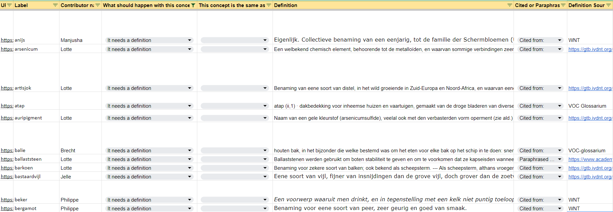
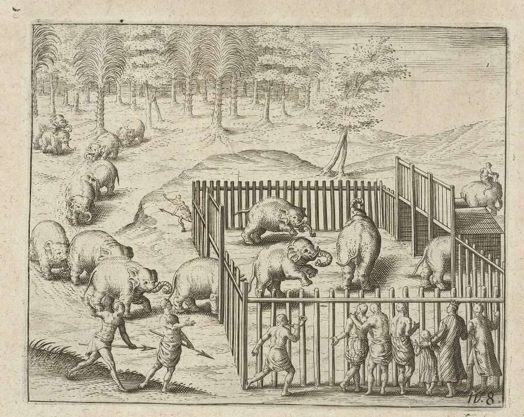
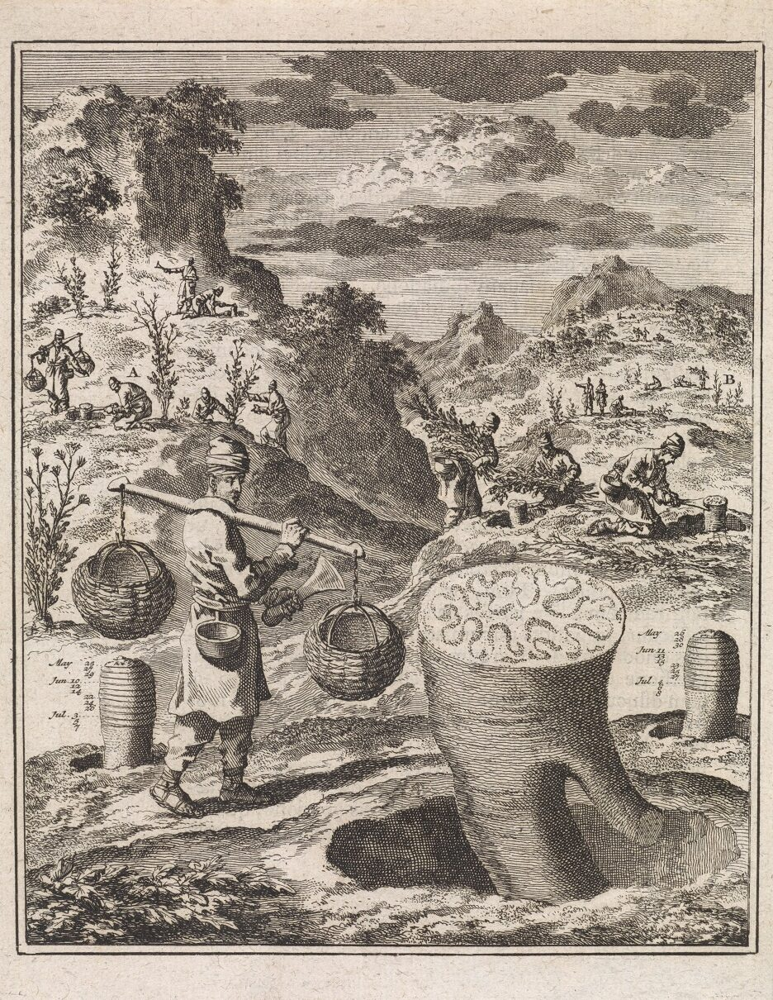

# Unearthing Insights at the GLOBALISE Commodity Data Sprint

> **Archived blog post.** This post was originally published on the Globalise project website on 2 April 2024 ([original URL](https://globalise.huygens.knaw.nl/unearthing-insights-at-the-globalise-commodity-data-sprint/)). The text is reproduced without changes; links to other blog posts now point to their archived copies, and other links may no longer work.

**About the author:** Kay Pepping is a junior researcher in the historical contextualisation team of the Globalise project at the Huygens Institute.

<!-- Bio source: Team page, https://globalise.huygens.knaw.nl/team/ (consulted 2026-10-01) -->

---

As you might have read in [our recent blog post about the commodities dataset](/pages/about/archive/blog/thesaurus-treasures-why-were-creating-a-hierarchical-lexicon-of-commodities.md) (if you haven’t, please take a look), we are actively seeking feedback and input for our new commodities dataset. In that spirit, we hosted the [data sprint ‘What on Earth is This? Defining, Labeling and Classifying Early Modern Commodities’](https://globalise.huygens.knaw.nl/globalise-datasprint-what-on-earth-is-this-defining-labeling-and-classifying-early-modern-commodities/) at the [University of Amsterdam’s Humanities Labs](https://aihr.uva.nl/humanities-labs/humanities-labs.html) on December 4, 2023, focussing on introducing the dataset to participants and collaboratively supplementing and improving it.

Twenty researchers attended the event either in person or online. The goal of the sprint was to invite participants to find definitions for those commodities that were undefined in the first version of our dataset. This resulted in over a hundred new definitions. 

*Part of the sheet participants helped fill in to provide the dataset with new definitions.*

We were very happy with those results, but the discussion that came out of having others work on our dataset was equally valuable. Our goal was to provide researchers with insights into our method of defining commodities and to acquaint them with the associated challenges. We hoped that this exercise would allow us to explore ways of improving our approach to creating a commodity thesaurus. During the sprint, various interesting topics were discussed:

## **Increased automation**

After the introduction, one participant enquired about the possibilities of automation. The question posed was whether it was possible to automatically search for definitions using dictionaries like the [WNT (Woordenboek der Nederlandsche Taal)](https://gtb.ivdnt.org/search/) instead of manually identifying them? This was a valid question, that prompted us to briefly reflect on the three reasons we have not deployed automated extraction for definitions so far:

1.  We are guided by the need to make sure that the returned definition applies to the context of the VOC and early modern Asia and this requires careful human curation.
2.  Definitions in the WNT drawn from older literature sometimes use words we would not prefer to use such as *inboorling,* which needs manual curation.
3.  Our commodity list consists of many composite words. Composite terms are those words that are born from the integration of two or more words. A good example is ‘kistbeitel’ (box chisel), a word made up of the two terms kist (box) and beitel (chisel). In such cases, automation would return the definition of only one of the composite parts (for example, ‘kist’ rather than the more relevant word ‘beitel’).
4.  This method is prone to error in instances where a term can have more than one meaning. In the case of ‘varken’, which in the VOC context is not just the farm-animal but also a keg of water, the choices made through automation may not be correct. 

The question concerning the possibilities of automation inspired one of our team members to run some new tests to re-assess the viability of this approach. They concluded that automation might indicate whether a word appears in a dictionary in some form, but returns full web pages, which can be impractical to work with. Additionally, we prefer manually curated definitions, especially in terms of legibility and usability and to keep track of problematic language. Nonetheless, automatically extracting links to possible definitions could be a way to speed up our process in the future.

*Elephants were often gifted by the VOC. *Elephant hunting at Pegu, 1604*, anonymous. [Rijksmuseum](http://hdl.handle.net/10934/RM0001.COLLECT.450430), CC0.*

**Identifying the languages of a commodity’s name**

Another question that was raised was whether our dataset also records the (original) language of a commodity label. This is a theme that has already generated significant discussion in our project and forms the basis of [a journal article](https://openhumanitiesdata.metajnl.com/articles/10.5334/johd.176). We made a provision for the inclusion of a language field in our dataset such that participants could indicate the commodity label language and provide source information to substantiate the labeling. We’re happy to report that the participants enthusiastically utilized this possibility.

## **Composite terms**

After the initial round of questions, the participants set to work. After exploring the list of commodities that needed definitions, the first problems were encountered and we explained how we’d tackled them in the past. The most important one that came up concerned composites.

There are a lot of composite words in the Dutch language. You can essentially chain words together forever: there is no issue with adding ‘salesman’ and ‘union’ to our earlier example box chisel to create ‘kistbeitelverkopersbond’. How do you find a definition for these words? Those of you who’ve looked at [the first version of our dataset](https://hdl.handle.net/10622/YAWDOV) might recognize the \[comp.\] keyword we use to indicate compositions. This keyword indicates that we have not found an existing definition for the entire label, but have instead opted to define one or more of its composite parts to extrapolate a definition from them.

The reaction of the participants to this solution was positive. One participant checked to see if Large Language Models (LLM) like ChatGPT could combine the definition of composite parts into a definition for the entire label. This led to more easily readable results, as they formed one whole rather than multiple individual definitions. We might adopt this approach for a future version of the dataset. However, we’d prefer to first define all composite terms with the current approach, so that we can offer users a choice between the original form of the information and an LLM amalgamation. Furthermore, using an LLM would warrant some consideration of the ethical dimensions of both the training material and the bias it might show towards the colonial context.

## **Diverse Perspectives on Historical Commodities**

Halfway through the sprint, we had various attendees give short presentations about some of the commodities featured in the dataset. Renate Smit spoke about *leggers* (kegs) and the many ways they were put to use. Henrike Vellinga discussed *nickanees* (a textile) and Brecht Nijman reflected on trumpets, both of which interestingly feature in paintings from the period. Manjusha Kuruppath briefly introduced the much-maligned spice *asafoetida* and Pichayapat Naisupap spoke of generous gifts that could be received in Asia – elephants. While these presentations highlighted the diversity of concepts in our datasets, the presenters also shed light on how these objects inform us about the social context of their use: from the social status derived from owning an elephant with a particular number of toes to the blue-striped *nickanees* being visual indicators of enslaved or imprisoned status in Batavia. 

**Treatment of a root to obtain Asafoetida*, Jan Luyken, [Rijksmuseum](http://hdl.handle.net/10934/RM0001.COLLECT.147744), CC0.*

The workshop continued with participants either delving into archives or discussing the various dimensions of object definitions and use that went beyond their dictionary definitions. The conversation initially centered on gifting commodities and expanded to explore other noteworthy occurrences involving commodities. Participants expressed interest in learning more about the (forceful) acquisition, production, and demand for commodities. 

In particular, it was emphasized that informing a computer about known instances of gifting or theft is less intriguing than having the computer identify the commodities involved in such events. While discussing how events in the [Event Ontology](/pages/about/archive/blog/automatic-event-detection-in-early-modern-dutch-voc-documents-the-annotation-phase.md) could provide this information, participants acknowledged the challenge of distinguishing specific events, like ‘gift-giving’, from similar actions without sufficient contextual knowledge.

As such, we also came up with other ways to retrieve this information using the [large-scale transcriptions of the VOC archive](https://transcriptions.globalise.huygens.knaw.nl/). Suggested approaches included:

- A document-based approach: Indicating which commodities appear on *schenkagie*-lijsten (for gifts), on *eisen* (to track demand) or on other types of documents.
- An approach based on existing databases: the specifications column of the [Bookkeeper-General Batavia](https://bgb.huygens.knaw.nl/) provides information on both use as gifts and places of production which is currently not reflected in the commodities dataset.

## **Conclusion**

The event showcased the power of collaborative research, where shared expertise and dedication led to a better understanding of trade and cultural exchange in the early modern Indian Ocean world. At the end of the data sprint, we had not only gathered useful and valuable feedback, but we’d also given over a hundred new commodities definitions. We were happy to hear that defining commodities was a fun activity for the participants and are happy to say that in the week following the sprint, another 25 commodities were defined by the participants.

We would like to once more thank the participants and all the interested parties for their contributions and suggestions and invite you to look forward to the second version of the commodities dataset in the second half of 2024.
