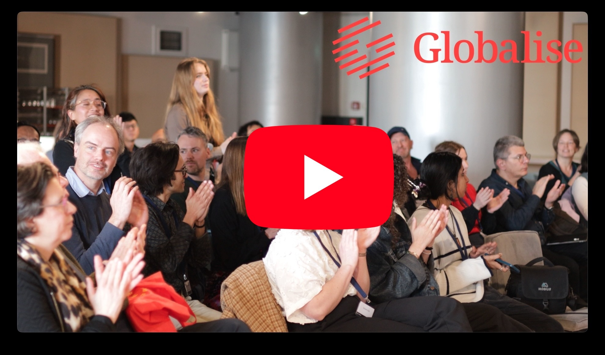
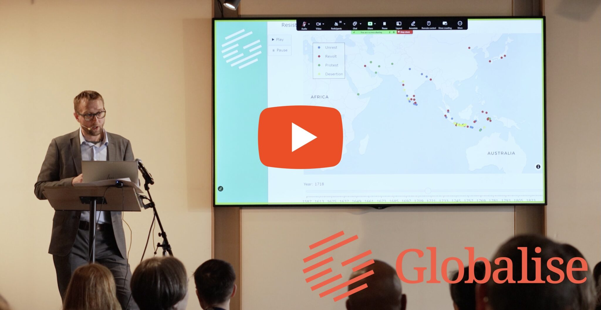
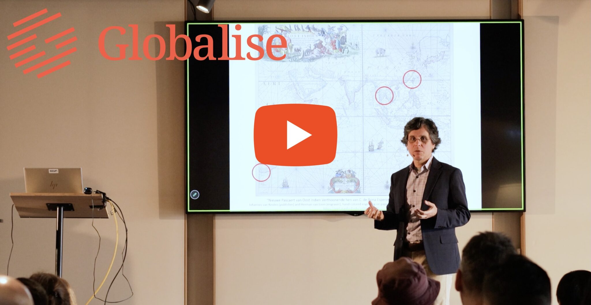
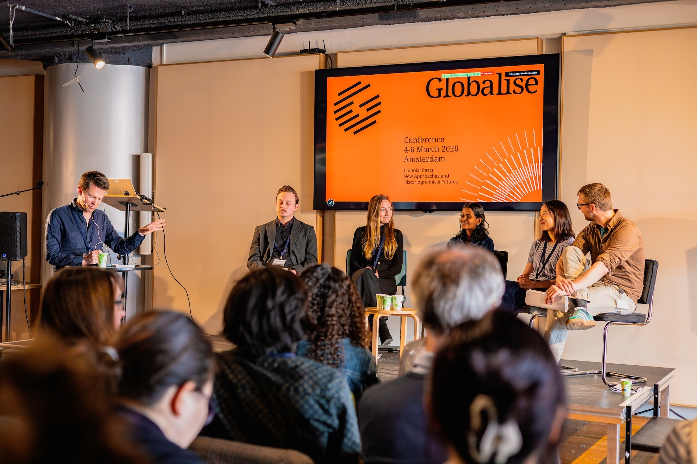
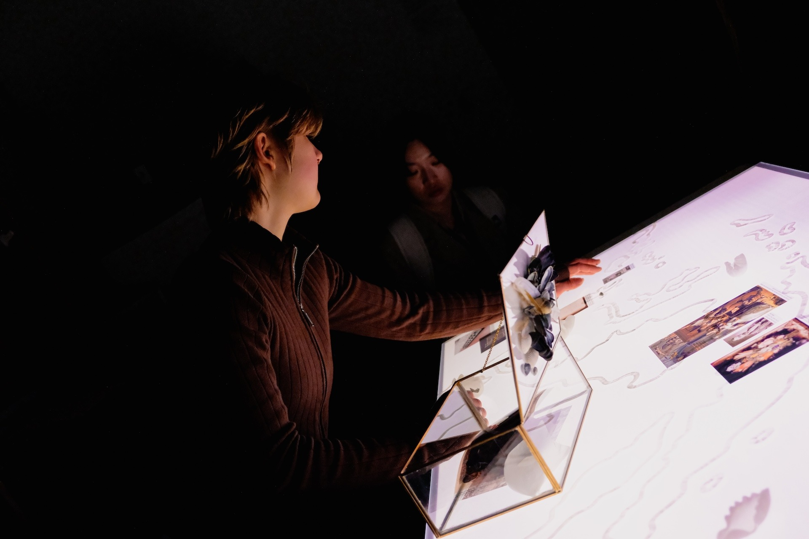
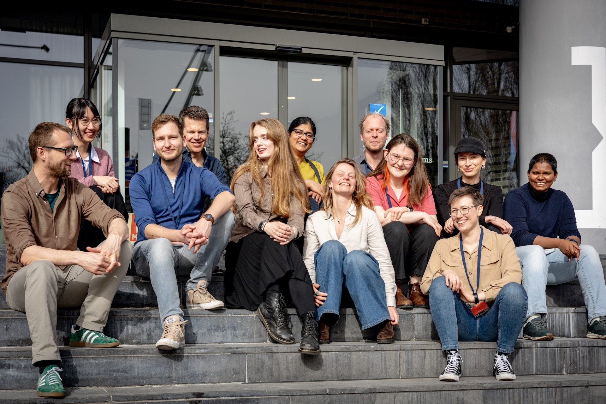

# From acts of resistance and feminist theory to tortoiseshell trade and 17th-century currency – (not) everything I learnt at the GLOBALISE conference

> **Archived blog post.** This post was originally published on the Globalise project website on 16 April 2026 ([original URL](https://globalise.huygens.knaw.nl/from-acts-of-resistance-and-feminist-theory-to-tortoiseshell-trade-and-17th-century-currency-not-everything-i-learnt-at-the-globalise-conference/)). The text is reproduced without changes; links to other blog posts now point to their archived copies, and other links may no longer work.

**About the author:** Lina de Swaaf was an intern in the project management and user interaction team of the Globalise project from January to March 2026.

<!-- Bio source: Former team members list, https://globalise.huygens.knaw.nl/team/ (consulted 2026-10-01) -->

---

Digital archives open up histories in an unprecedented way; however, they also come with a series of complex questions and difficulties, both for archival institutions and users. Digital colonial archives have another dimension of complexity to them, as they both allow one to shed light on underdocumented societies, but also pose a complex risk of giving in to the perspective and bias from the authors of the archives, namely the colonisers. To open up discussions about the further unlocking of colonial archives and present the possibilities of digitalisation along the lines of the GLOBALISE project, we hosted the conference ***Colonial Pasts, New Approaches and Historiographical Futures*** from 3 to 6 March. As someone who has been working with GLOBALISE for the past few months, but who, before that, was quite unfamiliar with colonial history or archival research, I will share some of my personal highlights and findings here.

*[Globalise conference impression video\
](https://www.youtube.com/watch?v=dp6hoLjfIkg)Video credits: Poorvi Garag / Globalise project. Licence: CC-BY 4.0.*

## Keynote lectures

*[Keynote lecture by Matthias van Rossum\
](https://www.youtube.com/watch?v=Fdnbv7kh39U)Video credits: Poorvi Garag / Globalise project. Licence: CC-BY 4.0.*

The GLOBALISE project leader, [Matthias van Rossum](https://orcid.org/0000-0002-9567-5654), Senior Researcher at the International Institute of Social History (IISH), kicked off the keynote lectures with his lecture titled *Resisting Empire! Reflections on colonialism, historiography and digital infrastructure*. He touched upon four key topics: how GLOBALISE can be a game changer in social history research, how its infrastructure can unveil long forgotten lives and stories, why the history of both resistance and the resisters themselves is important, and finally, what GLOBALISE can mean for historical research. He illustrated these important questions with the case study of a resistance movement that took place on a VOC ship, the Sara Carolina. He showed how such ships were often portrayed in rustic and aesthetically pleasing imagery. However, this hides the dehumanising conditions of the slave ships, erasing the history and memory of those entrapped there. Matthias told the story of how the slaves on the Sara Carolina rose and resisted, fighting back against their oppressors. Whilst listening to the lecture, I could envision the enslaved peoples’ fight, not just from the VOC point of view, who are the ones who actually wrote about it, but also from the resisters’ perspective. The combination of different resources brought to light deeper and darker details of their situation, their motivation, and the manner in which they fought. I can only attempt to comprehend their situation, the frustration that they must have felt inside the ship, and the victorious feeling they must have had when walking on top of the Sara Carolina. However, the lecture did bring me one, or even a few steps, closer to it. Matthias also explained his and Beth Warner’s methodology, which showed the potential of what one can do with GLOBALISE. They used [lexical event triggers](/pages/about/project/archive/blog/yes-okay-but-what-were-they-doing.md), compiled by [Stella Verkijk](https://orcid.org/0009-0000-9263-2272), to identify observations of revolt in the millions of pages of the GLOBALISE corpus, and the [places dataset](https://doi.org/10.34894/UFFFNO) to identify the locations where the acts of resistance took place. They then applied a methodology developed by the [Global Hub Collective Labour Action](https://iisg.amsterdam/en/blog/hub-global-labour-conflicts) to get insight into the quality of each of the automatically collected observations. Then, as a last step towards obtaining a high-quality dataset, they manually checked the findings above a certain quality threshold. 

*Keynote lecture impression video will be available soon.*

On the following day, [Ann Stoler](https://www.newschool.edu/nssr/faculty/ann-stoler/), Willy Brandt Distinguished University Professor of Historical Studies and Anthropology at The New School for Social Research, gave her keynote lecture, *On bearing Archival truths – their burdens of colonial proof*. Stoler showed that colonial archives are anything but neutral. Instead, they are sites where power, knowledge, and emotion intertwine. By tracing moments of hesitation and contradiction, in other words, moments where officials judged not just what people did but also how they felt, Stoler revealed how colonial rule depended on unstable ‘regimes of truth’. Her approach challenges historians to move beyond reading archives for information and instead interrogate how truth itself was produced, contested, and enforced. This perspective opens new pathways for studying colonial history and rethinking archival research as a critical practice.

*[Keynote lecture by Tonio Andrade\
](https://www.youtube.com/watch?v=0pG_9gKVjag)Video credits: Poorvi Garag / Globalise project. Licence: CC-BY 4.0.*

[Tonio Andrade](https://orcid.org/0000-0002-3550-4386), Professor of Chinese and Global History at Emory University, gave the last keynote lecture, *The Art and Peril of Being in Between: Reflections on Cultural Brokers and the Dutch East India Company*. He focused on microglobal histories, highlighting the lives of different translators and mediators, and how their roles shaped colonial interactions. One example was Osoet Pegua, a female trader and mediator who has often been portrayed as a gold-digger, sleeping her way to the top. Andrade revised this view, showing that she was a powerful merchant with many valuable connections, so well respected that even the VOC feared the repercussions they would face by obstructing her. This lecture showed how the lives of such mediators, the ones in between, were usually filled with problems and tragedies. These moments of tension frequently generated dense archival records, offering historians insights into the workings of colonial societies. And not only that. As someone specialised in gender studies, it was incredibly refreshing to see Andrade break through the patriarchal image that was painted on Osoet Pegua by the VOC, and give her the agency, respect and story she deserves. Not as a whorish gold-digger, but as an equal to any other merchant, perhaps even a superior, with her own voice. 

## Roundtables

We invited [Dagmar Freist](https://orcid.org/0000-0002-0489-6276), [Ana Sofia Ribeiro](https://orcid.org/0000-0002-1822-5908) and [Claude Chevaleyre](https://orcid.org/0000-0001-5770-0567) to open up the discussion at our first roundtable, chaired by [Guido van Meersbergen](https://orcid.org/0000-0002-3150-5891), *Global Histories and the Digital Turn.* They discussed the importance of awareness of bias in the colonial archives and how digitisation can affect which voices are heard and which remain hidden. Furthermore, the question of what should be done to further uncover and protect the histories of the subaltern. They came to the conclusion that the three key steps to take in the near future are collaboration between fields and communities, the correct training and education of future historians, and, most importantly, the accessibility and researchability of the archives for everyone.

For our second roundtable, *Decolonizing Infrastructure, Engaging Communities*, we invited [Asawari Luthra](https://www.linkedin.com/in/asawariluthra/), [Yus Broersma](https://www.ru.nl/personen/sadiyah-broersma-k), [Wisaal Abrahams](https://www.linkedin.com/in/wisaal-abrahams-92909528/) and [Charles Jeurgens](https://orcid.org/0000-0001-9338-0978) on stage. This discussion was chaired by [Wim Manuhutu](https://www.linkedin.com/in/wim-manuhutu-2620b26/). Drawing on the previous roundtable, the participants further elaborated on the topic of accessibility and what opportunities the digitisation of the archives provides. Building on that, they also discussed the democratisation of archives and what that means. While professional historians are incredibly happy and excited about this turn in archival research, other audiences might not understand how to utilise the digitised materials properly, or might not know of their existence at all. Offering training in order for these audiences to develop a basic level of knowledge and understanding is key to avoiding the reproduction of colonial biases. Furthermore, the level of responsibility for archival institutions in addressing these issues proactively was discussed, with everyone concluding that archival institutions should definitely keep trying to be as transparent and intersectional as possible.

Matthias van Rossum, [Lija Joseph](https://orcid.org/0009-0006-9773-9427), [Anna Bruins](https://orcid.org/0009-0009-7485-1370), [Wenrui Zhao](https://orcid.org/0009-0006-6083-1844) and [Luc Bulten](https://orcid.org/0009-0001-4939-9388) came together for the final roundtable, *Colonial Pasts, Empowering Futures*, chaired by [Lodewijk Petram](https://orcid.org/0000-0002-7246-4176). It was combined with a reflection on the conference, the GLOBALISE project, and the furthering of social history and archival research, together with the audience. The potential of projects such as GLOBALISE was discussed, together with the difficulties they bring. The many advantages of such a project were highlighted, such as new ways of researching archives and the revolutionization of archival access, as not everyone has the privilege to travel to their desired archive. On the other hand, however, there are certain dangers in this new development in archival research: people may be less tempted to dive deeper into the stories and check various sources and perspectives, as the so-called “low-hanging fruit” of information is so easily within reach. Additionally, researchers and students should not forget where the archives came from, what that means, and what the structure of an archival collection tells us. One needs to be able to give positionality to the document that they are working with. 

My main takeaways from the roundtables were that, firstly, the existence of colonial bias must be remembered and fought against at all times. There are so many ways in which archives, especially digitalised archives, tempt users to go the easy way, reaching for the so-called “low-hanging fruit” or the first digital hit. That temptation is incredibly dangerous, as the lives and experiences of the subaltern are hidden beneath the coloniser’s words, and they are key to fighting against the colonial view of the world. Secondly, that collaboration is primary in ensuring a fair and accessible archive and history. Not only between academics, but between communities as a whole. Only by sharing our histories will we be able to get the complete picture of the past.

*Final roundtable session at Globalise conference\
Photo credits: Poorvi Garag / Globalise project. Licence: CC-BY 4.0.*

## Panel sessions and GLOBALISE workshops

Besides our main keynotes and roundtable, we had eighteen incredibly interesting panel discussions, in which researchers shared their findings or ongoing projects, and three workshops, hosted by our team. These sessions had topics ranging from paper currency, FAIR datasets, VOC church workers and geo-visualisations of colonial infrastructure, to the patriarchy in the 17th-century VOC world, Chinese civil wars, and the arms trade through diplomatic relations. 

I do not know what I expected beforehand, but some of the papers certainly blew right past that, not only in their actual findings, but also in what those findings meant. For example, [Willemien de Kock](https://orcid.org/0000-0002-6619-4376) and [Emin Tatar](https://orcid.org/0000-0001-9631-2153)’s paper on tortoise shell exploitation showed the massive dimensions of the VOC’s shell trade. But it was deeper than that: through it, they uncovered the devastating and lasting effects the company had on the maritime ecosystem. Hawksbill turtles, the ones hunted by the VOC, are still critically endangered today, and they are only one of the many examples of species (nearly) destroyed by colonial institutions. Another paper that I found incredibly interesting was [Ann Heylen](https://orcid.org/0000-0002-5456-4747)’s. She showed the deep-rooted patriarchal lens in which archives are not only written but also read. Her goal is to re-emerge women’s lives, voices and agency from the archival pages, fighting against the patriarchal system that still prevails. Hearing someone stand up for the 17th-century women was refreshing and gave me hope for the future of feminist voices hidden in time.

Additionally, there were three different GLOBALISE workshops. *Transcriptions and Accessing the Archives*, centered around the path to the GLOBALISE transcriptions, from scans to searchable text, and demonstrated several methods for using the transcriptions, even if you cannot easily read early modern Dutch. The *Annotation and entity & event recognition* workshop presented the work we did on recognising entities (such as persons and places) and events in the GLOBALISE transcriptions, and why the outputs of our models are helpful for historical research by showing some examples of event detection. *The Historical Data and Research* workshop had three variations: the *Persons dataset*, the*Weights & Measures dataset*, and the *Places dataset*. Lastly, we hosted the *Outsmarting the machine: critically evaluating automatic data enrichments in text workshop*. In it, the inner workings of language technology based on deep neural networks were introduced, and then participants were invited to evaluate a sample of our event detection model’s output.

## Performance lectures

Lastly, I attended two of our performance lectures, which showed different ways of approaching archival research and opened our eyes to the countless ways in which history can be explored. [Carmen Draxler](https://www.instagram.com/silberring/), a visual researcher and designer, presented her project *»Mother-of-Oil«*, an archival research project that traces the colonial roots of the Dutch-British oil company Shell in Indonesia. By following the stories of seashells from the Indo-Pacific, the research unfolds as a relational map of archival material that reveals Shell’s entanglement with the VOC.

*Carmen Draxler during her performance lecture *»Mother-of-Oil«*\
Image credits: Lina de Swaaf / Globalise project. Licence: CC-BY 4.0.*

[TogetherTogether](https://www.instagram.com/togethertogether.collective/), a group formed by Juliana C. Acero, Stefano Cattani and Rita Gaspar, performed their piece *Farewell: An Imagined Response to Dutch Colonizers*, a research-based performance that departs from the VOC archives. Their work is an artistic translation of their research into cultural, spiritual, and epistemic dispossession in modern-day Indonesia. They depart from the stories of tree extirpations in the Maluku Islands, and on the life of the botanist and merchant Georg Eberhard Rumphius, as an example of the Company’s attempt to dominate the spice trade, knowledge authorship, and the imposition of violent systems of abduction upon people and territories. 

These two lectures provided a completely different perspective on colonial history than what we, or at least I, am accustomed to. It was very special to experience shells and trees being given a voice, highlighting the importance of non-human victims of the colonial project. It revealed a whole new dimension of suffering to me, of which we can still see the consequences today. 

## Closing note

We are incredibly grateful to have hosted this conference, and even more grateful to the people who attended and submitted their papers. It was only due to their research, curiosity and enthusiasm that this conference could become a success. Personally, I have learnt not only that there are unthinkable amounts of people, stories and voices one can find in the archives, but also what drives people to look for them. The passion everyone showed for their craft was inspiring, and has pushed me to reconsider what I knew about the colonial archives. 

Lastly, I want to thank our team one last time, as they put in an unbelievable amount of effort into not only this conference, but the GLOBALISE project as a whole. We are excited to see what the future holds and are looking forward to the new age of research.

*The Globalise team at the end of the conference\
Image credits: Poorvi Garag / Globalise project. Licence: CC-BY 4.0.*
