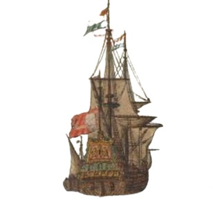
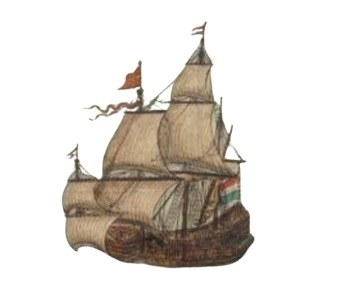
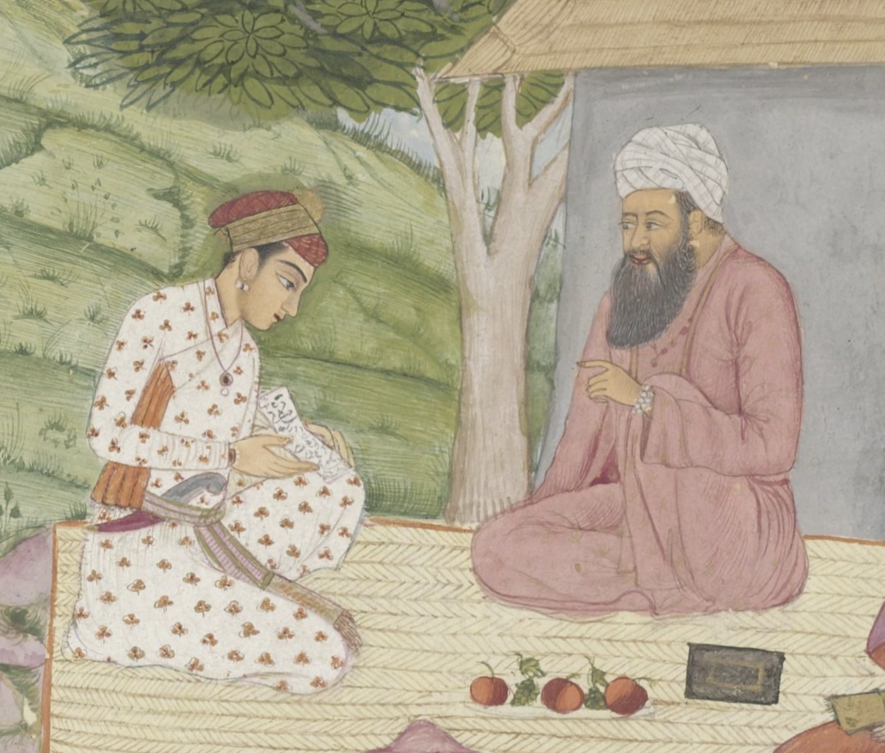
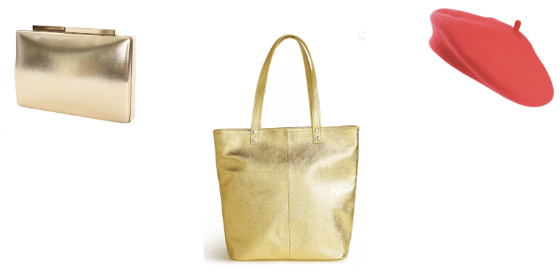
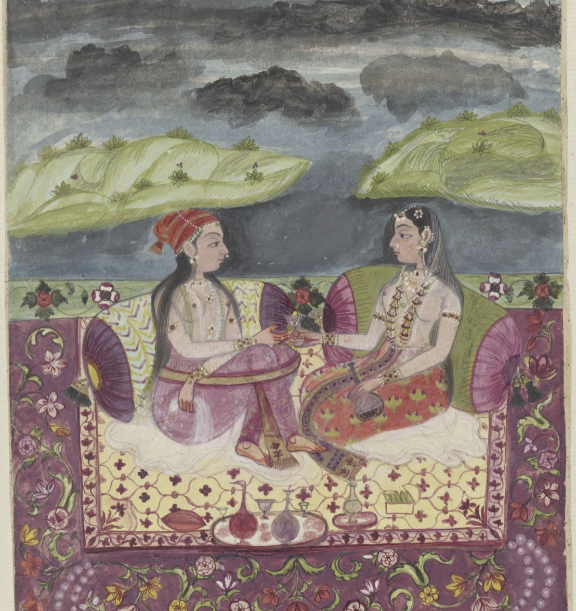

# Yes okay – but what were they doing?

> **Archived blog post.** This post was originally published on the Globalise project website on 7 April 2025 ([original URL](https://globalise.huygens.knaw.nl/yes-okay-but-what-were-they-doing/)). The text is reproduced without changes; links to other blog posts now point to their archived copies, and other links may no longer work.

**About the author:** Stella Verkijk is a natural language processing developer in the semantic contextualisation team of the Globalise project, based at Vrije Universiteit Amsterdam.

<!-- Bio source: Team page, https://globalise.huygens.knaw.nl/team/ (consulted 2026-10-01) -->

---

## How a lexical approach to event extraction can provide some first answers

In order to enable our users to not only look for entities, like places, people, or organizations, but also for actions or processes they were involved in, we work on the task referred to as *event extraction.* This means we try to identify and classify references to for example ships leaving, people being enslaved or wars being started. The last [blogpost](/pages/about/project/archive/blog/automatic-event-detection-in-early-modern-dutch-voc-documents-the-annotation-phase.md) on event extraction discussed the debut of us looking for the right framework for our event extraction module. Through a detailed process of trial annotations, discussions and research, we ultimately formed our very own event framework. This is a schema that contains over 80 event types that are all defined specifically for our corpus. 

We published a [paper](https://ceur-ws.org/Vol-3558/paper3332.pdf) explaining and motivating the ideas behind this approach to event modelling, set up our [wiki](https://github.com/globalise-huygens/nlp-event-detection/wiki) where we provide definitions of our event classes and finalized our [event annotation guidelines](https://docs.google.com/document/d/1hJ-HmomyGG_Am0A5w2LYPN4UFqcIeQOZrtFAG8ALLJI/edit?usp=sharing). We also started [mapping out](https://docs.google.com/spreadsheets/d/19V5mbjF86_-6XG9vQvYx1c0sw0cCbusYg_JiZqvTe7M/edit?usp=sharing) how our event classes relate to other event modelling schemas used in different projects. The event classes we define range from fairly general concepts, such as *Transportation*, to concepts more specific to our corpus, like *Mutiny*. Other examples of event types are *Killing*, *TakingUnderControl*, *Trade*, *FallingIll, Production* and many more. The event types are organized in a taxonomical structure so that they can be grouped. 

We continued annotating according to this schema. This means members of our team labelled words that referred to a specific event class in a selection of documents. For example, in *het affgevaerdigde schip,* ‘affgevaerdigde’ refers to the event class *Leaving*. The point of this is gathering examples of varying words in various contexts referring to the same event class, i.e., not only ‘affgevaerdigde’, but also ‘vertrocken’, ‘gelichte ankers’, ‘afscheid’, etc refer to *Leaving*.

We gather these examples to train machine learning systems with. In order to alleviate annotation labour, we started developing a lexicon: words of which we are sure that, regardless of the context, they refer to the same event class in the vast majority of cases. For example, we automatically label that ‘vertrecken’ refers to a *Leaving* event. On the other hand, we will not include ‘verseeckeren’ as a reference to an *Occupation* event in our lexicon, even though we know this sometimes happens.[^1] We refrain from doing this because ‘verseeckeren’ can also refer to many other things.[^2] Apart from using this lexicon as an automatic pre-annotation method, which means we annotate documents automatically with the lexicon before sending it to human annotators, it also serves as a good baseline to compare any machine learning systems to. Once we have a completely automatic (probabilistic) method linking words in the corpus to our event classes, it is good to see how they perform compared to a controlled lexical approach.

The lexicon grew and grew, until it reached a version where we thought it worthwhile to apply it to our complete corpus and see what we would find. This showed we could already find over 1.8 million instances of the event *Arriving* through this lexical approach, for example. Other examples: almost 200,000 instances of *BeingInConflict*, over 47,000 instances of *BeingInDebt* and over 22,000 instances of *Destroying*. We think this is useful for researchers and therefore decided to release this version of the lexicon. 

## **Building the lexicon**

The lexicon was created through an iterative process of three different techniques: i) annotation analysis ii) expert input and feedback and iii) synonym / spelling variation search using a semantic model.

### **Annotation analysis**

After two manual annotation rounds, we analyzed all annotations and extracted words that were annotated with the same event class twice or more. We went through them manually and decided which ones should be in the lexicon. We also directly added some token-type pairs that we knew might be relevant as experts working with the corpus all the time. This combination resulted in 150 token-type pairs.

### **Expert feedback**

We used the first version of the lexicon for pre-annotation of documents and gathered annotators’  feedback on the quality of the token-type pairs, adding as well as deleting token-type pairs here and there: essential changes though not drastic ones.  

*Adrianus Canter Visscher, *Two young princes receive the blessing*, c.1675-c.1725. [Rijksmuseum Amsterdam, CC0](https://id.rijksmuseum.nl/200563788).*

### **Word2Vec**

The biggest addition to this release of the lexicon came from an elaborate word2vec search using [a word2vec model trained on the VOC corpus](https://doi.org/10.5281/zenodo.15038313). A word2vec model is a collection of word embeddings: a computational representation of meaning where words that often appear in the same context in text are clustered together and seen as similar. An example to explain this concept could be: “I could really use a warm cup of \[blank\] right now”. As humans, we have an intuition of what should be in the blank space. Something like tea, coffee, hot chocolate. These are all drinkable liquids that humans enjoy to drink at the same temperature (hot). These are similar concepts. A word2vec model does not know anything about hot chocolate but it can learn the contexts it is used in and thus infer it is similar to coffee.

A word2vec model represents semantics that it encounters in its training data. For example, if you would train a word2vec model on text from fashion magazines, it would know the word ‘clutch’ and know it is similar to a tote bag but not to a beret, but if you would train it on cookbooks it would probably not. It is thus relevant on what text you train your word2vec model. 

We used the words gathered through annotation analysis and expert input as a ‘seed’ for this word2vec search. This means we put in a word we knew to refer to a specific event class and looked for the most similar words according to the word2vec model. Each similar word the model would suggest was evaluated, consulting the WNT[^3] when necessary, and added to the lexicon if the word was deemed to be indeed similar enough. Sometimes, words we accidentally came across, either through word2vec or through the WNT, were used again as a new seed. 

This expanded the lexicon to around the size it is now: from 150 to 610 token-type pairs. During subsequent annotations, we continued the iterative process of adding and deleting token-type pairs according to expert feedback. 

### **Limitations **

The lexicon is limited in three ways. Firstly with intent, because we only want to include token-type pairs of which we are fairly sure they are constant. This means we try not to include ambiguous tokens in the lexicon. Secondly without intent: we only include token-type pairs that we have come across in our creation method and this definitely does not cover all possible token-type pairs corresponding to our event type selection. Also, we try to cover as many spelling variations as possible, but we realize these are not complete. Thirdly, the current version of the lexicon only matches single tokens to an event type. It does not link “het hazenpad nemen” to *Leaving*, but it does link “hazenpad”.

## **Using the lexicon**

The lexicon contains 610 unique strings referring to 37 unique event types. This means we have no token-type pairs for the rest of the events from our framework. Apparently these events do not occur often, or are not referred to with unambiguous words for as far as we know. Though this is a very limited approach to event detection and very much the first step, it allows us to take a first peek into event-centered search in the VOC corpus. It allows us to try and evaluate what it means to gather events into concepts and search for a concept rather than a word. 

At the end of the blogpost we provide a table of links to perform a search for each of the events in the lexicon. An example: clicking on [this link](https://transcriptions.globalise.huygens.knaw.nl/?indexName=docs-2024-03-18&fragmentSize=100&from=0&size=10&sortBy=_score&sortOrder=desc&query=eyJkYXRlRnJvbSI6IjE1MDAtMDEtMDEiLCJkYXRlVG8iOiIxODAwLTAxLTAxIiwicmFuZ2VGcm9tIjoiMCIsInJhbmdlVG8iOiIzMDAwMCIsImZ1bGxUZXh0IjoidmVyZGVzdHJ1ZWVydCB2ZXJkZXN0cnVlcmVuIHZlcmRlc3RydWVlcmVuIGRlc3RydWN0aWUgZGVzdHJ1ZXJlbiBkZXN0cnVlZXJlbiBnZWxpY2h0IGRlbW9saWVyZW4gZGVtb2xpZWVyZW4gdmVyd29lc3RpbmcgdmVyd29lc3RlbiB2ZXJ3b2VzdGluZ2VuIHZlcndvZXN0aW5nZSB1aWp0Z2VwbHVuZGVydCB1aXRwbHVuZGVyZW4gdWlqdHBsdW5kZXJlbiB1aWp0Z2VwbHVuZGVydCBwbG9uZGVyZW4gZ2VwbG9uZGVydCB1aWp0Z2VwbG9uZGVydCB2ZXJkZWxnaW5nIHZlcmRlbGdpbmdlIHZlcmRlbGdlbiB2ZXJkZWxnZW5kZSB2ZXJkZWxndCB2ZXJkZWxnZCB2ZXJkZWxnZGUiLCJ0ZXJtcyI6e319) to the GLOBALISE transcription viewer allows you to search for instances of the event *Destroying*, which means looking for any occurrence of each of the following words:

> *verdestrueert; verdestrueren; verdestrueeren; destructie; destrueren; destrueeren; gelicht; demolieren; demolieeren; verwoesting; verwoesten; verwoestingen; verwoestinge; uijtgeplundert; uitplunderen; uijtplunderen; uijtgeplundert; plonderen; geplondert; uijtgeplondert; verdelging; verdelginge; verdelgen; verdelgende; verdelgt; verdelgd; verdelgde*

We performed an evaluation measuring how well the lexicon can make out which tokens refer to events and which ones do not in 15 (parts of) documents covering different years and subjects. According to this evaluation, the current version of the lexicon scores a precision of 0.8 and a recall of 0.2. This means that when the lexicon indicates a token refers to an event, in 80% of cases it is right. However, the lexicon only captures 20% of all tokens that refer to events. 

In light of this we would advise against using (this version of) the lexicon to draw any conclusions about longitudinal occurrences of events throughout the corpus. For example, the intuition might be that plotting the occurrences of the event *Production* over time might give you insight into the periods in which most crops were produced in a certain region. However, since we do not know to what extent the way people referred to crop production in language changed over time, there is no way to know whether the search is representative (i.e., we might only have words referring to *Production* in our lexicon that were used in the second half of the 18th century but not before). 

The lexicon in csv format along with a more technical description is available on our [GitHub page](https://github.com/globalise-huygens/nlp-event-lexical-approach)

## **Let’s make this a community-built resource!**

*Let’s* [***Collaborate***](https://transcriptions.globalise.huygens.knaw.nl/?indexName=docs-2024-03-18&fragmentSize=100&from=0&size=10&sortBy=_score&sortOrder=desc&query=eyJkYXRlRnJvbSI6IjE1MDAtMDEtMDEiLCJkYXRlVG8iOiIxODAwLTAxLTAxIiwicmFuZ2VGcm9tIjoiMCIsInJhbmdlVG8iOiIzMDAwMCIsImZ1bGxUZXh0IjoiYm9udGdlbm9vZHNjaGFwIGJvbmRnZW5vb2RzY2hhcCBib25kZ2Vub290c2NoYXAgYm9uZGdlbm9vZCBhbGlhbnRpZSBhbGxpYW50aWUgYm9udGdlbm9vdCBib25kZ2Vub290IGJvbnRnZW5vb3RzY2hhcCBib250Z2Vub29kIiwidGVybXMiOnt9fQ%3D%3D)*!*

*Adrianus Canter Visscher, *Two Moorish ladies,* c.1675-c.1725. [Rijksmuseum Amsterdam, CC0](https://id.rijksmuseum.nl/200563792).*

Throughout this blogpost we have mentioned the limitations of any lexical approach, as well as those of this specific lexical approach. We think our lexical approach could become very useful and powerful if we gather enough feedback from historians with different expertise. 

If you have critique, suggestions, know of tokens that should be deleted or know of tokens that should be added, we are all ears. In case you know of words that should be added: we are looking for any words that refer to one of our [events](https://github.com/globalise-huygens/nlp-event-detection/wiki). Please let us know by filling in our [***feedback form***](https://forms.office.com/Pages/ResponsePage.aspx?id=yFCH6vTj9U-kP-iCC-CffhgdATdArVtGtZ0L8Dbvn4dUN1NTOVJIWVlQM1g3Qk9EUUdGR0NORURPUi4u)! 

| Event Type | Description | Transcription viewer query |
|----|----|----|
| Arriving | The event of reaching a destination. | [Query](https://transcriptions.globalise.huygens.knaw.nl/?indexName=globalise-2024.03.18-test&fragmentSize=100&from=0&size=10&sortBy=_score&sortOrder=desc&query=eyJkYXRlRnJvbSI6IjE1MDAtMDEtMDEiLCJkYXRlVG8iOiIxODAwLTAxLTAxIiwicmFuZ2VGcm9tIjoiMCIsInJhbmdlVG8iOiIzMDAwMCIsImZ1bGxUZXh0IjoiZ2Vrb21lbiBnZWNvbWVuIGFhbnRlbGFuZGVuIGdlYXJyaXZlZXJ0IGFlbmNvbXBzdCBhcnJpdmVyZW4ga29tZW5kZSBnZWFycml2ZWVyZCBhZW5rb21zdCBhZW5rb21lbiBhZW5nZWxhbnQgcXVhbWVuIGdla29vbWVuIGFlbmdlY29tZW4gY29tZW4ga29vbWVuIGFlbmdlbGFuZCBhYW5rb21lbmRlIGFhbmxhbmRlbiBhYW5nZWxhbmQgYXJyaXZlbWVudCBhZW5jb21wc3RlIGtvbWVuIGFycml2ZSBnZWNvb21lbiBrb21zdCBhZW5nZWxhbmR0IGFhbmdlY29tZW4ga29vbWVuZGUgYXJyaXZlZXJlbiIsInRlcm1zIjp7fX0%3D) |
| Attacking | The act of initiating aggressive action against someone or something. | [Query](https://transcriptions.globalise.huygens.knaw.nl/?indexName=globalise-2024.03.18-test&fragmentSize=100&from=0&size=10&sortBy=_score&sortOrder=desc&query=eyJkYXRlRnJvbSI6IjE1MDAtMDEtMDEiLCJkYXRlVG8iOiIxODAwLTAxLTAxIiwicmFuZ2VGcm9tIjoiMCIsInJhbmdlVG8iOiIzMDAwMCIsImZ1bGxUZXh0IjoidmVndGVuIGdlZXNzZWxpbmcgbGlqZnN0cmFmZmUgYnJhbmRtZXJrZW4gZ2Vlc2VsYWFyIGFlbnRhc3RlbiBnZWJyYW50bWVyY2t0IGJyYW5kbWVyY2sgYnJhbnRtZXJrZW4gZ2VicmFuZG1lcmt0IGdlZ2Vlc3RlbHQga2FzdGlqZGluZ2VuIGJlbGVnZXJlbiBnZWdlZXNlbGQgYmVsZWdlcmRlIGdlZXNlbGluZyBnZWdlZXNlbHQgZ2VnZXNlbHQgZ2Vlc2VsZGUgYnJhbnRtZXJja2VuIGdlZXNlbGVuIGdlYnJhbmRtZXJja3QgZ2VnZWVzc2VsdCBicmFuZG1lcmNrZW4gYnJhbmR0bWVyY2sgdmVjaHRlbiBhdHRhY3F1ZXJlbiBrYXN0aWpkaW5nZSBicmFuZG1lcmsgYnJhbnRtZXJjayBicmFudG1lcmsgYXR0YWNxdWVlcmVuIG1vb3JkZW5hYXIgbW9vcmRlbmFhcnMgZXhlY3V0ZWVyZW4gdmVybW9vcmQgZXhlY3V0aWUgbW9vcmRlbiBtb29ydCBtb29yZCBkb29kc2xhZyBnZW1hc3NhY3JlZXJkZSBtb29yZGVuYWVycyB2ZXJtb29yZGVuIG9tYnJlbmdlbiBkb29kZ2VzbGFnZW4gbWFzc2FjcmVlcmVuIGV4ZWN1dGllbiBuZWVyZ2VzYWJlbGRlIGdlZG9vZCBuZWVyc2FiZWxkZSBuZWVyZ2VzYWJlbHQgZXhlY3V0ZXJlbiBvbWJyZW5ndCBnZW1hc3NhY3JlZXJkIHZlcm1vb3J0IGdlbWFzc2FjcmVlcnQgbWFzc2FjcmUgb21icmVuZ2VuZGUgZ2Vkb290IG5lZXJzYWJlbGVuIG1vb3JkZW5hZXIgbWFzc2FjcmVlcmRlIGludmFzaWUgaW52YXNpZXMgaW52YWRlcmVuIGludmFkZWVyZW4iLCJ0ZXJtcyI6e319) |
| BeingAtAPlace | The state of an entity being present at a specific location. | [Query](https://transcriptions.globalise.huygens.knaw.nl/?indexName=globalise-2024.03.18-test&fragmentSize=100&from=0&size=10&sortBy=_score&sortOrder=desc&query=eyJkYXRlRnJvbSI6IjE1MDAtMDEtMDEiLCJkYXRlVG8iOiIxODAwLTAxLTAxIiwicmFuZ2VGcm9tIjoiMCIsInJhbmdlVG8iOiIzMDAwMCIsImZ1bGxUZXh0IjoidmVyYmxpamZmIHZlcmJsaWpmIGJsaWp2ZW4gdmVyYmxpamZ0ICBjb21wYXJlZXJkZSB2ZXJibHlmIGFua2VyIGdlbW9udGVlcnQgY3J1aWpzc2VuIGFuY2tlciBrcnVpc3NlbiB2ZXJibHlmZiB2ZXJibGlqdiBjcnVpanNlbiBrcnVpc2VuIiwidGVybXMiOnt9fQ%3D%3D) |
| BeingDead | The state of no longer being alive. | [Query](https://transcriptions.globalise.huygens.knaw.nl/?indexName=globalise-2024.03.18-test&fragmentSize=100&from=0&size=10&sortBy=_score&sortOrder=desc&query=eyJkYXRlRnJvbSI6IjE1MDAtMDEtMDEiLCJkYXRlVG8iOiIxODAwLTAxLTAxIiwicmFuZ2VGcm9tIjoiMCIsInJhbmdlVG8iOiIzMDAwMCIsImZ1bGxUZXh0IjoiZ2VzdG9ydmVuIGRvb2Qgc3RpZXJmIGdlc3R1cnZlbiBkb29kdCBzdGVydnRlIHN0ZXJmZW4gb3ZlcmxpamRlbiBvdmVybGVkZW5lIHN0ZXJ2ZW4gc3RlcmZ0ZSBvdmVybGVkZW4iLCJ0ZXJtcyI6e319) |
| BeingInARelationship | The state of being connected or associated with someone or something. | [Query](https://transcriptions.globalise.huygens.knaw.nl/?indexName=globalise-2024.03.18-test&fragmentSize=100&from=0&size=10&sortBy=_score&sortOrder=desc&query=eyJkYXRlRnJvbSI6IjE1MDAtMDEtMDEiLCJkYXRlVG8iOiIxODAwLTAxLTAxIiwicmFuZ2VGcm9tIjoiMCIsInJhbmdlVG8iOiIzMDAwMCIsImZ1bGxUZXh0IjoidnJpbmRzY2hhcCB2cnVuZGVuIHZyaW50c2NoYXAgdnJ1bmRzY2hhcCB2cmllbmRzY2hhcCB2cnVudHNjaGFwIiwidGVybXMiOnt9fQ%3D%3D) |
| BeingInConflict | The state of being in a disagreement or clash between opposing parties. | [Query](https://transcriptions.globalise.huygens.knaw.nl/?indexName=globalise-2024.03.18-test&fragmentSize=100&from=0&size=10&sortBy=_score&sortOrder=desc&query=eyJkYXRlRnJvbSI6IjE1MDAtMDEtMDEiLCJkYXRlVG8iOiIxODAwLTAxLTAxIiwicmFuZ2VGcm9tIjoiMCIsInJhbmdlVG8iOiIzMDAwMCIsImZ1bGxUZXh0Ijoib29ybG9vZ2Ugb29ybG9naCB2aWphbmRlbiBvb3Jsb2dlIHZpamFuZCB2aWphbnQgb29ybG9nIHZ5YW5kIiwidGVybXMiOnt9fQ%3D%3D) |
| BeingInDebt | The state of owing money or favors to another party. | [Query](https://transcriptions.globalise.huygens.knaw.nl/?indexName=globalise-2024.03.18-test&fragmentSize=100&from=0&size=10&sortBy=_score&sortOrder=desc&query=eyJkYXRlRnJvbSI6IjE1MDAtMDEtMDEiLCJkYXRlVG8iOiIxODAwLTAxLTAxIiwicmFuZ2VGcm9tIjoiMCIsInJhbmdlVG8iOiIzMDAwMCIsImZ1bGxUZXh0Ijoic2NodWxkZW4gZGViaXQiLCJ0ZXJtcyI6e319) |
| BeingLeader | The state of holding a position of authority or control over a group or organization. | [Query](https://transcriptions.globalise.huygens.knaw.nl/?indexName=globalise-2024.03.18-test&fragmentSize=100&from=0&size=10&sortBy=_score&sortOrder=desc&query=eyJkYXRlRnJvbSI6IjE1MDAtMDEtMDEiLCJkYXRlVG8iOiIxODAwLTAxLTAxIiwicmFuZ2VGcm9tIjoiMCIsInJhbmdlVG8iOiIzMDAwMCIsImZ1bGxUZXh0IjoicmVnZWVyZW4gaGVlcnNlbmRlIGhlZXJzY2h0IHJlZ2VyZW4gY29tbWFuZG8gcmVnZWVydCBoZWVyc2NoZW4gaGVlcnNjaGVuZGUgaGVlcnN0IHJlZ2VlcmQgZ2Vjb21tYW5kZWVydCBoZWVyc2VuIiwidGVybXMiOnt9fQ%3D%3D) |
| Buying | The action of acquiring a product or service in exchange for money or another product. | [Query](https://transcriptions.globalise.huygens.knaw.nl/?indexName=globalise-2024.03.18-test&fragmentSize=100&from=0&size=10&sortBy=_score&sortOrder=desc&query=eyJkYXRlRnJvbSI6IjE1MDAtMDEtMDEiLCJkYXRlVG8iOiIxODAwLTAxLTAxIiwicmFuZ2VGcm9tIjoiMCIsInJhbmdlVG8iOiIzMDAwMCIsImZ1bGxUZXh0Ijoia29jaHQgZ2Vrb2d0IGdla29jaHRlIGdla29jaHQga29vcGVuIGtvcGVuIGdla29ndGUiLCJ0ZXJtcyI6e319) |
| Collaboration | The action of working jointly towards a common goal. | [Query](https://transcriptions.globalise.huygens.knaw.nl/?indexName=globalise-2024.03.18-test&fragmentSize=100&from=0&size=10&sortBy=_score&sortOrder=desc&query=eyJkYXRlRnJvbSI6IjE1MDAtMDEtMDEiLCJkYXRlVG8iOiIxODAwLTAxLTAxIiwicmFuZ2VGcm9tIjoiMCIsInJhbmdlVG8iOiIzMDAwMCIsImZ1bGxUZXh0IjoiYm9udGdlbm9vZHNjaGFwIGJvbmRnZW5vb2RzY2hhcCBib25kZ2Vub290c2NoYXAgYm9uZGdlbm9vZCBhbGlhbnRpZSBhbGxpYW50aWUgYm9udGdlbm9vdCBib25kZ2Vub290IGJvbnRnZW5vb3RzY2hhcCBib250Z2Vub29kIiwidGVybXMiOnt9fQ%3D%3D) |
| Communication | The act of conveying information. | [Query](https://transcriptions.globalise.huygens.knaw.nl/?indexName=globalise-2024.03.18-test&fragmentSize=100&from=0&size=10&sortBy=_score&sortOrder=desc&query=eyJkYXRlRnJvbSI6IjE1MDAtMDEtMDEiLCJkYXRlVG8iOiIxODAwLTAxLTAxIiwicmFuZ2VGcm9tIjoiMCIsInJhbmdlVG8iOiIzMDAwMCIsImZ1bGxUZXh0Ijoib3JkZXIgb3JkcmVzIGFudHdvb3JkZW4gYW50d29vcmRlbmRlIG9yZG9ubmFudGllIGdlYW50d29vcmQgIGFuZHdvb3JkIHNwcmVlY2tlbiBleHBsaWNlZXJlbiAgYW50d29vciB2cmFhZ2VuZGUgYmV2ZWVsZW4gYmV2ZWwgY29uZmVyZWVyZW4gIGFudHdvb3JkICBnZWFudHdvb3J0IHNwcmVlY2tlbmRlIGJldHVpamdlbiBiZXR1aWpndCBiZXZlZWxlbnMgb3JkcmUgb3JkZXJzIG9yZGVyZSBiZXR1aWpnZGUgdnJhZ2VuZGUgZCdvcmRvbm5hbnRpZSB2ZXJzbGFnIGFudHdvb3J0IHZyYWdlbiAgYmVhbmR3b29yZGVuIGJla2VudG1ha2VuIGRlY2xhcmVyZW4gIGJlYW50d29vcmRlbiB2cmFhZ2VuIiwidGVybXMiOnt9fQ%3D%3D) |
| Damaging | The act of causing harm or injury to something. | [Query](https://transcriptions.globalise.huygens.knaw.nl/?indexName=globalise-2024.03.18-test&fragmentSize=100&from=0&size=10&sortBy=_score&sortOrder=desc&query=eyJkYXRlRnJvbSI6IjE1MDAtMDEtMDEiLCJkYXRlVG8iOiIxODAwLTAxLTAxIiwicmFuZ2VGcm9tIjoiMCIsInJhbmdlVG8iOiIzMDAwMCIsImZ1bGxUZXh0IjoidmVybmllbGluZyBnZWJyb29rZW4gdmVybmllbGluZ2UgdmVybmllbHQgYnJla2VuIHZlcm5pZWxkZSBicmVla2VuIHZlcm5pZWxkIGdlYnJva2VuIHZlcm5pZWxlbiIsInRlcm1zIjp7fX0%3D) |
| Destroying | The action of damaging something beyond repair or causing something to cease to exist; putting an end to something. | [Query](https://transcriptions.globalise.huygens.knaw.nl/?indexName=globalise-2024.03.18-test&fragmentSize=100&from=0&size=10&sortBy=_score&sortOrder=desc&query=eyJkYXRlRnJvbSI6IjE1MDAtMDEtMDEiLCJkYXRlVG8iOiIxODAwLTAxLTAxIiwicmFuZ2VGcm9tIjoiMCIsInJhbmdlVG8iOiIzMDAwMCIsImZ1bGxUZXh0IjoiZ2VsaWNodCBkZXN0cnVjdGllIHZlcmRlbGdpbmdlIHZlcmRlbGdkZSB2ZXJ3b2VzdGVuIHZlcndvZXN0aW5nZW4gZGVtb2xpZXJlbiBkZXN0cnVlZXJlbiBkZXN0cnVlcmVuIHZlcndvZXN0aW5nIHZlcmRlbGd0IHZlcmRlc3RydWVyZW4gdWlqdGdlcGx1bmRlcnQgZ2VwbG9uZGVydCB2ZXJkZXN0cnVlZXJ0IHZlcmRlbGdpbmcgdWl0cGx1bmRlcmVuIHBsb25kZXJlbiB2ZXJkZWxnZW4gdWlqdHBsdW5kZXJlbiB2ZXJkZXN0cnVlZXJlbiB2ZXJkZWxnZW5kZSBkZW1vbGllZXJlbiB1aWp0Z2VwbG9uZGVydCB2ZXJkZWxnZCB2ZXJ3b2VzdGluZ2UiLCJ0ZXJtcyI6e319) |
| Dying | The change of state from being alive to being dead; approaching death; ceasing to live. | [Query](https://transcriptions.globalise.huygens.knaw.nl/?indexName=globalise-2024.03.18-test&fragmentSize=100&from=0&size=10&sortBy=_score&sortOrder=desc&query=eyJkYXRlRnJvbSI6IjE1MDAtMDEtMDEiLCJkYXRlVG8iOiIxODAwLTAxLTAxIiwicmFuZ2VGcm9tIjoiMCIsInJhbmdlVG8iOiIzMDAwMCIsImZ1bGxUZXh0Ijoic25ldXZlbGVuIGdlc25ldXZlbHQgZ2VzbmV1dmVsZGUgc25ldXZlbHQgc25ldXZlbGRlIiwidGVybXMiOnt9fQ%3D%3D) |
| FallingIll | The event of becoming sick or unwell or developing a disease. | [Query](https://transcriptions.globalise.huygens.knaw.nl/?indexName=globalise-2024.03.18-test&fragmentSize=100&from=0&size=10&sortBy=_score&sortOrder=desc&query=eyJkYXRlRnJvbSI6IjE1MDAtMDEtMDEiLCJkYXRlVG8iOiIxODAwLTAxLTAxIiwicmFuZ2VGcm9tIjoiMCIsInJhbmdlVG8iOiIzMDAwMCIsImZ1bGxUZXh0IjoiY29vcnRzIHNpZWt0ZW4gemlla3RlbiBzY2hldXJidWlrIHNpZWsgemlla3RlbnMgc2llY2t0ZSBzaWVjdGUgc2NoZXVyYnVpamsgc2lla3RlbnMgemllayBzaWVja2VsaWprIGtvb3J0cyIsInRlcm1zIjp7fX0%3D) |
| FinancialTransaction | The act of exchanging something for money. | [Query](https://transcriptions.globalise.huygens.knaw.nl/?indexName=globalise-2024.03.18-test&fragmentSize=100&from=0&size=10&sortBy=_score&sortOrder=desc&query=eyJkYXRlRnJvbSI6IjE1MDAtMDEtMDEiLCJkYXRlVG8iOiIxODAwLTAxLTAxIiwicmFuZ2VGcm9tIjoiMCIsInJhbmdlVG8iOiIzMDAwMCIsImZ1bGxUZXh0IjoiYmV0YWxlbiBiZXRhYWxlbiB0b2wiLCJ0ZXJtcyI6e319) |
| ForceToAct | The act of compelling someone to do something, regardless of their willingness or volition. | [Query](https://transcriptions.globalise.huygens.knaw.nl/?indexName=globalise-2024.03.18-test&fragmentSize=100&from=0&size=10&sortBy=_score&sortOrder=desc&query=eyJkYXRlRnJvbSI6IjE1MDAtMDEtMDEiLCJkYXRlVG8iOiIxODAwLTAxLTAxIiwicmFuZ2VGcm9tIjoiMCIsInJhbmdlVG8iOiIzMDAwMCIsImZ1bGxUZXh0Ijoic2xhdmVuaGFuZGVsIGdlY29uZmluZWVydCBiYW5pc3NlbWVudCBnZWNvbmZpbmVlcmRlIGdlY29uZmluZWVyZCB2ZXJiYW5uZW4gY29uZmluZWVyZW4gYmFubmlzc2VtZW50IiwidGVybXMiOnt9fQ%3D%3D) |
| Getting | The act of obtaining or receiving something, either through force or in agreement. | [Query](https://transcriptions.globalise.huygens.knaw.nl/?indexName=globalise-2024.03.18-test&fragmentSize=100&from=0&size=10&sortBy=_score&sortOrder=desc&query=eyJkYXRlRnJvbSI6IjE1MDAtMDEtMDEiLCJkYXRlVG8iOiIxODAwLTAxLTAxIiwicmFuZ2VGcm9tIjoiMCIsInJhbmdlVG8iOiIzMDAwMCIsImZ1bGxUZXh0Ijoicm92YWdlIG9udHZhbmdlbmUgb250ZmFuZ2VuIHBsdW5kZXJlbiBkaWVmdGUgcm92ZW4gcGx1bmRlcmVuZGUgcm92ZXIgcGx1bmRlcnQgb250ZmFuZ2VuZSByb29mc3RlciBvbnRmYW5nZSByb292ZW4gcmVjZXB0aWUgYmVjb21lbiB1aWp0Z2VwbHVuZGVydCBnZXBsb25kZXJ0IG9udHZhbmdlbiBkaWVmc3RhbCB1aXRwbHVuZGVyZW4gcGxvbmRlcmVuIHJlc2VwdGllIGRpZWYgb250ZmFuZ3N0IHVpanRwbHVuZGVyZW4gb250dmFuZ2UgdWlqdGdlcGxvbmRlcnQgZGlldmVyaWplbiIsInRlcm1zIjp7fX0%3D) |
| Giving | The action of transferring something to someone else. | [Query](https://transcriptions.globalise.huygens.knaw.nl/?indexName=globalise-2024.03.18-test&fragmentSize=100&from=0&size=10&sortBy=_score&sortOrder=desc&query=eyJkYXRlRnJvbSI6IjE1MDAtMDEtMDEiLCJkYXRlVG8iOiIxODAwLTAxLTAxIiwicmFuZ2VGcm9tIjoiMCIsInJhbmdlVG8iOiIzMDAwMCIsImZ1bGxUZXh0IjoiIGdlc2NoZW5rZSBnZXNjaGVuY2tlIHZlcmxlZW5kIHJlbGFnZWVydCBhZmdlZ2V2ZW4gc2NoZW5rYXNpZSByZWxhZ2VlcmRlIGdhZiBzY2hlbmtlbiBnYWZmIGdhYXZlbiBnZWV2ZW5kZSBnZXNjaGVuayBnZWV2ZW4gdmVybGVlbmUgc2NoZW5rYWdpZSBzY2hlbmNhZ2llIGdlc2NoZW5ja2plIGdlcmVsYWdlZXJ0IHNjaGVua2thZ2llIHNjaGVua2FnZSBzY2hlbmthZ2llbiBnZXNjaGVua2plIGdldmVuZGUgc2NoZW5ja2FnaWUgZ2VjaGVuY2tlbiByZWdhbGVyZW4gZ2V2ZW4gcmVnYWxlZXJlbiBnZXNjaGVua2VuIGdlc2NoZW5jayB2ZXJsZWVuZGUiLCJ0ZXJtcyI6e319) |
| HavingInPossession | The state of owning or holding on to something. | [Query](https://transcriptions.globalise.huygens.knaw.nl/?indexName=globalise-2024.03.18-test&fragmentSize=100&from=0&size=10&sortBy=_score&sortOrder=desc&query=eyJkYXRlRnJvbSI6IjE1MDAtMDEtMDEiLCJkYXRlVG8iOiIxODAwLTAxLTAxIiwicmFuZ2VGcm9tIjoiMCIsInJhbmdlVG8iOiIzMDAwMCIsImZ1bGxUZXh0Ijoidm9vcnJhYWQgYmVtYW50IGdlaG9vcmVuZGUgdm9vcnJhZWQgYmVtYW5kIGdlbW9udGhlZXJkIiwidGVybXMiOnt9fQ%3D%3D) |
| Invasion | The act of entering a place, often forcefully, to occupy or control it. | [Query](https://transcriptions.globalise.huygens.knaw.nl/?indexName=globalise-2024.03.18-test&fragmentSize=100&from=0&size=10&sortBy=_score&sortOrder=desc&query=eyJkYXRlRnJvbSI6IjE1MDAtMDEtMDEiLCJkYXRlVG8iOiIxODAwLTAxLTAxIiwicmFuZ2VGcm9tIjoiMCIsInJhbmdlVG8iOiIzMDAwMCIsImZ1bGxUZXh0IjoiaW52YXNpZSBpbnZhc2llcyBpbnZhZGVyZW4gaW52YWRlZXJlbiIsInRlcm1zIjp7fX0%3D) |
| Killing | The act of causing the death of a living being. | [Query](https://transcriptions.globalise.huygens.knaw.nl/?indexName=globalise-2024.03.18-test&fragmentSize=100&from=0&size=10&sortBy=_score&sortOrder=desc&query=eyJkYXRlRnJvbSI6IjE1MDAtMDEtMDEiLCJkYXRlVG8iOiIxODAwLTAxLTAxIiwicmFuZ2VGcm9tIjoiMCIsInJhbmdlVG8iOiIzMDAwMCIsImZ1bGxUZXh0IjoibW9vcmRlbmFhciBtb29yZGVuYWFycyBleGVjdXRlZXJlbiB2ZXJtb29yZCBleGVjdXRpZSBtb29yZGVuIG1vb3J0IG1vb3JkIGRvb2RzbGFnIGdlbWFzc2FjcmVlcmRlIG1vb3JkZW5hZXJzIHZlcm1vb3JkZW4gb21icmVuZ2VuIGRvb2RnZXNsYWdlbiBtYXNzYWNyZWVyZW4gZXhlY3V0aWVuIG5lZXJnZXNhYmVsZGUgZ2Vkb29kIG5lZXJzYWJlbGRlIG5lZXJnZXNhYmVsdCBleGVjdXRlcmVuIG9tYnJlbmd0IGdlbWFzc2FjcmVlcmQgdmVybW9vcnQgZ2VtYXNzYWNyZWVydCBtYXNzYWNyZSBvbWJyZW5nZW5kZSBnZWRvb3QgbmVlcnNhYmVsZW4gbW9vcmRlbmFlciBtYXNzYWNyZWVyZGUiLCJ0ZXJtcyI6e319) |
| Leaving | The act of departing from a place. | [Query](https://transcriptions.globalise.huygens.knaw.nl/?indexName=globalise-2024.03.18-test&fragmentSize=100&from=0&size=10&sortBy=_score&sortOrder=desc&query=eyJkYXRlRnJvbSI6IjE1MDAtMDEtMDEiLCJkYXRlVG8iOiIxODAwLTAxLTAxIiwicmFuZ2VGcm9tIjoiMCIsInJhbmdlVG8iOiIzMDAwMCIsImZ1bGxUZXh0IjoidmVybGFhdCBoYXplbnBhZCB1aWp0c2VpamxlbiBnZWxpZ3QgdmVydHJlayBoYXNlcGFkIHZlcnRyZWNrIGdldmx1Z3QgdmVydHJla2tlbiB2ZXJ0cm9ja2VuIHVpdHplaWxlbiBoYXplcGFkIG9uZGVyemVpbCB1aWp0Z2V6ZWlqbHQgYWZmZ2V2YWVyZGlndCB2bHVndCB2ZXJ0cmVja2UgYWZzY2hlaWQgdmVydHJlY2tlbiB2ZXJ0cmVja2VuZGUgdWlqdGdlemVpamxkIHZsdWd0ZW4gZGVwYXJ0IHVpanRnZXNlaWpsZCBhZmZ2YWVyZGlnZW4gdmVydHJva2tlbiB2ZXJsYXRlbiIsInRlcm1zIjp7fX0%3D) |
| Production | The process of creating or manufacturing goods or services. | [Query](https://transcriptions.globalise.huygens.knaw.nl/?indexName=globalise-2024.03.18-test&fragmentSize=100&from=0&size=10&sortBy=_score&sortOrder=desc&query=eyJkYXRlRnJvbSI6IjE1MDAtMDEtMDEiLCJkYXRlVG8iOiIxODAwLTAxLTAxIiwicmFuZ2VGcm9tIjoiMCIsInJhbmdlVG8iOiIzMDAwMCIsImZ1bGxUZXh0IjoiY3VsdGl2ZXJlbmQgYWFucXVlZWsgYWVucGxhbnRpbmdlIGN1bHRpdmVlcnQgYWFucGxhbnRlbiBhZW5wbGFudGVuIGN1bHRpdmVyZW4gcGxhbnRhZ2llcyBiZXBsYW50aW5nIHBsYW50aW5nIGFhbnF1ZWtpbmcgYWVucGxhbnRpbmcgdGVsZW4gYWFua3dlZWtlbiBvZWdzdGVuIHBsYW50YWdpZSBhYW5wbGFudGluZ2UgYWFucGxhbnRpbmcgY3VsdGl2ZWVyaW5nIGN1bHRpdmVyaW5nIGN1bHRpdmVlcmVuIG9vZ3N0ZW4gb29nc3QgYmVwbGFudGluZ2UgcGxhbnRhZ2llbiBjdWx0aXZlZXJlbmRlIHBsYW50aW5nZSBjdWx0aXZlZXJkZSBhYW5nZXBsYW50ZSIsInRlcm1zIjp7fX0%3D) |
| Punishing | The act of inflicting a penalty, sanction or torturous act on someone for a supposed offense or wrongdoing. | [Query](https://transcriptions.globalise.huygens.knaw.nl/?indexName=globalise-2024.03.18-test&fragmentSize=100&from=0&size=10&sortBy=_score&sortOrder=desc&query=eyJkYXRlRnJvbSI6IjE1MDAtMDEtMDEiLCJkYXRlVG8iOiIxODAwLTAxLTAxIiwicmFuZ2VGcm9tIjoiMCIsInJhbmdlVG8iOiIzMDAwMCIsImZ1bGxUZXh0Ijoic3RyYWZmaW5nZSBnZXB1bmllZXJ0IGthc3RpamRpbmdlIHN0cmFmZiBzdHJhZnQgc3RyYWZmZSBrYXN0aWpkaW5nZW4gc3RyYWZmZW4gbXVsY3RlZXJlbiBnZW11bGNrdGVlcnQgZXhlY3V0ZWVyZW4gZXhlY3V0ZXJlbiBsaWpmc3RyYWZmZSBwdW5pdGl0ZSB0ZXN0cmFmZnRlbiBnZXN0cmFmdCBzdHJhZiIsInRlcm1zIjp7fX0%3D) |
| Replacing | The act of substituting one person in a position of power for another (succession). | [Query](https://transcriptions.globalise.huygens.knaw.nl/?indexName=globalise-2024.03.18-test&fragmentSize=100&from=0&size=10&sortBy=_score&sortOrder=desc&query=eyJkYXRlRnJvbSI6IjE1MDAtMDEtMDEiLCJkYXRlVG8iOiIxODAwLTAxLTAxIiwicmFuZ2VGcm9tIjoiMCIsInJhbmdlVG8iOiIzMDAwMCIsImZ1bGxUZXh0Ijoic3VjY2Vzc2V1ciBvcHZvbGdlciIsInRlcm1zIjp7fX0%3D) |
| Request | An event where an individual or entity asks for something to be given or done. | [Query](https://transcriptions.globalise.huygens.knaw.nl/?indexName=globalise-2024.03.18-test&fragmentSize=100&from=0&size=10&sortBy=_score&sortOrder=desc&query=eyJkYXRlRnJvbSI6IjE1MDAtMDEtMDEiLCJkYXRlVG8iOiIxODAwLTAxLTAxIiwicmFuZ2VGcm9tIjoiMCIsInJhbmdlVG8iOiIzMDAwMCIsImZ1bGxUZXh0IjoidmVyem9la3NjaHJpZnQgdmVyc29layB2ZXJzb2NodGUgdmVyc29lY2tlbmRlIHZlcnNvZWNrZW4gcmVxdWVzIHZlcnNvZWtlbiB2ZXJzb3Vja2VuIHZlcnNvY2h0IHZlcnpvZWtlbiBzdXBwbGljcXVlbiByZXF1YXN0IHZlcnNvZWNrZSBzbWVla3NjaHJpZnRlbiB2ZXJzb2VjcSBzdXBwbGljcSByZXF1ZXN0amUgc21lZWtzY2hyaWZ0IHZlcnNvdWNrIHZlcnpvZWtzY2hyaWZ0ZW4gZWlzY2ggdmVyc29lY2sgcmVxdWVzdGUgdmVyc29la2UgcmVxdWVzdCB2ZXJzb2VrdCB2ZXJ6b2d0IHZlcnpvZWsgIHN1cHBsaWVxIHN1cHBsaWNlZXJ0IHZlcnNvdWNrZW5kZSBzdXBwbGljYXRpZSB2ZXJzb2Vja3Qgc3VwcGxpY2VlcmVuIHZlcnNvdWNrdCIsInRlcm1zIjp7fX0%3D) |
| Selling | The act of exchanging a product or service for money or another product. | [Query](https://transcriptions.globalise.huygens.knaw.nl/?indexName=globalise-2024.03.18-test&fragmentSize=100&from=0&size=10&sortBy=_score&sortOrder=desc&query=eyJkYXRlRnJvbSI6IjE1MDAtMDEtMDEiLCJkYXRlVG8iOiIxODAwLTAxLTAxIiwicmFuZ2VGcm9tIjoiMCIsInJhbmdlVG8iOiIzMDAwMCIsImZ1bGxUZXh0IjoidmVya29ndGUgdmVya29jaHQgdmVya29wZW4gdmVya29ndCB2ZXJrb29wZW4gdmVya29jaHRlIiwidGVybXMiOnt9fQ%3D%3D) |
| Sinking | The event of a vessel or object descending below the surface, typically of water. | [Query](https://transcriptions.globalise.huygens.knaw.nl/?indexName=globalise-2024.03.18-test&fragmentSize=100&from=0&size=10&sortBy=_score&sortOrder=desc&query=eyJkYXRlRnJvbSI6IjE1MDAtMDEtMDEiLCJkYXRlVG8iOiIxODAwLTAxLTAxIiwicmFuZ2VGcm9tIjoiMCIsInJhbmdlVG8iOiIzMDAwMCIsImZ1bGxUZXh0IjoiZ2Vzb25ja2VuIGdlc29ua2VuIHNpbmNrZW4gc2lua2VuZGUgemluY2tlbmRlIHNpbmNrZW5kZSB6aW5ja2VuIHNjaGlwYnJldWsgZ2V6b25rZW4gemlua2VuZGUgemlua2VuIHNpbmtlbiBnZXpvbmNrZW4iLCJ0ZXJtcyI6e319) |
| TakingUnderControl | The act of gaining dominance or command over something or someone. | [Query](https://transcriptions.globalise.huygens.knaw.nl/?indexName=globalise-2024.03.18-test&fragmentSize=100&from=0&size=10&sortBy=_score&sortOrder=desc&query=eyJkYXRlRnJvbSI6IjE1MDAtMDEtMDEiLCJkYXRlVG8iOiIxODAwLTAxLTAxIiwicmFuZ2VGcm9tIjoiMCIsInJhbmdlVG8iOiIzMDAwMCIsImZ1bGxUZXh0IjoiZ2V2YW5nZW5pcyBnZXZhbmdlbiBjb25xdWVlc3RlICBjb25xdWVzdGUgZ2Vjb25maW5lZXJ0IGdldmFuZ2VucyBiZWxlZ2VyZW4gZ2Vjb25maW5lZXJkZSBnZXZhbmdlbmVuIGJlbGVnZXJkZSBnZWNvbmZpbmVlcmQgZ2VzYWlzZWVyZCB2ZXJtZWVzdGVyZW4gY29uZmluZWVyZW4gb3Zlcm1lZXN0ZXJlbiIsInRlcm1zIjp7fX0%3D) |
| Trade | The action of buying, selling, or exchanging goods or services between parties, either involving a monetary exchange or not. | [Query](https://transcriptions.globalise.huygens.knaw.nl/?indexName=globalise-2024.03.18-test&fragmentSize=100&from=0&size=10&sortBy=_score&sortOrder=desc&query=eyJkYXRlRnJvbSI6IjE1MDAtMDEtMDEiLCJkYXRlVG8iOiIxODAwLTAxLTAxIiwicmFuZ2VGcm9tIjoiMCIsInJhbmdlVG8iOiIzMDAwMCIsImZ1bGxUZXh0Ijoic2xhdmVuaGFuZGVsIGxldmVyYW5jaWUgZGVsZXZlcmFudGllIGxldmVyYW50aWVuIGhhbmRlbCBsZWV2ZXJhbnRpZSBsZXZlcmFudGllIHZlcmtvZ3RlIHZlcmtvY2h0IHZlcmtvcGVuIHZlcmtvZ3QgdmVya29vcGVuIHZlcmtvY2h0ZSBrb2NodCBnZWtvZ3QgZ2Vrb2NodGUgZ2Vrb2NodCBrb29wZW4ga29wZW4gZ2Vrb2d0ZSIsInRlcm1zIjp7fX0%3D) |
| Translocation | The process where something or someone moves from one place to another. | [Query](https://transcriptions.globalise.huygens.knaw.nl/?indexName=globalise-2024.03.18-test&fragmentSize=100&from=0&size=10&sortBy=_score&sortOrder=desc&query=eyJkYXRlRnJvbSI6IjE1MDAtMDEtMDEiLCJkYXRlVG8iOiIxODAwLTAxLTAxIiwicmFuZ2VGcm9tIjoiMCIsInJhbmdlVG8iOiIzMDAwMCIsImZ1bGxUZXh0IjoidmFyZW4gd2VkZXJnZWtlZXJ0IHplaWxlbiBvdmVyZ2FldCB3ZWRlcmtlZXJlbiB0b2Vjb21lbiBkZXBlY2hlIGNydWlqc2VuIHBhc3NlcmVuIGdlemVpamx0IHJlcGF0cmllcmVuIGRlcGVjaGVyZW4gd2VkZXJrZXJlbiBvdmVyZ2FlbnQgZGVwZXNjaGUgemVpamxkIG92ZXJnYWVuZGUgZ2VyZXBhdHJpZWVyZGUgdG9lc2VuZGVuIGNydWlqc3NlbiB6ZW5kZW4gb3ZlcmdhZW5kIGdlc29uZGVuIG92ZXJnYWVuIHRvZWdlc29uZGVuIGdla2VlcnQgZ2Vjb25kdWlzZWVydCBzZWlqbGQgZ2V6ZWlsdCBkZXBlc2NoZXJlbiB0ZXZhcmVuIGtydWlzZW4gemVpamx0IGRlcGVjaGVlcmVuIHNlbmRlbiBkZXBlY2hlcyB2YWVyZW4gdG9lZ2Vjb21lbiBnYWFuZGUga3J1aXNzZW4gc2VpamxlbiB2YWFyZW4gZ2VyZXBhdHJpZWVyZCBwYXNzZWVyZGVuIGdlbGFlZGVuZSBhZmZnZXNvbmRlbiBkZWxldmVyYW50aWUgYmVzZW5kaW5naCB2ZXJ2b2VyZW4gYmV6ZW5kaW5nZSBhZmZnZWxhZGVuZSB0J3ZlcnZvZXJlbiBvdmVyc2NoZWVwZW4gZ2VsYWFkZW5lIGJlemVuZGluZyB2b2xsYWRpbmcgbGFkZW4gdGV2ZXJ2b2VyZW4gYWZmbGFhZGVuIHZlcnNlbmRlbiBiZXplbmRpbmdoIGJlemVuZGluZ2VuIGxlZXZlcmFudGllIGdlc2NoZWVwdCBvdmVyc2NoZXBlbiBhZmZnZXNjaGVlcHRlIGdlYnJhZ3QgdHJhbnNwb3J0ZWVyZW4gdmVyc29uZCBnZWxhZGVuZSBiZXNlbmRpbmdlIGxldmVyYW5jaWUgYWZmc29uZCBhZmZzZW5kZW4gYWZzY2hlcGVuIHBhc3NhZ2llcnMgdmVyc29uZGVuZSB2ZXJzb25kZW4gdmVydm9lciByZXRvdXJiZXNlbmRpbmcgb3ZlcnZvZXJlbiB2ZXJ2b2VyZGUgdHJhbnNwb3J0ZXJlbiBiZXNlbmRpbmdlbiB2b2xsYWFkZW4gdmVydm9lcnQgYWZmc2NoZXBlbiBhZmZnZXNvbmRlbmUgdmVydm9lcmRlbiAgYWZmZ2VsYWVkZW5lICBhZmxhZGVuIGdlYnJhY2h0IGxldmVyYW50aWVuIHRyYW5zcG9ydCByZXRvdXJiZXplbmRpbmcgYWZmZ2VzY2hlZXB0IGJyZW5nZW4gbGV2ZXJhbnRpZSBiZXNlbmRpbmcgcmV5c2UgcmhleXMgcmlqc2UgcmhleXNlIHJlaWp6ZSB2b3lhZ2llbiByeXplIHJ5c2UgcmVpanMgcmVpc2UgcmVpcyB2b2phZ2llIHJlaWpzZSByaGVpanNlIHVpanRyZWlqc2Ugdm95YWdpZSB2b2lqYWdpZW4gcmV5cyByZWl6IHJoZWlqemUgcmhlaWpzIHRvY2h0IHZvaWphZ2llIHJleXplIHJoZWlzZSByaGlqc2UgcmlqemUgdm9pamFnZSBkZXJlaWpzZSB0b2d0IHJlaXplIHZlcmxhYXQgaGF6ZW5wYWQgdWlqdHNlaWpsZW4gZ2VsaWd0IHZlcnRyZWsgaGFzZXBhZCB2ZXJ0cmVjayBnZXZsdWd0IHZlcnRyZWtrZW4gdmVydHJvY2tlbiB1aXR6ZWlsZW4gaGF6ZXBhZCBvbmRlcnplaWwgdWlqdGdlemVpamx0IGFmZmdldmFlcmRpZ3Qgdmx1Z3QgdmVydHJlY2tlIGFmc2NoZWlkIHZlcnRyZWNrZW4gdmVydHJlY2tlbmRlIHVpanRnZXplaWpsZCB2bHVndGVuIGRlcGFydCB1aWp0Z2VzZWlqbGQgYWZmdmFlcmRpZ2VuIHZlcnRyb2trZW4gdmVybGF0ZW4gZ2Vrb21lbiBnZWNvbWVuIGFhbnRlbGFuZGVuIGdlYXJyaXZlZXJ0IGFlbmNvbXBzdCBhcnJpdmVyZW4ga29tZW5kZSBnZWFycml2ZWVyZCBhZW5rb21zdCBhZW5rb21lbiBhZW5nZWxhbnQgcXVhbWVuIGdla29vbWVuIGFlbmdlY29tZW4gY29tZW4ga29vbWVuIGFlbmdlbGFuZCBhYW5rb21lbmRlIGFhbmxhbmRlbiBhYW5nZWxhbmQgYXJyaXZlbWVudCBhZW5jb21wc3RlIGtvbWVuIGFycml2ZSBnZWNvb21lbiBrb21zdCBhZW5nZWxhbmR0IGFhbmdlY29tZW4ga29vbWVuZGUgYXJyaXZlZXJlbiIsInRlcm1zIjp7fX0%3D) |
| Transportation | The movement of goods or individuals from one location to another. | [Query](https://transcriptions.globalise.huygens.knaw.nl/?indexName=globalise-2024.03.18-test&fragmentSize=100&from=0&size=10&sortBy=_score&sortOrder=desc&query=eyJkYXRlRnJvbSI6IjE1MDAtMDEtMDEiLCJkYXRlVG8iOiIxODAwLTAxLTAxIiwicmFuZ2VGcm9tIjoiMCIsInJhbmdlVG8iOiIzMDAwMCIsImZ1bGxUZXh0IjoiZ2VsYWVkZW5lIGFmZmdlc29uZGVuIGRlbGV2ZXJhbnRpZSBiZXNlbmRpbmdoIHZlcnZvZXJlbiBiZXplbmRpbmdlIGFmZmdlbGFkZW5lIHQndmVydm9lcmVuIG92ZXJzY2hlZXBlbiBnZWxhYWRlbmUgYmV6ZW5kaW5nIHZvbGxhZGluZyBsYWRlbiB0ZXZlcnZvZXJlbiBhZmZsYWFkZW4gdmVyc2VuZGVuIGJlemVuZGluZ2ggYmV6ZW5kaW5nZW4gbGVldmVyYW50aWUgZ2VzY2hlZXB0IG92ZXJzY2hlcGVuIGFmZmdlc2NoZWVwdGUgZ2VicmFndCB0cmFuc3BvcnRlZXJlbiB2ZXJzb25kIGdlbGFkZW5lIGJlc2VuZGluZ2UgbGV2ZXJhbmNpZSBhZmZzb25kIGFmZnNlbmRlbiBhZnNjaGVwZW4gcGFzc2FnaWVycyB2ZXJzb25kZW5lIHZlcnNvbmRlbiB2ZXJ2b2VyIHJldG91cmJlc2VuZGluZyBvdmVydm9lcmVuIHZlcnZvZXJkZSB0cmFuc3BvcnRlcmVuIGJlc2VuZGluZ2VuIHZvbGxhYWRlbiB2ZXJ2b2VydCBhZmZzY2hlcGVuIGFmZmdlc29uZGVuZSB2ZXJ2b2VyZGVuICBhZmZnZWxhZWRlbmUgIGFmbGFkZW4gZ2VicmFjaHQgbGV2ZXJhbnRpZW4gdHJhbnNwb3J0IHJldG91cmJlemVuZGluZyBhZmZnZXNjaGVlcHQgYnJlbmdlbiBsZXZlcmFudGllIGJlc2VuZGluZyIsInRlcm1zIjp7fX0%3D) |
| Unrest | A state of dissatisfaction, disturbance, or agitation in a community. | [Query](https://transcriptions.globalise.huygens.knaw.nl/?indexName=globalise-2024.03.18-test&fragmentSize=100&from=0&size=10&sortBy=_score&sortOrder=desc&query=eyJkYXRlRnJvbSI6IjE1MDAtMDEtMDEiLCJkYXRlVG8iOiIxODAwLTAxLTAxIiwicmFuZ2VGcm9tIjoiMCIsInJhbmdlVG8iOiIzMDAwMCIsImZ1bGxUZXh0IjoidmVycmFkZXJpamVuIG9wcm9lciB2ZXJkZWVsdGhlZGVuIHRyb3V3bG9zZSBhZnZhbGxpZ2Ugb25nZWhvb3JzYWVtaGVpdCB0cm91d2xvb3NoZWlqZCIsInRlcm1zIjp7fX0%3D) |
| Uprising | An act of resistance or rebellion against an established authority. | [Query](https://transcriptions.globalise.huygens.knaw.nl/?indexName=globalise-2024.03.18-test&fragmentSize=100&from=0&size=10&sortBy=_score&sortOrder=desc&query=eyJkYXRlRnJvbSI6IjE1MDAtMDEtMDEiLCJkYXRlVG8iOiIxODAwLTAxLTAxIiwicmFuZ2VGcm9tIjoiMCIsInJhbmdlVG8iOiIzMDAwMCIsImZ1bGxUZXh0IjoicmViZWxsaWUgcmViZWxsaWplIHJldm9sdGVlcmVuIG9wc3RhbmQgcmViZWxsZSByZWJlbGxlbiByZWJlbGxpZ2Ugb3BzdGFudCByZXZvbHRlIHJlYmVsbGVlcmVuZGUiLCJ0ZXJtcyI6e319) |
| ViolentContest | An event characterized by aggressive competition or conflict. | [Query](https://transcriptions.globalise.huygens.knaw.nl/?indexName=globalise-2024.03.18-test&fragmentSize=100&from=0&size=10&sortBy=_score&sortOrder=desc&query=eyJkYXRlRnJvbSI6IjE1MDAtMDEtMDEiLCJkYXRlVG8iOiIxODAwLTAxLTAxIiwicmFuZ2VGcm9tIjoiMCIsInJhbmdlVG8iOiIzMDAwMCIsImZ1bGxUZXh0IjoidmVyZHJpanZlbiBwbHVuZGVydCBnZXdlbHQgdmVyZHJpanZpbmcgcGx1bmRlcmVuIHZlcmphZ2VuIHBsdW5kZXJlbmRlIGdld2VsZCBvdmVybWVlc3RlcmVuIHZlcm1lZXN0ZXJlbiBnZXdlbGR0IHJlYmVsbGllIHJlYmVsbGlqZSByZXZvbHRlZXJlbiBvcHN0YW5kIHJlYmVsbGUgcmViZWxsZW4gcmViZWxsaWdlIG9wc3RhbnQgcmV2b2x0ZSByZWJlbGxlZXJlbmRlIHZlZ3RlbiBnZWVzc2VsaW5nIGxpamZzdHJhZmZlIGJyYW5kbWVya2VuIGdlZXNlbGFhciBhZW50YXN0ZW4gZ2VicmFudG1lcmNrdCBicmFuZG1lcmNrIGJyYW50bWVya2VuIGdlYnJhbmRtZXJrdCBnZWdlZXN0ZWx0IGthc3RpamRpbmdlbiBiZWxlZ2VyZW4gZ2VnZWVzZWxkIGJlbGVnZXJkZSBnZWVzZWxpbmcgZ2VnZWVzZWx0IGdlZ2VzZWx0IGdlZXNlbGRlIGJyYW50bWVyY2tlbiBnZWVzZWxlbiBnZWJyYW5kbWVyY2t0IGdlZ2Vlc3NlbHQgYnJhbmRtZXJja2VuIGJyYW5kdG1lcmNrIHZlY2h0ZW4gYXR0YWNxdWVyZW4ga2FzdGlqZGluZ2UgYnJhbmRtZXJrIGJyYW50bWVyY2sgYnJhbnRtZXJrIGF0dGFjcXVlZXJlbiBtb29yZGVuYWFyIG1vb3JkZW5hYXJzIGV4ZWN1dGVlcmVuIHZlcm1vb3JkIGV4ZWN1dGllIG1vb3JkZW4gbW9vcnQgbW9vcmQgZG9vZHNsYWcgZ2VtYXNzYWNyZWVyZGUgbW9vcmRlbmFlcnMgdmVybW9vcmRlbiBvbWJyZW5nZW4gZG9vZGdlc2xhZ2VuIG1hc3NhY3JlZXJlbiBleGVjdXRpZW4gbmVlcmdlc2FiZWxkZSBnZWRvb2QgbmVlcnNhYmVsZGUgbmVlcmdlc2FiZWx0IGV4ZWN1dGVyZW4gb21icmVuZ3QgZ2VtYXNzYWNyZWVyZCB2ZXJtb29ydCBnZW1hc3NhY3JlZXJ0IG1hc3NhY3JlIG9tYnJlbmdlbmRlIGdlZG9vdCBuZWVyc2FiZWxlbiBtb29yZGVuYWVyIG1hc3NhY3JlZXJkZSBpbnZhc2llIGludmFzaWVzIGludmFkZXJlbiBpbnZhZGVlcmVuIiwidGVybXMiOnt9fQ%3D%3D) |
| Voyage | A long journey involving travel on sea. | [Query](https://transcriptions.globalise.huygens.knaw.nl/?indexName=globalise-2024.03.18-test&fragmentSize=100&from=0&size=10&sortBy=_score&sortOrder=desc&query=eyJkYXRlRnJvbSI6IjE1MDAtMDEtMDEiLCJkYXRlVG8iOiIxODAwLTAxLTAxIiwicmFuZ2VGcm9tIjoiMCIsInJhbmdlVG8iOiIzMDAwMCIsImZ1bGxUZXh0IjoicmV5c2UgcmhleXMgcmlqc2UgcmhleXNlIHJlaWp6ZSB2b3lhZ2llbiByeXplIHJ5c2UgcmVpanMgcmVpc2UgcmVpcyB2b2phZ2llIHJlaWpzZSByaGVpanNlIHVpanRyZWlqc2Ugdm95YWdpZSB2b2lqYWdpZW4gcmV5cyByZWl6IHJoZWlqemUgcmhlaWpzIHRvY2h0IHZvaWphZ2llIHJleXplIHJoZWlzZSByaGlqc2UgcmlqemUgdm9pamFnZSBkZXJlaWpzZSB0b2d0IHJlaXplIiwidGVybXMiOnt9fQ%3D%3D) |

------------------------------------------------------------------------

[^1]: “*en op 2: a 3: plaetsen leegerneemen om in schijn de Twee landen te verseeckeren*”, NL-HaNA, VOC (1.04.02), inv. no. 1308, fo. 45r (scan no. 98), transcription GLOBALISE project (<https://globalise.huygens.knaw.nl/>), March 2024. ([view](https://transcriptions.globalise.huygens.knaw.nl/detail/urn:globalise:NL-HaNA_1.04.02_1308_0098))
[^2]: “*Verseeckeren deselve in seer goeden stant te weesen”,* NL-HaNA, VOC (1.04.02), inv. no. 4021, fo. 1153v. transcription GLOBALISE project (<https://globalise.huygens.knaw.nl/>), March 2024. ([view](https://transcriptions.globalise.huygens.knaw.nl/detail/urn:globalise:NL-HaNA_1.04.02_4021_0625))
[^3]: Woordenboek der Nederlandsche Taal \[Dictionary of the Dutch language\], containing nearly 400,000 (historical) Dutch words from 1500 to 1976, including examples of how they are used. See: [https://wnt.inl.nl](https://wnt.inl.nl).
