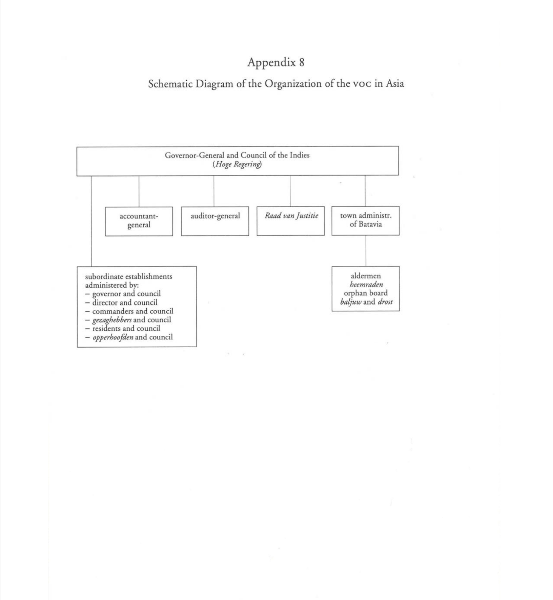
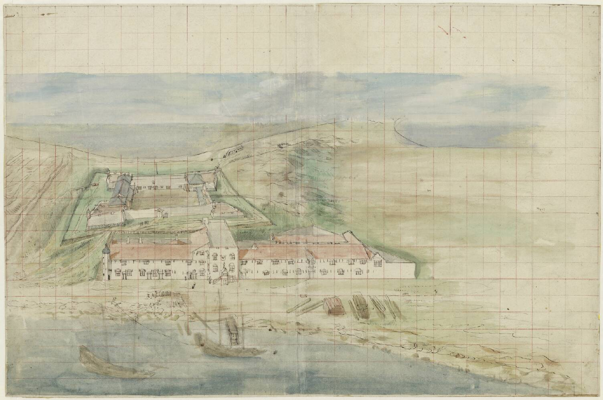
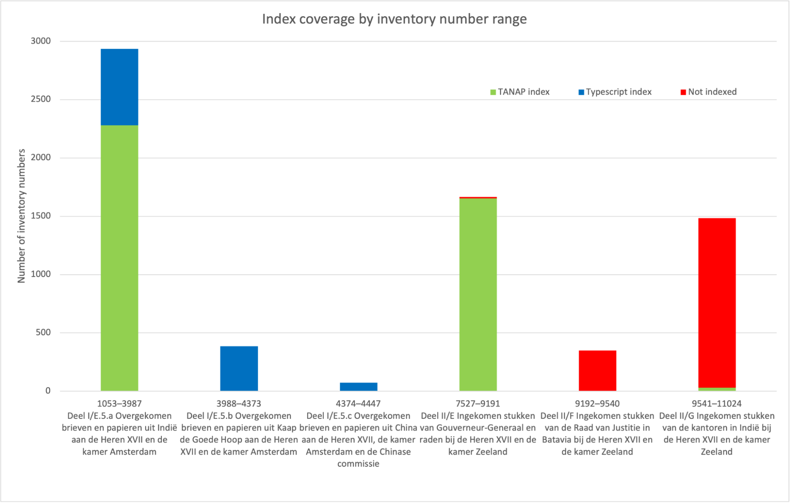
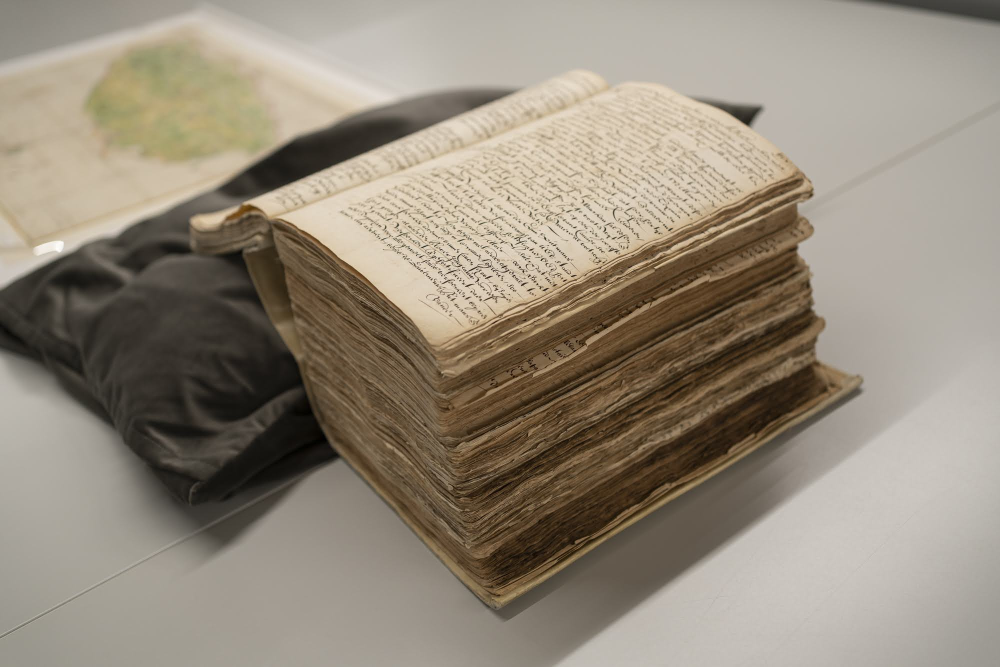
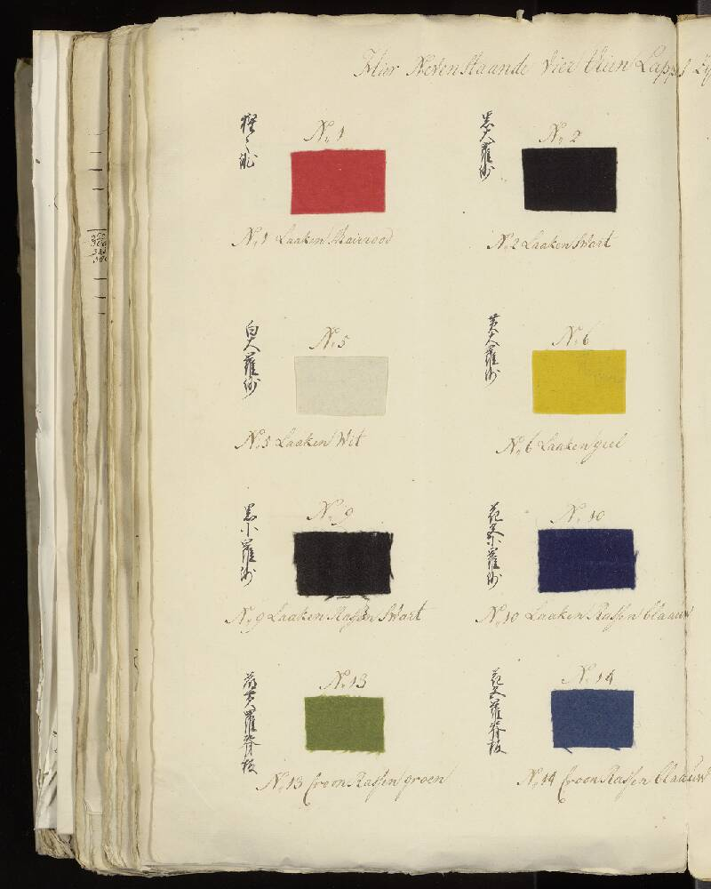
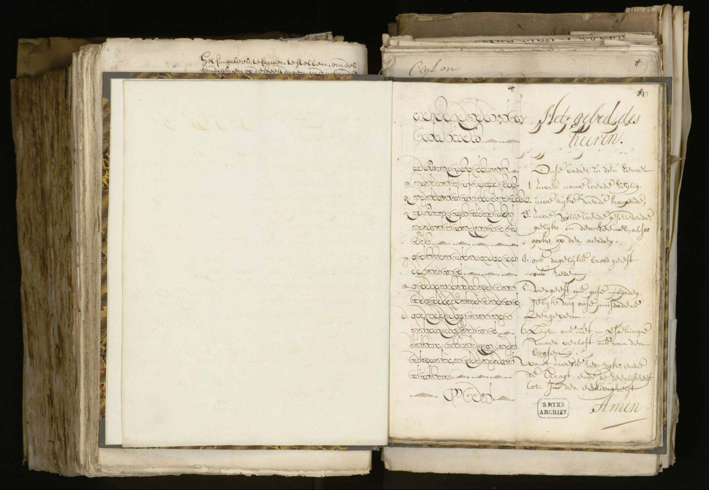

# VOC guide

## What is the Dutch East India Company (VOC)?

The Dutch East India Company, also known as the *Verenigde Oost-Indische Compagnie,* which translates as United East Indian Company or the VOC for short, was set up as an organization in 1602 in the Dutch Republic with the intention of establishing trade with the Indian Ocean World and to take the Republic’s conflict with the Habsburg empire to another theatre of war – Asia.[^1] In roughly the next two centuries – until 1799 when the Company was formally dismantled – the Company created a vast network of settlements (fortifications, warehouses and colonies) of differing sizes, roles and strengths in the Indian Ocean World. The Company became a colonizer governing subject populations in territories like Taiwan, Java, the Moluccas (Indonesia), and Sri Lanka, established a settler colony in South Africa subduing and dispossessing local populations, and controlled Mauritius. In other regions – like Iran, India (excluding Malabar) and Japan – the Company restricted themselves to the role of trade. The VOC is known as the Dutch East India Company in English to distinguish it from contemporary European trading organizations like the English East India Company, the French East India Company and the Danish East India Company. 

## What is the VOC Archive?

The VOC maintained a voluminous and meticulous handwritten record, in the Dutch language, of their activities and undertakings, the decisions they made and information they possessed. By far the largest part of these VOC archives were produced in settlements throughout Asia and Africa. Only a small part of the archive captures the administration, recruitment and activities of the VOC in the Dutch Republic. The archives contain a large variety of documents. Local administrators used **household rolls and population registers** to keep count of inhabitants of settlements and colonized territories. Company representatives who went on diplomatic visits to local courts wrote detailed day-to-day **accounts of their diplomatic journeys** and interactions at the courts. Ships recorded their journeys from one place to another in the form of **ship journals**. The **resolutions** that were taken by Company councils in settlements like Cochin and Ceylon were written down. The Company kept copies of the letters it sent to and received from local rulers and merchants. Local judicial courts of the Company kept records with testimonies and accusations in case files. The kinds of records mentioned here are not an exhaustive list. They only illustrate some kinds of documents that you find in the archive. These written records were copied and shared by different Company settlements with others, and with the Company headquarters in the Dutch Republic. According to the UNESCO memory of the world, “approximately 25 million pages” of this archive have been preserved.[^2] 

## Where are the VOC archives preserved in the present day?

The VOC archives that have survived to the present day are available in numerous archives across the world – in Indonesia, Sri Lanka, India,South Africa, Malaysia, United Kingdom and the Netherlands. For more information about the archival holdings of VOC archives by the aforementioned repositories, see [the TANAP project’s compilation of inventory information](https://docs.globalise.huygens.knaw.nl/tanap/archival-inventories/) available on the Globalise website. 

## Which VOC archives are available at the Dutch National Archives?

The Dutch National Archives in The Hague (The Netherlands) has numerous archival collections related to the VOC, including family archives as well as local archives from Batavia (Jakarta) such as the Schepenbank (Aldermen’s Court) and the Weeskamer (Orphan Chamber). The website of the Dutch National Archives provides a [complete list of their VOC related collections](https://www.nationaalarchief.nl/onderzoeken/zoekhulpen/overzicht-van-voc-archieven-1594-1814#collapse-5954). 

The largest of the Company archival collections in the Dutch National Archives is known as the ‘Archive of the VOC’ available in the [1.04.02](https://www.nationaalarchief.nl/onderzoeken/archief/1.04.02) series. This is the institutional archive of the VOC. It stretches over 1277 metres and runs into some millions of pages. While this archive comprises reports of decision making and correspondence created in the Dutch Republic related to the functioning of the VOC in Europe, Africa and Asia, a very large part of this archive is the Copied Letter Series (OBP) that contains a staggeringly voluminous body of correspondence sent to the Dutch Republic with copies of documents from the diverse settlements of the VOC ranging from the Cape of Good Hope in the west, to present-day Iran, India, and Japan, and from the larger and often colonial settlements in Sri Lanka, Taiwan and Indonesia.[^3] 

## Why is it important to engage with a previous era of history now considered problematic?

The sixteenth to eighteenth centuries marked the advent of European colonialism in the worlds of the Indian Ocean, Indonesian Archipelago and East Asian Seas. As mentioned before, the VOC was a colonizer in Sri Lanka (Ceylon), South Africa, Mauritius, Indonesia and Taiwan and parts of Malabar in Southern India. Many long-standing issues including economic inequality, and social, political and cultural conflict experienced by societies in these regions today have their origins in this period of emerging colonialism. This makes the study of the VOC archives necessary for understanding the social, cultural, economic, political and religious dynamics of these modern-day societies. The period was additionally marked by global connections and the movement of humans, ideas, commodities, plants and animals which can provide us with new perspectives about our past. 

## What do the VOC archives offer us today?

These archives record the VOC’s aggressive and transformative colonial and trading presence in Asia and Africa, and even the exploration of Australia. As the VOC governed, traded and interacted extensively with individuals, societies and polities in the worlds of the Indian Ocean, Indonesian Archipelago and East Asian Seas, the archives are a valuable source for studying the histories of the regions that the Company was involved or interested in. They provide information about a startlingly wide range of subjects ranging from politics and trade to science, religion, culture, food, weather and disease. The remarkable size of the archive means that we are yet to discover the full extent of the richness and diversity of its contents. The size of the archive, together with previous historiographical trends, has meant that historians who have researched the archive until now have focussed their attention on a limited, but gradually widening range of subjects. 

We hope that the transparency rendered to the archive by creating accessible machine transcriptions for a large part of it by the Globalise project together with its semantic and contextual enrichments will lead to a more extensive exploration of its potential. To read more on what themes the Globalise project can encourage research on, see Matthias van Rossum and Manjusha Kuruppath’s long read [Mission, Research Themes and Guiding Questions](https://docs.globalise.huygens.knaw.nl/mission/mission_researchthemes/) and Matthias van Rossum’s blogpost [Echoes of Genocidal Erasure](https://globalise.huygens.knaw.nl/echoes-of-genocidal-erasure-a-reflection-on-historical-voices-and-digital-infrastructure-for-colonial-archives/). 

## What do you need to be aware of when using historical archives like the records of the VOC?

**Colonial Archives**: The VOC archives are an important source of history. However, these archives should not be read at face value and its contents should not be regarded as the absolute truth. These archives should be used with the full knowledge that they are by and large colonial archives. They are records of the past as encountered, interpreted and written about by the Company as an organization, and Company personnel as individuals – all of whom possessed political, religious, racial and other prejudices and agendas.[^4] Neither the VOC archives at large, nor the Copied Letter series are one source. Instead, they are collections of a vast variety of different sources and document types. Within this richness, the archive also contains the voices of local individuals and communities – e.g. through court testimonies, letters or diplomatic agreements. This makes these archives unique and important for research into local histories, but here too the critical reader must remind oneself that statements and correspondence are often translated (from local languages to Dutch) and are selections that were preserved because of their role in processes relevant to colonial authorities.

**Varied Sources for History Writing:** Remember that the discipline of history as we know it has traditionally privileged written sources over other modes of remembering and recording the past. Societies have remembered and recorded their histories in numerous ways – through oral histories, material culture, art and written sources. When recovering histories, always enquire what sources are available for the subject that you want to research. Not all sources are written, digitized and transcribed. While acknowledging and using the rich archives of the VOC to its fullest potential, also be aware that you could inadvertently privilege narratives from certain collections like the Globalise corpus, and certain archives like the VOC archives over other archives from the Indian Ocean World because they are more easily available and accessible than others. Prioritizing digitized, transcribed and other accessible corpora will have consequences for how we comprehend histories from this period in time. 

**Put Your Critical Thinking Cap On**: Critically read the contents of this archive and ask the following questions: 

1) Which document does the contents feature in? What else does the document contain?   
2) What was the purpose of the document, and how did that shape the information in the document? Ask for example: Who is the document written by? Who is the document addressed to? When was the document written and what was the wider context in which the document was written? This can help to understand why a document framed events and processes in certain ways. Also ask yourself, am I familiar with how the archive is organized, and how correspondence was sent, received and acted upon? If you don’t have this information, you will read the contents of the archive without relevant context. This is similar to making assumptions and judgements about the whole picture, when you’ve only seen a small part of it.   
3) Are there other sources either in the VOC archives or other archival collections which record the same events and processes? How are the perspectives in these documents different from those consulted earlier and why do they differ? How does this process inform your interpretation of the documents, its information, and of the historic events or processes studied?  
4) The VOC archives, because of the way in which they were created, always carry reiterations of information. The same event can be written about in more than one document. For example, an event recorded in the daily diary of a settlement, might again be discussed in the resolutions of the government at the settlement level, and discussed again in its correspondence with Batavia. Most occurrences therefore will be discussed at multiple levels in what Jos Gommans calls the ‘Company’s paper trail.’[^5] To appreciate how the event was written and thought about, following this paper trail is vital.  
5) What can wider historiography about the region or event contribute to your knowledge about the information contained in the document you are reading? 

**Violent, Painful and Problematic Pasts**: The VOC archives record events that occurred 300 to 400 years ago. They are a window into a period of history that was fraught with violent words and deeds. The archive carries records of a wide range of distressing events including enslavement, conflict, judicial punishment, exploitation, marginalization, problematic characterizations and language which can be painful and discomforting to read and come to terms with. To learn more about how the VOC archive can affect its readers, see Asawari Luthra’s blogpost [When Archives Break Hearts](https://globalise.huygens.knaw.nl/when-archives-break-hearts/), and to know more about how the Globalise project engages with the VOC archives, see the section on Primary Sources in Mrinalini Luthra and Amber Zijlma’s report on [Globalise Ethics Policy](https://docs.globalise.huygens.knaw.nl/ethics/policy/). 

## Why did the VOC generate so much correspondence?

The VOC operated over a large maritime region, and written communication between its territories and trading possessions was vital for the trading and political interests of the Company. The Company procured and organized the production of commodities like textiles and spices from different regions in Asia both to sell within Asia, and send to the Dutch Republic to be sold on the European market. The success of this trade relied on information that was passed on between continents, as well as from one settlement to another. The Company also had to be battle ready to fight wars in Asia which required them to mobilise troops from the larger Company settlements in Ceylon and Java. For example, when the Chinese maritime entrepreneur Coxinga laid siege on the Dutch fort of Zeelandia in Taiwan in 1661, military reinforcements had to be requested and sent from the VOC headquarters in Batavia (Jakarta, Indonesia) signalling the importance of correspondence. 

It was necessary for the Company to create a ‘paper empire’ to organize and support its colonial possessions and trading interests.[^6] This was a network which bound together the possessions and territorial interests and administration of the Company in an established, regulated system of communication. Company employees adopted standard reporting practices and an entire industry of clerks in the different Company settlements documented day to day events, government resolutions, etc. for their respective settlements. They also created copies of relevant correspondence which were then dispatched to other settlements. 

## How was the Company’s administration organized?

The administration of the Company can be usefully divided into tiers. 

**The Metropole**: The first tier comprised the executive board of the Company in the Dutch Republic, the *Heren XVII* or the Gentlemen Seventeen. These individuals were the representatives of the six chambers based in cities in the Dutch Republic which together formed the VOC. The organization of the VOC in the Dutch Republic was only a fraction of the size of the organization outside Europe. It focussed on matters of policy, administration, finance, shipbuilding and recruitment. 

**The Headquarters in Asia**: Batavia (present-day Jakarta, Indonesia), established in 1619 as the headquarters of the Company in Asia, constituted the second tier. Headed by the Governor General and Council who together were known as the *Hoge Regering* (High Government), Batavia exercised control over all the Company possessions in Asia. Most of the political decision making for the overseas operations of the VOC was made in Batavia. Structural reporting from Batavia to the Dutch Republic through the *Generale Missiven* (general letters or reports) guaranteed the information flow to the Gentlemen Seventeen. The Copied Letters series with copies of local administrations and missives were sent along with these regular general reports.

**The Subordinate Settlements**: The third tier was made of the governments, directorates and commanderships that were subordinate to Batavia. According to the historian Femme Gaastra, this classification was based on the manner in which the VOC had gained possession of these settlements. He notes, “the large establishments, where the VOC also exercised a territorial authority, were under the authority of a governor. About 1685 these were Ambon, Banda, the Moluccas (Ternate), Coromandel, Ceylon and Malacca; a century later the Cape of Good Hope, the north coast of Java and Makassar also had a governor. Other economically important establishments such as Bengal, Surat and Persia were headed by a director (a title which, in the Company parlance, was associated with trade). In Malabar and on the west coast of Sumatra (Padang) there was a *commandeur* (commander) in charge. Cheribon, Banjarmasin and Palembang had residents, while in Japan and on Timor there was an *opperhoofd* (head of establishment).”[^7] 

Most of these establishments in turn consisted of a chief factory and subordinate posts. For instance, the Government of Banda (Eastern Indonesia) had its headquarters in Castle Nassau in Neira, which was under the control of the Governor. Subordinate to Neira were the Company establishments in Lonthor, Ai, Rosengain and Waer. Similarly, Bengal, which was headed by a director, had its principal factory in Hugli with subordinate factories in places like Patna, Kasimbazar and Dhaka. The establishments had their own council of policy, court of justice and other administrative bodies; these could be organized differently according to the size and specific local contexts. 

*Schematic diagram of the organization of the VOC in Asia*

## How was the Company’s network of correspondence organized?

Like the administrative framework of the Company, we could visualize its correspondence network in the form of tiers. The Dutch Republic was placed at the very top, the headquarters of the VOC in the second rung, the headquarters of the local settlements in the third rung and the subordinate settlements in the bottom rung. 

Clerks documented company affairs at every rung. In addition, every step sent correspondence to the levels directly below them and above them. To give you an example of how this worked in practice (and here based by the description of this correspondence chain by Gijs Kruitzer, Lennart Bes, and Jos Gommans in *Dutch Sources on South Asia, Volume 1*), the VOC had a factory in Patna in India which reported to the Directorate of Bengal (India) which had its chief factory in Hugly.[^8] The directorate of Bengal reported to Batavia in Indonesia which in turn reported to the Gentlemen XVII in the Dutch Republic. Patna created records about its administration, and corresponded with Hugly, the headquarters of the Bengal Directorate, sending other relevant documents as attachments in their correspondence. Hugly kept copies of the correspondence and attachments received. It would send letters to Batavia summarizing what Batavia needed to know about events in Patna together with relevant attachments. This was of course in addition to everything else that Bengal had to communicate to Batavia. Batavia as the headquarters of the Company in Asia would receive similar updates from all of the other settlements too. This would then be summarized and processed in the general report (generale missive) sent to the Dutch Republic together with relevant attachments (the Copied Letters series). The correspondence of the Dutch Republic with the Asian settlements took the reverse route.

The aforementioned description illustrates how correspondence travelled, but it is also important to note that some settlements in South Asia, Iran, the Cape of Good Hope and Mauritius corresponded directly with the Dutch Republic while also communicating with Batavia.[^9] Furthermore, the headquarters of the regional settlements communicated with one another especially where they were located in relatively close proximity with one another. The Directorate of Bengal, for instance, sent correspondence and received correspondence from other company settlements in the Indian subcontinent – Surat, Ceylon and the Coromandel. This allowed settlements in close proximity to one another to exchange information of regional relevance. 

Each factory and outpost of the VOC maintained an archive but unfortunately these are mostly lost. Those which survive can be found in the Western Cape Archives (South Africa), Chennai State Archives (India), National Archives Sri Lanka, Arsip Nasional Republik Indonesia (Indonesian National Archives) and the British Library (United Kingdom).[^10] 

*Bird’s-Eye View of Fort Zeelandia, Taiwan*

## Does the Globalise project work with the entire VOC Archive?

No, the Globalise project only works with the 1.04.02 series of the Dutch East India Company Archives in the National Archives in The Hague. Additionally, the Globalise project does not work with the entire 1.04.02 series but with the range of inventory numbers that comprises the Overgekomen Brieven en Papieren (Copied Letters) in its widest sense – this includes all the correspondence received in the Dutch Republic from the VOC’s trading and colonial settlements in Asia and the Cape of Good Hope (South Africa).[^11] More about what is covered in the Globalise project in the section [How much of the 1.04.02 series of the VOC Archives does the Globalise Project cover?](#how-much-of-the-1.04.02-series-of-the-voc-archives-does-the-globalise-project-cover?) 

For insight into the structure and content of the Copied Letters (OBP) series of the VOC archives in the Hague, interested researchers can consult:

**M.A.P. Meilink-Roelofsz, R. Raben and H. Spijkerman’s *The Archives of the Dutch East India Company (1602–1795):***[^12] This is the most complete inventory of the Dutch East India Company archival holdings in the Netherlands. The work also contains five chapters which clearly lay out the history and description of the archives. The access provided to the VOC archives by the National Archives is based on this finding aid which is downloadable from the National Archives website. 

**Towards A New Age of Partnership project (TANAP) Indices:** These are the most detailed finding aids for the 1.04.02 series. The TANAP project inventoried the document descriptions of the mostly contemporary tables of contents of a large section of the 1.04.02 series, and ordered them by settlement. There are 35 such settlement inventories available and they can be accessed [on the Globalise website](https://docs.globalise.huygens.knaw.nl/tanap/tanap-index-establishment-reconstructions/#list-of-available-establishment-reconstructions). 

**Globalise \- Digitized Indexes of the Dutch East India Company OBP (1602-1799)**:  
The TANAP index only covers part of the inventories that the Globalise project works with. The Globalise \- Digitized Indices carries descriptions of many inventories that are not included in the TANAP index, and integrates them with those entries from the TANAP index which cover the Globalise collection. These additional descriptions are based on the typed document descriptions (typescript index) that were made by the Dutch National Archives. The Globalise \- Digitized Indexes can be accessed [on Dataverse](https://dataverse.nl/dataset.xhtml?persistentId=doi:10.34894/OP20NM). To know more about the indices, see [Extending the TANAP Index by Digitizing the OBP Typescript Indices](https://docs.globalise.huygens.knaw.nl/tanap/tanap-index-establishment-reconstructions/#extending-the-tanap-index-by-digitizing-the-obp-typescript-indices). The diagram below indicates which inventory numbers have indices available.   

*Diagram showing which inventory numbers have indices available*

All finding aids have been based on the description of documents in the inventories (each inventory is a book of documents). These document descriptions mostly carry information about who wrote the document, when and where and whom this document was dispatched to. The document description also mentions what the document is about if this was relevant for the archive creators, VOC officials and archivists. Quite naturally then, the most visible persons in the document descriptions are Company servants, and the most recognizable subjects are trade and production even if the documents themselves might mention local individuals, communities and non-commercial subjects. If new histories of local societies, marginalized communities and other genders are to be written, and understudied themes such as disease, weather and environmental exploitation are to be explored, we need to create finding aids that make the archives more transparent. 

With this objective in mind, Globalise wants to go beyond existing document descriptions when creating metadata (information about the document) for the documents we work with. We aim to do this by also listing the entities (person names, place names etc.) and events that feature in the documents. 

## How much of the 1.04.02 series of the VOC Archives does the Globalise Project cover?

The Globalise project has transcribed and is contextually enriching approximately 4.8M pages of VOC archives from the 1.04.02 series in the Dutch National Archives. 

  

*One of the archival inventories of the Copied Letter Series of the VOC. Photo: Dave Straatmeyer*

The archives of the VOC in the National Archives are available as document books and each book has anywhere between 500 and 1500 pages. Each book is assigned a number which we call an inventory number. There are also inventories that only comprise a handful of pages. Inventory numbers are usually numerical but there are also inventories that have a number and a letter indicating parts of an inventory. Eg: 9524A, 9524B and 9524C constitute three separate inventory numbers. The Globalise project works with roughly 6900 inventory numbers. The specific ranges are: 

Inventory numbers 1053-4454   
Inventory numbers 7527-11024. 

The inventory numbers that Globalise works with belong in the following document categories[^13]: 

| Description | Inventory Number Range |
| :---- | :---- |
| Letters and Papers received from the Indies by the Gentlemen XVII and the Amsterdam Chamber | 1053-3987 |
| Letters and Papers received from the Cape of Good Hope by the Gentlemen XVII and the Amsterdam Chamber | 3988-4360 |
| Reports of the Commissioner General about the Cape of Good Hope | 4361-4366 |
| Letters and Papers received from the Cape of Good Hope concerning the expedition to Rio Delgoa and the settlement there | 4367-4373 |
| Letters received from China by the Gentlemen XVII, the Amsterdam Chamber and the China Commission | 4374-4447; 2682; 2806 |
| Tables of Content of the Letters (OBP) received by the Gentlemen XVII and the Amsterdam Chamber  | 4448-4454 |
| Documents received by the Gentlemen XVII and the Zeeland Chamber from the Governor General and Council  | 7527-9191 |
| Documents received from the Council of Justice in Batavia by the Gentlemen XVII and the Zeeland Chamber  | 9192-9540 |
| Documents received from the Comptoirs in the Indies by the Gentlemen XVII and the Zeeland Chamber | 9541-11024 |

## What sections in the 1.04.02 series of the VOC archives does the Globalise project not cover?

| Description[^14] | Inventory Number Range |
| :---- | :---- |
| Charters *(contracts concerning the rights and privileges granted to the VOC)* | 1-22 |
| Resolutions *(of the Gentlemen XVII)* | 23-310 |
| Outgoing Correspondence *(mostly from the Gentlemen XVII and the Chamber of Amsterdam to the Company settlements in the Indies)* | 311-360 |
| Incoming correspondence from Europe *(includes resolutions made by and correspondence received by the Company from the States-General of the Dutch Republic)* | 361-436 |
| Incoming correspondence from the Indies *(includes archives concerning the early ships voyages of the Company commanded by admirals like Steven van der Hagen and Pieter Both. Also includes invoices and pricelists of commodities from various regions for the period prior to 1614\)* | 437-1053 |
| Documents of Commissions from the Gentlemen XVII and the Chamber of Amsterdam  | 4454-7527 |
| This section of the archive include  i) parts of the Zeeland Chamber Collections such as Documents of the Commission on the Ten-Year and Four-Year Accounts and Separately Kept Documents, Partly Originally Loose Papers (including Administration in Europe, Individual VOC Employees of the Zeeland Chamber).  ii) Archives of the Delft Chamber iii) Archives of the Rotterdam Chamber iv) Archives of the Hoorn Chamber v) Archives of the Enkhuizen Chamber vi) Documents whose connection with the VOC has not been established.  vii) Outdated finding aids for the VOC archives.  | 11025-14934 (last inventory number in the 1.04.02 series) |

## What kinds of material can be found in the Globalise Corpus (those sections of the VOC archive that the Globalise project works with)?

The Globalise corpus mostly bears handwritten textual material in early modern Dutch. A very small percentage of the corpus comprises [printed](https://transcriptions.globalise.huygens.knaw.nl/detail/urn:globalise:NL-HaNA_1.04.02_9555_0225?query[fullText]=achmella&lastSearchResult=urn%3Aglobalise%3ANL-HaNA_1.04.02_2039_0661) text. Occasionally [maps](https://transcriptions.globalise.huygens.knaw.nl/detail/urn:globalise:NL-HaNA_1.04.02_1921_0032), other [drawings](https://transcriptions.globalise.huygens.knaw.nl/detail/urn:globalise:NL-HaNA_1.04.02_1337_0281), [dried pressed plants](https://transcriptions.globalise.huygens.knaw.nl/detail/urn:globalise:NL-HaNA_1.04.02_1470_0058), and [cloth samples](https://transcriptions.globalise.huygens.knaw.nl/detail/urn:globalise:NL-HaNA_1.04.02_3477_0710) can be found in the collection. Most maps that belonged in this archive now feature in different collections in the Dutch National Archives and can be accessed [here](https://www.nationaalarchief.nl/onderzoeken/zoekhulpen/overzicht-van-voc-archieven-1594-1814#collapse-5950) (see section on maps). 

  

*Cloth samples featured in a document titled “A paper covered with fourteen samples from Japanese Manufacturers”. VOC, 3477, 0710, transcription Globalise project (https://globalise.huygens.knaw.nl/), March 2024\. [https://transcriptions.globalise.huygens.knaw.nl/detail/urn:globalise:NL-HaNA\_1.04.02\_3477\_0710](https://transcriptions.globalise.huygens.knaw.nl/detail/urn:globalise:NL-HaNA_1.04.02_3477_0710). I thank Arno Bosse for bringing the page to my attention.*

## What languages are the archives in?

Most of the archive is written in early modern Dutch, but the archive also has documents written in languages like Malay, Persian and Sinhala. The archive also features documents that are written in non-European languages but in Latin script. European language documents like English, Portuguese and Spanish also feature in the archive. Read [Arno Bosse’s blogpost](https://globalise.huygens.knaw.nl/the-languages-of-globalise/) for more information on which languages are represented in the archive.   

*The Lord’s Prayer in both Sinhala (left) and Dutch (right) languages. VOC, 1632, 0361 (scan). [https://www.nationaalarchief.nl/onderzoeken/archief/1.04.02/invnr/@1632/file/NL-HaNA\_1.04.02\_1632\_0361](https://www.nationaalarchief.nl/onderzoeken/archief/1.04.02/invnr/@1632/file/NL-HaNA_1.04.02_1632_0361). This scan was found using the Globalise Transcription Viewer: transcription Globalise project (https://globalise.huygens.knaw.nl/), March 2024\.*

## What kinds of documents can be found in the Globalise Corpus?

The VOC archives that the Globalise project works with include letters of correspondence between the different company settlements, daily journals (diaries of day to day events maintained in different Company settlements), accounts of different VOC embassies to the courts of local rulers and dignitaries, correspondence of local rulers, merchants and other notable individuals with the Company and lists of transported commodities. 

## What kinds of subjects are covered by the Globalise Corpus?

The VOC was a trading company which colonized many territories that it was active in. Their archives, principally focus on trade, conquest and governance and a related array of subjects ranging from shipping, agriculture, politics, law, and enslavement. The archive also covers other themes such as ethnic identity, religion, language, culture, disease, death and the weather. Given the size of it, this list of subjects are only illustrative of what the archive contains. 

## What chronological periods and regions does the Globalise Corpus cover?

The archive bears material roughly from the 1605 to 1794 period, and bears correspondence created in the Dutch Republic and VOC settlements in South Africa and from across Asia consequently offering rich insight into events and processes in these regions ranging from natural disasters to changes in political regimes. This corpus also discusses events and processes associated with the places beyond the regions that the VOC operated in such as seventeenth- and eighteenth-century China, the Ottoman Empire, Spanish-controlled Philippines, Europe and South America.

## OK. I’m now ready to research the archives. Where do I begin?

See Melinda Susanto’s [informative guide](https://globalise.huygens.knaw.nl/transcriptions-viewer-how-to-guide/) on undertaking research using the transcription viewer. 

## Glossary of Terms and Acronyms used in this article

**VOC:** Abbreviation for the *Verenigde Oost-Indische Compagnie*, the trading corporation set up in the Dutch Republic (present-day Netherlands). It was active between 1602 and 1799 in commercial and colonial endeavours in the Indian Ocean World. The VOC is known as the Dutch East India Company in English to distinguish it from contemporary European trading organizations like the English East India Company, the French East India Company and the Danish East India Company. 

**OBP**: Abbreviation for *Overgekomen Brieven en Papieren* which translates as Copied Letters. This body of archive refers to that administrative correspondence and copied letters generated in settlements of the Dutch East India Company in Asia and South Africa that were received in the Dutch Republic in the 1600 to 1800 period. This archive constitutes part of the 1.04.02 series of the VOC archives kept in the Dutch National Archives in The Hague. 

**Inventory:** An inventory usually refers to one bound book of VOC documents. It can comprise anywhere between 500 and 1500 pages. There are also inventories that only comprise a handful of pages. Each inventory is assigned an inventory number which is usually numerical but there are also inventories that have a number and letter indicating parts of an inventory. Eg: 9524A, 9524B and 9524C constitute three separate inventory numbers. 

**Document Description:** A document description is a short title rendered to a document. Document descriptions sometimes feature at the beginning of the document. Very often, document descriptions feature in the Tables of Content section at the beginning of an inventory, or they feature at the start of new sections in these inventories. 

**Settlement**: Area of operation of the VOC. This could either be a fortified trading post or even a colony depending on the political and military influence that the VOC had in the region. The settlement was the base for Dutch trading, colonial and administrative activity. The term settlement could refer to the fortifications as physical structures, or the VOC’s administration in the region, or the region in general. 

**Archive**: This article uses archive in both meanings of the term: a) as a collection of historical documents created by the VOC and b) as an institution and physical space where these historical documents are preserved. 

## Recommended Resources

### Accessible introductions to the VOC

F.S. Gaastra, *The Dutch East India Company: Expansion and Decline* (Zutphen: Walburg Pers, 2003). This is a short and accessible introduction to the history of the VOC. 

BBC Radio 4\. 2016\. *In Our Time: The Dutch East India Company*. [https://www.bbc.co.uk/programmes/b071vl2l](https://www.bbc.co.uk/programmes/b071vl2l) (an audio interview from a critically acclaimed interview series hosted by Melvin Bragg featuring renowned historians). PODCAST. 

### Accessible introductions to the VOC archives

M.A.P. Meilink-Roelofsz, R. Raben, and H. Spijkerman, *Inventaris van het archief van de Verenigde Oost-Indische Compagnie (VOC), 1602–1795 (1811)* (The Hague: Nationaal Archief, 1992). [https://www.nationaalarchief.nl/onderzoeken/archief/1.04.02/invnr/%40Deel%20I?query=1.04.02\&search-type=inventory\&start=0\&searchAfter=1%2C%40Deel+I](https://www.nationaalarchief.nl/onderzoeken/archief/1.04.02/invnr/%40Deel%20I?query=1.04.02&search-type=inventory&start=0&searchAfter=1%2C%40Deel+I). The work has the following chapters that are valuable introductions to the Company, and its archives. Follow this link to read these chapters in English: [https://www.nationaalarchief.nl/sites/default/files/afbeeldingen/toegangen/NL-HaNA\_1.04.02\_introduction-VOC.pdf](https://www.nationaalarchief.nl/sites/default/files/afbeeldingen/toegangen/NL-HaNA_1.04.02_introduction-VOC.pdf) 

Chapter 1 “Introduction to the Archives of the Vereenigde Oost Indische Compagnie,” by F.S. Gaastra

Chapter 2 “Origin and Administration of the VOC Archives,” by J.C.M. Pennings; 

Chapter 3 “Notes on the Use of the VOC Archives,” by B.J. Slot, M.C.J.C. van Hoof and F. Lequin; 

Chapter 4 “Other Archives of VOC Institutions and Officials,” by B.J. Slot; 

Chapter 5 “VOC Maps and Drawings,” by C.J. Zandvliet; 

Chapter 7 “Literature” (a bibliographical overview of publications about the VOC and its archives).

Lennart Bes, “De Archieven van de Vereenigde Oost-Indische Compagnie,” in *Nederlands kolonialisme van archief tot geschiedschrijving: Een gids voor onderzoekers*, ed. Alicia Schrikker, Lennart Bes, Sanne Ravensbergen, Pouwel van Schooten, and Anita van Dissel (Leiden: Leiden University Press, 2023), 159–167. \[In Dutch\]. 

Jos Gommans, Lennart Bes, Gijs Kruijtzer, *Bibliography and Archival Guide to the National Archives at the Hague (The Netherlands), Dutch Sources on South Asia c. 1600-1825*, 3 volumes (New Delhi: Manohar, 2001-15). All three volumes can be accessed on [https://leidenuniv.academia.edu/LennartBes](https://leidenuniv.academia.edu/LennartBes). \[In English. While these guides focus on archives about South Asia, the first volume provides a comprehensive description of the VOC archives in the Dutch National Archives\]. 

### Discussions about how different societies remember the past

Ashis Nandy (1995), ‘History’s Forgotten Doubles,’ *History and Theory* 34, no. 2: 44-66. [https://doi.org/10.2307/2505434](https://doi.org/10.2307/2505434)

Wayan Jarrah Sastrawan, *The Precarious Past: Historical Practices in Pre-Modern Java*, YouTube video, 1:03:45, 2021, accessed January 9, 2026 [https://www.youtube.com/watch?v=lXSK46-AsT4](https://www.youtube.com/watch?v=lXSK46-AsT4) 

### Critical reflections on why to problematise and how to use archives in general

[https://sydneyreviewofbooks.com/reviews/disrupting-the-colonial-archive](https://sydneyreviewofbooks.com/reviews/disrupting-the-colonial-archive)

[https://libguides.hull.ac.uk/archives-basics/using-archives](https://libguides.hull.ac.uk/archives-basics/using-archives) 

### Long Reads, Blogposts and Datasets mentioned in this Article (Globalise and Associated Projects)

Arno Bosse, “The Languages of GLOBALISE,” GLOBALISE (blog), 2024, accessed January 9, 2026, [https://globalise.huygens.knaw.nl/the-languages-of-globalise/](https://globalise.huygens.knaw.nl/the-languages-of-globalise/) 

Asawari Luthra, “When Archives Break Hearts,” GLOBALISE (blog), 2025, accessed January 9, 2026, [https://globalise.huygens.knaw.nl/when-archives-break-hearts/](https://globalise.huygens.knaw.nl/when-archives-break-hearts/) 

Kay Pepping, Renate Smit, and Manjusha Kuruppath, 2025, “GLOBALISE \- Digitized Indexes of the Dutch East India Company OBP (1602-1799)”, [https://hdl.handle.net/10622/LVOQTG](https://hdl.handle.net/10622/LVOQTG)  
IISH Data Collection, V2. 

Manjusha Kuruppath, “Prisoners of the (Written and Accessible) Past: Reflections on Bias in the Dutch East India Company Historian’s Craft.” Combatting Bias (blog), 2025 accessed May 31, 2026, [https://combattingbias.huygens.knaw.nl/news/historicalbias/](https://combattingbias.huygens.knaw.nl/news/historicalbias/) 

Matthias van Rossum and Manjusha Kuruppath, “GLOBALISE Mission, Research Themes and Guiding Questions,” 2024, accessed January 9, 2026, [https://docs.globalise.huygens.knaw.nl/mission/mission\_researchthemes/](https://docs.globalise.huygens.knaw.nl/mission/mission_researchthemes/).

Matthias van Rossum, “Echoes of Genocidal Erasure: A Reflection on Historical ‘Voices’ and Digital Infrastructure for Colonial Archives,” 2025, accessed January 9, 2026, [https://globalise.huygens.knaw.nl/echoes-of-genocidal-erasure-a-reflection-on-historical-voices-and-digital-infrastructure-for-colonial-archives/](https://globalise.huygens.knaw.nl/echoes-of-genocidal-erasure-a-reflection-on-historical-voices-and-digital-infrastructure-for-colonial-archives/)

Melinda Susanto, “Transcriptions Viewer: How-to Guide, Huygens Institute,” 2025, accessed January 9, 2026, [https://globalise.huygens.knaw.nl/transcriptions-viewer-how-to-guide/](https://globalise.huygens.knaw.nl/transcriptions-viewer-how-to-guide/) 

Mrinalini Luthra and Amber Zijlma, “GLOBALISE Ethics Policy,” 2025, accessed January 9, 2026, [https://docs.globalise.huygens.knaw.nl/ethics/policy/](https://docs.globalise.huygens.knaw.nl/ethics/policy/) 

Renate Smit, “TANAP Index and Establishment Reconstructions,” 2025, accessed January, 23, 2026, [https://docs.globalise.huygens.knaw.nl/tanap/tanap-index-establishment-reconstructions/](https://docs.globalise.huygens.knaw.nl/tanap/tanap-index-establishment-reconstructions/) 

### Related Projects

[Exploring Slave Trade in Asia](https://exploringslavetradeinasia.com/): A database of trade in enslaved persons in the Indian Ocean Region and Maritime Asia in the 16th to 19th centuries. The database uses the VOC archives as a source.   
[https://voices.iisg.nl/sourceslab](https://voices.iisg.nl/sourceslab/): The [Global Slavery Cluster](https://voices.iisg.nl/) at the International Institute of Social History that holds several projects in which VOC and other European colonial archives are text recognized to further the study of slavery, colonialism and labour in Asia and elsewhere. This link gives access to the transcription viewer of relevant collections from the VOC archives that have not been transcribed by the Globalise project but are still relevant to its content). This resource is behind a login as of June 2nd, 2026\. 

### Acknowledgements

The earliest and preliminary version of this guide was prepared in 2021 for the seed grant of the [CAPASIA project](https://www.capasia.eu/), and I thank Giorgio Riello for giving me permission to publish this for Globalise. I also thank Lennart Bes for reviewing the 2021 version of this guide. The present version of the guide has been altered and developed to focus on Globalise, and the sections of the VOC archive that the project works with. I thank Jos Gommans, Lodewijk Petram, Matthias van Rossum, Melinda Susanto, Kay Pepping, Archishman Chaudhuri, Brecht Nijman, Lina de Swaaf and Thuy Dung Pham for their constructive feedback on the piece. 

[^1]:  This conflict was part of the Eighty Years War (1568-1648) which formally resulted in the independence of the Dutch Republic from the Hapsburg Empire in 1648\. In actuality however, the Republic was independent from Habsburg control as early as the 1580s. 

[^2]:  [https://www.unesco.org/en/memory-world/archives-dutch-east-india-company](https://www.unesco.org/en/memory-world/archives-dutch-east-india-company). Accessed on 29th December 2025\. 

[^3]:  What the Overgekomen Brieven en Papieren (OPB) or the Copied Letters are is explained in greater detail in the section [How was the Company’s network of correspondence organized?](#how-was-the-company’s-network-of-correspondence-organized?) 

[^4]:  See Manjusha Kuruppath, “Prisoners of the (Written and Accessible) Past: Reflections on Bias in the Dutch East India Company Historian’s Craft.” *Combatting Bias*. August 4, 2025\. 

[^5]:  Jos Gommans, *Back to the Water: Early Modern Malabar and the Dutch Colonial Archive*. iSHORE Working Papers 1, no. 1 (2025): 1–40. [https://hdl.handle.net/1887/4288062](https://hdl.handle.net/1887/4288062). See pages 26-29. 

[^6]:  H.V. Bowen uses this phrase to refer to the archives of the English East India Company, but the label is equally applicable, if not more, to the VOC archives. H.V. Bowen, *The Business of Empire: The East India Company and Imperial Britain, 1756-1833*. (Cambridge: Cambridge University Press, 2006), 169\. 

[^7]:  Femme Gaastra, “The Organization of the VOC,” in M.A.P. Meilink-Roelofsz, R. Raben and H. Spijkerman  
    eds., *De archieven van de Verenigde Oostindische Compagnie. The Archives of the Dutch East India Company,*  
    *1602–1795* (‘s-Gravenhage: Sdu Publishers, 1992), unnumbered. I have consulted the version of the book that features in the website of the National Archives, The Hague.  
    https://www.nationaalarchief.nl/sites/default/files/afbeeldingen/toegangen/NL-HaNA\_1.04.02\_introduction-  
    VOC.pdf Accessed on 27 April, 2026\.   

[^8]:  For outlining the channels of correspondence laid down by the VOC, I have relied  
    on Jos Gommans, Lennart Bes, Gijs Kruitzer, *Bibliography and Archival Guide to the National*  
    *Archives at The Hague (The Netherlands), vol. 1: Dutch Sources on South Asia c. 1600–1825* (New  
    Delhi: Manohar, 2001), 94\. Also see Jos Gommans, *Back to the Water: Early Modern Malabar and the Dutch Colonial Archive*. iSHORE Working Papers 1, no. 1 (2025): 1–40. [https://hdl.handle.net/1887/4288062](https://hdl.handle.net/1887/4288062). See pages 26-29 for a detailed description of how different genres of documentation relating to Malabar inform and interact with one another to create ‘the Company’s paper trail.’ 

[^9]:  The correspondence from the Cape of Good Hope and Mauritius received directly in the Dutch Republic is available in the inventory numbers 3988-4373 of the 1.04.02 series, and is part of the archival collection that the Globalise project works with. The inventory numbers 3988-4360 “also carry correspondence received from Persia and Surat.” See description of Deel I/E.5.B Overgekomen brieven en papieren uit Kaap de Goede Hoop aan de Heren XVII en de Kamer Amsterdam in M. A. P. Meilink-Roelofsz, R. Raben, and H. Spijkerman, *Inventaris van het archief van de Verenigde Oost-Indische Compagnie (VOC), 1602–1795 (1811)* (The Hague: Nationaal Archief, 1992). p. 12\. 

[^10]:  I thank Lennart Bes for informing me about this. Some collections from the regional settlements are available in the Dutch National Archives such as the records of the VOC factories in Hirado and Dechima in Japan ( [https://www.nationaalarchief.nl/onderzoeken/archief/1.04.21](https://www.nationaalarchief.nl/onderzoeken/archief/1.04.21)) and scans of parts of the VOC records of Bengal, Surat and Malabar in India from the Chennai Archives [https://www.nationaalarchief.nl/onderzoeken/archief/1.11.06.11](https://www.nationaalarchief.nl/onderzoeken/archief/1.11.06.11). Selections from the Arsip Nasional Republik Indonesia (Indonesian National Archives), Jakarta have been made online. They can be accessed on [https://sejarah-nusantara.anri.go.id/archive/](https://sejarah-nusantara.anri.go.id/archive/) (Accessed on 27th April, 2026). 

[^11]:  Although the Globalise project does not digitize or enrich archives outside the OBP, the project does collaborate to further text recognition and enrichment by other initiatives, such as that of the [*Global Slavery*](https://voices.iisg.nl/) cluster at the [International Institute of Social History](https://iisg.amsterdam/en/research) that holds several projects in which VOC and other European colonial archives are text recognized to further the study of slavery, colonialism and labour in Asia and elsewhere. More information: [https://voices.iisg.nl/sourceslab](https://voices.iisg.nl/sourceslab). This resource is behind a login as of June 2nd, 2026\.   

[^12]:  M.A.P. Meilink-Roelofsz, R. Raben and H. Spijkerman eds., *De archieven van de Verenigde Oostindische Compagnie. The Archives of the Dutch East India Company*, 1602–1795 ( 's-Gravenhage: Sdu Publishers, 1992). For South Asia, Jos Gommans, Lennart Bes and Gijs Kruijtzer’s *Dutch Sources on South Asia* is indispensable. This inventory does not only deal with the 1.04.02 series but addresses the theme of Dutch sources on South Asia at large. Jos Gommans, Lennart Bes, Gijs Kruijtzer, *Bibliography and Archival Guide to the National Archives at the Hague (The Netherlands), Dutch Sources on South Asia* c. 1600-1825, 3 volumes (New Delhi: Manohar, 2001-15). All three volumes can be accessed on [https://leidenuniv.academia.edu/LennartBes](https://leidenuniv.academia.edu/LennartBes) .   

[^13]:  These descriptions are drawn from M.A.P. Meilink-Roelofsz, R. Raben and H. Spijkerman’s *The Archives of the Dutch East India Company (1602–1795)*. The information that this finding aid will give you is that it will indicate the year range that the correspondence was created in, and provide you with information about the region the correspondence was received from and the type of correspondence it is. Many of the categories listed in the table carry numerous sub-categories. Please refer to the work of Meilink-Roelofz for detailed information concerning these sub-categories. For the most complete overview of descriptions of documents in the VOC archives, refer to the Globalise [Digitised Indexes of the Dutch East India Company](https://datasets.iisg.amsterdam/dataset.xhtml?persistentId=hdl:10622/LVOQTG&version=2.0). This dataset combines the [TANAP Index](https://docs.globalise.huygens.knaw.nl/tanap/tanap-index-establishment-reconstructions/#introduction-to-the-tanap-index) and the typed out document descriptions for those inventory numbers that do not feature in the TANAP index. Here, you will find information about which documents feature in every inventory number in the Globalise corpus. 

[^14]:  These descriptions are drawn from M.A.P. Meilink-Roelofsz, R. Raben and H. Spijkerman’s *The Archives of the Dutch East India Company (1602–1795)*. 
